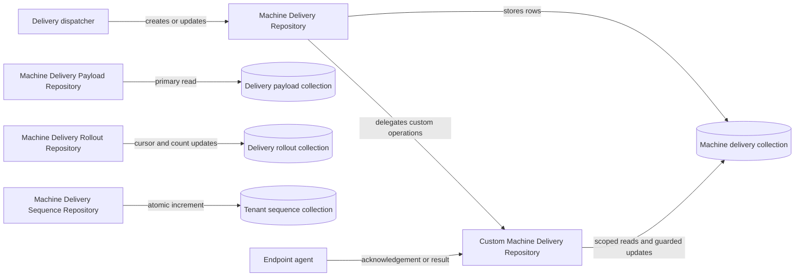
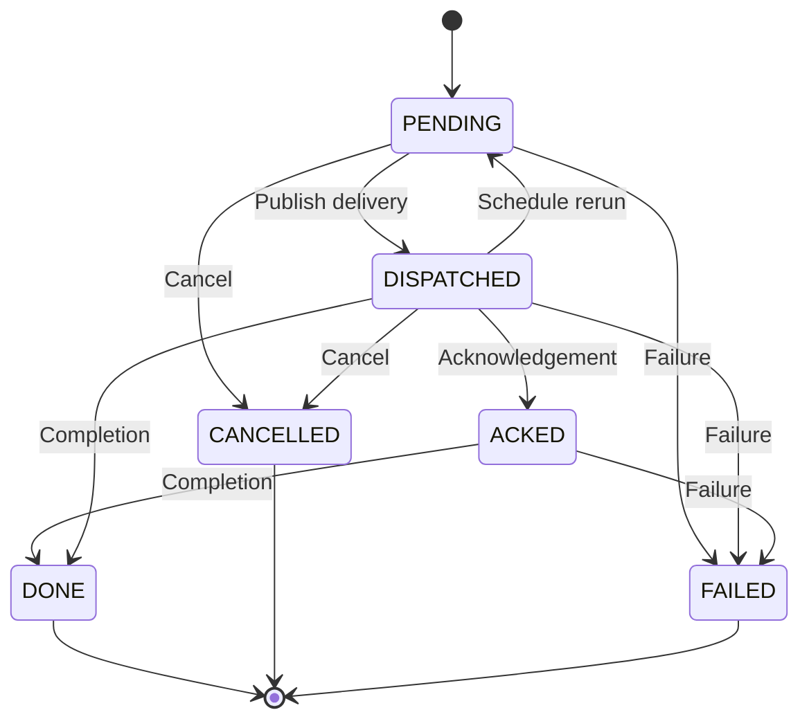

# Delivery Repositories

Delivery Repositories is the tenant-aware MongoDB persistence layer for device-targeted work. Supplied by the OpenFrame OSS Library artifact `com.openframe.oss:openframe-data-mongo-sync` at version `7.0.11`, it records delivery rows and payloads, tracks rollout progress, and provides guarded state transitions for concurrent dispatchers and asynchronous agent results.

The module is assembled into this repository's runtime services. It is not an HTTP surface: its callers use Spring Data repository interfaces and custom MongoDB operations to create, dispatch, retry, acknowledge, and close delivery work inside the active tenant scope.

## Responsibilities

- Persist `MachineDelivery` records and test whether an incoming result belongs to a specific dispatch.
- Store delivery payloads, reading them from MongoDB's primary when a just-written payload must be visible immediately.
- Track rollout cursors and dispatched counts with sequence-guarded updates.
- Select due work in oldest-due-first order from the primary, avoiding stale secondary reads during resend sweeps.
- Apply compare-and-set style updates so stale publishers, duplicate results, and competing pods cannot overwrite a newer delivery decision.
- Allocate monotonically increasing, tenant-local delivery sequence values atomically.

## Architecture

All repository types participate in tenant-aware persistence. The custom delivery and sequence implementations are enabled only when `openframe.tenant-isolation.enabled` is `true`; they extend the tenant-aware repository support and use a tenant-aware Mongo template. This makes the tenant identity part of every custom operation rather than a field callers must remember to apply.

## Delivery Lifecycle

The actual transition methods constrain updates by a delivery identifier, an allowed source-status set, and either the observed dispatch timestamp or dispatch identifier. A zero-row update means that another actor changed the record first, so the caller must treat its view as stale rather than force an update.

## Consistency Model

Delivery state is intentionally optimized for concurrent workers:

- **Primary reads:** due-work scans, lookup by identifier for result handling, and payload retrieval read from the primary. This avoids retrying work or missing a payload because a secondary is milliseconds behind a write.
- **Sequence ordering:** an incoming pending row can replace an existing row only when the existing sequence is absent or lower. A force dispatch with a newer sequence therefore wins over a later-arriving rollout write.
- **Dispatch identity:** acknowledgement, completion, payload replacement, and agent-reported failure operations require the current dispatch identifier. A delayed message cannot close a subsequent dispatch of the same delivery.
- **Rerun identity:** rerun scheduling also verifies its rerun number. A repeated closer for an earlier run no longer matches after the counter moves forward.
- **Terminal cleanup:** completion, cancellation, and failure clear inline payload JSON while retaining final state and expiration metadata.

## Source Components

The implementation comes from OpenFrame OSS Library source:

- [Machine Delivery Payload Repository](https://github.com/flamingo-stack/openframe-oss-lib/blob/7a766f00e4f58b5d89db007b878ac8d6e0c344f4/openframe-data-mongo-sync/src/main/java/com/openframe/data/repository/delivery/MachineDeliveryPayloadRepository.java) exposes primary-read payload lookup.
- [Machine Delivery Repository](https://github.com/flamingo-stack/openframe-oss-lib/blob/7a766f00e4f58b5d89db007b878ac8d6e0c344f4/openframe-data-mongo-sync/src/main/java/com/openframe/data/repository/delivery/MachineDeliveryRepository.java) combines ordinary Spring Data persistence with the custom delivery contract and supports dispatch identity checks.
- [Machine Delivery Rollout Repository](https://github.com/flamingo-stack/openframe-oss-lib/blob/7a766f00e4f58b5d89db007b878ac8d6e0c344f4/openframe-data-mongo-sync/src/main/java/com/openframe/data/repository/delivery/MachineDeliveryRolloutRepository.java) persists rollout state and advances sequence-bound cursors.
- [Custom Machine Delivery Repository Implementation](https://github.com/flamingo-stack/openframe-oss-lib/blob/7a766f00e4f58b5d89db007b878ac8d6e0c344f4/openframe-data-mongo-sync/src/main/java/com/openframe/data/repository/delivery/impl/CustomMachineDeliveryRepositoryImpl.java) implements due selection, guarded transitions, retries, reruns, and payload replacement.
- [Machine Delivery Sequence Repository Implementation](https://github.com/flamingo-stack/openframe-oss-lib/blob/7a766f00e4f58b5d89db007b878ac8d6e0c344f4/openframe-data-mongo-sync/src/main/java/com/openframe/data/repository/delivery/impl/MachineDeliverySequenceRepositoryImpl.java) provides tenant-scoped atomic sequence allocation.

## Component Guides

- [Delivery Records](delivery-repositories/delivery_records/delivery_records.md) describes the Spring Data interfaces for delivery rows, payloads, and rollout progress.
- [Delivery State Transitions](delivery-repositories/delivery_state_transitions/delivery_state_transitions.md) explains primary reads, guarded updates, retries, reruns, and supersession handling.
- [Delivery Sequencing](delivery-repositories/delivery_sequencing/delivery_sequencing.md) documents tenant-local atomic ordering and its role in concurrent delivery arbitration.