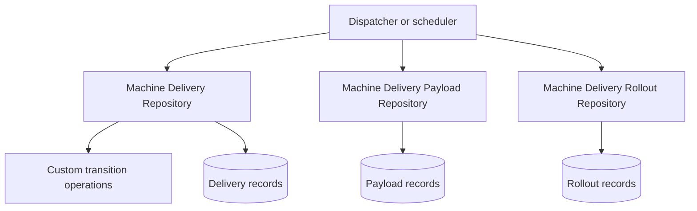

# Delivery Records

Delivery Records defines the Spring Data repository entry points for the three persisted concepts used by device delivery: an individual delivery, its payload, and a rollout cursor. Each interface is tenant aware, so standard repository CRUD operations execute in the active tenant scope.

## Components

| Component | Responsibility |
|---|---|
| `MachineDeliveryRepository` | Persists `MachineDelivery` rows, incorporates the custom delivery repository contract, and verifies that an identifier still belongs to a given dispatch identifier. |
| `MachineDeliveryPayloadRepository` | Persists `MachineDeliveryPayload` bodies and retrieves a held payload from MongoDB's primary node. |
| `MachineDeliveryRolloutRepository` | Persists `MachineDeliveryRollout` progress and atomically advances or completes a sequence-specific batch. |

## Repository Interactions

### Individual Deliveries

`MachineDeliveryRepository` extends `MongoRepository` and the custom repository contract. Its `existsByIdAndDispatchId` query is a lightweight identity guard: a result processor can establish whether a row is still associated with the dispatch that produced the message before taking further action. The custom implementation supplies lifecycle and retry mutations that need stricter compare-and-set conditions than ordinary CRUD calls.

### Payload Visibility

`findHeldById` has an explicit primary read preference. A delivery sweep can fetch a payload immediately after another pod writes it; reading a secondary could observe replication lag and incorrectly behave as though the body were unavailable. The repository therefore favors read-after-write correctness for this path.

### Rollout Progress

`findByStatus` locates rollouts in a particular rollout status. `advance` and `finish` both match the rollout identifier **and** sequence before updating state. `advance` sets the next cursor and increments the dispatched total. `finish` marks the matched rollout `DONE` and increments the dispatched total. If a newer rollout reuses the same identifier with a different sequence, an older worker cannot move the newer rollout's cursor or complete it.

## Operational Invariants

- The payload lookup and custom due-work queries deliberately use MongoDB primary reads.
- A dispatch identity is distinct from the delivery identifier, allowing a row to be reissued while rejecting results from an earlier issue.
- Rollout updates must use the sequence observed while reading the rollout.
- Tenant-aware annotations and support constrain persistence to the current tenant.

## Source

- [Machine Delivery Payload Repository](https://github.com/flamingo-stack/openframe-oss-lib/blob/7a766f00e4f58b5d89db007b878ac8d6e0c344f4/openframe-data-mongo-sync/src/main/java/com/openframe/data/repository/delivery/MachineDeliveryPayloadRepository.java)
- [Machine Delivery Repository](https://github.com/flamingo-stack/openframe-oss-lib/blob/7a766f00e4f58b5d89db007b878ac8d6e0c344f4/openframe-data-mongo-sync/src/main/java/com/openframe/data/repository/delivery/MachineDeliveryRepository.java)
- [Machine Delivery Rollout Repository](https://github.com/flamingo-stack/openframe-oss-lib/blob/7a766f00e4f58b5d89db007b878ac8d6e0c344f4/openframe-data-mongo-sync/src/main/java/com/openframe/data/repository/delivery/MachineDeliveryRolloutRepository.java)