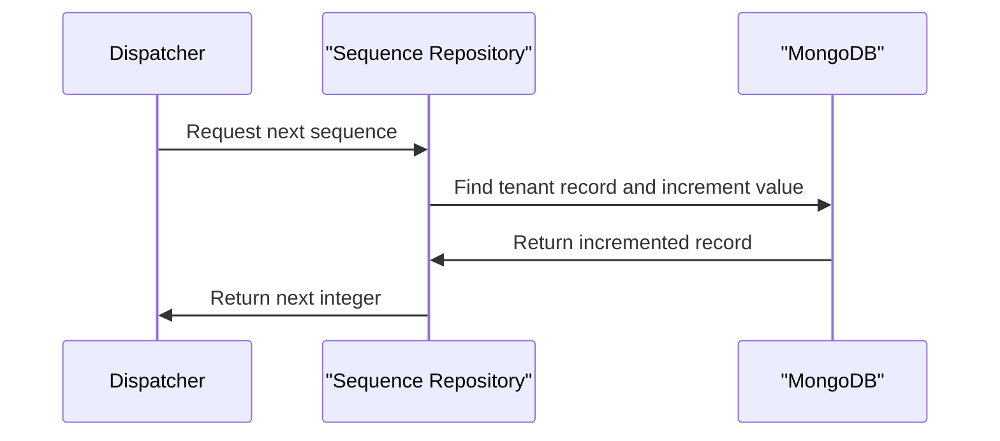

# Delivery Sequencing

Delivery Sequencing provides the ordering primitive used to arbitrate concurrent decisions for the same machine delivery. `MachineDeliverySequenceRepositoryImpl` implements the sequence contract using a tenant-aware MongoDB `findAndModify` operation.

## Atomic Tenant-Local Counter

The counter document is keyed by the current tenant identifier. The update increments `value`, upserts the document when it does not yet exist, and returns the updated document. Consequently, two dispatches within one tenant cannot receive the same number, and returned values do not move backwards for that tenant.

## Role in Delivery Arbitration

The custom delivery repository uses an incoming sequence to determine whether a pending upsert may replace an existing row:

1. A missing existing sequence is eligible for replacement.
2. An existing lower sequence is eligible for replacement.
3. An equal or higher existing sequence owns the row and rejects the older or duplicate decision.

This is particularly important when a rollout and a force action target the same machine. A rollout write arriving after a newer force decision must not restore the older payload, dispatch identity, or state.

## Tenant Isolation

The implementation extends tenant-aware repository support and queries the sequence collection by the active tenant identifier. It is conditional on `openframe.tenant-isolation.enabled` being `true`, aligning sequence allocation with the same tenant isolation mode used by guarded delivery transitions.

## Source

[Machine Delivery Sequence Repository Implementation](https://github.com/flamingo-stack/openframe-oss-lib/blob/7a766f00e4f58b5d89db007b878ac8d6e0c344f4/openframe-data-mongo-sync/src/main/java/com/openframe/data/repository/delivery/impl/MachineDeliverySequenceRepositoryImpl.java)