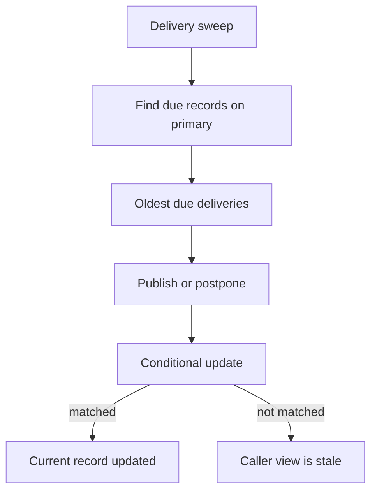

# Delivery State Transitions

Delivery State Transitions is implemented by `CustomMachineDeliveryRepositoryImpl`. It uses `TenantAwareMongoTemplate` to perform primary reads and conditional MongoDB updates for delivery processing. The implementation is active only when tenant isolation is enabled.

## Due Work and Ordering

The repository finds due deliveries by status and deadline, optionally including or excluding delivery types. Every due-work query sorts by `dueAt` ascending, limits the batch, and reads from the primary. This provides predictable oldest-first processing and prevents a lagging secondary from showing work that a competing worker already republished.

## Conditional Mutation Strategy

Each state mutation uses an `updateFirst` query containing the delivery identifier, permitted source statuses, and an identity for the specific work instance:

- **Timestamp identity** protects actions that operate on the observed dispatch timestamp.
- **Dispatch identity** protects acknowledgements, completion, payload replacement, and agent-reported failures.
- **Rerun number** protects rerun scheduling from a duplicate closer after another worker advances the rerun count.
- **Published rerun guard** distinguishes an existing dispatch that an agent may report from a rerun that has been scheduled but has not received its new dispatch identifier.

The operation returns `true` only if MongoDB reports a modified row. `false` is an expected concurrency result: the delivery has changed, been closed, been superseded, or does not match the caller's observed dispatch.

## Lifecycle Operations

| Operation group | Effects |
|---|---|
| Pending upsert | Writes individual fields, sets the active tenant identifier, clears prior terminal metadata, and applies only when no newer sequence owns the row. |
| Republish and postpone | Changes retry timing, incrementing attempts for a republish and errors for an error-driven postponement. |
| Acknowledge and close | Sets `ACKED`, `DONE`, `CANCELLED`, or `FAILED` with timestamp and failure data as appropriate. Closing removes inline payload JSON. |
| Rerun | Returns the row to `PENDING`, resets attempts and errors, increments reruns, schedules the next due time, and clears prior closure fields. |
| Rerun publish | Writes a fresh dispatch identifier, publish time, first attempt count, and due time only when that rerun has not already been published. |
| Payload replacement | Replaces the payload reference and next dispatch identifier while retaining optional offline behavior settings when supplied. |

## Supersession and Recovery

`upsertPending` protects a row against an older decision overwriting a newer one. The match accepts a row only when it has no sequence or its sequence is lower than the incoming delivery sequence. The write uses field-level updates, not document replacement, so tenant scoping remains intact and fields absent from the serialized input do not accidentally clear unrelated data. It explicitly removes values that must not survive a fresh pending dispatch, including terminal timestamps, failure details, and inline payload JSON.

If an upsert races an insertion and receives a duplicate key error, the implementation retries as an update using the same not-outranked condition. This admits a same-or-later valid update while rejecting work that lost to a newer sequence.

## Source

[Custom Machine Delivery Repository Implementation](https://github.com/flamingo-stack/openframe-oss-lib/blob/7a766f00e4f58b5d89db007b878ac8d6e0c344f4/openframe-data-mongo-sync/src/main/java/com/openframe/data/repository/delivery/impl/CustomMachineDeliveryRepositoryImpl.java)