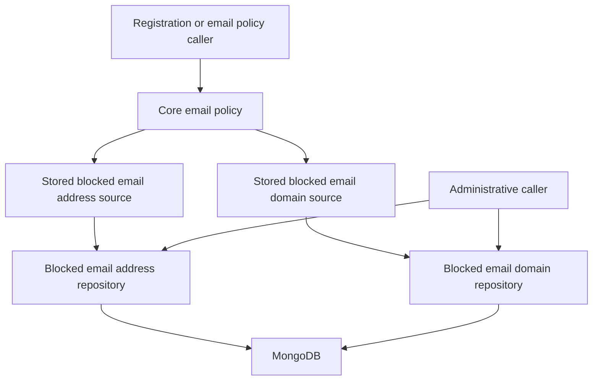
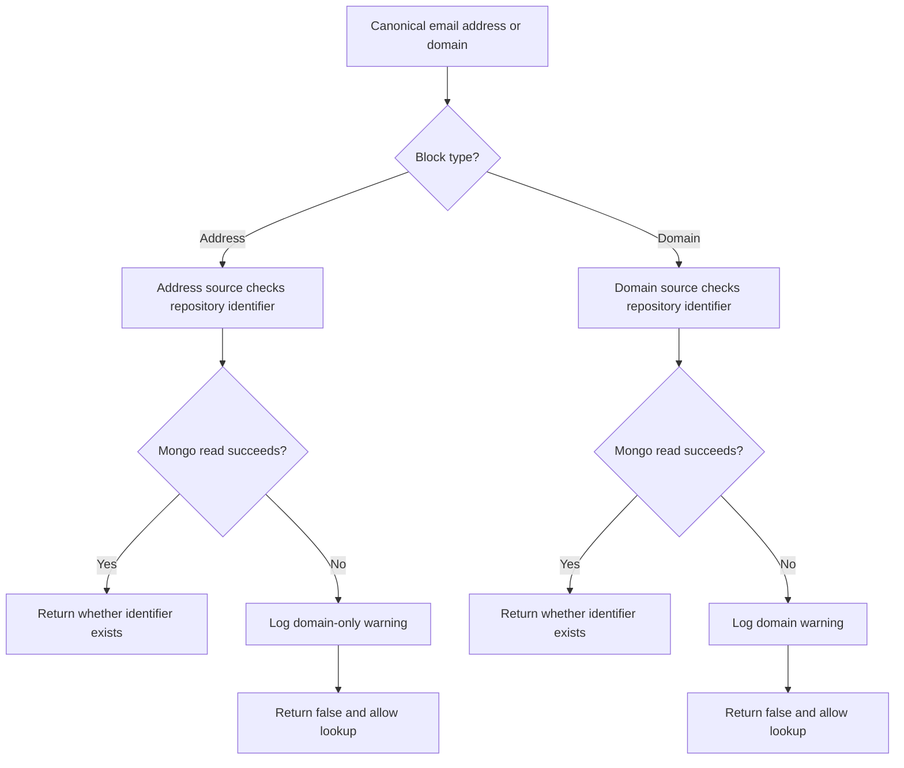

# Email Blocklist Repositories

Email Blocklist Repositories supplies the MongoDB-backed persistence boundary for OpenFrame email admission policy. It stores explicit email-address and domain blocks, exposes case-insensitive administrative search, and adapts both stores to the core policy source interfaces used during registration.

The implementation is supplied by the **OpenFrame OSS Library** through the `com.openframe.oss:openframe-data-mongo-sync` artifact, pinned by this repository at version `7.0.11`. It is discovered by Spring as repository and component beans when the synchronous Mongo data module is assembled into a service.

## Responsibilities

- Persist and retrieve blocked email-address records using `BlockedEmailAddressRepository`.
- Persist and retrieve blocked domain records using `BlockedEmailDomainRepository`.
- Provide immediate, identifier-based address and domain policy checks through `StoredBlockedEmailAddressSource` and `StoredBlockedEmailDomainSource`.
- Support pageable, case-insensitive searches by address or domain and by recorded reason.
- Preserve registration availability during Mongo access failures by allowing the lookup when the datastore cannot be read, while logging a warning.

## Architecture

The core policy layer owns canonicalization and policy composition. This module receives a canonical address or domain and performs a MongoDB `existsById` lookup. Consequently, a newly stored block affects the next policy evaluation without a cache-refresh step in these adapters.

## Components

| Component | Role | Key behavior |
|---|---|---|
| [`BlockedEmailAddressRepository`](https://github.com/flamingo-stack/openframe-oss-lib/blob/7a766f00e4f58b5d89db007b878ac8d6e0c344f4/openframe-data-mongo-sync/src/main/java/com/openframe/data/repository/email/BlockedEmailAddressRepository.java) | Spring Data Mongo repository for `BlockedEmailAddress` documents keyed by `String`. | Inherits standard `MongoRepository` operations and adds pageable, case-insensitive matching against `email` or `reason`. |
| [`BlockedEmailDomainRepository`](https://github.com/flamingo-stack/openframe-oss-lib/blob/7a766f00e4f58b5d89db007b878ac8d6e0c344f4/openframe-data-mongo-sync/src/main/java/com/openframe/data/repository/email/BlockedEmailDomainRepository.java) | Spring Data Mongo repository for `BlockedEmailDomain` documents keyed by `String`. | Adds sorted full retrieval plus pageable, case-insensitive matching against `domain` or `reason`. |
| [`StoredBlockedEmailAddressSource`](https://github.com/flamingo-stack/openframe-oss-lib/blob/7a766f00e4f58b5d89db007b878ac8d6e0c344f4/openframe-data-mongo-sync/src/main/java/com/openframe/data/repository/email/StoredBlockedEmailAddressSource.java) | Adapter from stored address blocks to the core `BlockedEmailAddressSource` contract. | Calls `existsById` with the canonical address. On `DataAccessException`, logs only the address domain and returns `false`. |
| [`StoredBlockedEmailDomainSource`](https://github.com/flamingo-stack/openframe-oss-lib/blob/7a766f00e4f58b5d89db007b878ac8d6e0c344f4/openframe-data-mongo-sync/src/main/java/com/openframe/data/repository/email/StoredBlockedEmailDomainSource.java) | Adapter from stored domain blocks to the core `BlockedEmailDomainSource` contract. | Calls `existsById` with the requested domain. On `DataAccessException`, logs a warning and returns `false`. |

## Repository Query Semantics

Both repository interfaces extend `MongoRepository`, so callers have the normal CRUD operations, including identifier-based reads and existence checks. Their declared methods add the policy-management queries below.

| Repository | Declared query | Result |
|---|---|---|
| Address | `findByEmailContainingIgnoreCaseOrReasonContainingIgnoreCase(email, reason, pageable)` | A `Page` of address blocks where either field contains the supplied text without case sensitivity. |
| Domain | `findAll(sort)` | All domain blocks ordered by the caller-provided `Sort`. |
| Domain | `findByDomainContainingIgnoreCaseOrReasonContainingIgnoreCase(domain, reason, pageable)` | A `Page` of domain blocks where either field contains the supplied text without case sensitivity. |

The address and domain adapters do not use the search methods while making a policy decision. They use exact identifier existence checks, so search behavior does not alter enforcement behavior.

## Lookup and Failure Flow

## Availability and Privacy Characteristics

The adapters intentionally **fail open**. A `DataAccessException` does not independently prevent registration: each source reports `false`, meaning it cannot confirm that the value is blocked. This makes MongoDB availability an important observability concern because policy enforcement is temporarily reduced while the datastore is unavailable.

For address lookup errors, the warning message derives and records the email domain rather than the entire canonical address. This limits exposure of the address in operational logs. Domain lookup errors log the requested domain and exception message.

## Integration Boundaries

- **Upstream policy contracts:** The source adapters implement `BlockedEmailAddressSource` and `BlockedEmailDomainSource` from the core email package. Those contracts define how this persistence-backed source participates in email policy evaluation.
- **Persistence:** The repositories use Spring Data MongoDB and operate on `BlockedEmailAddress` and `BlockedEmailDomain` documents. The document schema and Mongo infrastructure are outside this module.
- **Application services:** Registration and authentication flows decide when to invoke the core policy. This module does not expose HTTP endpoints, define registration flow, normalize input, or administer records itself.

## Maintenance Notes

1. Keep document identifiers aligned with the values passed to `existsById`. Address enforcement depends on canonical-address identifiers, and domain enforcement depends on domain identifiers.
2. Preserve the fail-open behavior unless the core policy contract changes intentionally. Changing it to fail closed would make datastore outages block registrations.
3. Retain the reduced logging treatment for address failures. Do not add the full address to warning messages without a reviewed privacy decision.
4. When adding management functionality, use the existing pageable search methods for filtered listings and the domain repository's sorted retrieval method when a complete ordered domain list is required.
