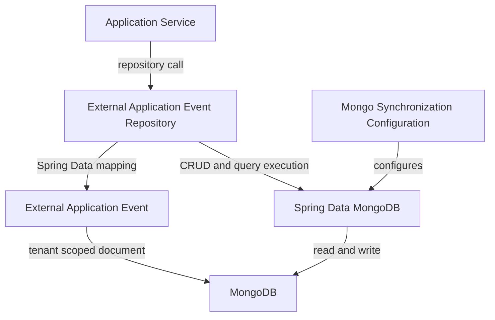
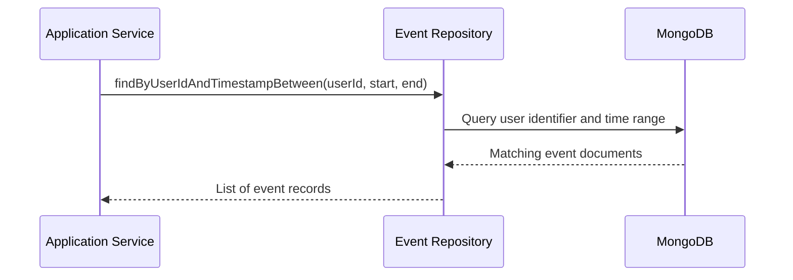
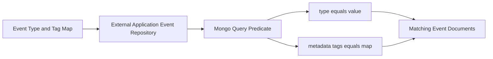
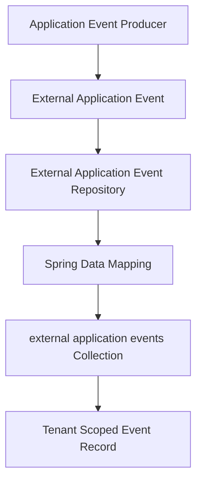

# Event Repositories

Event Repositories provides the MongoDB access boundary for externally generated application events. The module currently consists of `ExternalApplicationEventRepository`, a Spring Data repository supplied by the `com.openframe.oss:openframe-data-mongo-sync` library at version `7.0.11`. It persists and retrieves tenant-scoped `ExternalApplicationEvent` records while retaining the standard `MongoRepository` CRUD and pagination capabilities.

The implementation is library code assembled by this tenant service rather than a controller or independently deployed service. Its source is maintained in the [OpenFrame OSS Library](https://github.com/flamingo-stack/openframe-oss-lib/blob/7a766f00e4f58b5d89db007b878ac8d6e0c344f4/openframe-data-mongo-sync/src/main/java/com/openframe/data/repository/event/ExternalApplicationEventRepository.java).

## Responsibilities

- Persist `ExternalApplicationEvent` documents through inherited `MongoRepository` operations.
- Retrieve a user's events in a bounded time interval.
- Retrieve events using an exact event type and metadata tag-map match.
- Delegate connection, conversion, index, tenant-aware infrastructure, and retry configuration to the Mongo synchronization layer.

The repository does **not** publish events, expose an HTTP endpoint, validate business policies, or define retention. Those responsibilities belong to application services and surrounding platform infrastructure.

## Data Model

The repository manages the `external_application_events` collection. Its document type is supplied by `com.openframe.oss:openframe-data-mongo-common` and includes an indexed `tenantId`, plus event-specific data:

| Field | Purpose |
|---|---|
| `id` | MongoDB document identifier. |
| `tenantId` | Tenant scope carried by the `TenantScoped` document. |
| `type` | Application-defined event classification used by the type-and-tags query. |
| `payload` | Event body stored as a string. |
| `timestamp` | Event occurrence time used for range retrieval. |
| `userId` | User identifier used for user history retrieval. |
| `metadata.source` | Event origin. |
| `metadata.version` | Event-schema or producer version. |
| `metadata.tags` | Map of string keys and values used by the metadata query. |

`tenantId` is indexed in the document model. This module does not declare indexes for `userId`, `timestamp`, `type`, or `metadata.tags`; query performance for the two derived methods therefore depends on the deployed collection indexes and query volume.

## Architecture and Dependencies



The repository interface extends `MongoRepository<ExternalApplicationEvent, String>`. Spring Data creates its runtime implementation and derives MongoDB queries from method names unless an explicit `@Query` is provided.

### Primary Component

| Component | Role |
|---|---|
| `ExternalApplicationEventRepository` | Repository interface annotated with `@Repository`; provides inherited persistence operations and two domain-specific list queries. |
| `ExternalApplicationEvent` | Tenant-scoped document from `openframe-data-mongo-common`; defines collection name and event fields. |

The available organization-wide code graph records no direct static callers or tests for `ExternalApplicationEventRepository` as of the indexed main branch. Spring dependency injection and reflective repository calls may not appear as static call edges, so this should not be interpreted as proof that the repository is unused at runtime.

## Query Contract

### User and time-window lookup

```java
List<ExternalApplicationEvent> findByUserIdAndTimestampBetween(
    String userId,
    Instant start,
    Instant end
);
```

Spring Data derives a query constrained by `userId` and `timestamp`. The `Between` keyword expresses a bounded interval; callers should supply UTC `Instant` values and decide their own ordering because the method name does not request a sort.



### Type and metadata tag-map lookup

```java
@Query("{'type': ?0, 'metadata.tags': ?1}")
List<ExternalApplicationEvent> findByTypeAndTags(
    String type,
    Map<String, String> tags
);
```

This explicit MongoDB query matches the event `type` and compares `metadata.tags` with the supplied map. It is a map-level equality predicate in the repository declaration, not an API for querying an individual dynamic tag key or for partial tag matching. Callers that need a different matching semantic should add a deliberately named repository method and validate its MongoDB behavior with integration tests.



## Event Persistence Flow

The standard persistence path uses inherited repository operations such as `save`. The module maps the domain object into the collection; it does not transform or distribute the event payload itself.



For a read path, an application service selects one of the specialized methods, supplies filtering values, receives the matching documents, and applies any presentation, authorization, or business-level filtering outside this repository.

## Operational Considerations

### Tenant boundaries

The event document implements `TenantScoped` and contains `tenantId`, but neither specialized method includes `tenantId` in its declared predicate. Correct tenant isolation therefore depends on the tenant-aware Mongo configuration and the application context in which this repository runs. Maintainers should preserve that infrastructure when moving repository usage into asynchronous jobs, administrative tools, or new services.

### Time and ordering

- Use `Instant` for all time-window boundaries to avoid time-zone conversion ambiguity.
- No sort is encoded in `findByUserIdAndTimestampBetween`; consumers requiring deterministic chronology must request or apply it explicitly.
- High-volume history queries should use narrow intervals and appropriate MongoDB indexes.

### Tag matching

- Metadata tags are represented as `Map<String, String>`.
- The explicit query receives the full map as its second parameter.
- Do not assume subset matching, per-key matching, or result ordering without verifying a new query against MongoDB.

### Index review

`tenantId` is indexed by the document class. Before relying on either specialized lookup for user-facing or scheduled workloads, evaluate indexes that reflect the actual query pattern, such as tenant scope combined with user and timestamp, or tenant scope combined with type and metadata criteria. Index changes should be made through the platform's MongoDB migration and operational practices.

## Extension and Testing Guidance

When adding repository behavior:

1. Keep persistence concerns in the repository and business decisions in a service layer.
2. Include tenant-scoping expectations in the test fixture and execution context.
3. Test timestamp boundary behavior, empty result sets, and multiple event types.
4. Test tag-map behavior using equal, missing, and additional tag entries so the intended MongoDB matching semantics are explicit.
5. Add suitable indexes only after measuring the intended predicates and cardinality.

An integration test backed by MongoDB is the appropriate verification level: it confirms Spring Data method derivation, `@Query` parameter binding, document mapping, and tenant-aware configuration together.

## Source and Ownership

- **Runtime artifact:** `com.openframe.oss:openframe-data-mongo-sync:7.0.11`
- **Document artifact:** `com.openframe.oss:openframe-data-mongo-common:7.0.11`
- **Repository source:** [External Application Event Repository](https://github.com/flamingo-stack/openframe-oss-lib/blob/7a766f00e4f58b5d89db007b878ac8d6e0c344f4/openframe-data-mongo-sync/src/main/java/com/openframe/data/repository/event/ExternalApplicationEventRepository.java)
- **Document source:** [External Application Event](https://github.com/flamingo-stack/openframe-oss-lib/blob/7a766f00e4f58b5d89db007b878ac8d6e0c344f4/openframe-data-mongo-common/src/main/java/com/openframe/data/document/event/ExternalApplicationEvent.java)
