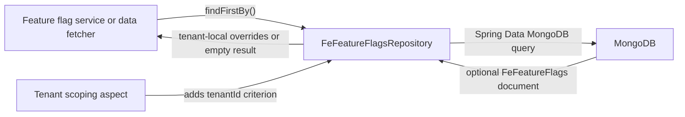
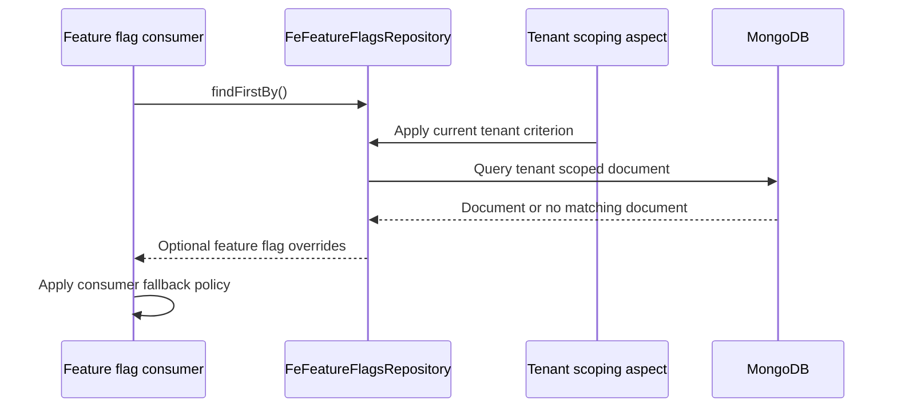
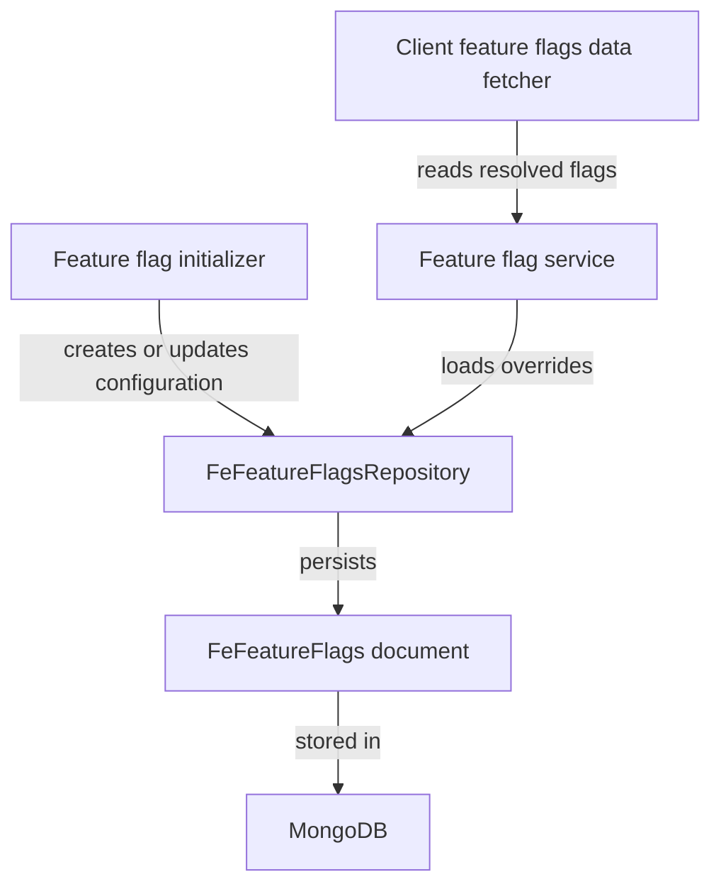

# Feature Flags Repositories

Feature Flags Repositories provides the MongoDB persistence boundary for a tenant's frontend feature-flag overrides. Its single Spring Data repository, `FeFeatureFlagsRepository`, reads and writes the `FeFeatureFlags` document while relying on the platform's tenant-scoping aspect to restrict the lookup to the tenant served by the current pod.

The implementation is supplied by the OpenFrame OSS Library artifact `com.openframe.oss:openframe-data-mongo-sync` version `7.0.11`, which this service consumes. The repository source is maintained in [OpenFrame OSS Library](https://github.com/flamingo-stack/openframe-oss-lib/blob/7a766f00e4f58b5d89db007b878ac8d6e0c344f4/openframe-data-mongo-sync/src/main/java/com/openframe/data/repository/featureflags/FeFeatureFlagsRepository.java).

## Responsibilities

- Expose Spring Data MongoDB CRUD operations for `FeFeatureFlags` documents through `MongoRepository<FeFeatureFlags, String>`.
- Resolve the optional override document associated with the current tenant through `findFirstBy()`.
- Keep tenant filtering outside repository call sites: the tenant aspect contributes the `tenantId` condition automatically.
- Preserve a simple persistence contract for services that initialize, resolve, or present frontend feature flags.

The repository does not define feature names, default values, rollout rules, authorization policy, or a public HTTP endpoint. Those concerns belong to the surrounding feature-flag model and service layers.

## Component Model

| Component | Kind | Responsibility |
| --- | --- | --- |
| `FeFeatureFlagsRepository` | Spring repository interface | Extends `MongoRepository` and declares the tenant-local `findFirstBy()` query. |
| `FeFeatureFlags` | MongoDB document | Represents the stored frontend feature-flag overrides. It is tenant-scoped, allowing the repository query to be constrained by infrastructure rather than a method parameter. |
| Tenant aspect | Persistence infrastructure | Injects the current tenant criterion into tenant-scoped MongoDB access. |
| Feature-flag service and data fetcher | Application consumers | Resolve stored overrides and shape them for client-facing use. The module tree identifies `FeFeatureFlagService` and `ClientFeatureFlagsDataFetcher` as surrounding library components. |

## Architecture



The repository deliberately has no explicit tenant identifier argument. The active tenant context selects the document, so the same call path can operate correctly for different tenant pods without application code building a tenant filter.

## Repository Contract

`FeFeatureFlagsRepository` inherits the standard persistence operations provided by Spring Data's `MongoRepository`, including lookup by identifier, saving documents, deletion, and collection-oriented operations. In addition, it declares:

```java
Optional<FeFeatureFlags> findFirstBy();
```

The return type communicates an important state distinction:

- A present value means a feature-flag override document exists for the active tenant.
- An empty value means no tenant override document was found; the caller must apply its own fallback behavior, such as model defaults.

`findFirstBy()` is intended to resolve a single current-tenant document. It should not be reinterpreted as a cross-tenant query or as a way to enumerate all tenants' configurations.

## Feature-Flag Resolution Flow

The repository is one part of a broader read path. The exact mechanism used to merge document values with defaults is outside this repository, but the persistence and lookup boundary are clear.



## Initialization and Runtime Context

The module tree places this repository alongside the synchronous MongoDB configuration and also identifies an `OpenFrameClientFeatureFlagsInitializer` in the management service core. That initializer is the appropriate lifecycle-level concern for ensuring a client feature-flag configuration exists; this repository remains the storage abstraction used to retrieve or persist it.

At runtime, application-layer components such as the client-core feature-flag data fetcher can consume resolved values without owning MongoDB query construction. Keeping the query here centralizes the convention that frontend overrides are tenant-local.



## Tenant Isolation

Tenant isolation is a functional requirement of this repository rather than merely a deployment convention.

1. A request or background operation runs with an active tenant context.
2. The caller invokes `findFirstBy()` without supplying a tenant identifier.
3. The tenant-scoping aspect augments the MongoDB query with the active tenant criterion because `FeFeatureFlags` is tenant-scoped.
4. MongoDB returns only the applicable document, if one exists.
5. The caller receives an `Optional` and decides how to handle absent overrides.

This separation reduces the risk of callers accidentally omitting a tenant predicate. Maintainers changing the document's tenant-scoping metadata or the persistence configuration should verify this flow before changing repository usage.

## Maintenance Guidance

### Add a repository query only for a persistence need

Prefer inherited `MongoRepository` methods for standard document lifecycle operations. Introduce a derived query when an application use case cannot be expressed through the existing tenant-local lookup or standard CRUD operations. Any new query must remain compatible with automatic tenant scoping.

### Preserve the optional result

Do not change `findFirstBy()` to assume that a document always exists unless initialization and all migration paths establish that invariant. The optional result currently allows consumers to distinguish missing overrides from a stored configuration.

### Keep tenant ownership implicit only where supported

The zero-argument lookup is safe because the `FeFeatureFlags` document is tenant-scoped and the persistence infrastructure injects the criterion. If adding a query that bypasses the repository or uses a different document type, confirm that tenant enforcement still applies.

### Test the repository boundary

Repository-focused tests should cover at least these cases:

- A tenant with a persisted overrides document receives that document from `findFirstBy()`.
- A tenant with no document receives an empty `Optional`.
- Documents belonging to another tenant are not returned under the active tenant context.
- Normal `MongoRepository` persistence operations retain the document's tenant-scoped behavior.

## Operational Notes

- MongoDB connectivity and synchronous MongoDB configuration are provided by the broader data layer, not by this interface.
- The repository contains no scheduler, messaging listener, controller, or network client, so it does not independently publish updates to agents or browsers.
- For a missing overrides document, downstream behavior is intentionally owned by the consumer. This module only reports absence through `Optional`.
- The repository source has two hidden tests recorded by the code graph; test details are not exposed in this documentation context.
