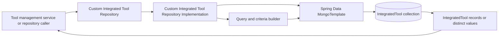
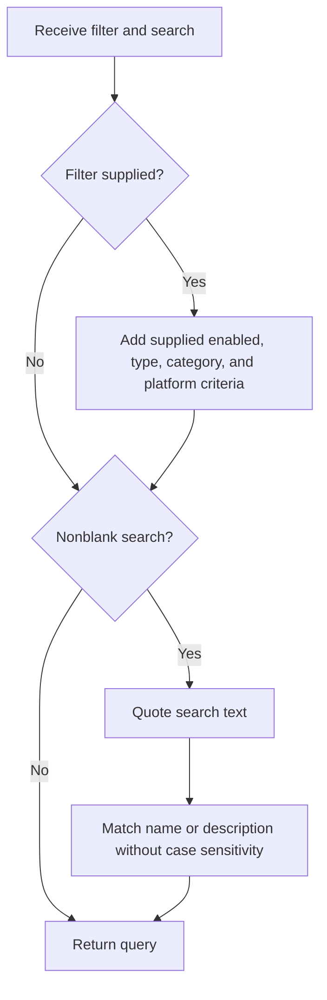
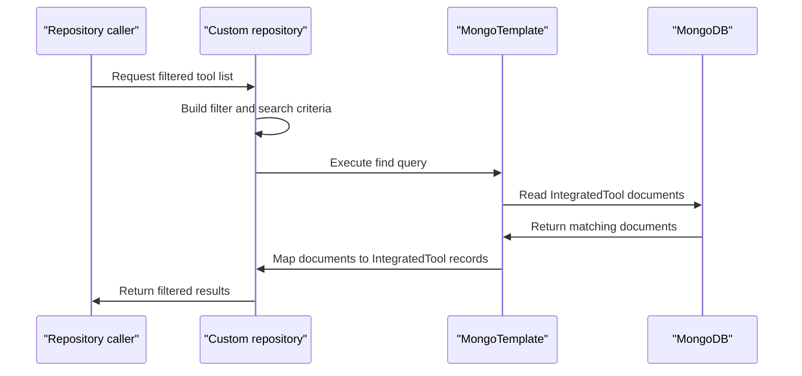

# Integrated Tool Repositories

## Purpose

Integrated Tool Repositories provide the MongoDB query extension used to list and classify `IntegratedTool` records. The module belongs to the `openframe-data-mongo-sync` library supplied by **OpenFrame OSS Library** (`com.openframe.oss:openframe-data-mongo-sync` version `7.0.11`) and is assembled into OpenFrame OSS Tenant services at runtime.

The public repository contract separates caller-facing query operations from their Spring Data MongoDB implementation. It supports optional exact-match filters, safe text search, stable ordering, and filter-option discovery for tool-management views and services.

## Architecture Overview

The module has two cooperating components:

| Component | Responsibility |
| --- | --- |
| [`CustomIntegratedToolRepository`](https://github.com/flamingo-stack/openframe-oss-lib/blob/7a766f00e4f58b5d89db007b878ac8d6e0c344f4/openframe-data-mongo-sync/src/main/java/com/openframe/data/repository/tool/CustomIntegratedToolRepository.java) | Defines the custom query, filtered lookup, sorting, facet discovery, and sort-validation contract. |
| [`CustomIntegratedToolRepositoryImpl`](https://github.com/flamingo-stack/openframe-oss-lib/blob/7a766f00e4f58b5d89db007b878ac8d6e0c344f4/openframe-data-mongo-sync/src/main/java/com/openframe/data/repository/tool/CustomIntegratedToolRepositoryImpl.java) | Spring `Repository` implementation backed by `MongoTemplate`; constructs criteria and executes reads against `IntegratedTool` documents. |

## Query Semantics

### Filtering and search

`buildToolQuery` starts with an empty MongoDB `Query` and adds criteria only when a `ToolQueryFilter` supplies a value:

- `enabled` matches the tool's enabled state.
- `type` matches the exact tool type.
- `category` matches the exact category.
- `platformCategory` matches the exact platform category.
- A nonblank `search` value applies a case-insensitive regular-expression match against either `name` or `description`.

The implementation quotes the search text before constructing the regular expression. Consequently, punctuation supplied by a caller is treated as literal text rather than as regular-expression syntax.

`findToolsWithFilters` executes that query and returns matching `IntegratedTool` documents. `findToolsWithFiltersAndSort` uses the same criteria and then applies a caller-selected ordering.

### Sorting guarantees

The repository recognizes exactly five sortable fields:

- `_id`
- `name`
- `type`
- `category`
- `enabled`

`isSortableField` lets a higher layer validate a requested field, while `getDefaultSortField` returns `_id`. The implementation treats `DESC` case-insensitively as descending; every other sort-direction value becomes ascending.

For a non-ID primary field, `_id` is appended as a secondary key in the same direction. This makes ordering deterministic when several documents share the primary value. When sorting directly by `_id`, it uses only that key.

> Callers should validate external sort fields with `isSortableField` before calling the sorted lookup. The implementation accepts the supplied field when creating the MongoDB `Sort` object.

### Facet values

The repository exposes three discovery methods for UI filters and similar consumers:

- `findDistinctTypes`
- `findDistinctCategories`
- `findDistinctPlatformCategories`

Each queries all `IntegratedTool` documents for a distinct property, removes null values, sorts the remaining strings, and returns the ordered list.

## Data Flow

For a facet request, the same implementation calls MongoDB's distinct operation for the requested property and normalizes the result by removing nulls and sorting values.

## Integration Boundaries

This custom contract is designed to be combined with the broader integrated-tool repository layer in the OpenFrame OSS Library. The code graph records it alongside the base integrated-tool repository and tool-connection repository types. The module itself is read-only: it does not create, update, or delete tool documents.

At the platform level, integrated-tool management is exposed by the Management service's `IntegratedToolController`; client-side components consume tool metadata to obtain assets and manage installations. Those layers are outside this module. This repository focuses solely on efficiently shaping MongoDB reads for the stored tool catalog.

## Maintenance Notes

- Keep filter field names aligned with the persisted `IntegratedTool` document schema.
- Add a field to `SORTABLE_FIELDS` only after confirming it is a valid and appropriate indexed document property.
- Preserve the `_id` tie-breaker for non-ID sorts to avoid unstable pagination or inconsistent user-visible ordering.
- Preserve search quoting unless deliberately introducing an explicitly documented pattern-search feature.
- Changes must remain compatible with the OpenFrame OSS Library artifact version consumed by this repository.

## Verification Scope

The organization code graph reports direct references in the OpenFrame OSS Library's integrated-tool repository types and test coverage for distinct-value queries and quoted search input. No downstream consumer is recorded outside that library in the current full-coverage graph snapshot.
