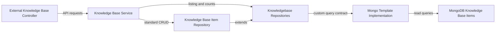
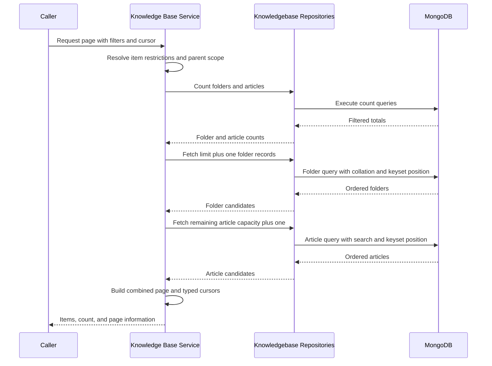
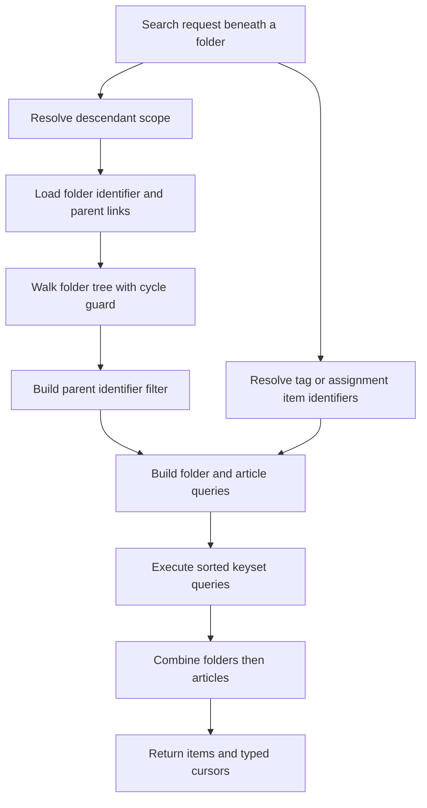

# Knowledgebase Repositories

Knowledgebase Repositories supplies the MongoDB query contract that backs knowledge base folder and article listings. The module is provided at runtime by the OpenFrame OSS Library artifact `com.openframe.oss:openframe-data-mongo-sync` version `7.0.11`, which this repository consumes. Its public contract is [`CustomKnowledgeBaseItemRepository`](https://github.com/flamingo-stack/openframe-oss-lib/blob/7a766f00e4f58b5d89db007b878ac8d6e0c344f4/openframe-data-mongo-sync/src/main/java/com/openframe/data/repository/knowledgebase/CustomKnowledgeBaseItemRepository.java).

It augments the standard `KnowledgeBaseItemRepository` with tailored, cursor-based Mongo queries. The queries separate folders from articles, support parent, search, tag-derived item-ID, and status restrictions, preserve stable ordering, and expose count operations that use the same filters as their corresponding listings.

## Scope and Responsibilities

The repository contract provides these operations:

| Area | Operations | Behavior |
|---|---|---|
| Folder listings | `findFolders`, `countFolders` | Lists folders by natural, case-insensitive name order and uses the identifier as a deterministic tie-breaker. |
| Active article listings | `findArticles`, `countArticles` | Lists articles by most recently updated first. Unless statuses are supplied, archived articles are excluded while drafts remain visible to administrators. |
| Archive listings | `findArchivedArticles`, `countArchivedArticles` | Restricts results to archived articles and retains article ordering and cursor behavior. |
| Tree traversal support | `findFolderLinks` | Loads folders with only their identifiers and parent identifiers so a caller can resolve a subtree in memory. |
| Bulk article read | `findAllArticles` | Returns non-archived articles in name order for callers that need the complete active set. |

The implementation, `CustomKnowledgeBaseItemRepositoryImpl`, is intentionally kept behind the repository contract. It uses Spring Data `MongoTemplate` and Mongo query primitives rather than derived repository method names because the listing rules require combined filters, collation-aware ordering, and keyset pagination.

## Position in the System

The module is part of the broader Data Mongo Sync library. It is used by the library's Knowledge Base Service, which combines folder and article streams into API pages, applies assignment and tag restrictions, validates folder hierarchy changes, and owns create, update, archive, and deletion workflows. API-facing components, including the external knowledge base controller and GraphQL data fetchers, remain above this persistence boundary.

## Query Inputs and Filter Semantics

### Parent scope

`KnowledgeBaseParentFilter` makes parent matching explicit:

- `any()` leaves parent unrestricted, allowing items from every hierarchy level.
- `root()` matches items whose `parentId` is absent.
- `of(parentIds)` matches direct children of one or more specified folders.

For a descendant view, the service obtains lightweight folder links from `findFolderLinks`, walks the hierarchy while guarding against data cycles, and passes the resulting folder identifiers back as a parent filter. This keeps recursive hierarchy resolution outside the database query while retaining a single filtered listing query.

### Other restrictions

- A non-null item-ID list becomes an identifier inclusion filter. The service uses this for tag and assignment intersections.
- Folder search matches names case-insensitively.
- Article and archived-article search matches either title or summary case-insensitively.
- Search text is quoted before it is used as a regular expression, so it is treated as literal user input rather than regex syntax.
- For active articles, a non-empty status list is authoritative. With no status list, only the archived status is excluded.
- Archived queries always select only article records whose status is archived.

## Ordering and Cursor Pagination

The repository uses keyset pagination rather than offset pagination. Every page query asks for at most the requested limit, while the service requests one additional result to determine whether a next page exists.

| Stream | Sort sequence | Cursor payload | Position after cursor |
|---|---|---|---|
| Folders | Name ascending, identifier descending | Folder tag, identifier, URL-encoded name | Higher name, or same name with a lower identifier |
| Articles | Update time descending, identifier descending | Article tag, identifier, update epoch milliseconds | Older update time, or same time with a lower identifier |
| Archived articles | Update time descending, identifier descending | Article cursor format | Same article keyset rule as active articles |

Folder ordering uses the `en` Mongo collation at strength two with numeric ordering. Consequently, case differences do not determine the primary sort order, and numbers are compared by their numeric value. For example, a name equivalent to `Folder 2` sorts before one equivalent to `Folder 10`. The collation is also applied to the keyset comparison, which ensures that page boundaries use the same semantics as the sort.

The cursor format is deliberately typed. `KnowledgeBaseItemCursor` serializes folders with an `F` tag and their name sort key, and articles with an `A` tag and their update-time sort key. A malformed tagged cursor parses as absent. The service also supports a legacy untagged identifier cursor by loading the corresponding item when it still exists; if it does not, it safely falls back to an article identifier position.

Folders are always served before articles in a combined listing. A folder cursor continues the folder stream; an article cursor indicates the folder stream has already been exhausted. The service fills any remaining page capacity with articles and derives the next cursor from the final returned item.

## Implementation Details

The implementation constructs a base query for each stream and adds only the applicable criteria:

1. Apply parent, item-type, and optional identifier restrictions.
2. Add search criteria when a nonblank search string is present.
3. Add article status criteria where applicable.
4. Add keyset criteria derived from the typed cursor.
5. Apply the stream sort, folder collation if needed, and limit.

Article search and cursor predicates can each produce a Mongo logical OR. Spring Data Mongo rejects multiple root-level OR criteria in the same query, so the implementation combines present composite criteria under one root-level AND expression. This is necessary for requests that combine a text search with cursor pagination.

Identifier values in cursors are converted to Mongo object identifiers only when valid. If an identifier is invalid, the query still uses the available primary sort value. If an article cursor contains neither a usable identifier nor an update timestamp, the implementation logs a warning and omits the position predicate instead of producing an invalid Mongo query.

## Data Flow for a Descendant Search

## Operational and Maintenance Notes

- Maintain count and listing filters together. The service relies on the counts to report the filtered result total, so a new restriction must be added to both paths.
- Keep each keyset predicate aligned with its full sort order, including the identifier tie-breaker. Changing only the sort or only the cursor condition can create skipped or duplicated rows between pages.
- Folder index definitions must use the same collation as the folder query. Otherwise, Mongo may not serve natural name ordering efficiently or consistently.
- Preserve literal search quoting. Treating search input as a raw regular expression would change matching semantics and may introduce unsafe or unexpectedly expensive patterns.
- `findFolderLinks` intentionally loads only parent linkage. Do not expand it into a full-document read unless the hierarchy traversal actually needs more fields.
- The repository returns data only; lifecycle rules such as publishing, archiving, moving, tag and assignment updates, and attachment handling belong to the Knowledge Base Service layer.

## Source and Verification

The custom contract and its Mongo implementation are supplied by the OpenFrame OSS Library:

- [`CustomKnowledgeBaseItemRepository`](https://github.com/flamingo-stack/openframe-oss-lib/blob/7a766f00e4f58b5d89db007b878ac8d6e0c344f4/openframe-data-mongo-sync/src/main/java/com/openframe/data/repository/knowledgebase/CustomKnowledgeBaseItemRepository.java)
- [`CustomKnowledgeBaseItemRepositoryImpl`](https://github.com/flamingo-stack/openframe-oss-lib/blob/7a766f00e4f58b5d89db007b878ac8d6e0c344f4/openframe-data-mongo-sync/src/main/java/com/openframe/data/repository/knowledgebase/CustomKnowledgeBaseItemRepositoryImpl.java)
- [`KnowledgeBaseItemRepository`](https://github.com/flamingo-stack/openframe-oss-lib/blob/7a766f00e4f58b5d89db007b878ac8d6e0c344f4/openframe-data-mongo-sync/src/main/java/com/openframe/data/repository/knowledgebase/KnowledgeBaseItemRepository.java)

The library includes cursor and keyset-query tests for this repository family. Changes to ordering, cursor encoding, or query composition should be validated against those tests as well as the knowledge base service pagination behavior.
