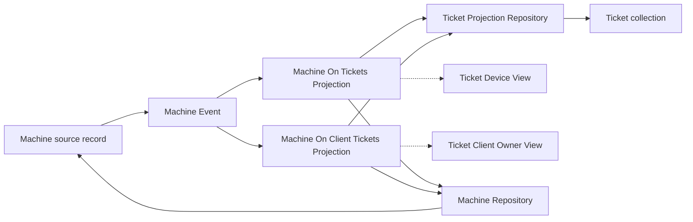
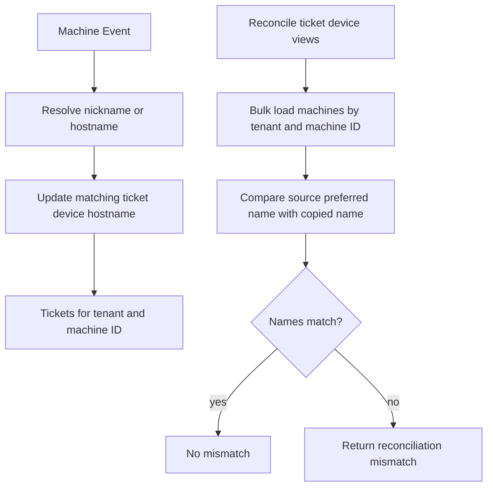
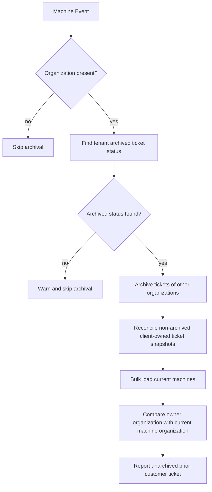

# Machine Device Publishing

Machine Device Publishing keeps the ticket-facing copies of device data consistent with their source `Machine` records. It is implemented by the `openframe-data-mongo-sync` library from [OpenFrame OSS Library](https://github.com/flamingo-stack/openframe-oss-lib), consumed by this repository as `com.openframe.oss:openframe-data-mongo-sync` version `7.0.11`.

The module defines a compact machine event and two Spring projection components:

- It publishes the machine business identifier, hostname, nickname, and organization identifier.
- It propagates a machine's preferred display name to tickets that reference that device.
- It archives non-archived client-owned tickets when their stored customer differs from the device's current organization.
- It supports normal application, bounded batch application, change counting, and reconciliation for both projections.

The module does not create tickets or devices. It maintains denormalized ticket fields after a machine event is processed.

## Architecture

Both projections are Spring components implementing the publishing library's `Projection` contract. A published record supplies the tenant identifier and a `MachineEvent`; writes are scoped to that tenant. Reconciliation reads a narrow view of ticket fields, loads the relevant machines in bulk, and returns mismatches for records whose stored copy no longer agrees with a current machine.

## Event Contract

[Machine Event](https://github.com/flamingo-stack/openframe-oss-lib/blob/7a766f00e4f58b5d89db007b878ac8d6e0c344f4/openframe-data-mongo-sync/src/main/java/com/openframe/data/repository/device/publishing/MachineEvent.java) is the event payload consumed by both projections.

| Field | Meaning | Projection use |
|---|---|---|
| `machineId` | Business device identifier used by tickets and insights, rather than the MongoDB document identifier. | Locates tickets and source machines. |
| `hostname` | Machine hostname. | Fallback device name. |
| `nickname` | Optional user-friendly machine name. | Preferred device name when present. |
| `organizationId` | Current customer organization identifier. | Determines whether client-owned tickets belong to a prior customer. |

The event's `preferredName()` delegates to the shared machine-name policy: nickname first, otherwise hostname. This gives ticket copies the same naming rule as the source machine.

## Projection Components

### Ticket Device Name Projection

[Machine On Tickets Projection](https://github.com/flamingo-stack/openframe-oss-lib/blob/7a766f00e4f58b5d89db007b878ac8d6e0c344f4/openframe-data-mongo-sync/src/main/java/com/openframe/data/repository/device/publishing/MachineOnTicketsProjection.java) is named `machine-on-tickets`. It updates `deviceHostname` on tickets matching the event's tenant and `machineId`.

`Ticket Device View` is its reduced reconciliation read model. It contains only ticket identifier, tenant identifier, device identifier, and copied device hostname, avoiding a full ticket read during reconciliation.

Key behavior:

- `apply` updates all matching ticket device-name copies and logs the number updated.
- `countChanges` returns a bounded count for planning or progress purposes.
- `applyBatch` delegates a cursor-based batch update and returns the repository's next cursor value.
- Reconciliation ignores tickets with no device identifier and intentionally treats a deleted source machine as non-actionable; the historical ticket copy remains without producing a mismatch.

### Client Ownership Projection

[Machine On Client Tickets Projection](https://github.com/flamingo-stack/openframe-oss-lib/blob/7a766f00e4f58b5d89db007b878ac8d6e0c344f4/openframe-data-mongo-sync/src/main/java/com/openframe/data/repository/device/publishing/MachineOnClientTicketsProjection.java) is named `machine-on-client-tickets`. Its purpose is to prevent a ticket opened under a device's previous customer organization from remaining active after the device changes organization.

`Ticket Client Owner View` supplies only the ticket identifier, tenant identifier, status kind, and owner required to evaluate this invariant.

The projection only acts when the event has an organization and the tenant defines an `ARCHIVED` ticket status. When either precondition is absent, application makes no changes; a missing archived status also emits a warning. This matches reconciliation semantics: tickets in a tenant that cannot be repaired because it lacks the required status are not reported as mismatches.

For reconciliation, a candidate must be non-archived, have a client-ticket owner, and carry both a machine identifier and an owner organization identifier. The projection reports a mismatch only when the source machine still exists, has an organization, and that organization differs from the ticket owner's saved organization. If the device is deleted, or either organization is absent, no mismatch is produced.

## Processing Modes and Data Boundaries

| Operation | Device-name projection | Client-ownership projection |
|---|---|---|
| Immediate application | Writes the event's preferred name to matching ticket device-name copies. | Archives matching tickets whose client-owner organization differs from the event organization. |
| Change count | Counts tickets whose copied name differs, respecting a supplied limit. | Counts eligible prior-customer tickets, respecting a supplied limit. |
| Batch application | Updates matching ticket names after a supplied cursor. | Archives eligible tickets after a supplied cursor. |
| Reconciliation source | `TicketDeviceView` plus current machines. | `TicketClientOwnerView` plus current machines and tenant status availability. |
| Missing source machine | No mismatch. | No mismatch. |

The projections use tenant-and-business-machine-ID keys while reconciling. This prevents a machine identifier from one tenant being compared with a ticket from another tenant. A mismatch includes the ticket record identifier and the source machine's MongoDB identifier, allowing the publishing framework to identify the target and source for repair or re-publication.

## Operational Considerations

- **Event fields are contract data.** `machineId`, hostname, nickname, and organization assignment affect ticket projections. Changes to their meaning can alter both naming and archival outcomes.
- **Preferred names are derived.** Do not independently implement nickname-versus-hostname selection in ticket code; publish the event and allow `preferredName()` to apply the shared policy.
- **Archived status is a prerequisite.** A tenant missing an `ARCHIVED` status cannot receive the customer-transition cleanup. The projection logs the skip rather than applying a partial rule.
- **Batch operations are cursor driven.** Preserve the cursor returned from `applyBatch` until the repository signals completion, rather than assuming all matching tickets are changed in one operation.
- **Reconciliation is intentionally conservative.** Deleted machines and incomplete ownership context do not generate mismatches, so the module does not attempt to repair historical copies without an authoritative current source.

## Source Files

The implementation is supplied by OpenFrame OSS Library:

- [Machine Event](https://github.com/flamingo-stack/openframe-oss-lib/blob/7a766f00e4f58b5d89db007b878ac8d6e0c344f4/openframe-data-mongo-sync/src/main/java/com/openframe/data/repository/device/publishing/MachineEvent.java)
- [Machine On Tickets Projection](https://github.com/flamingo-stack/openframe-oss-lib/blob/7a766f00e4f58b5d89db007b878ac8d6e0c344f4/openframe-data-mongo-sync/src/main/java/com/openframe/data/repository/device/publishing/MachineOnTicketsProjection.java)
- [Machine On Client Tickets Projection](https://github.com/flamingo-stack/openframe-oss-lib/blob/7a766f00e4f58b5d89db007b878ac8d6e0c344f4/openframe-data-mongo-sync/src/main/java/com/openframe/data/repository/device/publishing/MachineOnClientTicketsProjection.java)
- [Ticket Device View](https://github.com/flamingo-stack/openframe-oss-lib/blob/7a766f00e4f58b5d89db007b878ac8d6e0c344f4/openframe-data-mongo-sync/src/main/java/com/openframe/data/repository/device/publishing/TicketDeviceView.java)
- [Ticket Client Owner View](https://github.com/flamingo-stack/openframe-oss-lib/blob/7a766f00e4f58b5d89db007b878ac8d6e0c344f4/openframe-data-mongo-sync/src/main/java/com/openframe/data/repository/device/publishing/TicketClientOwnerView.java)
