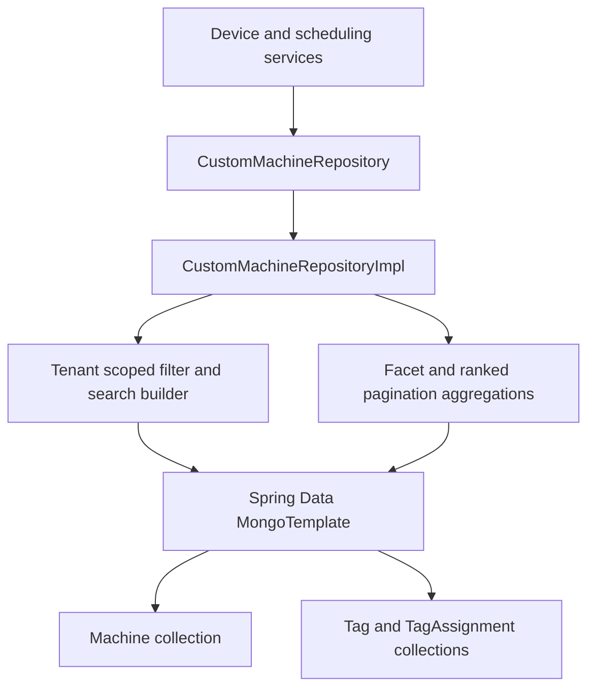
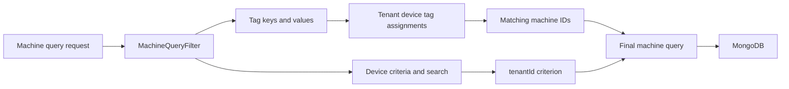
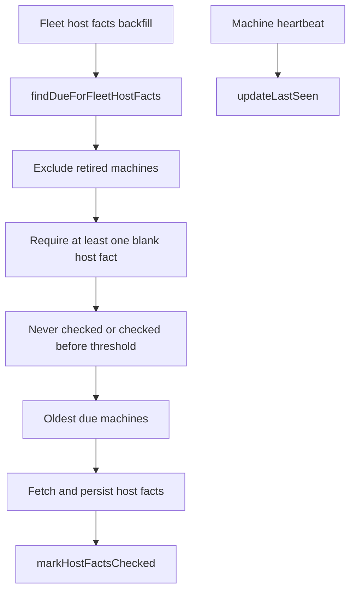

# Machine Device Repositories

Machine Device Repositories is the MongoDB query layer for tenant-scoped machine records. It is supplied at runtime by the OpenFrame OSS Library artifact `com.openframe.oss:openframe-data-mongo-sync` version `7.0.11`, which this repository consumes. The module exposes device selection, counting, facets, keyset pagination, scheduling availability, and targeted maintenance updates without placing endpoint or business-workflow logic in the repository itself.

## Purpose and Scope

The module centers on two complementary types from the library:

- [`CustomMachineRepository`](https://github.com/flamingo-stack/openframe-oss-lib/blob/7a766f00e4f58b5d89db007b878ac8d6e0c344f4/openframe-data-mongo-sync/src/main/java/com/openframe/data/repository/device/CustomMachineRepository.java) defines the custom persistence operations used by device-facing services.
- [`CustomMachineRepositoryImpl`](https://github.com/flamingo-stack/openframe-oss-lib/blob/7a766f00e4f58b5d89db007b878ac8d6e0c344f4/openframe-data-mongo-sync/src/main/java/com/openframe/data/repository/device/CustomMachineRepositoryImpl.java) implements those operations with Spring Data `MongoTemplate`, MongoDB queries, and aggregation pipelines.

Every public read accepts a tenant identifier and builds a query containing `tenantId`. This makes the repository responsible for data isolation at the query boundary. The implementation also resolves tag filters through `Tag` and `TagAssignment` records constrained to device entities in the same tenant.

## Architecture

The repository works with the `Machine` document and a `MachineQueryFilter`. It is a custom extension rather than a general CRUD repository: its methods are optimized around the device inventory screens, RMM targeting, scheduling selection, and background Fleet host-fact maintenance.

## Core Responsibilities

| Responsibility | Key operations | Behavior |
|---|---|---|
| Filtered device discovery | `findMachines`, `findMachinesAfter`, `findMachineIds` | Returns machines or IDs matching tenant, filter, optional text search, tags, directory attributes, and package-manager capability. |
| Cursor-based inventory pages | `findMachinesWithCursor` | Uses keyset pagination over an allowed sort field and `_id` tie-breaker. |
| Counts and facets | `countMachines`, `facet` | Produces total results and dimension counts from the same tenant-scoped predicate. |
| Schedule targeting | `findAvailableForScheduleWithCursor`, `findMachineIdsByCriteria`, `countMachinesByCriteria` | Finds eligible machines, including operating-system constraints and a deliberate assigned/online priority order. |
| Naming validation | `findMatchingNames` | Checks requested hostname and visible-name values with case-insensitive exact matching. |
| Lightweight maintenance | `updateLastSeen`, `markHostFactsChecked`, `findDueForFleetHostFacts` | Updates non-projected markers without the standard save pipeline and selects devices due for host-fact backfill. |
| Sorting policy | `isSortableField`, `getDefaultSortField` | Restricts sort input to the supported fields and provides `_id` as the default. |

## Query Construction and Isolation

`buildTenantQuery` combines the device predicate with an explicit `tenantId` criterion. When tag keys or tag values are present, it first resolves matching `TagAssignment` entries for the tenant and device entity type, then constrains the machine query to their machine IDs.

The base device predicate supports:

- Status inclusion and exclusion. When callers provide neither, deleted machines are excluded by default.
- Connectivity, device type, operating system, organization, and explicit machine-ID restrictions.
- Package-manager eligibility, including machines that predate the package-manager field.
- Exact hostname, nickname, or display-name matching; wildcard name patterns using `*` and `?`; and case-insensitive free-text search across identifying machine fields.
- Directory source and directory user-link filters. A `NONE` directory-user-link selection intentionally includes records where the field is missing or null.

## Pagination and Ordering

### Standard Cursor Pages

For ordinary sortable fields, the implementation performs keyset pagination rather than offset pagination. It sorts by the requested field and then by `_id`, using the cursor document to construct criteria strictly beyond the prior row. This retains deterministic ordering when many devices share a sort value.

Supported fields are `_id`, `hostname`, `displayName`, `nickname`, `status`, `connectivity`, and `lastSeen`. Invalid cursors are logged and fall back to the first page rather than terminating the query. When a cursor record cannot be found, pagination continues based on the cursor identifier.

`status` and `connectivity` require computed ordering and use aggregation pipelines:

- Status descending ranks `ONLINE`, `OFFLINE`, `PENDING`, and `PENDING_DELETION` in that order. Ascending reverses the same rank order.
- Connectivity ranks telemetry status `ONLINE` ahead of all non-online values for descending order.

For regular nullable sort fields, the cursor criteria deliberately preserve MongoDB null ordering. In particular, descending pages include null-valued records after a non-null cursor so that trailing rows are not skipped.

### Schedule Availability Pages

Schedule availability uses an aggregation-specific cursor with the format `bucket|objectIdHex`. A computed bucket orders machines as follows:

1. Assigned and online.
2. Assigned and not online.
3. Unassigned and online.
4. Unassigned and not online.

Within each bucket, records are ordered by `_id`. The resulting compound keyset supports stable continuation while prioritizing a scheduler's current assignments and reachable devices.

## Aggregations and Device Selection

Facet requests group matching rows by the requested `DeviceFacetDimension` field. To avoid a facet filtering itself out, that same field is excluded from the query filter used for its aggregation. Null grouping keys are omitted from the returned option map.

`findMatchingNames` creates a grouped aggregation that returns boolean existence flags for each submitted name. Hostnames are checked against `hostname`; nickname requests are checked against both `nickname` and `displayName`. Inputs are quoted before inclusion in regular expressions, so submitted names remain literal and are anchored for exact matching.

The criteria-based methods add an optional operating-system scope to the normal tenant and machine filter, then return either distinct `machineId` values or a count. They are appropriate for workflows that need a target population without loading complete documents.

## Background Maintenance Semantics

The repository deliberately bypasses regular `save` operations for two high-frequency markers:

- `updateLastSeen` changes only `lastSeen`.
- `markHostFactsChecked` changes only `hostFactsCheckedAt`.

Both use a direct update with a zero version increment. This avoids unnecessary optimistic-lock contention with user changes. More importantly, the comments in the implementation state that these fields are outside the Pinot payload, so bypassing the normal save and writer flow prevents heartbeat or maintenance stamps from generating needless Kafka publication events.

`findDueForFleetHostFacts` identifies live machines with at least one blank Fleet host fact and either no previous check time or a check time older than the supplied threshold. It excludes retired states: pending deletion, deleted, and archived. Results are ordered from the oldest unchecked marker to newest, with `machineId` as a tie-breaker, and limited by the caller.

## Integration Boundaries

Machine Device Repositories belongs to the broader synchronous Mongo data layer. It consumes the common device, tag, package-search, and RMM document models from the OpenFrame OSS Library. Upstream device-facing services and API layers use the repository to retrieve tenant-safe inventory and targeting results; machine events and projections are handled by the adjacent machine publishing area rather than by this module.

The module does not define HTTP routes, message listeners, or MongoDB connection configuration. Those responsibilities belong to service, controller, messaging, and Mongo configuration components elsewhere in the platform.

## Maintenance Guidance

- Preserve explicit tenant criteria when adding custom queries or aggregations. Aggregation execution bypasses template-level automatic scoping, so the predicate must carry `tenantId` itself.
- Keep cursor predicates aligned with the exact sort order and `_id` tie-breaker. A mismatch can duplicate or omit records between pages.
- Add a field to the sortable allowlist before accepting it as a caller-provided sort field, and implement cursor value extraction if it is a regular field.
- Use targeted updates only for fields intentionally excluded from publication and document why the normal save path is bypassed.
- Quote user-provided names and search values before constructing regular expressions to preserve literal matching behavior.
