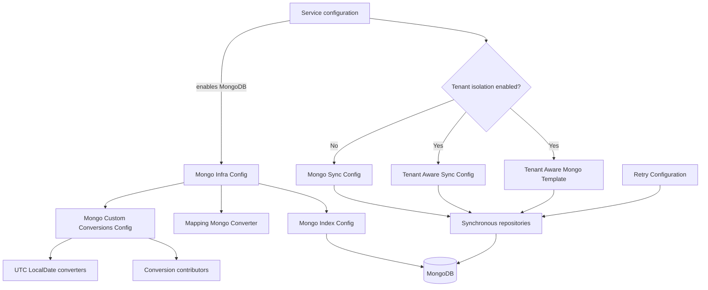
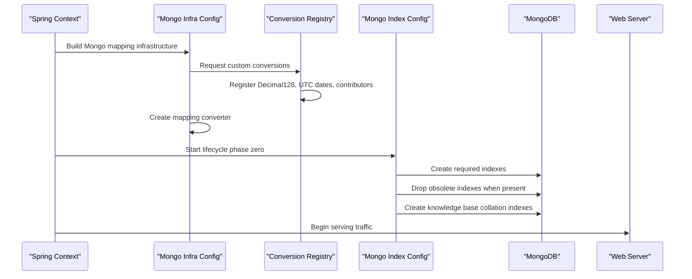

# Mongo Config

Mongo Config supplies the synchronous MongoDB wiring used by OpenFrame services. It is implemented by the `com.openframe.oss:openframe-data-mongo-sync` 7.0.11 library, consumed by this repository. The module establishes one conversion pipeline, activates the appropriate repository model for a deployment, installs required database indexes before the web tier accepts traffic, and enables retry support.

The configuration code is supplied by the OpenFrame OSS Library rather than this repository. Its sources are available in the library at [Mongo configuration sources](https://github.com/flamingo-stack/openframe-oss-lib/tree/7a766f00e4f58b5d89db007b878ac8d6e0c344f4/openframe-data-mongo-sync/src/main/java/com/openframe/data/config).

## Responsibilities

- **Stable value mapping:** serialize `LocalDate` values at UTC midnight and use MongoDB Decimal128 for `BigDecimal` values.
- **Single conversion registry:** aggregate optional conversion contributors into the single `MongoCustomConversions` bean permitted by Spring Data.
- **Mongo infrastructure:** construct the mapping converter, enable auditing, and escape dots in map keys.
- **Repository mode selection:** select ordinary repositories or tenant-aware repositories based on the Mongo and tenant-isolation flags.
- **Tenant-aware operations:** replace the default `mongoTemplate` with a tenant-aware implementation when isolation is enabled.
- **Startup integrity:** create load-bearing, query-supporting, and case-insensitive indexes; remove obsolete indexes; and do this before web traffic begins.
- **Retry capability:** enable Spring Retry annotations for participating beans.

## Architecture

Mongo infrastructure is conditional on `spring.data.mongodb.enabled=true`. Repository registration requires that MongoDB flag and then takes one mutually exclusive branch:

| Deployment condition | Active configuration | Result |
|---|---|---|
| MongoDB enabled and tenant isolation disabled | `MongoSyncConfig` | Scans `com.openframe.data.repository`, excluding types marked as `TenantAwareRepository`. |
| MongoDB enabled and tenant isolation enabled | `TenantAwareSyncConfig` | Scans the complete repository package so tenant-aware fragments can participate. |
| Tenant isolation enabled | `TenantIsolationAutoConfiguration` | Registers the primary bean named `mongoTemplate` as `TenantAwareMongoTemplate`. |

The concrete tenant-aware template and the `TenantIdProvider` contract are supplied elsewhere in the data library. In an OSS runtime, the documented configuration expects the provider implementation available to the application context. The template resolves a tenant identifier when queries execute, not during application-context construction.

## Startup Flow

`MongoIndexConfig` implements `SmartLifecycle` at phase `0`. This makes index initialization occur after context refresh and before the web server's later lifecycle phase. A context refresh by itself does not require MongoDB until this lifecycle start occurs.

## Core Components

### Conversion and Mapping

#### UTC Local Date Converters

[LocalDateUtcMongoConverters](https://github.com/flamingo-stack/openframe-oss-lib/blob/7a766f00e4f58b5d89db007b878ac8d6e0c344f4/openframe-data-mongo-sync/src/main/java/com/openframe/data/config/LocalDateUtcMongoConverters.java) provides paired read and write converters:

- `LocalDateToUtcDateConverter` writes a `LocalDate` as midnight at `ZoneOffset.UTC`.
- `UtcDateToLocalDateConverter` reads a BSON date using UTC before returning its `LocalDate`.

This avoids host-time-zone-dependent encodings. Without it, pods in different zones could persist the same logical date as different instants, causing exact-date matching and deduplication to fail.

#### Custom Conversion Registry

[MongoCustomConversionsConfig](https://github.com/flamingo-stack/openframe-oss-lib/blob/7a766f00e4f58b5d89db007b878ac8d6e0c344f4/openframe-data-mongo-sync/src/main/java/com/openframe/data/config/MongoCustomConversionsConfig.java) creates the library's sole `MongoCustomConversions` bean. It configures these common policies:

1. `BigDecimal` is written using MongoDB Decimal128.
2. UTC `LocalDate` conversion is always registered.
3. beans implementing `MongoConversionsContributor` are applied in Spring order.

[MongoConversionsContributor](https://github.com/flamingo-stack/openframe-oss-lib/blob/7a766f00e4f58b5d89db007b878ac8d6e0c344f4/openframe-data-mongo-sync/src/main/java/com/openframe/data/config/MongoConversionsContributor.java) is the extension point for an additional converter. Consumers must contribute to this registry instead of defining another conversions bean, because Spring Data allows only one such bean and competing definitions make the context ambiguous.

Decimal128 rollout compatibility is read-safe but query-sensitive: legacy string values and Decimal128 values can both deserialize as `BigDecimal`, while database comparisons or aggregations across mixed representations require old values to be migrated first.

#### Mongo Infrastructure

[MongoInfraConfig](https://github.com/flamingo-stack/openframe-oss-lib/blob/7a766f00e4f58b5d89db007b878ac8d6e0c344f4/openframe-data-mongo-sync/src/main/java/com/openframe/data/config/MongoInfraConfig.java) is activated only when MongoDB is explicitly enabled. It runs before Spring Boot's Mongo data auto-configuration, enables Mongo auditing, imports the conversion registry, and creates a `MappingMongoConverter` using the application database factory and mapping context.

The converter replaces dots in map keys with `__dot__`, allowing map data with dot-containing keys to be represented without violating MongoDB field-name constraints.

### Repository and Tenant Selection

[MongoSyncConfig](https://github.com/flamingo-stack/openframe-oss-lib/blob/7a766f00e4f58b5d89db007b878ac8d6e0c344f4/openframe-data-mongo-sync/src/main/java/com/openframe/data/config/MongoSyncConfig.java) registers normal synchronous repositories only when tenant isolation is off. It excludes marker-annotated `TenantAwareRepository` types.

[TenantAwareSyncConfig](https://github.com/flamingo-stack/openframe-oss-lib/blob/7a766f00e4f58b5d89db007b878ac8d6e0c344f4/openframe-data-mongo-sync/src/main/java/com/openframe/data/config/TenantAwareSyncConfig.java) is the complementary branch. With tenant isolation enabled, it scans the same base package without that exclusion so repository fragments that need tenant-aware operations are present.

[TenantIsolationAutoConfiguration](https://github.com/flamingo-stack/openframe-oss-lib/blob/7a766f00e4f58b5d89db007b878ac8d6e0c344f4/openframe-data-mongo-sync/src/main/java/com/openframe/data/config/TenantIsolationAutoConfiguration.java) supplies a primary `TenantAwareMongoTemplate` under the conventional `mongoTemplate` bean name. This causes Boot's default template auto-configuration to back off and preserves the standard repository lookup convention. Its lazy `TenantIdProvider` injection prevents bean construction order from coupling template startup to the provider implementation.

### Index Lifecycle

[MongoIndexConfig](https://github.com/flamingo-stack/openframe-oss-lib/blob/7a766f00e4f58b5d89db007b878ac8d6e0c344f4/openframe-data-mongo-sync/src/main/java/com/openframe/data/config/MongoIndexConfig.java) creates and maintains operational indexes through `MongoTemplate`.

| Collection or area | Index behavior | Purpose |
|---|---|---|
| `sso_identities` | Unique compound `provider`, `subject` index | Enforces one SSO account mapping per user identity. |
| `oauth2_authorizations` | Sparse retired refresh-token index | Supports refresh-token lookup. |
| `application_events` | User/timestamp and type/tag compound indexes | Supports event history and tagged-event queries. |
| `scripts` | Partial unique tenant/name index for active and archived states | Allows reuse of a name after soft deletion. |
| `script_schedules` | Equivalent partial unique tenant/name index | Applies the same soft-delete name-reuse semantics to schedules. |
| `knowledge_base_items` | Two indexes using the folder-name collation | Supports case-insensitive, numeric-aware folder ordering for scoped and whole-base listings. |

The configuration also attempts to remove obsolete indexes from tags and software-related collections. A missing stale index is intentionally non-fatal and logged at debug level. Explicit names and matching definitions make indexes idempotent across redeployments while avoiding conflicts with equivalent annotation-driven definitions.

The partial indexes intentionally enumerate the non-deleted `ScriptStatus` values, `ACTIVE` and `ARCHIVED`, rather than using a negated deleted condition. This matches MongoDB partial-index operator support and must be updated if new non-deleted script states are introduced.

### Retry Enablement

[RetryConfiguration](https://github.com/flamingo-stack/openframe-oss-lib/blob/7a766f00e4f58b5d89db007b878ac8d6e0c344f4/openframe-data-mongo-sync/src/main/java/com/openframe/data/config/RetryConfiguration.java) enables Spring Retry through `@EnableRetry`. It supplies the AOP infrastructure required for retry annotations on eligible beans; retry policies remain the responsibility of the annotated operations.

## Operational Considerations

- Set `spring.data.mongodb.enabled` deliberately. Mongo infrastructure and both repository registration modes require it to be `true`.
- Do not add a separate `MongoCustomConversions` bean. Add a `MongoConversionsContributor` instead.
- Treat UTC conversion and Decimal128 representation as persistence contracts. Changing either can alter query semantics or make existing data inconsistent.
- Verify that the database user can create and drop indexes before deploying a new environment. Index initialization is part of application startup and runs before traffic handling.
- When adding a script status that is not deleted, update both partial-index filters so name uniqueness remains correct.
- In tenant-isolation mode, ensure exactly one appropriate `TenantIdProvider` is available and that calls run with a resolvable tenant context.

## Relationship to the Platform

Mongo Config is the foundation beneath the synchronous repositories in the data layer. Those repositories persist domain data such as devices, users, organizations, tickets, scripts, software state, delivery records, and configuration. Application services from the API, authorization, client, management, and stream workloads consume those repositories through the common Mongo mapping and tenant-selection behavior defined here.

This repository deploys MongoDB as a datasource and supplies the shared application Mongo URI through its configuration. Mongo Config does not expose HTTP endpoints or own domain repositories; it determines how repository data is converted, isolated, and made queryable at runtime.
