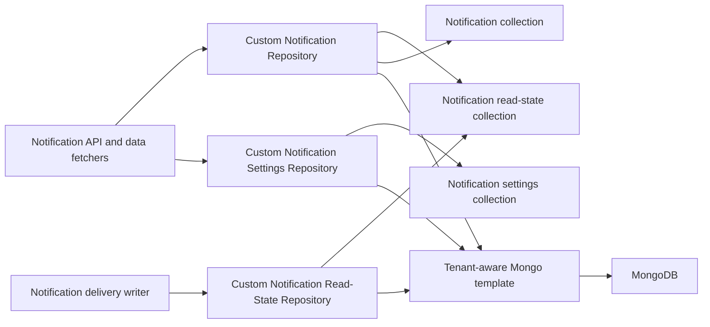
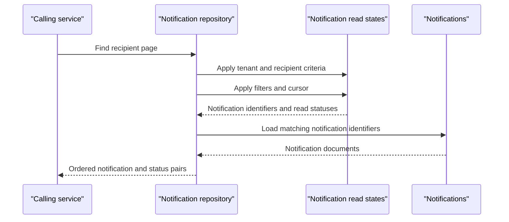
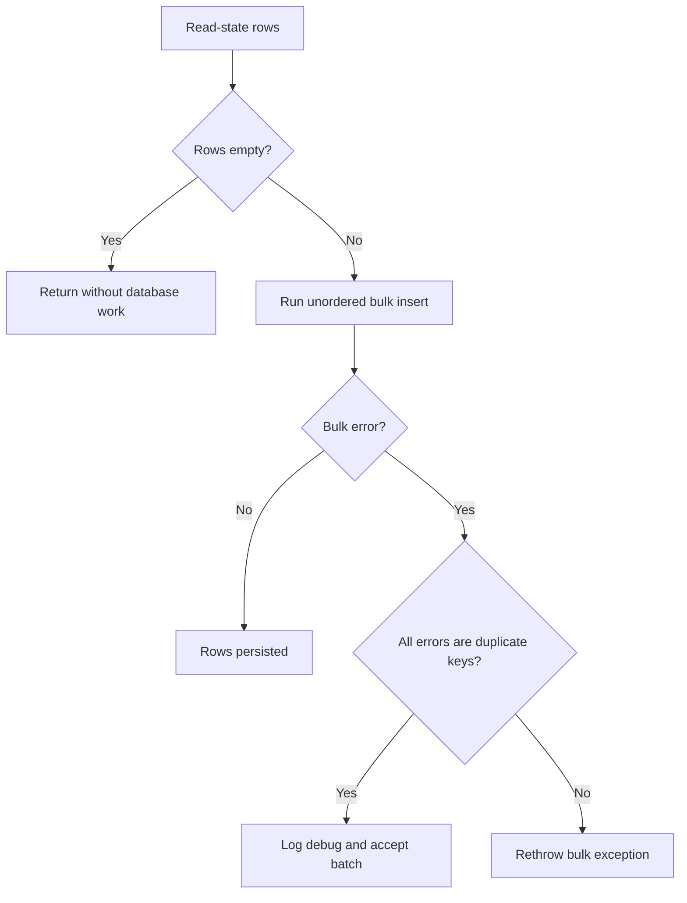

# Notification Repositories

Notification Repositories provides the tenant-scoped MongoDB persistence behavior behind notification inboxes and notification preferences. It is implemented by the `com.openframe.oss:openframe-data-mongo-sync` library at version `7.0.11`, which OpenFrame OSS Tenant consumes at runtime. The module is active only when `openframe.tenant-isolation.enabled` is `true`.

The implementation separates recipient-facing state from notification content:

- A notification read-state row is the recipient-specific index used for filtering, cursor pagination, and read status.
- A notification document supplies the notification content after matching state rows have been identified.
- A per-user settings document stores whether notifications are enabled and which setting groups are muted.

## Architecture Overview

All three repository implementations inherit tenant-aware repository support and receive a tenant-aware Mongo template. Consequently, notification retrieval and settings writes execute within the current tenant scope rather than relying on a caller to add a tenant identifier manually.

## Core Components

| Component | Responsibility |
| --- | --- |
| [`CategoryCount`](https://github.com/flamingo-stack/openframe-oss-lib/blob/7a766f00e4f58b5d89db007b878ac8d6e0c344f4/openframe-data-mongo-sync/src/main/java/com/openframe/data/repository/notification/CategoryCount.java) | Projection record that maps MongoDB aggregation `_id` to a `NotificationCategory` and carries its count. |
| [`CustomNotificationRepositoryImpl`](https://github.com/flamingo-stack/openframe-oss-lib/blob/7a766f00e4f58b5d89db007b878ac8d6e0c344f4/openframe-data-mongo-sync/src/main/java/com/openframe/data/repository/notification/impl/CustomNotificationRepositoryImpl.java) | Finds and counts notifications for a recipient, applying state, category, type, severity, entity, title-search, and cursor criteria. |
| [`CustomNotificationReadStateRepositoryImpl`](https://github.com/flamingo-stack/openframe-oss-lib/blob/7a766f00e4f58b5d89db007b878ac8d6e0c344f4/openframe-data-mongo-sync/src/main/java/com/openframe/data/repository/notification/impl/CustomNotificationReadStateRepositoryImpl.java) | Inserts recipient read-state rows in unordered batches and treats all-duplicate batches as idempotent success. |
| [`CustomNotificationSettingsRepositoryImpl`](https://github.com/flamingo-stack/openframe-oss-lib/blob/7a766f00e4f58b5d89db007b878ac8d6e0c344f4/openframe-data-mongo-sync/src/main/java/com/openframe/data/repository/notification/impl/CustomNotificationSettingsRepositoryImpl.java) | Atomically creates or updates a user's enabled flag and muted notification groups. |

## Recipient Inbox Query Path

`CustomNotificationRepositoryImpl` treats `NotificationReadState` as the recipient index. It first retrieves a page of matching state rows, then loads the referenced notification documents. This avoids scanning notification content to determine a recipient's inbox status and preserves the order established by the read-state query.

### Filters and Ordering

The state query always constrains the recipient identifier and recipient type, then applies optional filters:

- **Read state:** an unspecified filter excludes deleted entries; `true` includes read and archived entries; `false` selects unread entries.
- **Category, type, and severity:** non-empty filter lists use membership matching.
- **Entity:** entity filtering is applied only when both an entity type and a non-blank entity identifier are available. This prevents a type-only request from returning every notification for that entity type.
- **Text search:** title matching uses a case-insensitive regular expression with the supplied search text quoted as a literal.
- **Cursor:** the cursor is compared with `notificationId`. Forward requests use the requested sort direction, while backward requests invert it. The resulting page retains the state-query order after notification documents are loaded.

Rows with malformed notification identifiers are ignored while converting identifiers to MongoDB object identifiers. Likewise, a valid state row whose notification document no longer exists is not returned. These behaviors let the inbox remain usable in the presence of stale state records.

### Counting and Category Aggregates

`countForRecipient` reuses the same recipient criteria as page retrieval, so counts align with the current filter state. `CategoryCount` is a minimal aggregation projection for category totals: MongoDB's aggregation identifier maps to `category`, while `count` carries the grouped cardinality.

## Write Semantics

### Idempotent Read-State Fan-Out

`bulkInsertUnordered` exits immediately for a null or empty input. For non-empty batches it uses unordered MongoDB bulk insertion, allowing independent rows to continue even if another row conflicts. Duplicate-key error code `11000` is accepted only when **every** bulk error is a duplicate key; mixed failures are rethrown. This preserves idempotency for repeated delivery fan-out without hiding unrelated database errors.

### Settings Upsert and Concurrent Creation

`saveSettings` scopes its lookup to the current tenant and user identifier. It uses MongoDB upsert to set the enabled flag and update timestamp, while initializing the creation timestamp only for new rows. A non-null muted-group set replaces the stored value. A null set is intentionally treated as omitted input, retaining existing muted groups for compatibility with master-only writes.

A simultaneous first write can lose the unique-index insert race. In that case, the repository catches `DuplicateKeyException` and retries as a normal update, ensuring the effective settings are stored once the competing insert has created the row.

## Operational Considerations

- **Tenant isolation is mandatory for these implementations.** The conditional bean declaration means this custom behavior is not registered unless the tenant-isolation property is enabled.
- **Preserve the read-state index model.** Paging, unread counts, and read status depend on the recipient-specific `NotificationReadState` records.
- **Use stable notification identifiers for cursor pagination.** Cursor comparison is performed against `notificationId`, not a timestamp field.
- **Maintain the `{tenantId, userId}` uniqueness guarantee for settings.** It is required for the upsert and duplicate-race recovery behavior to represent one settings row per user in a tenant.
- **Treat duplicate read-state inserts as expected replay behavior, not general error suppression.** Only batches whose errors are exclusively duplicate keys are accepted.

Within the wider platform, API data fetchers expose notification and notification-settings data, while this module owns the persistence-side query and mutation details. The shared data model, tenant-aware Mongo infrastructure, and public repository contracts are supplied by OpenFrame OSS Library; this tenant service assembles that library into its runtime services.
