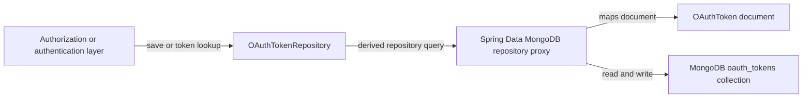
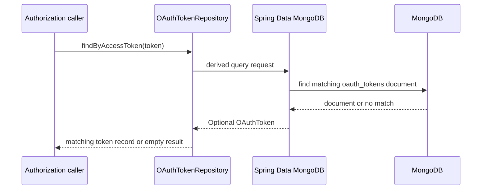

# Oauth Repositories

Oauth Repositories is the MongoDB persistence boundary for OAuth token records. It is supplied at runtime by the OpenFrame OSS Library artifact `com.openframe.oss:openframe-data-mongo-sync` version `7.0.11`, which this service consumes. The module contains one Spring Data repository, `OAuthTokenRepository`, and extends the standard MongoDB CRUD contract with exact-token lookups for access and refresh tokens.

The repository is deliberately small: it does not issue, validate, rotate, encrypt, or revoke tokens. Those decisions belong to the authentication and authorization layers. Its responsibility is to map repository operations to the `oauth_tokens` MongoDB collection and return an optional matching record when a caller supplies an access or refresh token.

## Responsibilities and Boundaries

| Area | Responsibility |
| --- | --- |
| Persistence | Provides `MongoRepository<OAuthToken, String>` operations for token documents identified by string IDs. |
| Access-token lookup | Exposes `findByAccessToken(String accessToken)` to retrieve at most one matching document. |
| Refresh-token lookup | Exposes `findByRefreshToken(String refreshToken)` to retrieve at most one matching document. |
| Tenant data | Persists an OAuth token document that carries a tenant identifier and implements the platform tenant-scoping contract. |
| Not owned here | Token minting, expiry enforcement, cryptographic protection, authorization policy, and HTTP endpoints. |

## Components

### OAuthTokenRepository

[`OAuthTokenRepository`](https://github.com/flamingo-stack/openframe-oss-lib/blob/7a766f00e4f58b5d89db007b878ac8d6e0c344f4/openframe-data-mongo-sync/src/main/java/com/openframe/data/repository/oauth/OAuthTokenRepository.java) is annotated as a Spring `Repository` and inherits the generic persistence API from Spring Data MongoDB. In addition to `save`, `findById`, and deletion operations inherited from `MongoRepository`, it declares two query-derived methods:

| Method | Input | Result | Intended use |
| --- | --- | --- | --- |
| `findByAccessToken` | Access-token value | `Optional<OAuthToken>` | Resolve the persisted record associated with a presented access token. |
| `findByRefreshToken` | Refresh-token value | `Optional<OAuthToken>` | Resolve the persisted record associated with a presented refresh token. |

Both methods return `Optional`, so repository callers must handle an absent record. The interface itself has no implementation class: Spring Data derives and executes the MongoDB queries from the method names when the application context creates the repository proxy.

## Persisted Record Model

The repository stores the `OAuthToken` document from the OpenFrame OSS Library's `com.openframe.oss:openframe-data-mongo-common` artifact. The document is mapped to the `oauth_tokens` collection and contains the following fields:

| Field | Meaning |
| --- | --- |
| `id` | MongoDB document identifier. |
| `tenantId` | Indexed tenant identifier used by the tenant-scoping model. |
| `userId` | Identifier of the user associated with the token pair. |
| `accessToken` | Access-token value searched by `findByAccessToken`. |
| `refreshToken` | Refresh-token value searched by `findByRefreshToken`. |
| `accessTokenExpiry` | Instant at which the access token expires. |
| `refreshTokenExpiry` | Instant at which the refresh token expires. |
| `clientId` | OAuth client identifier associated with the record. |
| `scopes` | Granted scope values. |

The tenant identifier is indexed in the document definition. The provided source does not declare indexes for the access-token or refresh-token fields; query performance and uniqueness behavior for those values therefore depend on MongoDB indexes and deployment configuration outside this repository interface.

## Architecture

The library contributes both the repository interface and the token document model. The tenant service assembles the library through its Mongo synchronous-data dependency; configuration of MongoDB connectivity and tenant-aware data access is supplied by the broader data layer.

## Token Lookup Flow

The same persistence pattern applies to access and refresh tokens. Selection of the repository method determines which stored field is queried.

For a refresh-token operation, the caller invokes `findByRefreshToken` instead; Spring Data derives the corresponding query from that method name. Expiry timestamps are persisted data, but the repository does not compare them or decide whether a token is still valid. Callers must apply expiry and authorization rules after receiving a record.

## Operational and Security Considerations

- Treat both lookup inputs and returned token values as secrets. Do not log raw access tokens or refresh tokens in application, audit, or error logs.
- Do not equate a successful lookup with authorization. The caller must verify token expiry, tenant context, client context, scopes, and any revocation policy enforced by the authentication subsystem.
- A token record includes `tenantId`, while the lookup method signatures contain only a token. Consumers should ensure their configured tenant-isolation mechanisms are active and should not assume the interface independently adds a tenant predicate.
- The repository source exposes no explicit unique-index declaration for token values. If token uniqueness is an operational requirement, validate the actual MongoDB index configuration before relying on it.
- Handle `Optional.empty()` as an expected outcome for unknown, expired-and-removed, or otherwise unavailable token records.

## Integration Status

The repository is part of the synchronous Mongo data artifact used by this tenant service. Code-graph analysis of the indexed organization snapshot found no direct static callers or tests referencing `OAuthTokenRepository`; dependency injection and reflection-based repository discovery can be invisible to static call analysis. The `OAuthToken` document is imported by a test utility in this repository, but that does not establish a runtime repository call path.

The repository code is maintained in the OpenFrame OSS Library rather than this tenant repository. Changes to its query methods or document mapping should be made and reviewed with the consuming authorization flows and the deployed MongoDB schema in mind.
