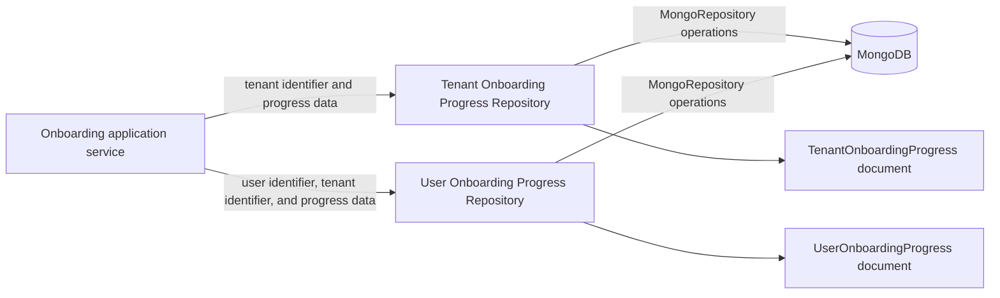
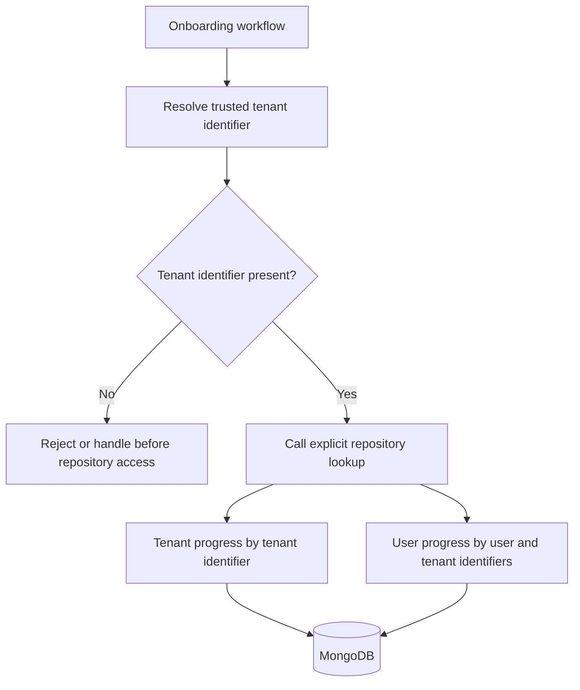
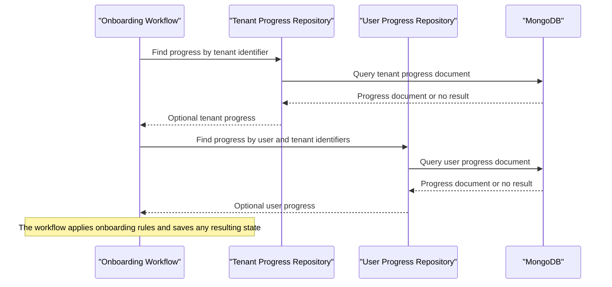

# Onboarding Repositories

## Purpose

Onboarding Repositories is the MongoDB persistence boundary for onboarding-progress state. It provides Spring Data repositories for two independently scoped records supplied by the `com.openframe.oss:openframe-data-mongo-sync` library, version `7.0.11`, which this tenant service consumes:

- tenant progress: one `TenantOnboardingProgress` record per tenant;
- user progress: one `UserOnboardingProgress` record per user and tenant pair.

The module deliberately does not expose HTTP endpoints, perform authorization, or decide which onboarding step is next. Its responsibility is durable retrieval and standard MongoDB lifecycle operations. The owning application service must supply the tenant identifier in every lookup.

## Source and System Placement

Both repository interfaces are implemented in the OpenFrame OSS Library and are assembled into this repository through the `com.openframe.oss:openframe-data-mongo-sync` Maven dependency. Their source is maintained with the library rather than in this tenant repository:

- [Tenant Onboarding Progress Repository source](https://github.com/flamingo-stack/openframe-oss-lib/blob/7a766f00e4f58b5d89db007b878ac8d6e0c344f4/openframe-data-mongo-sync/src/main/java/com/openframe/data/repository/onboarding/TenantOnboardingProgressRepository.java)
- [User Onboarding Progress Repository source](https://github.com/flamingo-stack/openframe-oss-lib/blob/7a766f00e4f58b5d89db007b878ac8d6e0c344f4/openframe-data-mongo-sync/src/main/java/com/openframe/data/repository/onboarding/UserOnboardingProgressRepository.java)

The persisted record types originate in the companion `com.openframe.oss:openframe-data-mongo-common` library. MongoDB connectivity, conversions, indexes, retry behavior, and tenant-isolation infrastructure are provided elsewhere by the consumed data libraries.

## Repository Responsibilities

| Component | Record scope | Lookup contract | Responsibilities |
|---|---|---|---|
| `TenantOnboardingProgressRepository` | One record per tenant | `findByTenantId(String tenantId)` | Reads a tenant's progress record and inherits create, save, delete, and identifier-based lookup operations from `MongoRepository`. |
| `UserOnboardingProgressRepository` | One record per user and tenant | `findByUserIdAndTenantId(String userId, String tenantId)` | Reads the progress record associated with a particular user in a particular tenant and inherits standard `MongoRepository` operations. |

### Tenant Onboarding Progress Repository

`TenantOnboardingProgressRepository` extends `MongoRepository<TenantOnboardingProgress, String>`. The repository's domain identifier is a `String`; its business lookup is explicitly `tenantId` and returns `Optional<TenantOnboardingProgress>`.

Use the optional result to distinguish a tenant with no persisted onboarding progress from a tenant with an existing record. The interface documents an intended cardinality of one record per tenant. Callers are responsible for preserving that invariant when creating records because the repository does not add a custom upsert or uniqueness workflow.

### User Onboarding Progress Repository

`UserOnboardingProgressRepository` extends `MongoRepository<UserOnboardingProgress, String>`. Its explicit lookup requires both `userId` and `tenantId`, returning `Optional<UserOnboardingProgress>`.

Including the tenant identifier in the query is essential: user onboarding progress is tenant-scoped even when a user identifier is available. The interface documents an intended cardinality of one record per user and tenant combination.

## Tenant Scope and Safety Boundary

These are intentionally plain Spring `@Repository` interfaces, rather than tenant-aware repository types. The library documentation states that the SaaS-side runtime runs with tenant isolation disabled and bypasses the tenant aspect. Consequently, the repositories do not infer or inject tenant scope.

Maintain the following invariants in callers and service-layer logic:

1. Treat the tenant identifier as required input for both repositories.
2. For user progress, query by the complete user-and-tenant pair; do not query by user identifier alone.
3. Perform authorization and tenant-context validation before calling the repository.
4. Handle an empty `Optional` as absent progress, not as an implicit default record.
5. Ensure writes preserve the documented one-per-tenant and one-per-user-and-tenant cardinalities.

## Typical Interaction Flow

The repositories support a read-or-initialize pattern, while leaving initialization policy outside this module.

## Operational Notes

- Spring Data derives the declared finder queries from their method names, so the Java property names on the persisted documents must remain aligned with `tenantId` and `userId`.
- Inherited `MongoRepository` methods are general-purpose persistence operations. They are not substitutes for a tenant-scoped business operation, because no tenant aspect protects these repository interfaces.
- The module has no custom repository implementation, transaction orchestration, cache, scheduler, or event publication code.
- The code-graph snapshot records test references for both onboarding progress documents, but does not expose those test files to this repository view. Repository behavior should therefore be validated at the service or integration-test layer using the explicit lookup keys.

## Maintenance Guidance

When changing these interfaces or their backing document fields:

1. Preserve the explicit tenant lookup keys, or update every caller and data migration together.
2. Review MongoDB indexes and existing data before changing the documented cardinality assumptions.
3. Avoid adding an implicit tenant filter unless the deployment's tenant-isolation model is changed deliberately across the data layer.
4. Keep the repository methods narrow. Business transitions, permissions, and onboarding-step rules belong in the consuming application service.
