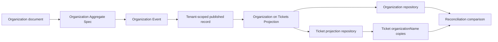
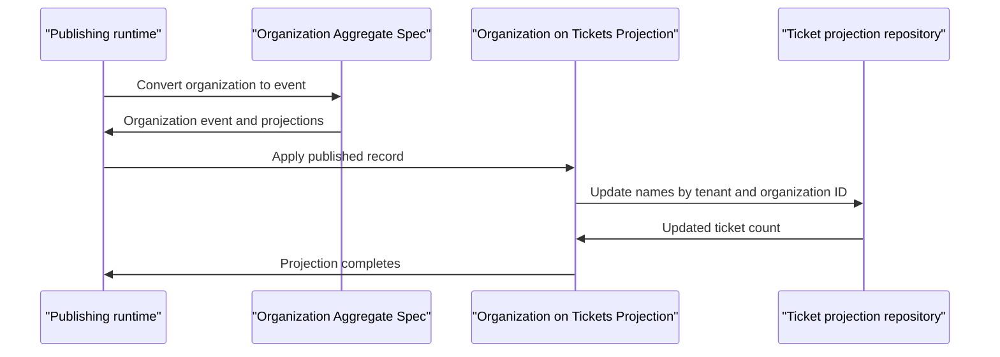
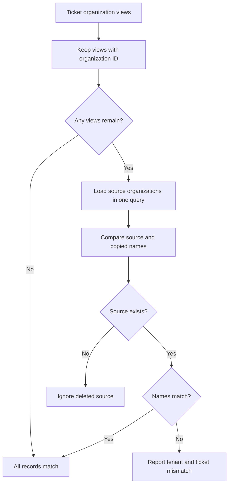

# Organization Publishing

Organization Publishing keeps the denormalized organization name stored on tickets consistent with the authoritative organization document. It is implemented by the `openframe-data-mongo-sync` library from [OpenFrame OSS Library](https://github.com/flamingo-stack/openframe-oss-lib) and is assembled into this repository's services through `com.openframe.oss:openframe-data-mongo-sync` version `7.0.11`.

The module participates in the platform publishing framework as an aggregate specification for organizations. An organization change is converted to a compact event, then its ticket projection applies the current organization name to all tickets belonging to that organization and tenant. Projection work can be performed in one operation or incrementally in batches, and reconciliation detects stale ticket copies.

## Responsibilities

- Defines `organizations` as the publishing aggregate type.
- Builds the public organization event from an organization document.
- Preserves the serialized `isDefault` property name in the event payload.
- Propagates an organization's current name to its associated tickets within the same tenant.
- Supports change counting and cursor-based batch projection for large ticket sets.
- Reconciles ticket copies against source organizations and reports drift without treating deleted sources as mismatches.

## Architecture

The projection deliberately limits its ticket-facing view to the fields needed for comparison: ticket identifier, tenant identifier, organization identifier, and copied organization name. This keeps reconciliation reads narrow and decouples the job from unrelated ticket fields.

## Core Components

| Component | Responsibility |
| --- | --- |
| [`OrganizationAggregateSpec`](https://github.com/flamingo-stack/openframe-oss-lib/blob/7a766f00e4f58b5d89db007b878ac8d6e0c344f4/openframe-data-mongo-sync/src/main/java/com/openframe/data/repository/organization/publishing/OrganizationAggregateSpec.java) | Registers the `organizations` aggregate type, converts an organization to an event, and supplies the ticket projection. |
| [`OrganizationEvent`](https://github.com/flamingo-stack/openframe-oss-lib/blob/7a766f00e4f58b5d89db007b878ac8d6e0c344f4/openframe-data-mongo-sync/src/main/java/com/openframe/data/repository/organization/publishing/OrganizationEvent.java) | Published payload containing organization ID, name, default flag, and status. |
| [`OrganizationOnTicketsProjection`](https://github.com/flamingo-stack/openframe-oss-lib/blob/7a766f00e4f58b5d89db007b878ac8d6e0c344f4/openframe-data-mongo-sync/src/main/java/com/openframe/data/repository/organization/publishing/OrganizationOnTicketsProjection.java) | Updates ticket copies, estimates projection work, performs batches, and reconciles tickets with source organizations. |
| [`TicketOrganizationView`](https://github.com/flamingo-stack/openframe-oss-lib/blob/7a766f00e4f58b5d89db007b878ac8d6e0c344f4/openframe-data-mongo-sync/src/main/java/com/openframe/data/repository/organization/publishing/TicketOrganizationView.java) | Minimal ticket read model consumed by reconciliation. |

## Event Contract

`OrganizationAggregateSpec.toEvent` maps the source organization into `OrganizationEvent`.

| Event field | Source | Notes |
| --- | --- | --- |
| `organizationId` | Organization identifier | Identifies the organization referenced by a ticket. |
| `name` | Organization name | The value copied to `organizationName` on matching tickets. |
| `isDefault` | Organization default flag | Normalized to `false` when the source value is absent. The boxed Boolean retains the JSON property name `isDefault`. |
| `status` | Organization status | Published as organization state for consumers of the organization aggregate. |

The aggregate specification returns the ticket projection as its projection list, so organization publication makes the projection available to the publishing runtime.

## Projection Lifecycle

### Applying Changes

For a published record, the projection takes the tenant ID, organization ID, and name from the event. It calls the ticket projection repository to update only tickets matching that tenant and organization. The debug log records the organization, tenant, and number of affected tickets.

### Batching Large Updates

The publishing runtime can first call `countChanges` with a limit to estimate work. It can then call `applyBatch` with a cursor represented by `lastId` and a batch size. The ticket projection repository returns the next cursor, allowing the runtime to continue until the update completes. Both operations use the record tenant and organization identifiers, maintaining tenant isolation.

### Reconciliation

Reconciliation receives minimal ticket views and ignores tickets without an organization reference. It then:

1. Collects the distinct tenant IDs and organization IDs from the remaining tickets.
2. Retrieves candidate source organizations in a single repository query.
3. Keys source organizations by the combined tenant and organization ID.
4. Compares each ticket's `organizationName` with the source organization name.
5. Returns a mismatch for each unequal pair, associating the ticket with the source document ID.

A ticket whose referenced source organization no longer exists is intentionally not considered drift. The copied name is retained after source deletion, and reconciliation does not request another publication for that case.

## Data Boundaries and Invariants

- **Tenant scope is mandatory.** Updates and reconciliation use tenant ID together with organization ID, avoiding cross-tenant matches when identifiers overlap.
- **Organization ID is the relationship key.** Ticket updates target `organizationId`; the organization name is a replicated display value rather than the join key.
- **The copied name is eventually consistent.** A published organization event drives repair after a source name changes; reconciliation detects copies that remain out of date.
- **Deletion is not repaired by this projection.** Missing source organizations are excluded from mismatch output by design.
- **Event shape is intentional.** `isDefault` uses `Boolean` rather than primitive `boolean` so standard JavaBean serialization retains the specified payload key.

## Integration Context

Organization Publishing belongs to the Mongo synchronous data layer supplied by OpenFrame OSS Library. It relies on the organization repository for source records and the ticket projection repository for targeted ticket updates. The broader platform's ticket and organization application services can therefore display denormalized organization names efficiently while the publishing framework maintains consistency.

The implementation source is maintained in OpenFrame OSS Library at the component links above; this tenant repository consumes the library artifact rather than defining these classes locally.
