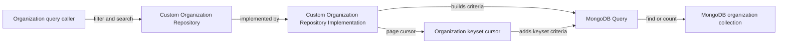
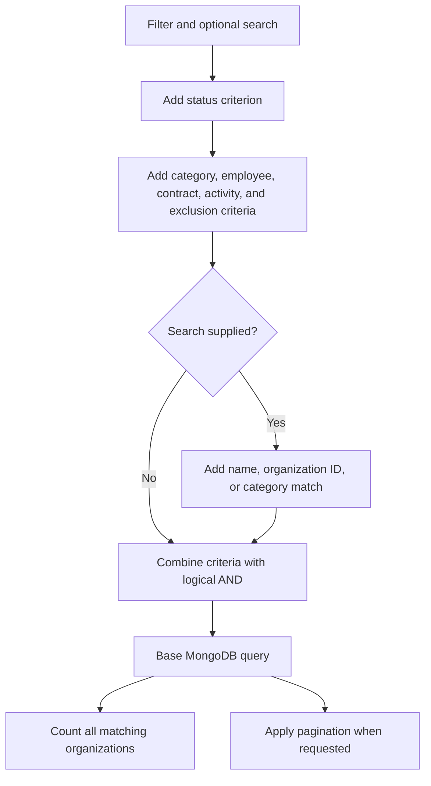
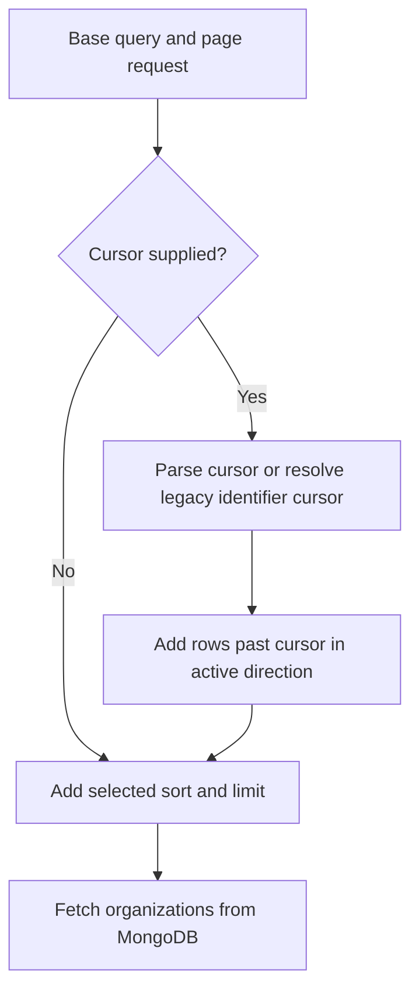
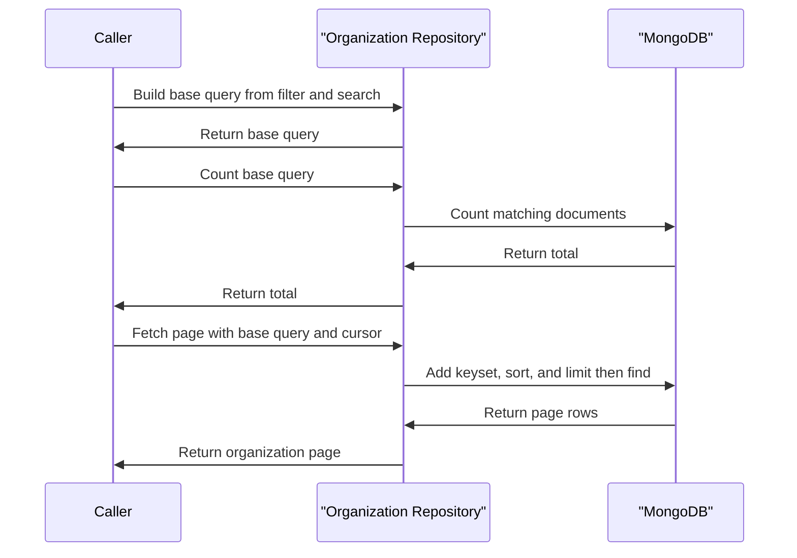

# Organization Repositories

## Purpose

Organization Repositories is the MongoDB query extension for organization records used by OpenFrame services. It is supplied at runtime by the OpenFrame OSS Library artifact `com.openframe.oss:openframe-data-mongo-sync` version `7.0.11`, which this repository consumes. The module turns an `OrganizationQueryFilter` and optional free-text search into database-side MongoDB criteria, supports total counts over the unpaginated query, and retrieves stable cursor-based pages of `Organization` documents.

The source components belong to the OpenFrame OSS Library:

- [Custom Organization Repository](https://github.com/flamingo-stack/openframe-oss-lib/blob/7a766f00e4f58b5d89db007b878ac8d6e0c344f4/openframe-data-mongo-sync/src/main/java/com/openframe/data/repository/organization/CustomOrganizationRepository.java) defines the query contract.
- [Custom Organization Repository Implementation](https://github.com/flamingo-stack/openframe-oss-lib/blob/7a766f00e4f58b5d89db007b878ac8d6e0c344f4/openframe-data-mongo-sync/src/main/java/com/openframe/data/repository/organization/CustomOrganizationRepositoryImpl.java) implements the contract with `MongoTemplate`.

This module is intentionally a repository concern: callers supply validated filters, pagination, and sorting choices, while the implementation controls how those choices become MongoDB queries.

## Responsibilities

- Build a reusable base query for organization status, category, employee count, contract activity, last activity, exclusions, and text search.
- Keep filtering in MongoDB rather than loading an unfiltered organization set into application memory.
- Apply keyset pagination to a base query without changing the criteria used for the accompanying total count.
- Restrict pagination sorting to known fields and use `_id` as a deterministic tie-breaker.
- Preserve compatibility with older cursor values that contain only an organization identifier.

## Architecture

The repository has two query stages:

1. `buildOrganizationQuery` constructs the base criteria for filtering and search.
2. `findOrganizationsWithCursor` optionally adds a cursor boundary, adds a sort and limit, then executes the page query. `countOrganizations` instead counts the unchanged base query so the result represents all matching organizations, not only the current page.

## Core Components

### Custom Organization Repository

`CustomOrganizationRepository` is the application-facing contract. It exposes six operations:

| Operation | Responsibility |
|---|---|
| `buildOrganizationQuery` | Produces the reusable filter and search query before paging is applied. |
| `findOrganizationsWithFilters` | Executes a non-paginated organization query. |
| `findOrganizationsWithCursor` | Retrieves one sorted keyset page from a supplied base query. |
| `countOrganizations` | Counts matches for a base query without pagination constraints. |
| `isSortableField` | Checks whether a requested sort field is allowlisted. |
| `getDefaultSortField` | Supplies the fallback sort field, `_id`. |

The separation between query construction and execution is important for page metadata: the caller can use exactly the same base query for both a page and its total count.

### Custom Organization Repository Implementation

`CustomOrganizationRepositoryImpl` is a Spring `@Repository` backed by `MongoTemplate`. Its primary behavior is summarized below.

| Area | Behavior |
|---|---|
| Status | When a filter is present but has no status, or no filter is supplied, includes organizations whose status is `ACTIVE` or absent. An explicit status replaces that default. |
| Category | Performs a case-insensitive exact category match. The requested value is regex-quoted before use. |
| Employee count | Applies independent inclusive minimum and maximum bounds to `numberOfEmployees`. |
| Contract activity | Includes contracts whose start date is not null and no later than today, and whose end date is not null and no earlier than today. The inactive branch includes missing dates, future starts, and expired ends. |
| Last activity | Applies inclusive `lastActivityFrom` and `lastActivityTo` bounds to `updatedAt`, which backs the exposed last-activity value. |
| Exclusions | Excludes all supplied `organizationId` values with a MongoDB not-in criterion. |
| Search | Performs case-insensitive substring matching across `name`, `organizationId`, and `category`. The search term is regex-quoted, so special characters are treated literally. |
| Sorting | Allows only `_id`, `name`, `organizationId`, `createdAt`, and `updatedAt`; any non-identifier sort is followed by `_id` in the same direction. |

All independent filters are collected and combined with one logical AND. Search itself is a logical OR across its three fields, which is then included in that overall AND. This preserves the intended meaning: the record must satisfy every selected filter and must match at least one searchable field when search is supplied.

## Filtering Flow

### Default Status Semantics

A missing filter is not equivalent to an unrestricted query. The implementation defaults to active organizations and also includes legacy documents where `status` does not exist. This behavior is applied both when the filter object is absent and when the filter exists but omits its status field.

### Safe Text Matching

Category matching anchors the quoted input at both ends, producing an exact case-insensitive comparison. Free-text search uses the quoted input without anchors, producing a case-insensitive substring search. Quoting is significant because user input is not interpreted as a regular expression pattern.

## Cursor Pagination

The module uses keyset pagination rather than offset pagination. A page request supplies a base query, a cursor, a limit, a sort field, and a sort direction. The implementation treats any direction other than `DESC` as ascending.

### Stable Ordering

- For `_id` sorting, the cursor boundary is simply greater than the cursor identifier in ascending order or less than it in descending order.
- For `name`, `organizationId`, `createdAt`, and `updatedAt`, the cursor represents both the selected field value and `_id`.
- The keyset condition selects a value beyond the cursor, or an equal value with an `_id` beyond the cursor. This secondary identifier rule avoids duplicates and skipped rows when organizations share the same primary sort value.
- `_id` is appended as a secondary sort whenever the primary sort field is different, using the same direction.

The associated `OrganizationKeysetCursor` helper encodes date fields as epoch milliseconds and text fields as Base64, then pairs the value with the object identifier. A pre-compound, identifier-only cursor is supported for non-identifier sorts by loading its anchor organization and deriving the current compound cursor. Missing anchors and malformed cursor content result in an invalid-cursor error.

## Query and Pagination Boundaries

The following sequence shows why count and pagination must operate on separate stages of the same logical query.

Do not pass an already limited or keyset-constrained query to `countOrganizations`; its contract requires the base filter and search query before paging has been applied.

## Integration in OpenFrame OSS Tenant

OpenFrame OSS Tenant publishes the `openframe-api` service and consumes the library module containing this repository. At runtime, higher-level organization API and data-fetching paths can use the repository as part of the synchronous MongoDB data layer. The module operates on `Organization` documents and does not expose HTTP routes itself.

Within the wider platform, this repository complements the organization query and API layers by providing database-level selection and deterministic paging. Organization event publishing, organization document definitions, and API controller behavior are separate concerns in the platform documentation and are not duplicated here.

## Operational and Maintenance Notes

- Validate a requested sort field with `isSortableField` before calling the paging method. The supported field set is deliberately narrow.
- Use `getDefaultSortField` when no allowed sort field is chosen; it returns `_id`.
- Keep `countOrganizations` on an unmodified base query to ensure page totals remain accurate.
- Reuse the same filter, search value, sort field, and sort direction while following a cursor. Changing any of these inputs changes the ordering and invalidates the semantic meaning of the cursor.
- Treat the active-contract check as date-sensitive because it evaluates against the server's current local date.
- When extending filters, add criteria to the existing collection before the final logical AND rather than issuing competing keyless criteria calls on the same `Query`.
- When adding a sortable non-identifier field, update both the sortable-field allowlist and the cursor encoding and decoding logic so keyset pagination retains a typed sort value and stable tie-breaker.

## Testing Focus

The library includes focused cursor and integration tests for this repository implementation. Changes should preserve at least the following behaviors:

- Default active-status inclusion, including legacy records without a status field.
- Literal handling of search and category input that contains regular-expression metacharacters.
- Inclusive employee and last-activity range boundaries.
- Active and inactive contract classification at date boundaries.
- Ascending and descending cursor pagination, including repeated primary sort values.
- Legacy identifier-only cursor compatibility, malformed-cursor rejection, and missing-anchor rejection.
- Counts that remain independent of cursor and limit constraints.
