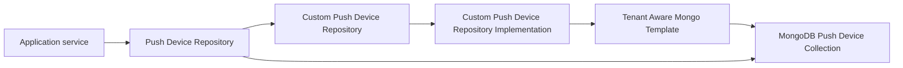
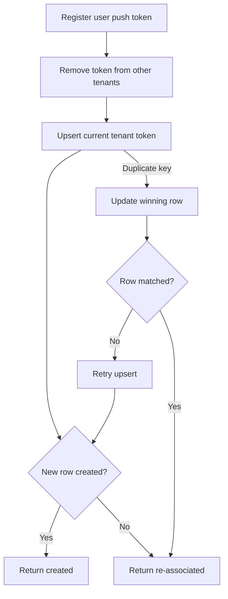

# Push Device Repositories

Push Device Repositories is the tenant-aware MongoDB persistence boundary for mobile push-notification device registrations. It is supplied at runtime by the OpenFrame OSS Library artifact `com.openframe.oss:openframe-data-mongo-sync` version `7.0.11`, which this repository consumes. The module stores the association between a user, a push token, the client platform, and the app version while ensuring that a token is associated with at most one tenant at a time.

The module intentionally exposes a narrow repository API. In particular, it does not extend `MongoRepository`: its inherited bulk operations would not be tenant-scoped and could therefore operate on records belonging to every tenant.

## Architecture

The public repository combines Spring Data derived lookup and deletion methods with a custom registration operation. The custom implementation uses update-based MongoDB operations because entity-stamping callbacks do not apply to those operations; the tenant-aware template supplies the normal scoped filter.

## Components

### Push Device Repository

[`PushDeviceRepository`](https://github.com/flamingo-stack/openframe-oss-lib/blob/7a766f00e4f58b5d89db007b878ac8d6e0c344f4/openframe-data-mongo-sync/src/main/java/com/openframe/data/repository/push/PushDeviceRepository.java) is a `@TenantAwareRepository` and the application-facing contract.

| Operation | Responsibility |
|---|---|
| `findByUserId` | Retrieves the current tenant's registered push devices for a user. |
| `deleteByUserIdAndToken` | Deregisters a token only when it remains bound to the supplied user. This prevents a token that has been re-bound from being deleted through an old user association. The deleted-row count is expected to be zero or one. |
| `deleteByTokenIn` | Removes registrations matching a supplied token collection through the tenant-aware repository boundary. |
| `registerToken` | Delegates atomic insert-or-rebind registration to the custom repository contract; it returns `true` only when the registration created a new row. |

The interface deliberately avoids inheriting `count` and `deleteAll`. Callers must use explicitly scoped operations instead of broad repository methods that could bypass tenant isolation.

### Custom Push Device Repository Implementation

[`CustomPushDeviceRepositoryImpl`](https://github.com/flamingo-stack/openframe-oss-lib/blob/7a766f00e4f58b5d89db007b878ac8d6e0c344f4/openframe-data-mongo-sync/src/main/java/com/openframe/data/repository/push/impl/CustomPushDeviceRepositoryImpl.java) implements the custom `registerToken` operation when `openframe.tenant-isolation.enabled` is `true`.

Its registration algorithm is designed around the unique `{tenantId, token}` index:

1. It removes any row for the token that belongs to another tenant. This is intentionally cross-tenant so that a token can move cleanly to its current tenant.
2. It upserts the row identified by the token in the current tenant scope, setting the user, platform, app version, and update timestamp.
3. It sets `createdAt` only for a newly inserted row.
4. If concurrent registration causes a duplicate-key error, it updates the row that won the insert race. If that row is no longer found, it retries the upsert.
5. It returns `true` for a new row and `false` when an existing registration was re-associated.

The app version is written on every registration, including a `null` value. This ensures the record represents the last registering client rather than retaining capabilities from a newer installation after a client downgrade or reinstall.

## Registration Flow

## Data and Isolation Semantics

A push-device record includes the token, tenant identifier, user identifier, platform, app version, and creation and update times. Registration uses MongoDB `upsert` rather than a read followed by `save`, avoiding a read-modify-write race during creation or reassociation.

Tenant isolation is active only when the implementation's conditional property is enabled. The cross-tenant cleanup is a narrowly scoped exception: it explicitly filters for the same token and a tenant identifier different from the active tenant, allowing a token to be moved without leaving stale registrations behind. All subsequent token lookup and write work is performed through the tenant-aware template.

## Operational Considerations

- Treat push tokens as movable credentials: registration may re-associate a token with a different user or tenant.
- Use `deleteByUserIdAndToken` for user-initiated deregistration so an outdated request cannot delete a token that has since been reassigned.
- Preserve the unique tenant-and-token index expected by `registerToken`; it is part of the concurrency design, not merely a storage optimization.
- Test concurrent registration paths, including duplicate-key recovery, whenever changing index definitions or registration behavior.
- Do not introduce broad inherited repository operations unless their tenant scoping is established explicitly.

## Relationship to the Platform

Push Device Repositories belongs to the Mongo synchronous persistence layer provided by the OpenFrame OSS Library. It is available to the tenant service through its pinned library dependency rather than being implemented in this repository. Upstream services use this boundary to manage device-token registrations; the module itself does not expose an HTTP route or send notifications.
