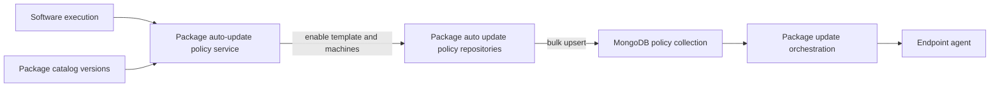
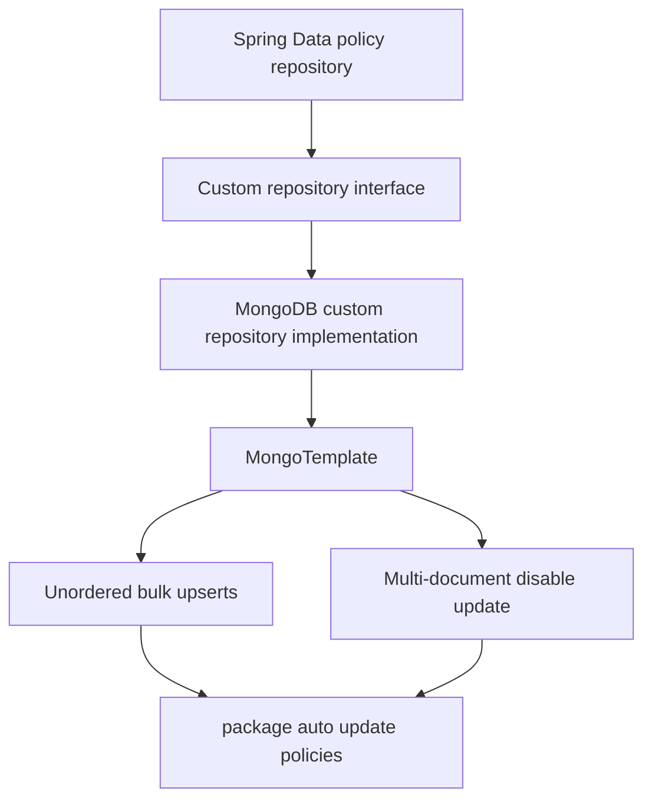
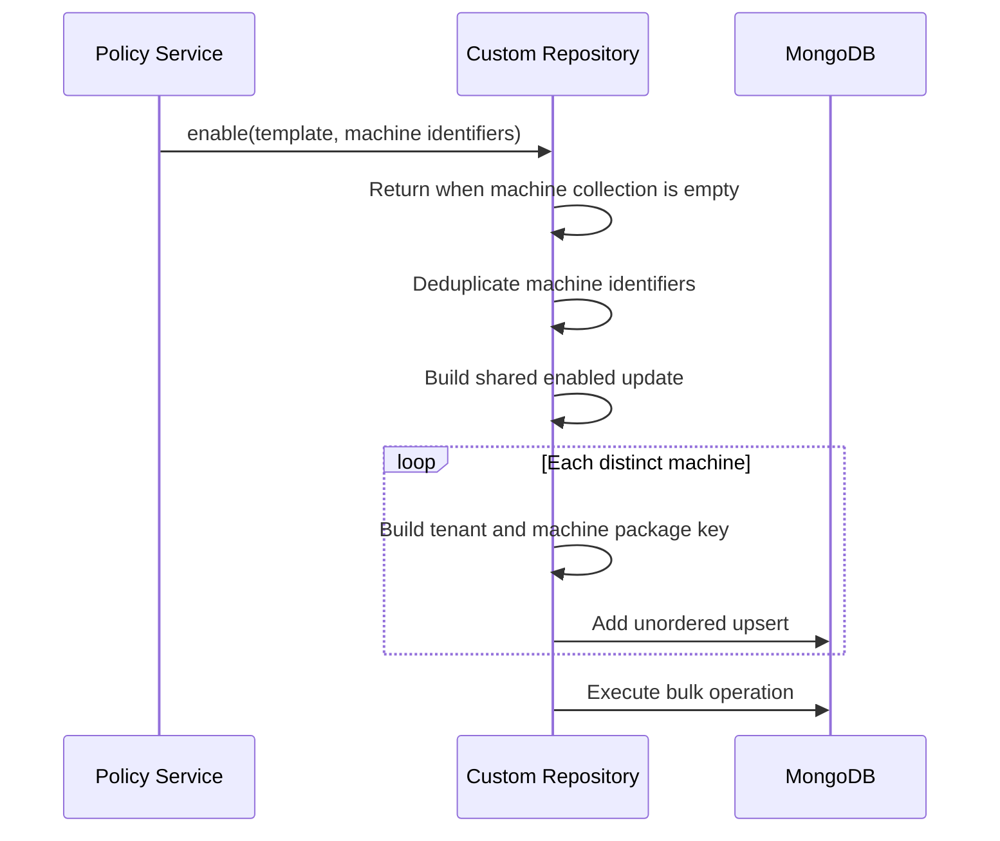
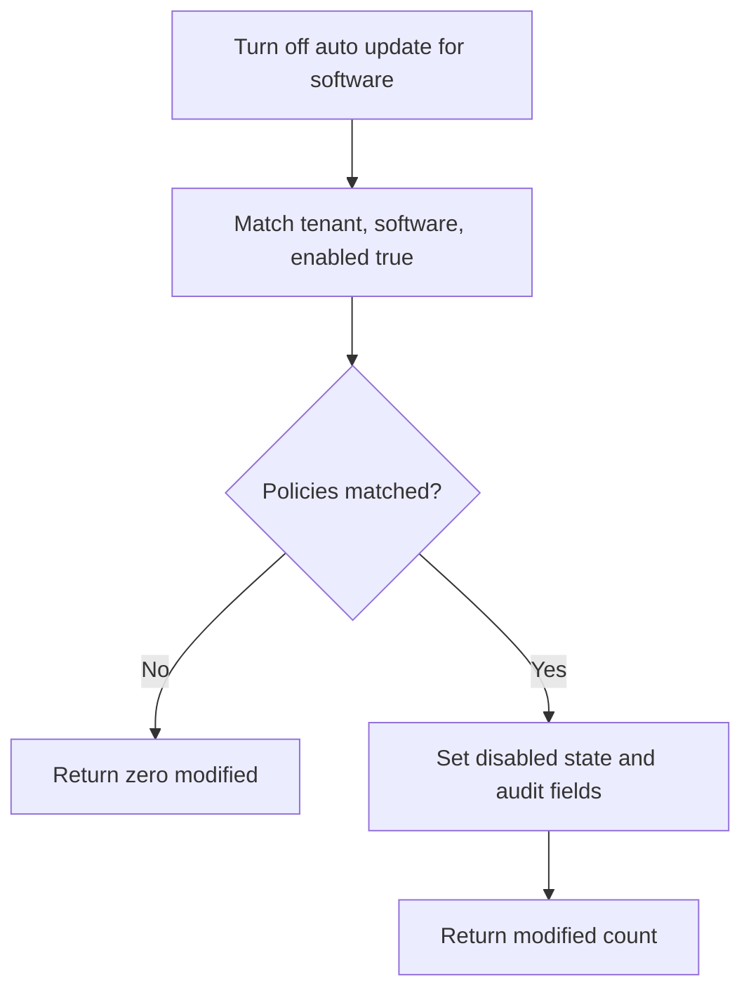
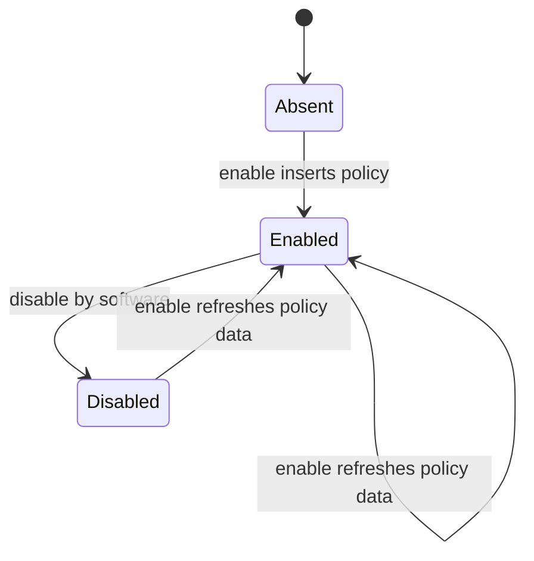

# Package Auto Update Policy Repositories

Package Auto Update Policy Repositories provides the MongoDB write operations that create, refresh, and retire per-machine package auto-update policies. It is implemented by the `openframe-data-mongo-sync` library from [OpenFrame OSS Library](https://github.com/flamingo-stack/openframe-oss-lib/tree/7a766f00e4f58b5d89db007b878ac8d6e0c344f4/openframe-data-mongo-sync), consumed by this tenant service at version `7.0.11`.

The module deliberately operates on **one policy per tenant, machine, package manager, and package name**. Its custom operations complement the standard Spring Data policy repository: they efficiently enable policies for many target machines and disable active policies attached to a software record.

## Responsibilities

- Enable or refresh a policy for every selected machine using unordered MongoDB bulk upserts.
- Preserve a stable policy identity through the compound tenant, machine, package-manager, and package-name key.
- Carry current update configuration, Homebrew package type, known catalog version, attribution, and timestamps into enabled policies.
- Associate policies with a software record when one is supplied, while preserving an existing association when an incoming template has no software identifier.
- Disable every currently enabled policy associated with a given tenant and software record, recording the actor and change time.

## Position in the Package Update Flow

The repository is part of the RMM policy persistence layer. A software execution that has auto-update enabled builds a policy template and supplies the affected machine identifiers. The policy service obtains the catalog's latest known version when available, then invokes the custom `enable` operation. Subsequent package-update orchestration can read these persisted policies, record ordering state, and report outcomes.

The module does not decide whether a policy should be enabled. That decision belongs to the policy service and its auto-update settings. It also does not dispatch update commands; it persists the durable policy state used by the rest of the package-update flow.

## Persisted Policy Model

The repository writes `PackageAutoUpdatePolicy` documents. The model is defined in the [policy document source](https://github.com/flamingo-stack/openframe-oss-lib/blob/7a766f00e4f58b5d89db007b878ac8d6e0c344f4/openframe-data-mongo-common/src/main/java/com/openframe/data/document/rmm/software/PackageAutoUpdatePolicy.java).

| Concern | Stored fields | Repository behavior |
|---|---|---|
| Identity and tenancy | `tenantId`, `machineId`, `packageManager`, `packageName` | Forms the unique lookup key for an enabled-policy upsert. |
| Package context | `brewPackageType`, `softwareId` | Refreshes Homebrew type; writes `softwareId` only when the template provides one. |
| Policy state | `enabled`, `settings`, `lastVersion`, `requestId` | Enables and refreshes settings and version. This module does not update `requestId`. |
| Audit data | `createdBy`, `createdAt`, `updatedBy`, `updatedAt` | Always updates modification attribution and time; initializes creation fields only on insert. |

MongoDB enforces the identity with a unique compound index on tenant, machine, package manager, and package name. Additional tenant-and-package and tenant-and-software indexes support lookup patterns used by the broader policy repository.

## Architecture

### Custom Repository Interface

The [custom repository interface](https://github.com/flamingo-stack/openframe-oss-lib/blob/7a766f00e4f58b5d89db007b878ac8d6e0c344f4/openframe-data-mongo-sync/src/main/java/com/openframe/data/repository/rmm/CustomPackageAutoUpdatePolicyRepository.java) exposes two domain-oriented methods:

- `enable(template, machineIds)` upserts enabled policy documents from a shared template and a machine collection.
- `disableBySoftwareId(tenantId, softwareId, actor)` disables active policies associated with a software record and returns the number of documents modified.

The regular `PackageAutoUpdatePolicyRepository` extends this interface alongside Spring Data `MongoRepository` operations. That surrounding repository also supports policy reads, ordering marks, retry markers, and optimistic disable operations; those methods are outside this custom module's implementation.

### MongoDB Implementation

The [custom repository implementation](https://github.com/flamingo-stack/openframe-oss-lib/blob/7a766f00e4f58b5d89db007b878ac8d6e0c344f4/openframe-data-mongo-sync/src/main/java/com/openframe/data/repository/rmm/CustomPackageAutoUpdatePolicyRepositoryImpl.java) is a Spring `Repository` backed by `MongoTemplate`.

- **Empty input avoidance:** `enable` returns without creating a bulk operation when no machine identifiers are supplied.
- **Deduplication:** machine identifiers are processed through `distinct`, so duplicates do not create duplicate upsert requests.
- **Unordered execution:** the operation uses `BulkMode.UNORDERED`, allowing MongoDB to process independent machine upserts without requiring input order.
- **Key-scoped upsert:** each upsert query is constrained to the document identity key, preventing an update for one machine or package from matching another.
- **Targeted bulk disable:** the multi-update matches only documents for the supplied tenant and software identifier whose `enabled` value is `true`.

## Enable Processing

The enable path makes a template reusable across a machine group while preserving machine-specific document identity.

For every matched or inserted document, the shared update sets:

- `enabled` to `true`.
- `brewPackageType`, `settings`, and `lastVersion` from the template.
- `updatedBy` from the template and `updatedAt` to the operation time.

For a newly inserted document only, it also sets `createdBy` to the updating actor and `createdAt` to the same operation time. Each invocation therefore has a consistent timestamp across all policies it enables.

If the template includes `softwareId`, the upsert updates that association. If it does not, the update intentionally leaves an existing `softwareId` unchanged. This protects an earlier software association when a later package-search-driven run lacks that identifier.

## Disable Processing

Disabling is a bulk state transition rather than a delete. `disableBySoftwareId` matches policies by tenant, software identifier, and enabled state, then writes:

- `enabled: false`
- `updatedBy: actor`
- `updatedAt: current time`

The method returns MongoDB's modified-document count. A result of zero can mean there were no enabled policies for the given tenant and software combination, or that matching policies were already disabled. The implementation does not remove policy history or modify policies belonging to other tenants or software records.

## Data Flow and Lifecycle

The lifecycle shown here concerns the repository-owned `enabled` state. Package-order and retry state are managed by the wider Spring Data repository and package-update services. In particular, a policy document also stores `lastVersion` and `requestId`, allowing the surrounding workflow to track an ordered version and request without the custom bulk operations overwriting the request identifier.

## Operational and Maintenance Notes

- Keep the unique compound index aligned with the `key` query. Altering either independently can allow duplicate policy documents or make upserts ambiguous.
- Treat `tenantId` as mandatory partitioning data. Both custom operations explicitly scope writes by tenant.
- `enable` is idempotent for the same policy key: repeated calls update the same document rather than insert a second one.
- Calls that remove auto-update intent should use the disable operation rather than deleting records, preserving audit and prior policy information.
- Tests for behavior that depends on bulk upsert semantics should cover empty inputs, duplicate machine identifiers, inserts, updates, software association preservation, and disable filtering.

## Source and Runtime Ownership

This tenant repository packages and runs the implementation through the `com.openframe.oss:openframe-data-mongo-sync` dependency, pinned to version `7.0.11`. The Java source and policy document remain owned by OpenFrame OSS Library; the links above intentionally point to the verified library revision rather than to this tenant repository.
