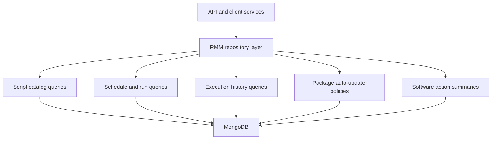
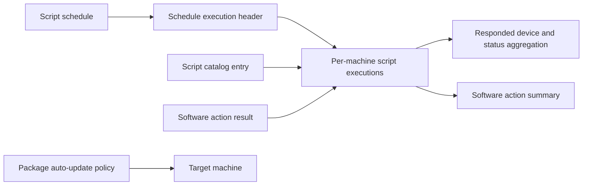

# Rmm Policy And Script Repositories

Rmm Policy And Script Repositories is the MongoDB persistence layer for tenant-scoped remote-monitoring-and-management policy, script, schedule, execution-history, and software-action views. The implementation is supplied by the OpenFrame OSS Library artifact `com.openframe.oss:openframe-data-mongo-sync` at version `7.0.11`, which this service assembles at run time.

The module uses `MongoTemplate` where derived Spring Data repository methods are insufficient: keyset pagination, scoped search and filters, facet aggregation, bulk policy updates, and execution-state rollups. Every exposed query begins from a tenant constraint, preserving tenant isolation in its data-access boundary.

## Architecture

## Responsibilities

- **Script catalog access** applies tenant, lifecycle, script-type, shell, platform, author, tag, and name predicates. It returns cursor-paginated pages and matching counts, and calculates shell, platform, and author facets. System and software-managed script types are excluded from this user-facing repository view.
- **Script schedule access** lists schedules with tenant-scoped filters, cursor pagination, facets, and specialized aggregation paths for assigned-device counts and start time ordering. Device-online schedules are explicitly ordered as a distinct trigger bucket because they do not have a start time.
- **Execution history access** creates queued or running execution leaf records, finds execution pages for script, schedule, or software owners, produces status/initiator/machine facets, and summarizes terminal state across leaves.
- **Schedule-run access** supports the schedule-runs header collection, including page counts, search, status/date filters, cursor encoding, filter-panel facets, and a batched distinct-device response count from execution leaves.
- **Package auto-update policy access** bulk-upserts one enabled policy per distinct machine and disables enabled policies associated with a software record while preserving an audit actor and timestamps.
- **Software action aggregation** joins action records to execution leaves and derives operational status and device counts for software-action history.

## Data Relationships And Execution Flow

A schedule fire is represented by a header record and related per-machine execution leaves. The schedule-runs repository reads the headers and aggregates terminal leaf responses by execution identifier. The script-execution repository retains the leaf-level records and derives the overall settled state: a failed leaf takes precedence, followed by a script error, otherwise success once no queued or running leaf remains. Software-action aggregation uses the same leaf collection to calculate responded and waiting machine counts and to reconcile live action status.

## Query And Pagination Conventions

The list repositories use keyset rather than offset pagination for script, schedule, and execution history. The default order is descending identifier order. When a non-identifier field can contain duplicate values, the cursor encodes that sort value together with the identifier to provide a stable tie-breaker. Invalid cursors are either rejected as malformed request input for execution and schedule-run views, or logged and treated as a first-page request in the script and schedule catalog views.

Facet queries deliberately omit only their own active filter while retaining other filters. This lets an interface show alternative values that can still be selected without broadening unrelated constraints. Search values are quoted before being used in case-insensitive MongoDB regular expressions.

## Component Documentation

Detailed documentation is available for each implementation group:

- [Script Catalog Repositories](script_catalog_repositories.md) — tenant-scoped script listing, filtering, facets, tags, and identifier-cursor pagination.
- [Script Schedule Repositories](script_schedule_repositories.md) — schedule listing, compound cursors, trigger-aware ordering, device-count aggregation, and facets.
- [Script Execution Repositories](script_execution_repositories.md) — per-machine execution persistence, owner-scoped history, facets, and leaf-status rollups.
- [Schedule Run Repositories](schedule_run_repositories.md) — scheduled-fire headers, schedule-run pagination, responded-device aggregation, and facets.
- [Package Auto Update Policy Repositories](package_auto_update_policy_repositories.md) — bulk enablement and software-linked disablement of machine policies.
- [Software Action Aggregation Repository](software_action_aggregation_repository.md) — aggregation-based software-action history and live status reconciliation.

## Source Files

The runtime implementation is maintained in the OpenFrame OSS Library:

- [Custom Package Auto Update Policy Repository](https://github.com/flamingo-stack/openframe-oss-lib/blob/7a766f00e4f58b5d89db007b878ac8d6e0c344f4/openframe-data-mongo-sync/src/main/java/com/openframe/data/repository/rmm/CustomPackageAutoUpdatePolicyRepository.java)
- [Custom Script Repository](https://github.com/flamingo-stack/openframe-oss-lib/blob/7a766f00e4f58b5d89db007b878ac8d6e0c344f4/openframe-data-mongo-sync/src/main/java/com/openframe/data/repository/rmm/CustomScriptRepository.java)
- [Custom Script Schedule Repository](https://github.com/flamingo-stack/openframe-oss-lib/blob/7a766f00e4f58b5d89db007b878ac8d6e0c344f4/openframe-data-mongo-sync/src/main/java/com/openframe/data/repository/rmm/CustomScriptScheduleRepository.java)
- [Custom Script Execution Repository](https://github.com/flamingo-stack/openframe-oss-lib/blob/7a766f00e4f58b5d89db007b878ac8d6e0c344f4/openframe-data-mongo-sync/src/main/java/com/openframe/data/repository/rmm/CustomScriptExecutionRepository.java)
- [Custom Schedule Script Execution Repository](https://github.com/flamingo-stack/openframe-oss-lib/blob/7a766f00e4f58b5d89db007b878ac8d6e0c344f4/openframe-data-mongo-sync/src/main/java/com/openframe/data/repository/rmm/CustomScheduleScriptExecutionRepository.java)
- [Software Action Aggregation Repository](https://github.com/flamingo-stack/openframe-oss-lib/blob/7a766f00e4f58b5d89db007b878ac8d6e0c344f4/openframe-data-mongo-sync/src/main/java/com/openframe/data/repository/rmm/SoftwareActionAggregationRepositoryImpl.java)
