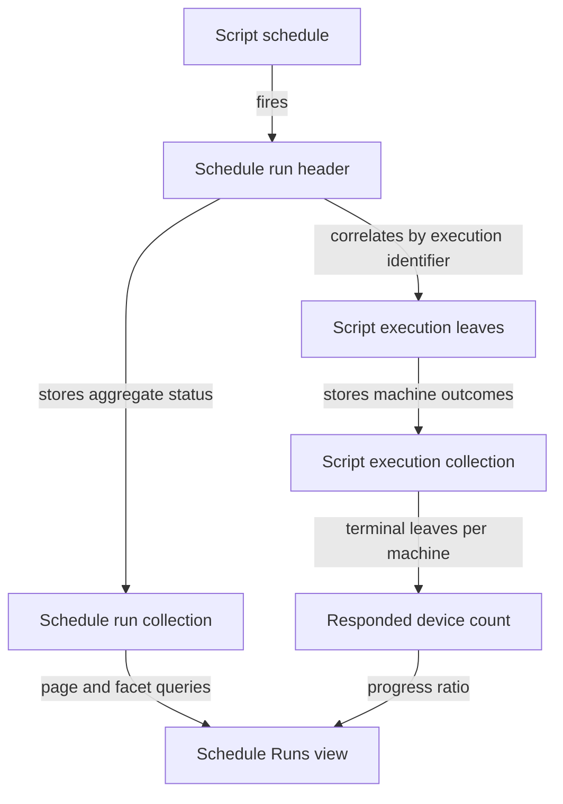
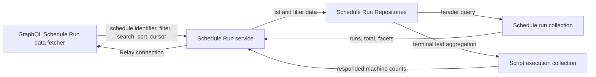
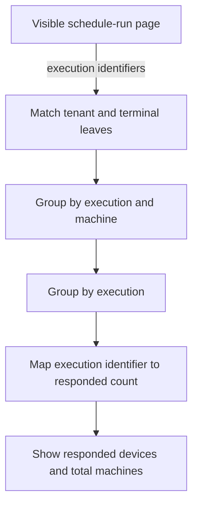
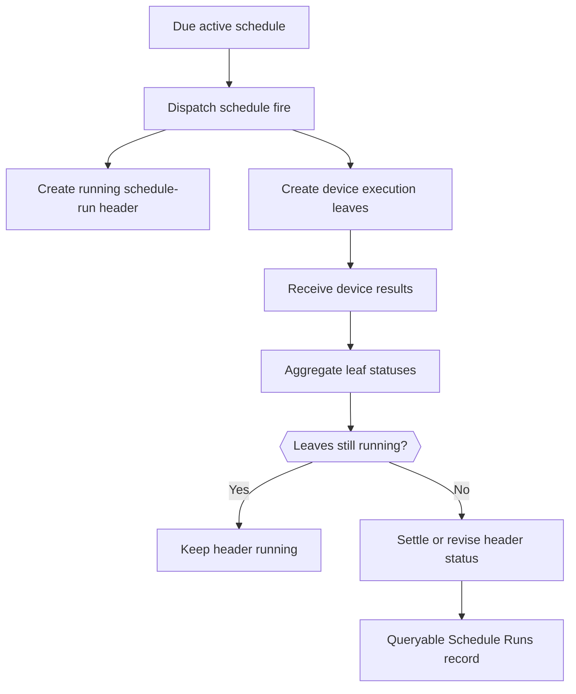

# Schedule Run Repositories

Schedule Run Repositories provide the MongoDB query layer behind the RMM Schedule Runs view. The module reads schedule-fire header records, applies tenant and schedule isolation, supports keyset pagination, computes page-level device-response progress, and produces filter-facet counts. It is implemented by the OpenFrame OSS Library artifact `com.openframe.oss:openframe-data-mongo-sync` version `7.0.11`, which this service assembles at runtime.

The implementation is deliberately separate from ordinary derived repository methods. Schedule Runs need cursor-aware ordering, search, grouped aggregation across execution leaves, and filter facets that are efficient for an entire page rather than one database request per displayed run.

## Responsibilities

The public `CustomScheduleScriptExecutionRepository` contract supplies five responsibilities:

- **Page retrieval:** returns one tenant-scoped page for one script schedule, with status, dispatch-time, and execution-identifier search constraints.
- **Sort and cursor support:** permits only the identifier and dispatch-time sort keys, identifies the default sort key, and encodes boundary cursors.
- **Filtered total:** counts all matching schedule fires without applying the cursor or page size.
- **Response progress:** counts distinct machines with at least one terminal execution leaf for each displayed schedule fire.
- **Facets:** returns value-to-count maps for status or initiator filter options while preserving the rest of the active query scope.

The library source is available in [the repository contract](https://github.com/flamingo-stack/openframe-oss-lib/blob/7a766f00e4f58b5d89db007b878ac8d6e0c344f4/openframe-data-mongo-sync/src/main/java/com/openframe/data/repository/rmm/CustomScheduleScriptExecutionRepository.java) and [its MongoTemplate implementation](https://github.com/flamingo-stack/openframe-oss-lib/blob/7a766f00e4f58b5d89db007b878ac8d6e0c344f4/openframe-data-mongo-sync/src/main/java/com/openframe/data/repository/rmm/CustomScheduleScriptExecutionRepositoryImpl.java).

## Data Model and Boundaries

A schedule fire is persisted as a `ScheduleScriptExecution` header in the schedule-run header collection. The header identifies the tenant, schedule, shared execution correlation identifier, initiator, aggregate status, total target-machine count, and dispatch and completion timestamps. Its tenant-and-execution-identifier pair is unique. Supporting indexes include tenant plus schedule plus dispatch time, and status plus dispatch time.

Per-machine and per-script work is represented separately by `ScriptExecution` leaf records. The header answers “what happened when this schedule fired?”; the leaves answer “which device executions have responded?” This division is important: the response ratio cannot be derived correctly from headers alone.

The header document type is defined by the library's [Schedule Script Execution model](https://github.com/flamingo-stack/openframe-oss-lib/blob/7a766f00e4f58b5d89db007b878ac8d6e0c344f4/openframe-data-mongo-common/src/main/java/com/openframe/data/document/rmm/schedule/ScheduleScriptExecution.java).

## Query Architecture

All header queries begin with exact `tenantId` and `scheduleId` criteria. If present, the filter adds an inclusive dispatch-time range and a set of acceptable statuses. Search is a case-insensitive literal substring match against the execution identifier: user input is quoted before becoming a regular expression, so search characters are not interpreted as regular-expression operators.

The repository uses `MongoTemplate` for both document queries and aggregation pipelines. This allows keyset predicates and grouped aggregation while keeping the data access layer responsible for tenant scoping and query construction.

The GraphQL data fetcher accepts a schedule Relay identifier, converts it to a raw script-schedule identifier, translates connection arguments into cursor-pagination criteria, and maps the service result to a counted connection. For initiator facets, it re-encodes raw user identifiers as Relay node identifiers. This behavior is implemented in the OpenFrame OSS Library [Schedule Run data fetcher](https://github.com/flamingo-stack/openframe-oss-lib/blob/7a766f00e4f58b5d89db007b878ac8d6e0c344f4/openframe-api-service-core/src/main/java/com/openframe/api/datafetcher/rmm/ScheduleRunDataFetcher.java).

## Cursor Pagination and Ordering

The default ordering is the Mongo identifier in descending order, which presents newest fires first. The only allowed sort keys are the Mongo identifier and dispatch time. An identifier sort needs one key. A dispatch-time sort is made deterministic by adding the identifier as a second key in the same direction.

For a forward query, the repository reads in the requested direction. For a backward query, it reverses the database direction so that it can read the adjacent page efficiently; higher layers can restore connection order. The requested limit is normally one greater than the visible page size, allowing the caller to determine whether another page exists without a separate existence query.

Cursor formats are specific to the active sort:

| Active sort | Cursor value | Boundary rule |
|---|---|---|
| Mongo identifier | Raw ObjectId hexadecimal value | Compare the identifier only. |
| Dispatch time | Epoch milliseconds, then a separator, then ObjectId | Compare dispatch time first, then identifier as a tie-breaker. |

A descending traversal treats a lower key as next, while ascending traversal treats a higher key as next. Invalid identifier values, missing compound separators, and invalid epoch values are rejected with a bad-request error rather than being silently accepted. Changing a cursor format or sort tie-breaker therefore requires coordinated updates to the API connection layer and clients that retain cursors.

## Page Progress Aggregation

For each returned header, the Schedule Runs view needs a count such as responded devices divided by total target devices. The repository obtains every page's numerators in one aggregation over the script-execution leaf collection:

1. Match leaf records by tenant and by the page's execution identifiers.
2. Exclude leaves still in the `RUNNING` status.
3. Group by execution identifier and machine identifier, collapsing multiple script leaves for the same machine.
4. Group by execution identifier again and count the distinct machines.

Runs without a terminal leaf do not appear in the aggregation output. Consumers must interpret a missing map entry as zero. A terminal leaf means that a device result has been received and processed; it does not merely indicate that the schedule was dispatched.

## Facets

The repository can group matching header rows into value-to-count maps for `status` and `initiatedBy`. Facets retain tenant, schedule, dispatch-time range, search text, and every filter except the filter for the field being grouped. For example, a status facet does not apply the active status selection, enabling the filter panel to show all statuses available in the current date and search scope. Null group values are omitted, so an absent initiator is not presented as a selectable facet.

## Schedule Execution Lifecycle

Schedule Run Repositories are read-oriented, but their records are produced and finalized by surrounding RMM services. The client-core schedule execution service finds active schedules whose next-run time is due, dispatches each fire, updates the last-run time, computes the following recurrence, and persists the schedule. The stream-side aggregator later counts leaf statuses and transitions a running header to its settled status only when no leaves remain in progress. If a late result changes the aggregate outcome, it can revise an already settled header.

## Operational Considerations

- Preserve the tenant predicate on every new query and aggregation stage. Schedule-run headers and execution leaves are both tenant-scoped.
- Preserve the compound dispatch-time and identifier cursor comparison. Removing the identifier tie-breaker creates duplicates or gaps when multiple fires share a timestamp.
- Keep progress aggregation page-scoped. Calling a per-run count method from a list resolver would create an N-plus-one query pattern.
- Treat terminal leaf results as the source of response progress and header status as the source of run-level state. These fields represent different aggregation levels.
- Validate any future sort field through `isSortableField` and use the default sort field if it is unsupported.
- Facet changes must continue to omit only their own filter arm. Applying the grouped field's selection would make alternative filter values disappear.

## Verification Focus

Repository tests and service-level tests should cover tenant separation, status and inclusive dispatch-time bounds, literal case-insensitive search, both sort modes, forward and backward traversal, malformed cursors, stable ordering where dispatch times tie, zero-response runs, distinct-machine counting across multiple leaves, null facet values, and self-excluding facet behavior.

The module contains no HTTP endpoint of its own. It is used beneath the schedule-run GraphQL query path and is part of the larger RMM scheduling, dispatch, result-processing, and execution-history workflow.
