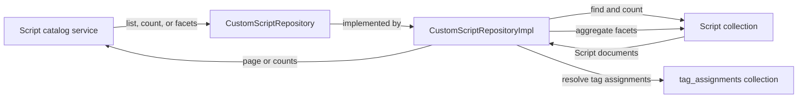
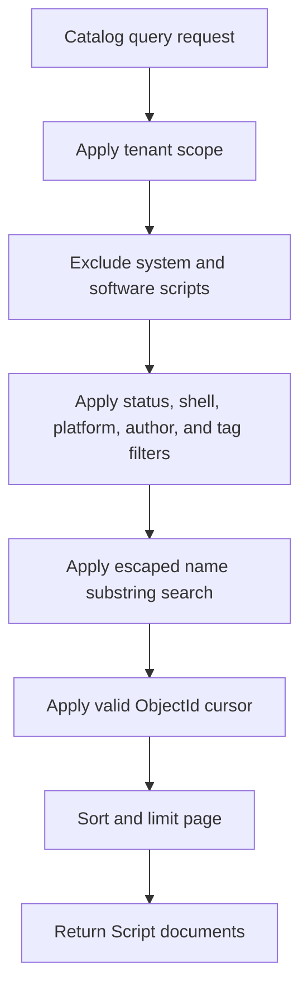
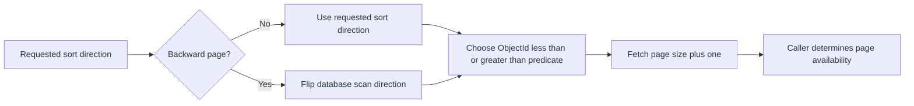
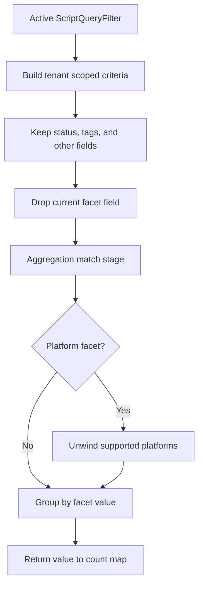
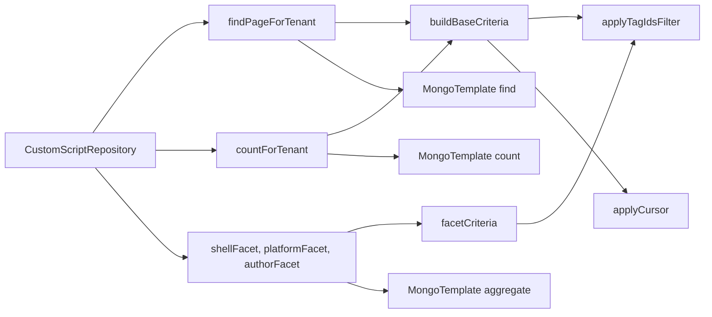

# Script Catalog Repositories

Script Catalog Repositories provides the MongoDB query layer for tenant-scoped script catalog listings. It extends the standard Spring Data repository capability with a MongoTemplate implementation that combines filtering, free-text name search, cursor pagination, sortable list queries, total counts, and filter-facet counts.

The module is supplied at runtime by the **OpenFrame OSS Library** artifact `com.openframe.oss:openframe-data-mongo-sync` version `7.0.11`. This repository assembles that library into its services; the implementation source is maintained in the library repository.

## Purpose and Scope

The module has two components:

| Component | Responsibility |
| --- | --- |
| [`CustomScriptRepository`](https://github.com/flamingo-stack/openframe-oss-lib/blob/7a766f00e4f58b5d89db007b878ac8d6e0c344f4/openframe-data-mongo-sync/src/main/java/com/openframe/data/repository/rmm/CustomScriptRepository.java) | Defines custom script-list queries, count queries, filter facets, and sorting metadata. |
| [`CustomScriptRepositoryImpl`](https://github.com/flamingo-stack/openframe-oss-lib/blob/7a766f00e4f58b5d89db007b878ac8d6e0c344f4/openframe-data-mongo-sync/src/main/java/com/openframe/data/repository/rmm/CustomScriptRepositoryImpl.java) | Implements the contract with `MongoTemplate`, `Criteria`, standard queries, and aggregation pipelines. |

It is deliberately focused on reading and shaping the script catalog. Script schedule storage, execution history, and schedule-run persistence are separate repository concerns. Higher layers own authorization, cursor encoding or decoding, result presentation, and mutation workflows; this module receives the already decoded raw cursor value and returns domain `Script` documents.

## Position in the System

The repository is part of the RMM policy and script persistence area. A script-facing application service supplies the active tenant, the optional `ScriptQueryFilter`, search text, sorting choices, and pagination direction. The custom repository applies those constraints directly to MongoDB and returns catalog records or aggregate counts.

### External Dependencies

`CustomScriptRepositoryImpl` relies on the following persistence model and framework facilities:

- **MongoTemplate** executes document queries and aggregation pipelines.
- **Script** is the catalog document being queried.
- **ScriptQueryFilter** carries optional status, shell, platform, tag, and creator constraints.
- **TagAssignment** supplies script identifiers for tag-based filtering. Only assignments whose entity type is `SCRIPT` participate.
- **ScriptStatus** controls the default exclusion of soft-deleted catalog entries.
- **ScriptType** prevents managed system and software scripts from appearing in this catalog query path.
- Spring Data `Sort.Direction` controls requested sort order and determines cursor comparison behavior.

## Query Contract

### List Pages

`findPageForTenant` fetches one page using a required tenant identifier and optional filters. The caller normally requests one more item than the visible page size, which permits it to determine whether another page exists without a separate probe.

The repository always begins with tenant scoping and then builds a shared predicate:

1. Require `tenantId` to equal the supplied tenant.
2. Exclude scripts with type `SYSTEM` or `SOFTWARE`.
3. Apply an explicit status list when provided. Otherwise, exclude `DELETED`; documents with no status are retained for compatibility with legacy data.
4. Optionally constrain shell, supported platform, creator identifier, and assigned tags.
5. Optionally perform a case-insensitive substring search against the script name.
6. Apply a valid raw Mongo `ObjectId` cursor when one is supplied.
7. Sort, limit, and map matching documents to `Script` values.

### Filter Semantics

| Filter input | MongoDB behavior |
| --- | --- |
| Statuses | Uses the supplied status set exactly. Without a non-empty set, scripts whose status is `DELETED` are excluded. |
| Shells | Matches scripts whose `shell` value belongs to the supplied set. |
| Supported platforms | Matches scripts whose `supportedPlatforms` array contains any supplied platform. |
| Creator identifiers | Matches scripts whose `createdBy` value belongs to the supplied set. |
| Tag identifiers | Reads matching `SCRIPT` entries from `tag_assignments`, collects valid assigned script IDs, and constrains script `_id` to that set. An empty resolved set matches no scripts. A null tag filter adds no constraint. |
| Search | Matches a trimmed, case-insensitive literal substring in `name`. User text is escaped with `Pattern.quote`, so it is not treated as a regular expression expression. |

The tag lookup is intentionally performed in the repository rather than delegated to a higher service. This makes tags a first-class part of the data-layer filter and keeps page, count, and facet semantics aligned.

### Sort and Cursor Rules

The sort allowlist contains only `_id`, `name`, `createdAt`, and `updatedAt`. `isSortableField` lets callers validate requested sort keys, while `getDefaultSortField` selects `_id` when no approved key is available.

Pagination uses the raw hexadecimal `ObjectId` of the boundary script. The implementation converts the raw cursor to BSON `ObjectId` before comparing it to `_id`; comparing a string to a BSON identifier would not give the intended MongoDB type-aware result. Invalid, blank, or absent cursors do not fail the query: invalid values are logged and treated as the first page.

| Requested traversal | Cursor predicate |
| --- | --- |
| Forward with descending sort | `_id` is less than the cursor |
| Forward with ascending sort | `_id` is greater than the cursor |
| Backward with descending sort | `_id` is greater than the cursor |
| Backward with ascending sort | `_id` is less than the cursor |

For backward traversal, the database scan direction is flipped relative to the requested sort direction. The returned rows therefore represent items immediately newer than the boundary; the caller reverses the returned list for display when its connection model requires normal display order.

## Count and Facet Queries

### Matching Count

`countForTenant` uses the same tenant, managed-script, filter, tag, and search predicate as a page query but omits cursor, ordering, and limit. It returns the complete matching total, allowing a UI to report a filtered count while catalog items load incrementally.

### Faceted Filters

The module exposes three facet methods:

| Method | Grouping value | Special handling |
| --- | --- | --- |
| `shellFacet` | `shell` | Counts each non-null shell value. |
| `platformFacet` | `supportedPlatforms` | Unwinds the platform array before grouping, so every platform receives an independent count. |
| `authorFacet` | `createdBy` | Counts non-null creator identifiers; an upper layer resolves identifiers to user labels. |

Each facet retains the tenant restriction, managed-script shield, status behavior, tag filter, and all **other** applicable filters. It omits only its own filter field. For example, a shell facet honors selected platforms and authors but does not restrict to the currently selected shells. This keeps the filter control able to present every available alternative and its count.

Null grouping values are omitted from facet results. This avoids presenting an unusable blank option for legacy records that lack a field such as `createdBy`.

## Component Interaction

The public interface establishes the data operations available to consumers. The implementation centralizes predicate construction to ensure a page request and a matching-count request cannot unintentionally diverge. Facets use a closely related predicate builder that explicitly removes the grouped field while retaining the rest of the active state.

## Operational and Maintenance Notes

- **Tenant isolation is mandatory.** Every standard page, count, and facet criterion starts with the tenant identifier. New query methods should preserve that pattern rather than accepting an unscoped query.
- **Keep predicates consistent.** Add a catalog filter to `buildBaseCriteria` and, where appropriate, to `facetCriteria`. If the field has a facet, exclude only that field from its own facet criterion.
- **Do not bypass the managed-script shield.** Catalog queries exclude `SYSTEM` and `SOFTWARE` script types independently of caller-provided status filters.
- **Treat cursor data as Mongo identity data.** Cursor values must be validated and converted to `ObjectId` before `_id` comparisons. The current fallback behavior favors a safe first page over exposing a server error for an opaque invalid cursor.
- **Preserve literal search behavior.** Escape user search text before creating a regular expression to prevent regex metacharacters from changing the query.
- **Account for tag query cost.** A tag-constrained request first resolves assigned script IDs from `tag_assignments` and then performs the script query. Maintain this two-step tenant-safe behavior if the tag model changes.
- **Preserve the page-plus-one convention.** The repository does not calculate page metadata. Consumers request an additional row and own trimming that row, encoding cursors, and exposing pagination flags.

## System Relationships

Script catalog records are a foundation for adjacent RMM workflows. Schedule repositories associate scripts with timed execution, execution repositories retain script outcomes, and application services use the selected catalog record to prepare delivery and execution. This module does not create schedules, dispatch commands, or execute scripts; it supplies the filterable catalog view that those workflows begin from.

The broader tenant deployment provides MongoDB as the shared document datasource. The data layer is assembled from the OpenFrame OSS Library while the tenant services provide runtime configuration and application composition.
