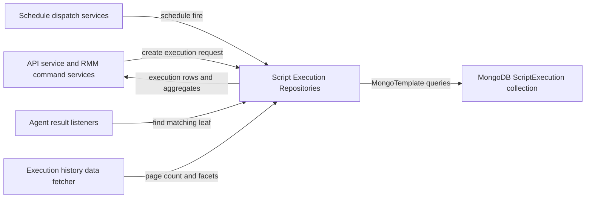
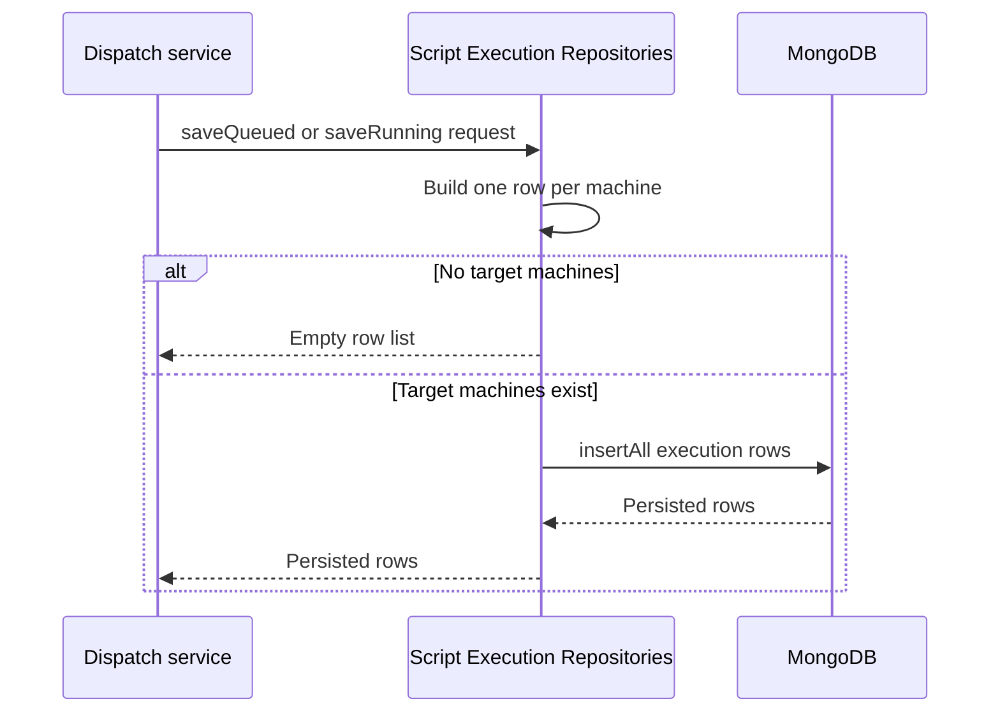
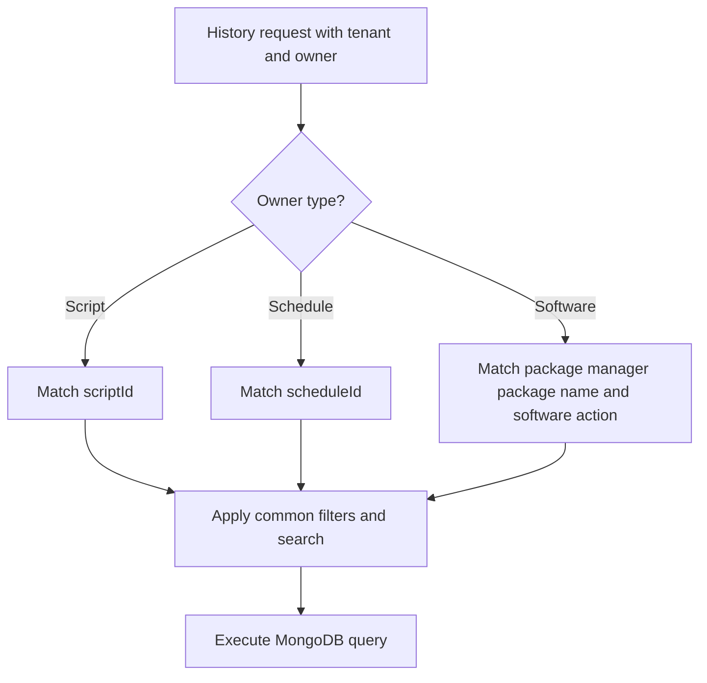
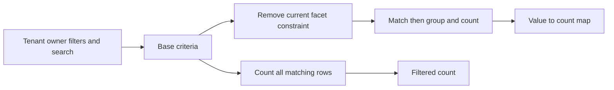
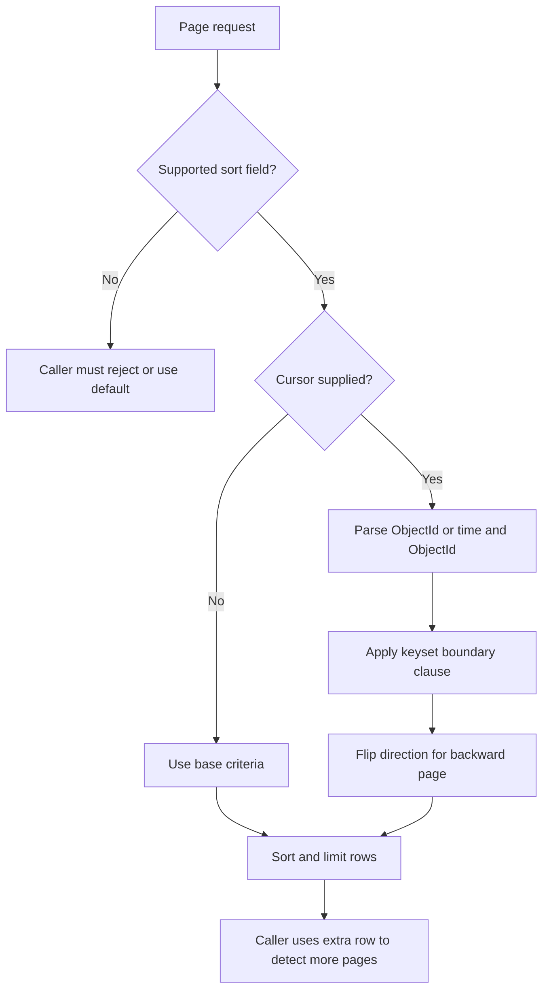
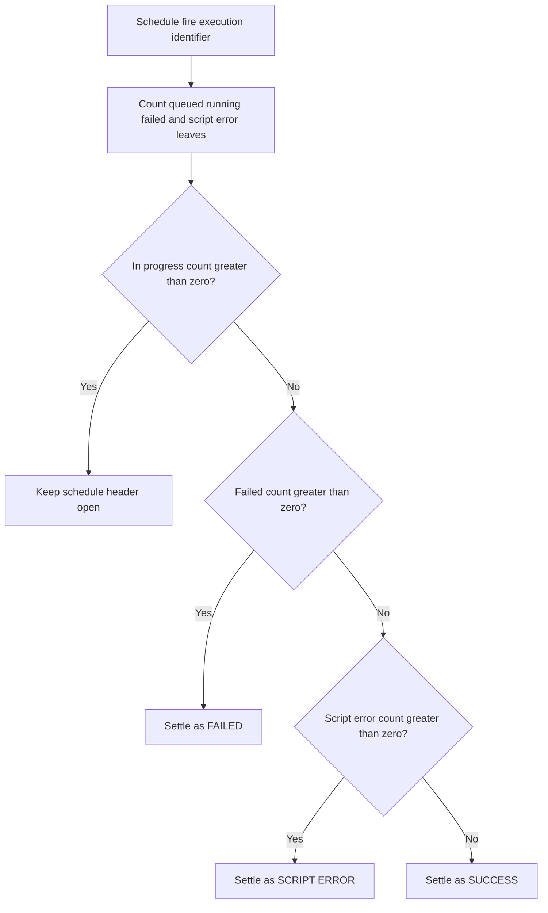

# Script Execution Repositories

Script Execution Repositories is the MongoDB query boundary for Remote Monitoring and Management script-execution records. It is supplied at runtime by the OpenFrame OSS Library artifact `com.openframe.oss:openframe-data-mongo-sync` version `7.0.11`, which this tenant service consumes. The module owns persistence-oriented operations for creating one execution row per target machine, resolving execution rows that report results, listing execution history, calculating filter facets, and determining the aggregate outcome of a scheduled execution.

The public contract is [`CustomScriptExecutionRepository`](https://github.com/flamingo-stack/openframe-oss-lib/blob/7a766f00e4f58b5d89db007b878ac8d6e0c344f4/openframe-data-mongo-sync/src/main/java/com/openframe/data/repository/rmm/CustomScriptExecutionRepository.java). Its MongoTemplate implementation is [`CustomScriptExecutionRepositoryImpl`](https://github.com/flamingo-stack/openframe-oss-lib/blob/7a766f00e4f58b5d89db007b878ac8d6e0c344f4/openframe-data-mongo-sync/src/main/java/com/openframe/data/repository/rmm/CustomScriptExecutionRepositoryImpl.java).

## Responsibilities

The repository separates MongoDB-specific query construction from higher-level RMM services and GraphQL-facing code. Its responsibilities are:

- Insert a leaf `ScriptExecution` row for every target machine when work is queued or begins running.
- Look up rows by the machine, execution, and script identifiers when processing a machine result.
- Enforce tenant scope for history, count, facet, and schedule-leaf aggregation operations.
- Restrict history to an owner scope: a script, a script schedule, or software-action identity.
- Apply optional status, initiator, machine, source, test-run, dispatch-time, and text-search constraints.
- Provide deterministic keyset pagination and a cursor encoding suitable for an opaque API cursor layer.
- Calculate selectable history-filter values and their matching counts.
- Summarize leaf state for a schedule fire so its header can remain open while work is queued or running, then settle to an execution status.

## Position in the Execution Lifecycle

A script or software action targeting multiple devices is represented by multiple leaf rows that share an execution identifier. Each leaf has its own machine identifier and lifecycle status. This design lets the platform render machine-level outcomes while computing a single schedule-run outcome from its leaves.

The repository is part of the RMM policy and script repositories grouping. Neighboring modules handle script definitions, schedules, and schedule-run records. This module specifically handles the per-device execution rows rather than the script catalog or schedule configuration.

## Components

| Component | Role |
|---|---|
| `CustomScriptExecutionRepository` | Public persistence contract. It defines creation, targeted lookup, paginated history, count, facets, cursor handling, and leaf-status aggregation. |
| `CustomScriptExecutionRepositoryImpl` | Spring `@Repository` implementation backed by `MongoTemplate`. It composes `Criteria`, `Query`, sorting, and aggregation pipelines. |
| `LeafStatusCounts` | Value record containing in-progress, failed, and script-error leaf counts. Its `settledStatus()` gives failure precedence over script error, then success. |
| `ExecutionOwnerScope` | Input model that identifies the execution-history owner. Script and schedule scopes resolve to their identifiers; software scope resolves by package manager, package name, and software action. |
| `ScriptExecutionQueryFilter` | Optional filter model for status, initiator, machine, excluded source, test-run exclusion, and inclusive dispatch-time bounds. |
| `ExecutionFacetField` | Selects the status, initiator, or machine field grouped by `facet()`. |

## Write and Result Lookup Operations

### Creating leaf rows

`saveQueued()` and `saveRunning()` delegate to one private write path, differing only in the initial status. For every machine in `RunningExecutionRows.machineIds`, the implementation builds a `ScriptExecution` record with shared dispatch metadata and a per-machine identifier, then calls `MongoTemplate.insertAll`.

Persisted metadata includes tenant, execution, script and optional schedule identifiers; privilege level; timeout; initiator; source; package and software-action fields; optional software bundle, software schedule, and package-update identifiers; and the test-run marker. `dispatchedAt` and `statusChangedAt` receive the same current instant. An empty target-machine collection produces no database write and returns an empty list.

### Resolving a reporting leaf

Two primary-read lookups support result processing:

- `findByMachineIdAndExecutionIdAndScriptId()` returns a single optional row for an exact machine, execution, and script tuple.
- `findByMachineIdAndExecutionIdAndScriptIdIn()` resolves all matching rows when a result can apply to one of several script identifiers. It short-circuits to an empty list when the script identifier collection is absent or empty.

Both use MongoDB primary read preference, which avoids reading a replica that has not yet observed the dispatched row when an agent result arrives soon after creation. These point lookups do not include tenant criteria; callers must therefore pass trustworthy identifiers and apply tenant authorization before invoking them.

## History Queries

### Base predicate and filters

Every history operation begins with a required `tenantId` and owner scope. The repository adds filters only when their collections or values are populated:

| Input | MongoDB constraint | Facet behavior |
|---|---|---|
| Owner | Script identifier, schedule identifier, or software identity triplet | Always applied |
| Excluded sources | Source is not in the provided values | Always applied |
| Exclude test runs | Test-run flag is not true | Always applied |
| Statuses | Status is in the selected values | Omitted only for the status facet |
| Initiators | Initiator is in the selected identifiers | Omitted only for the initiator facet |
| Machines | Machine is in the selected identifiers | Omitted only for the machine facet |
| Dispatch range | Inclusive `dispatchedAt` lower and upper bounds | Always applied |
| Search text | Case-insensitive literal substring search | Always applied |

Search is performed as a literal, quoted regular expression across execution identifier, machine identifier, standard output, and standard error. Quoting prevents user-supplied regular-expression syntax from changing the search expression; it remains a substring match rather than a caller-defined regex.

When a dispatch range is present, the implementation combines it with the rest of the predicate using an `andOperator`. This avoids collisions if another constraint subsequently targets the same MongoDB field.

### Owner scopes

### Count and facets

`count()` applies the complete base predicate and search expression, but not pagination. The result backs a full filtered total for a connection while its items are loaded incrementally.

`facet()` groups matching rows by one supported facet field: status, initiator, or machine. It deliberately excludes the filter for the field currently being faceted. For example, the status facet retains the selected machine and initiator constraints but does not constrain itself to already-selected statuses. This preserves options that a user can switch to without clearing other filters. Rows lacking a grouped value are omitted from the output map, such as rows with no initiator.

## Keyset Pagination

`findPage()` uses cursor-based pagination rather than offset pagination. It applies the history predicate, then adds a cursor clause, search predicate, sort specification, and a caller-provided limit. Callers conventionally request one more record than the visible page size to determine whether another page exists.

Only `_id`, `dispatchedAt`, `finishedAt`, and `statusChangedAt` are sortable. `_id` is the default. For temporal sort fields, `_id` is appended as a tie breaker, producing a stable order when timestamps match.

### Cursor formats

| Sort field | Encoded cursor boundary |
|---|---|
| `_id` | ObjectId hexadecimal value |
| `dispatchedAt`, `finishedAt`, or `statusChangedAt` | Epoch milliseconds, a pipe separator, and ObjectId hexadecimal value |
| Null temporal value | Empty value before the pipe, followed by ObjectId hexadecimal value |

The API layer may base64-encode this raw value for transport. The repository expects the raw value after decoding. Invalid ObjectIds, missing compound separators, and invalid temporal values fail with a bad-request exception rather than silently falling back to a first-page query.

For forward paging, rows after the boundary are read in the requested order. For backward paging, the sort direction is flipped and the cursor comparison is inverted; callers reverse the returned records before display. The cursor logic explicitly accounts for MongoDB ordering of null temporal values and applies the ObjectId tie breaker for equal timestamps.

## Schedule-Run Aggregation

`countLeavesByStatus()` summarizes all leaf rows for one tenant and execution identifier. It reads queued and running leaf counts into `inProgress`, failed leaf counts into `failed`, and script-error leaf counts into `scriptErrors`. The implementation performs these status counts as primary-read MongoDB count queries. A null tenant or execution identifier returns zero counts without querying MongoDB.

`LeafStatusCounts.settledStatus()` encodes outcome precedence:

1. Any failed leaf produces `FAILED`.
2. Otherwise, any script-error leaf produces `SCRIPT_ERROR`.
3. Otherwise, the settled outcome is `SUCCESS`.

The schedule header should not settle while `inProgress` is greater than zero. Consequently, queued leaves count as in progress as well as running leaves.

## Operational and Maintenance Notes

- Tenant-scoped history queries must always receive a non-null tenant identifier. The repository does not add a fallback tenant scope.
- Extend `SORTABLE_FIELDS`, cursor extraction, and cursor predicate behavior together when introducing another sort field. Adding a field to only one of these locations can yield invalid pagination or a null cursor value.
- Any new facet requires updates to the facet-field mapping and base-criteria exclusion rules. The current semantics intentionally remove only the facet's own selected filter.
- Preserve ObjectId as a secondary temporal sort key. It is required to avoid skipped or duplicated rows when multiple executions have the same timestamp.
- Keep status transitions and result mutation outside this repository unless the persistence contract is intentionally expanded. This module creates initial rows, finds them, and queries their stored state.
- Primary read preference is explicitly used for result-correlation and schedule-leaf count paths, where immediately consistent reads matter after writes or status transitions.

## Integration Boundaries

Script Execution Repositories is library code assembled into the tenant's services through the `openframe-data-mongo-sync` dependency. It persists `ScriptExecution` documents and consumes execution filter, owner-scope, status, and row-request models supplied by the same broader domain layer. The API service's execution data fetcher and RMM result processing layers consume the repository's outputs, while agent dispatch and scheduled execution components create the leaf rows it manages.

The repository contains no HTTP routes and does not publish messages itself. It is a synchronous database access layer; message delivery, agent execution, scheduling, API authorization, and user-facing cursor encoding remain responsibilities of surrounding modules.
