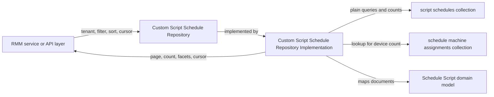
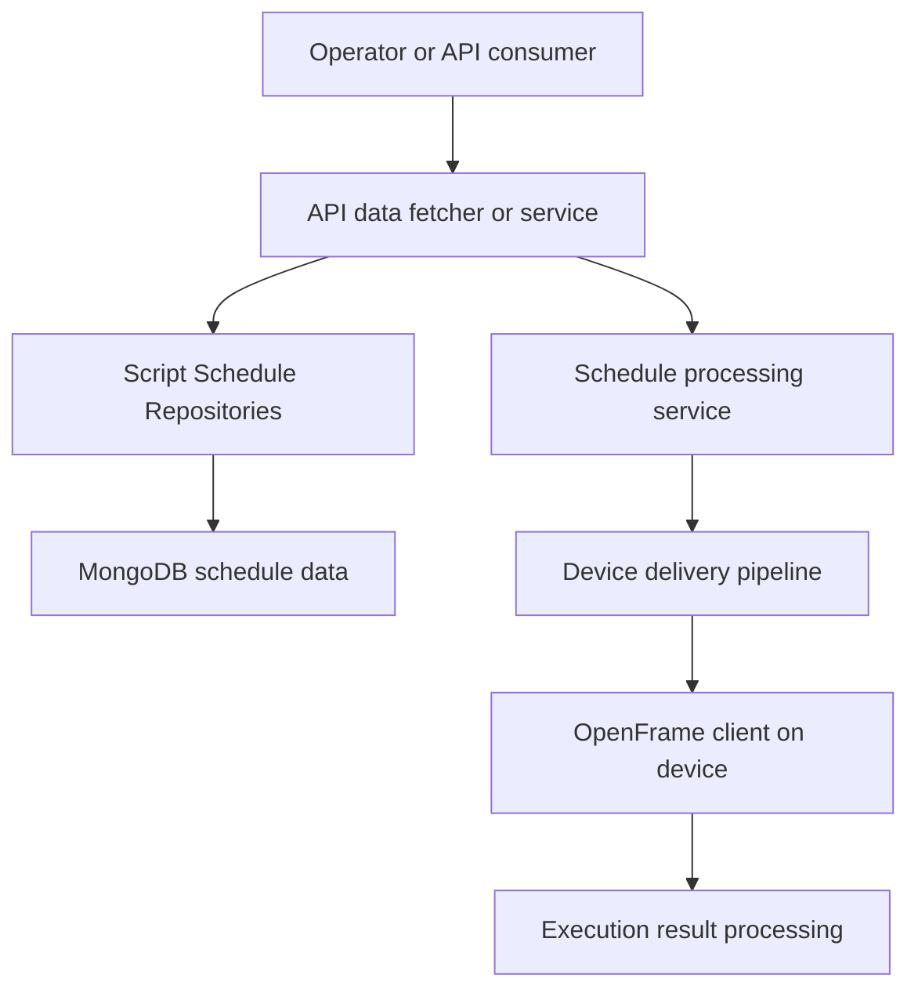
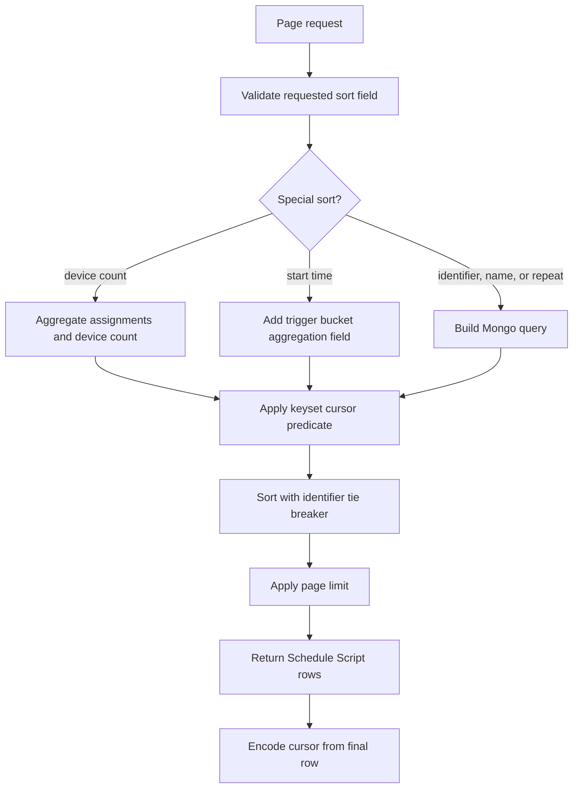
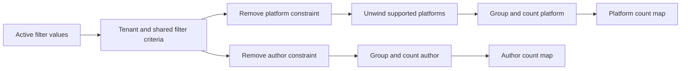

# Script Schedule Repositories

Script Schedule Repositories provides the MongoDB query layer for Remote Monitoring and Management script schedules. It is implemented by the `openframe-data-mongo-sync` library from OpenFrame OSS Library, consumed by this service at version `7.0.11`. The module exposes tenant-bounded schedule listing, counts, filter facets, sort validation, and keyset pagination over `ScheduleScript` records.

The public [Custom Script Schedule Repository interface](https://github.com/flamingo-stack/openframe-oss-lib/blob/7a766f00e4f58b5d89db007b878ac8d6e0c344f4/openframe-data-mongo-sync/src/main/java/com/openframe/data/repository/rmm/CustomScriptScheduleRepository.java) separates repository consumers from the MongoTemplate query construction in the [Custom Script Schedule Repository implementation](https://github.com/flamingo-stack/openframe-oss-lib/blob/7a766f00e4f58b5d89db007b878ac8d6e0c344f4/openframe-data-mongo-sync/src/main/java/com/openframe/data/repository/rmm/CustomScriptScheduleRepositoryImpl.java).

## Responsibilities

The module supports schedule-browser and scheduling workflows by:

- constraining every list, count, and facet operation to a supplied tenant identifier;
- applying schedule status, supported-platform, author, start-time-window, and case-insensitive name-search criteria;
- hiding soft-deleted schedules unless statuses are explicitly requested;
- returning stable pages for approved sort fields;
- deriving device assignment counts from the schedule-to-machine assignment collection when requested for sorting;
- exposing platform and author counts that can populate filter controls; and
- producing raw cursors that callers can preserve or encode for subsequent page requests.

It does not create, modify, dispatch, or execute schedules. Those activities belong to higher-level RMM services, schedulers, delivery processing, and the endpoint client.

## Public Contract

| Operation | Purpose | Important behavior |
|---|---|---|
| `findPageForTenant` | Retrieves one filtered, sorted page. | Uses keyset pagination, not offset pagination. The `backward` flag reverses traversal from the active cursor. |
| `countForTenant` | Counts schedules matching the list predicate. | Includes the active search term and the default soft-delete exclusion. |
| `platformFacet` | Counts matching schedules by supported platform. | Unwinds the platform array before grouping. The selected platform constraint itself is omitted. |
| `authorFacet` | Counts matching schedules by creator. | Groups by creator without an array unwind. The selected author constraint itself is omitted. |
| `isSortableField` | Validates a requested sort field. | Only identifier, name, start time, repeat interval, and computed device count are accepted. |
| `getDefaultSortField` | Supplies the fallback order. | Returns identifier order; callers choose the direction. |
| `encodeCursor` | Builds the repository's pre-encoding cursor payload. | Its format depends on the active sort and must be paired with that same sort on the next request. |

## Architecture and Dependencies

The implementation is a Spring `@Repository` with an injected `MongoTemplate`. Its primary collection is `script_schedules`; computed device-count ordering additionally joins `script_schedules_machines_assigned`. The repository reads `ScheduleScript`, its query-filter model, assignment records, schedule triggers, and script statuses from the shared data model.

The module fits into the broader script-scheduling path as a read/query component. A schedule service or data fetcher can request schedules and their filter metadata, while scheduling and delivery components independently decide when a stored schedule fires and publish work to devices.

## Shared Predicate Model

`buildBaseCriteria` is the common predicate constructor used by both page retrieval and counting. This keeps the visible list and its total consistent.

1. **Tenant boundary:** every query starts with an exact `tenantId` match.
2. **Status:** an explicit non-empty status filter is honored. Without one, records whose status is `DELETED` are excluded; the not-equal predicate also retains legacy records whose status is absent.
3. **Platforms:** an explicit platform set matches schedules whose supported-platform array contains one of the supplied values.
4. **Authors:** an explicit creator identifier set narrows the result.
5. **Start time:** supplied lower and upper bounds are inclusive. Device-online schedules have no start time, so a time window naturally excludes them.
6. **Search:** a nonblank search term is trimmed, quoted as literal regular-expression text, and matched case-insensitively against the schedule name.

Facet predicates intentionally differ from the list predicate in two ways: they do not apply text search, and each facet omits its own constraint. For example, a platform facet retains the current status, author, and time constraints but removes the selected-platform constraint. This lets a filter picker show values that can be switched to, rather than only the values already selected.

## Sorts and Stable Pagination

The supported sort fields are `id`, `name`, `startAt`, `repeat`, and `deviceCount`; the underlying Mongo identifier is represented as `_id` in repository queries. Pagination is keyset-based, so the cursor represents the last row seen in the active order. This avoids the shifting and increasing scan cost associated with offset paging.

For ordinary identifier, name, and repeat sorts, the repository sorts by the requested value and then by `_id` in the same direction. The compound key is essential because names and repeat intervals are not unique. A cursor over only `_id` could skip or duplicate schedules at a shared primary sort value.

### Cursor Shapes

| Sort | Cursor payload | Reason |
|---|---|---|
| Identifier | `id` | The identifier is the complete key. |
| Name or repeat interval | `value|id` | Adds the identifier tie-breaker to a repeatable sort value. |
| Start time | `triggerBucket|milliseconds|id` | Preserves the special position of device-online schedules and handles missing start times. |
| Device count | `count|id` | Preserves ordering after the assignment-count aggregation. |

An empty value portion denotes a null sort value where applicable. The implementation locates compound cursor separators from the right, allowing a schedule name itself to contain the separator. Malformed identifiers, missing separators, or unparsable values are logged and treated as no cursor, causing the query to return the first page rather than failing the repository operation.

### Null and Direction Handling

MongoDB range comparisons do not naturally traverse null values as needed for a stable mixed-value sort. The compound cursor logic therefore explicitly continues a null group by identifier and adds the remaining non-null or null tail depending on direction. This preserves continuity when sort data is incomplete.

Backward pagination flips the effective primary sort direction before constructing cursor comparisons. For `startAt`, the implementation also creates a trigger bucket: ordinary time-based schedules are bucket `0`, while `DEVICE_ONLINE` schedules are bucket `1`. In forward traversal the online-trigger bucket follows the time-based bucket; backward traversal reverses the bucket traversal so it remains the exact inverse path.

## Aggregated Sort Paths

### Device Count

Device count is not stored directly on each schedule. The repository uses an aggregation pipeline that:

1. matches the shared tenant and filter predicate;
2. performs a correlated lookup into the assignments collection using both tenant identifier and schedule identifier;
3. adds `deviceCount` as the size of the matched assignment array;
4. applies the compound device-count cursor predicate;
5. sorts by computed count and identifier; and
6. limits and maps each aggregation document back to `ScheduleScript`.

The same count is recomputed for cursor construction when the caller asks for a device-count cursor. This ensures that the emitted cursor uses the value that defines the aggregate order.

### Start Time

Start-time ordering uses an aggregation pipeline because schedules triggered when a device comes online have no `startAt` value and must appear as a deliberate terminal group during forward traversal. The pipeline adds the transient trigger-bucket field, applies the three-part cursor predicate, then orders by bucket, start time, and identifier.

## Facet Data Flow

Null facet values are excluded from the returned maps. The maps preserve aggregation-result iteration order through `LinkedHashMap`; consumers should not infer a documented semantic ordering from that implementation detail.

## Operational Guarantees and Limits

- **Tenant isolation at query construction:** each exposed operation starts from the supplied tenant identifier. Callers must still provide the tenant context correctly.
- **Stable sort order:** identifier tie-breakers make equal primary values deterministic.
- **Soft deletion by default:** deleted schedules are hidden only when the caller does not explicitly provide statuses.
- **Bounded page work:** all page paths apply the requested limit after their filter and cursor stages.
- **Recoverable cursor errors:** invalid cursors are logged and reset to first-page behavior. A caller that needs to distinguish an invalid cursor from a genuine first-page request must validate it before invoking this repository.
- **Search scope:** name search is literal and case-insensitive; it is not full-text search.
- **Facet scope:** facets intentionally do not include the text search term, so their counts are filter-context counts rather than search-result counts.

## Maintenance Guidance

When adding a filter, apply it consistently to the shared list/count predicate and decide whether each facet should retain or omit it. When adding a sortable field, update all of the following together:

1. the sortable-field allowlist;
2. page-query or aggregation selection;
3. deterministic sort and keyset predicate logic;
4. sort-value parsing and cursor encoding; and
5. null-order and backward-navigation behavior.

A sort field with duplicate values must include a deterministic identifier tie-breaker. A computed sort value may require an aggregation pipeline and must use the same value both when retrieving rows and when encoding the final row's cursor. Changes to the assignment lookup must retain both tenant and schedule identifiers in its join condition to avoid cross-tenant counts.

The code graph records integration-test support applications that import the implementation, but it does not record direct consumers of the repository interface or implementation. Treat the public interface and cursor formats as internal library contracts that still require compatibility review before changing behavior.
