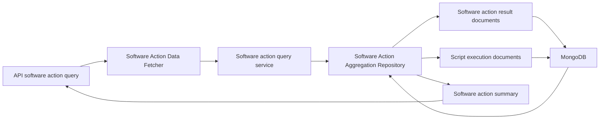
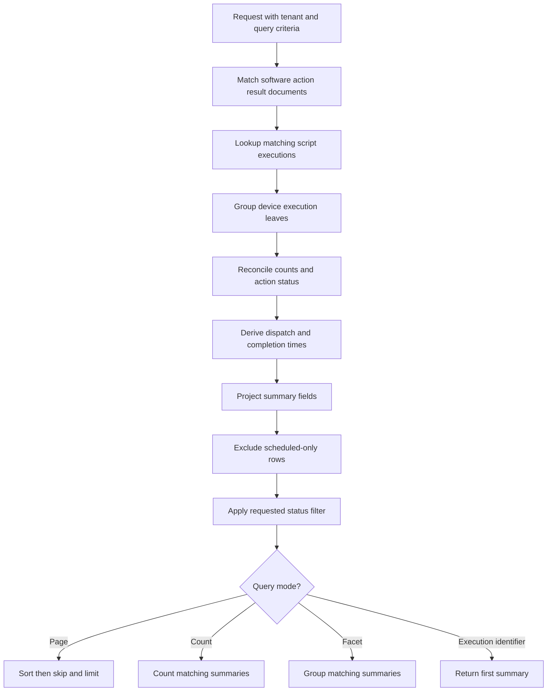
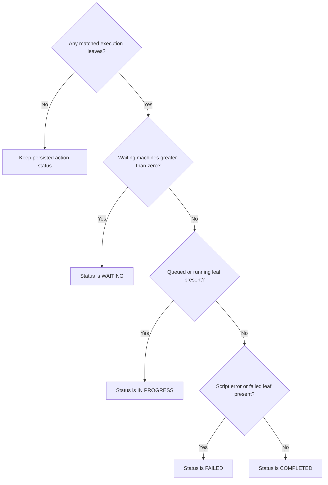
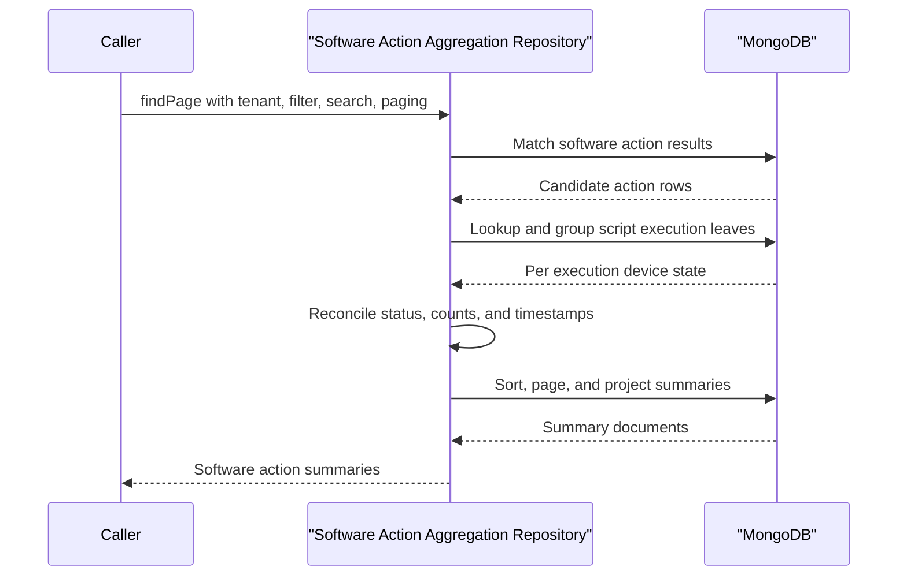

# Software Action Aggregation Repository

Software Action Aggregation Repository is the MongoDB read-model adapter for Remote Monitoring and Management software-action history. It converts persisted software-action result rows and their per-device script-execution leaves into one `SoftwareActionSummary` per execution. The summary is suitable for paginated history views because it provides reconciled action state, participating-machine counts, timestamps, package metadata, and dispatch provenance without requiring callers to perform their own joins.

The implementation is supplied by the OpenFrame OSS Library through the `com.openframe.oss:openframe-data-mongo-sync` artifact. This tenant repository assembles that artifact at version `7.0.11`. Its source is [Software Action Aggregation Repository Implementation](https://github.com/flamingo-stack/openframe-oss-lib/blob/7a766f00e4f58b5d89db007b878ac8d6e0c344f4/openframe-data-mongo-sync/src/main/java/com/openframe/data/repository/rmm/SoftwareActionAggregationRepositoryImpl.java).

## Responsibilities

- Scope every query to an explicit tenant identifier.
- Build a MongoDB aggregation that joins a software-action result with matching script-execution leaves by tenant and execution identifiers.
- Reconcile device-level execution state into waiting, in-progress, failed, or completed action status.
- Supply page retrieval, total counts, facet counts, and single-execution lookup through the repository interface.
- Apply action, kind, package-manager, status, and package-name filters.
- Restrict sorting to an allowlist and provide deterministic pagination.

The repository does not execute packages or dispatch commands. It is a read-side component: action production, delivery, and per-device execution persist data elsewhere; this module derives the aggregate view from that data.

## Position in the Remote Monitoring and Management Read Path

`SoftwareActionAggregationRepositoryImpl` is a Spring `@Repository` backed by `MongoTemplate`. It aggregates from the `SoftwareActionResult` mapping and performs a pipeline lookup against the script-execution collection. The associated API layer includes `SoftwareActionDataFetcher`, while the broader RMM repository group includes the verified [RMM Policy and Script Repositories](rmm-policy-and-script-repositories.md) overview and related [Script Execution Repositories](script_execution_repositories.md).

## Public Query Contract

The implementation fulfills the aggregation repository contract with the following operations.

| Operation | Purpose | Result |
|---|---|---|
| `findPage` | Runs the shared reconciliation pipeline, sorts, skips, and limits rows. | A list of `SoftwareActionSummary` values. |
| `count` | Runs the same eligible-row pipeline and counts output documents. | The total number of matching action summaries. |
| `facet` | Groups matching output rows by a requested field. | A map of non-null field values to counts. |
| `findByExecutionId` | Finds and reconciles one execution within one tenant. | An optional summary. |
| `isSortableField` | Validates a requested sort property against the repository allowlist. | Whether the property is sortable. |
| `getDefaultSortField` | Identifies the fallback sort property. | `dispatchedAt`. |

### Summary Shape

The projection deliberately exposes a compact history row:

| Field group | Projected values |
|---|---|
| Identity | Execution identifier |
| Package action | Package manager, package name, version, action, and kind |
| Origin | Initiator, bundle identifier, and schedule identifier |
| Timing | Dispatch and completion timestamps |
| Scope and progress | Total, responded, and waiting machine counts plus aggregate status |

The repository maps package manager, action, kind, and status strings back to their corresponding enum values. Numeric values that are absent or not numeric are represented as zero, and absent timestamps remain null.

## Aggregation Architecture

### Base Match

The first stage always matches `tenantId`. It may additionally constrain:

- **Action:** requested `SoftwareAction` enum names.
- **Kind:** requested `SoftwareActionKind` names. For legacy rows without `kind`, the action value is also tested so older records remain discoverable.
- **Engine:** requested package-manager enum names.
- **Search:** a case-insensitive literal regular expression against `packageName`. User input is trimmed and escaped with `Pattern.quote`, so search text is treated as text rather than an executable regular expression.

### Leaf Lookup and Device Counting

The lookup is correlated by both execution identifier and tenant identifier. It includes only script-execution documents that contain a non-null software-action marker. The nested aggregation groups those leaves and collects:

- distinct machines with a terminal success, script error, or failure response;
- distinct machines whose execution is running and marked as waiting;
- whether any leaf is queued or running;
- whether any leaf is unsuccessful;
- the earliest leaf dispatch time and latest leaf completion time; and
- the number of matched leaf records.

The device sets are built with `$addToSet` and cleaned with `$setDifference` before measuring size. Consequently, non-matching conditional branches do not inflate responded or waiting machine counts, and repeated leaves for the same machine count once.

## Status Reconciliation

The result row supplies the baseline state when no matching execution leaves exist. When at least one leaf exists, leaf data wins and is evaluated in this precedence order:

This ordering intentionally gives waiting devices priority over otherwise active or failed leaves. A mixed action can therefore remain `WAITING` while a device is waiting, even if another device has reported a failure.

Completion time is set only for reconciled `COMPLETED` or `FAILED` actions; it uses the maximum leaf `finishedAt`. Dispatch time uses the stored result value when present, otherwise it uses the minimum dispatch time among matching device leaves. That fallback supports scheduled actions whose result row is written before a device dispatch occurs.

Rows whose final status is `SCHEDULED` are excluded from normal page, count, and facet queries. If a status filter includes only `SCHEDULED`, no rows can satisfy it because scheduled rows have already been removed.

## Pagination, Sorting, and Facets

The allowed sort fields are `dispatchedAt`, `status`, `packageName`, and `totalMachineCount`. Any other requested field falls back to `dispatchedAt`. The page pipeline adds `executionId` in ascending order as a secondary key, ensuring a stable order among rows equal on the primary property. Negative skip values are converted to zero before the pipeline is run.

Facet queries run after status reconciliation and scheduled-row removal. They group by the caller-supplied field and return only non-null group keys. Since field validation is not performed by `facet`, callers should expose facets only for known projected fields.

## Data Flow

## Operational and Maintenance Notes

- **Tenant isolation:** Keep tenant matching in every new aggregation entry point. The lookup already correlates tenant identifiers as well as execution identifiers, preventing cross-tenant leaf association.
- **State semantics:** Update the terminal, unsuccessful, and in-progress status lists together when `ExecutionStatus` gains or changes values. The reconciliation precedence determines user-visible action history.
- **Projection discipline:** Fields used for filtering after projection, sorting, or faceting must remain in `projectDoc`.
- **Index planning:** The primary result match uses tenant identifier and may use action, kind, package manager, and package name. The lookup matches script executions by tenant identifier and execution identifier, then inspects the software-action marker and status. MongoDB indexes should be evaluated against these predicates and production query patterns.
- **Legacy compatibility:** The kind fallback is intentional. Removing it would hide historic records that stored only the action field.
- **Testing focus:** Test zero leaf, waiting, in-progress, failed, and completed cases; duplicate leaves for one machine; absent result dispatch time; invalid sort input; and tenant collisions using the same execution identifier. The platform test suite includes a software-action history test, but repository aggregation behavior should also be covered with Mongo integration tests.

## Related Modules

- [RMM Policy and Script Repositories](rmm-policy-and-script-repositories.md) provides the parent repository grouping.
- [Script Execution Repositories](script_execution_repositories.md) documents adjacent persistence support for script execution history.
- [Schedule Run Repositories](schedule_run_repositories.md) covers neighboring schedule-run persistence concerns.
- [Package Auto Update Policy Repositories](package_auto_update_policy_repositories.md) covers the adjacent package-policy repository area.
