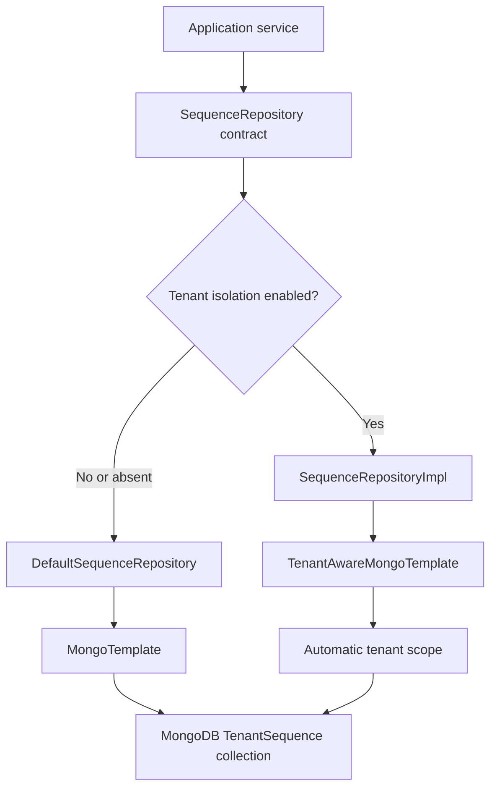
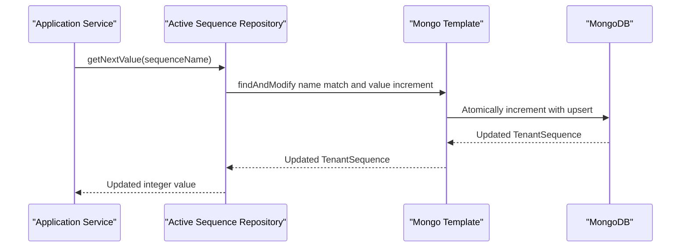

# Sequence Repositories

Sequence Repositories supplies monotonically incremented, named counters backed by MongoDB. It is part of the `openframe-data-mongo-sync` library from [OpenFrame OSS Library](https://github.com/flamingo-stack/openframe-oss-lib/blob/7a766f00e4f58b5d89db007b878ac8d6e0c344f4/openframe-data-mongo-sync/src/main/java/com/openframe/data/repository/sequence/DefaultSequenceRepository.java), which this repository consumes as `com.openframe.oss:openframe-data-mongo-sync` version `7.0.11`.

The module provides two Spring repository implementations of the same sequence contract. Spring selects exactly one implementation from the `openframe.tenant-isolation.enabled` setting:

- **Default sequence repository** is active when tenant isolation is `false` or unspecified. A sequence name identifies one shared counter document.
- **Tenant-scoped sequence repository** is active when tenant isolation is `true`. The tenant-aware Mongo template supplies tenant filtering and stamps the tenant identifier when an upsert creates a document.

This arrangement lets application services request the next number by name without owning MongoDB query construction or branching on deployment topology.

## Architecture

Both repositories execute the same counter operation: locate a `TenantSequence` document by `name`, increment `value` by one, create the document if it is absent, and return the post-increment value. The MongoDB `findAndModify` call is configured to return the updated document, so the integer returned by `getNextValue` is the allocated sequence value rather than the previous value.

## Components

| Component | Activation | Responsibility |
|---|---|---|
| [`DefaultSequenceRepository`](https://github.com/flamingo-stack/openframe-oss-lib/blob/7a766f00e4f58b5d89db007b878ac8d6e0c344f4/openframe-data-mongo-sync/src/main/java/com/openframe/data/repository/sequence/DefaultSequenceRepository.java) | `openframe.tenant-isolation.enabled=false`, including a missing property | Allocates shared counters through Spring `MongoTemplate` for single-tenant or OSS deployments. |
| [`SequenceRepositoryImpl`](https://github.com/flamingo-stack/openframe-oss-lib/blob/7a766f00e4f58b5d89db007b878ac8d6e0c344f4/openframe-data-mongo-sync/src/main/java/com/openframe/data/repository/sequence/SequenceRepositoryImpl.java) | `openframe.tenant-isolation.enabled=true` | Allocates counters through `TenantAwareMongoTemplate`, delegating tenant predicate injection and upsert stamping to the tenant-aware data layer. |

## Allocation Flow

### Shared Counter Mode

`DefaultSequenceRepository` queries only the sequence `name`. It uses `MongoTemplate` and therefore does not introduce tenant constraints. The implementation is conditionally registered by `@ConditionalOnProperty` with `matchIfMissing = true`; deployments that do not explicitly enable isolation receive this behavior by default.

### Tenant-Scoped Counter Mode

`SequenceRepositoryImpl` has the same query and update shape, but it delegates to `TenantAwareMongoTemplate`. The supplied implementation documents two important invariants of that template integration:

1. Tenant identity is automatically added to the `findAndModify` query.
2. When `upsert` creates a `TenantSequence`, the tenant-stamping callback writes its tenant identifier.

Consequently, callers still pass only a sequence name, while the data layer separates sequences for the active tenant. No composite key construction is required in this repository.

## Persistence Semantics

Each call applies these MongoDB options:

- `inc("value", 1)` performs the counter update.
- `upsert(true)` creates an initial counter document if no matching name exists in the applicable scope.
- `returnNew(true)` obtains the document after the increment.

The repository reads the returned `TenantSequence.value`, emits a debug log containing the sequence name and allocated value, and returns that integer. The use of a single `findAndModify` operation is the module's allocation boundary: it avoids a separate read followed by write in repository code.

## Configuration and Operational Considerations

| Setting | Effect |
|---|---|
| `openframe.tenant-isolation.enabled=true` | Registers `SequenceRepositoryImpl`; counter queries are tenant-aware. |
| `openframe.tenant-isolation.enabled=false` | Registers `DefaultSequenceRepository`; counter queries are shared by name. |
| Property omitted | Registers `DefaultSequenceRepository` because its conditional match defaults to true. |

Only one of these repository beans should be active for a given deployment configuration. Moving between shared and tenant-isolated modes changes the scope in which a sequence name is resolved; migration planning should account for the different stored counter documents.

## Relationship to the Data Layer

Sequence Repositories lives alongside the synchronous Mongo repository implementations in the `openframe-data-mongo-sync` artifact. It uses Spring Data MongoDB abstractions and the `TenantSequence` document type supplied by that library. Tenant isolation behavior is not duplicated here: the tenant-aware template and its document-stamping mechanism own the scoping policy, while the repository owns the named-counter operation.

This module has no child documentation because its two implementation classes are alternative runtime strategies for the same small repository contract.
