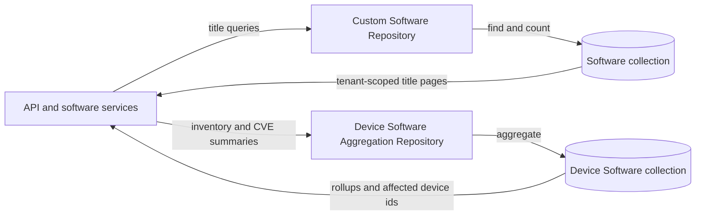
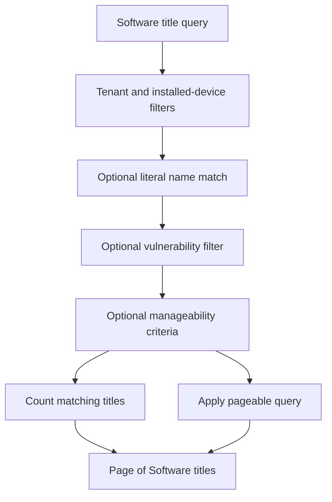
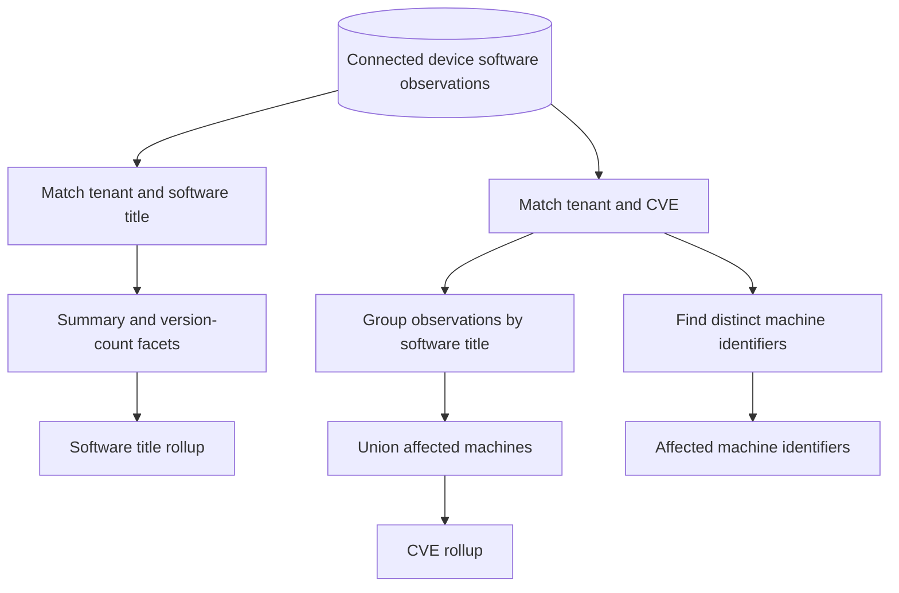

# Software Repositories

Software Repositories is the MongoDB read-model layer for Remote Monitoring and Management software inventory. It is supplied at runtime by the `com.openframe.oss:openframe-data-mongo-sync` library, version `7.0.11`, which this repository consumes. The module provides two complementary query capabilities:

- paginated discovery of software titles that are present on devices within one tenant; and
- aggregation of per-device software observations into title- and vulnerability-oriented summaries.

The implementation is library code rather than application bootstrap code in this repository. Its source is maintained in the OpenFrame OSS Library; the links in this document point to the verified library revision used by the documented components.

## Responsibilities

| Component | Responsibility |
| --- | --- |
| [Custom Software Repository](https://github.com/flamingo-stack/openframe-oss-lib/blob/7a766f00e4f58b5d89db007b878ac8d6e0c344f4/openframe-data-mongo-sync/src/main/java/com/openframe/data/repository/rmm/software/CustomSoftwareRepository.java) | Defines a pageable title search contract returning `Software` records. |
| [Custom Software Repository Implementation](https://github.com/flamingo-stack/openframe-oss-lib/blob/7a766f00e4f58b5d89db007b878ac8d6e0c344f4/openframe-data-mongo-sync/src/main/java/com/openframe/data/repository/rmm/software/CustomSoftwareRepositoryImpl.java) | Builds tenant-scoped MongoDB criteria for inventory titles and executes a count-plus-page query. |
| [Device Software Aggregation Repository Implementation](https://github.com/flamingo-stack/openframe-oss-lib/blob/7a766f00e4f58b5d89db007b878ac8d6e0c344f4/openframe-data-mongo-sync/src/main/java/com/openframe/data/repository/rmm/software/DeviceSoftwareAggregationRepositoryImpl.java) | Uses MongoDB aggregation pipelines to derive software-title and CVE rollups from connected-device observations. |

## Architecture

The repositories isolate MongoDB-specific query construction from the API and software-service layers. The surrounding platform uses this read model to expose inventory, software management, and vulnerability views; repository methods return domain rollups rather than transport-specific responses.

## Software Title Search

`CustomSoftwareRepository` exposes `findTitles(SoftwareTitleQuery, Pageable)`. Its implementation applies the following conditions before pagination:

1. It always restricts records to the requested `tenantId` and requires `devicesCount` to be greater than zero. Titles without installed devices are excluded.
2. When a lower-case name is supplied, it applies a quoted regular expression to `nameLower`. Quoting makes the supplied value literal rather than executable regular-expression syntax; because the expression is not anchored, matching is substring-based.
3. When the vulnerable-only option is selected, it requires `cveCount` to be greater than zero.
4. When manageability is specified, it classifies a title as manageable if its `source` belongs to the configured manager-source set or its package-match state is `MATCHED`. Unmanageable results must satisfy both inverse conditions: the source is outside that set and the match state is not `MATCHED`.

The method counts using the unpaged criteria and then executes the pageable query, producing a Spring `Page<Software>` with a total that is independent of the requested page window.

## Device Software Aggregations

`DeviceSoftwareAggregationRepositoryImpl` reads per-device `DeviceSoftware` observations and consistently limits both title and CVE rollups to a tenant's connected machines. Sorting by machine identifier provides deterministic input ordering before aggregation.

### Title Rollup

`rollUpTitle` matches a software title identifier, then uses a facet pipeline to compute a summary and a device count by version in one aggregation. The summary includes:

- connected-device count;
- representative name, source, vendor, and upgrade code;
- distinct versions, ARP keys, package-family names, and installer types;
- distinct vulnerability count, excluding `null` values;
- whether every explicitly reported `systemComponent` value is `true`; and
- a map of version values to device counts.

Empty or blank optional string values are removed or filtered before the response is assembled. No matching connected-device records produces an empty result rather than a partial rollup.

### CVE Rollup and Affected Devices

`rollUpCve` matches connected observations whose vulnerability list contains a supplied CVE identifier. It groups first by software title, collecting distinct machine identifiers and representative title metadata, then performs a second grouping to calculate the union of affected devices across all titles. The result therefore distinguishes the total affected-device count from each affected title's device count.

`machineIdsWithCve` is the lighter-weight path for callers that need only machine identifiers. It uses a tenant-, CVE-, and connection-scoped distinct query, removes null identifiers, and returns the remaining identifiers.

## Data and Tenant Boundaries

All public aggregation and lookup paths accept a tenant identifier and include it in their MongoDB match criteria. This makes tenant scope a required repository concern rather than an assumption imposed only by callers. Aggregated counts are additionally bounded by `machineConnected = true`, so offline or disconnected-device observations do not contribute to the displayed rollups.

The title-search repository similarly filters by tenant and only includes titles with a positive device count. Maintainers changing query behavior should preserve these two scopes unless the product contract explicitly changes: tenant isolation and connected-device inventory semantics.

## Maintenance Notes

- Keep count queries unpaged. MongoDB count behavior considers skip and limit, so counting after `Pageable` is applied would produce an incorrect total.
- Preserve literal quoting for name input to avoid treating user-provided search text as a regular expression.
- The manageability predicates are intentionally asymmetric: manageable is an `OR`, while unmanageable is an `AND` of negations. This ensures a match from either management signal qualifies as manageable.
- When changing rollup projections, account for null, blank, and mixed-type values. The pipeline deliberately filters or removes invalid optional values before converting aggregation documents into domain rollups.
- Preserve connected-machine matching in title and CVE aggregations so rollups and the machine identifier query report the same active-inventory population.
