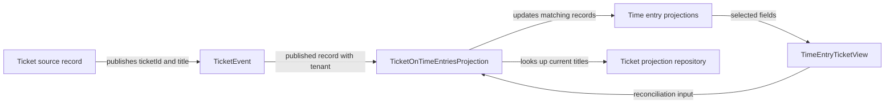
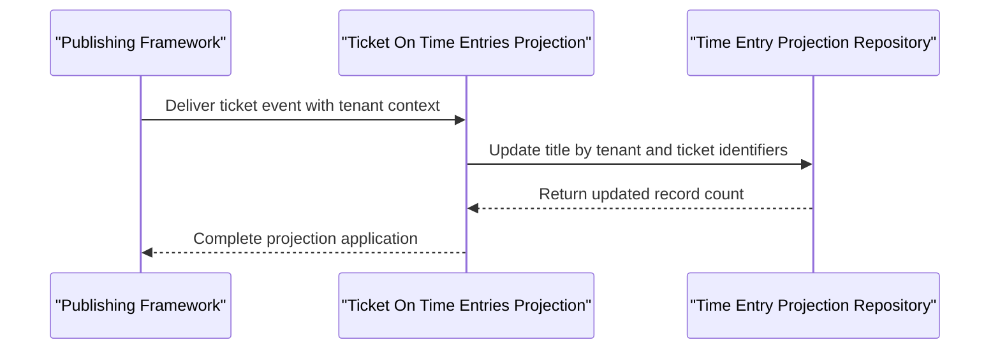
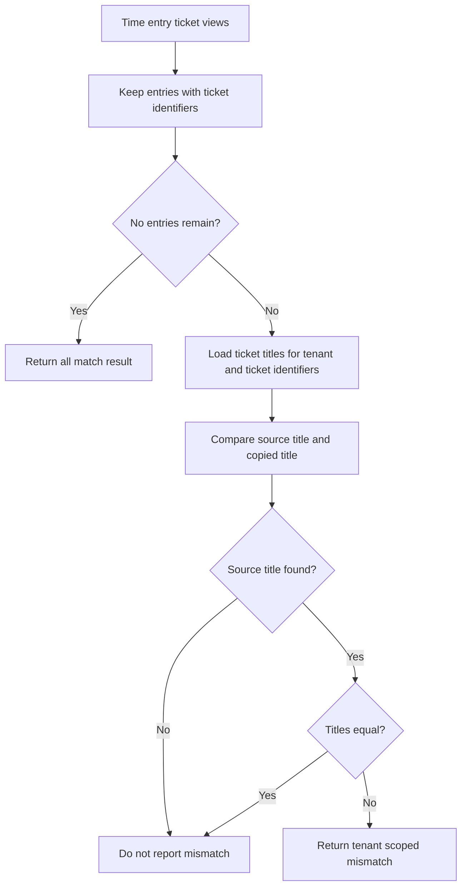

# Ticket Publishing

Ticket Publishing maintains the denormalized ticket title stored on time entries. It is implemented by the `openframe-data-mongo-sync` library from [OpenFrame OSS Library](https://github.com/flamingo-stack/openframe-oss-lib) and is consumed by this repository at version `7.0.11`.

The module publishes a deliberately small ticket change payload: a ticket identifier and its current title. Its projection applies that payload to every time entry for the same tenant and ticket, so time-entry records can retain a ticket-title snapshot without loading the ticket for every read. It also supports bounded batch updates and reconciliation of those copied values.

## Responsibilities

- Define the public `TicketEvent` payload used by the publishing framework.
- Update `ticketTitle` on matching time entries when a ticket event is applied.
- Keep projection writes tenant-scoped through repository calls that include `tenantId`.
- Offer change counting and cursor-based batch application for large fan-out updates.
- Compare projected time-entry values with authoritative ticket titles and return repair candidates as reconciliation mismatches.

## Architecture

The publishing framework supplies a `PublishedRecord` that combines an event with its tenant context. `TicketOnTimeEntriesProjection` reads the event's ticket identifier and title, then delegates persistence work to `TimeEntryProjectionRepository`. The lightweight `TimeEntryTicketView` limits reconciliation reads to the time-entry identifier, tenant, ticket identifier, and copied title.

## Components

### Ticket Event

[`TicketEvent`](https://github.com/flamingo-stack/openframe-oss-lib/blob/7a766f00e4f58b5d89db007b878ac8d6e0c344f4/openframe-data-mongo-sync/src/main/java/com/openframe/data/repository/ticket/publishing/TicketEvent.java) implements the publishing library's `PublishedEvent` contract. It carries two fields:

| Field | Meaning |
|---|---|
| `ticketId` | Identifier of the ticket whose projection must be refreshed. |
| `title` | Current title to copy into related time entries. |

The class uses Lombok to provide data accessors, a builder, and no-argument and all-argument constructors. Its narrow payload is intentional: the projection needs only the ticket identity and title.

### Ticket on Time Entries Projection

[`TicketOnTimeEntriesProjection`](https://github.com/flamingo-stack/openframe-oss-lib/blob/7a766f00e4f58b5d89db007b878ac8d6e0c344f4/openframe-data-mongo-sync/src/main/java/com/openframe/data/repository/ticket/publishing/TicketOnTimeEntriesProjection.java) is a Spring component implementing `Projection<TicketEvent, TimeEntryTicketView>`. Its stable projection name is `ticket-on-time-entries`.

| Operation | Behavior |
|---|---|
| `apply` | Updates the copied title on all matching time entries and logs the number of updated records. |
| `countChanges` | Asks the time-entry repository how many records differ, subject to the caller's limit. |
| `applyBatch` | Updates one bounded batch and returns the repository-provided cursor for subsequent work. |
| `projectedClass` | Declares `TimeEntry` as the underlying projected document type. |
| `projectedViewClass` | Declares `TimeEntryTicketView` as the read model used during reconciliation. |
| `reconcile` | Finds time entries whose copied title differs from the authoritative ticket title and returns mismatches. |

The projection does not directly manipulate Mongo documents. It uses `TimeEntryProjectionRepository` for mutations and `TicketProjectionRepository` for source-title lookup. This keeps repository query and update behavior outside the projection's orchestration logic.

### Time Entry Ticket View

[`TimeEntryTicketView`](https://github.com/flamingo-stack/openframe-oss-lib/blob/7a766f00e4f58b5d89db007b878ac8d6e0c344f4/openframe-data-mongo-sync/src/main/java/com/openframe/data/repository/ticket/publishing/TimeEntryTicketView.java) is the projection's reconciliation view. It is a compact representation of properties on a time-entry document:

- `id` is the time-entry identifier and is marked as the Spring Data identifier.
- `tenantId` scopes the relationship and mismatch result.
- `ticketId` identifies the source ticket.
- `ticketTitle` is the denormalized value being verified.

## Event Application Flow

For normal application, `apply` passes the record tenant identifier, event ticket identifier, and event title to `updateTicketTitle`. The same three values are used by `countChanges` and `applyBatch`, ensuring that preflight counting and batch processing target the same tenant-scoped record set.

## Batch Processing

Large ticket fan-outs can be processed incrementally:

1. The caller invokes `countChanges` with a limit to estimate pending updates.
2. The caller invokes `applyBatch` with a batch size and the prior cursor, or no cursor for the first batch.
3. The repository returns the cursor identifying where the next batch should resume.
4. The caller repeats until its batch-processing contract reports completion.

The projection owns neither scheduling nor cursor interpretation. Those concerns belong to the surrounding publishing infrastructure and `TimeEntryProjectionRepository` implementation.

## Reconciliation Semantics

Reconciliation is designed to identify stale copies without treating deleted sources as defects.

The projection first excludes time entries that have no ticket identifier. It then loads source titles in one repository query for the distinct tenant and ticket identifiers in the batch. A `TenantScopedId` is used as the lookup key, preventing title comparisons from crossing tenant boundaries.

If a ticket source is absent from the lookup result, the time entry is not reported as inconsistent. The copied title is intentionally retained when a source ticket has been deleted. When a source is present and the copied title differs, the result identifies the tenant, time-entry identifier, ticket identifier, and a diagnostic message showing both titles.

## Operational Notes

- A ticket title rename can affect multiple time entries, so monitor the debug log emitted by `apply` for the update count.
- Use `countChanges` before a repair or rollout process when the number of affected records matters.
- Preserve tenant context when producing ticket events. The event itself does not contain `tenantId`; tenant isolation depends on the enclosing published record and repository methods.
- Reconciliation is read-oriented and reports divergence. Applying repairs is the responsibility of the publishing and reconciliation workflow that invokes this projection.

## Source Files

- [Ticket Event](https://github.com/flamingo-stack/openframe-oss-lib/blob/7a766f00e4f58b5d89db007b878ac8d6e0c344f4/openframe-data-mongo-sync/src/main/java/com/openframe/data/repository/ticket/publishing/TicketEvent.java)
- [Ticket on Time Entries Projection](https://github.com/flamingo-stack/openframe-oss-lib/blob/7a766f00e4f58b5d89db007b878ac8d6e0c344f4/openframe-data-mongo-sync/src/main/java/com/openframe/data/repository/ticket/publishing/TicketOnTimeEntriesProjection.java)
- [Time Entry Ticket View](https://github.com/flamingo-stack/openframe-oss-lib/blob/7a766f00e4f58b5d89db007b878ac8d6e0c344f4/openframe-data-mongo-sync/src/main/java/com/openframe/data/repository/ticket/publishing/TimeEntryTicketView.java)
