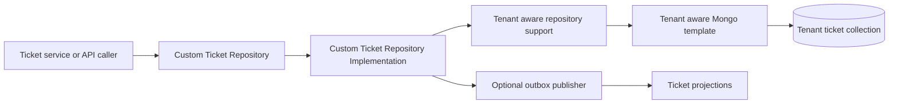
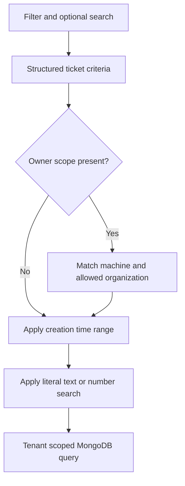
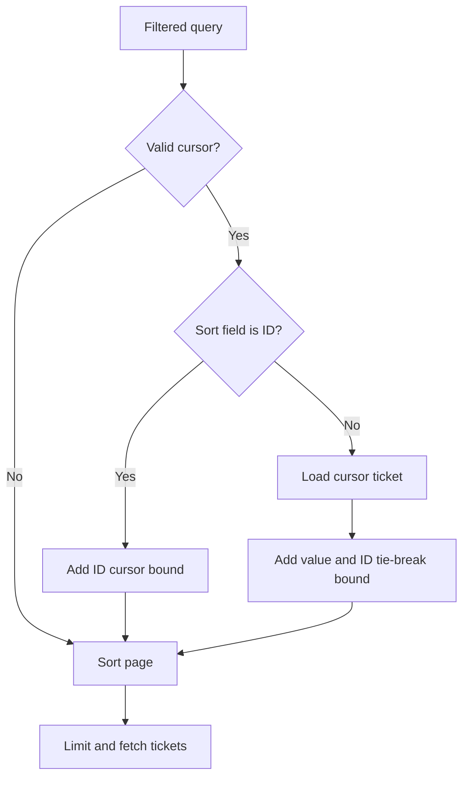
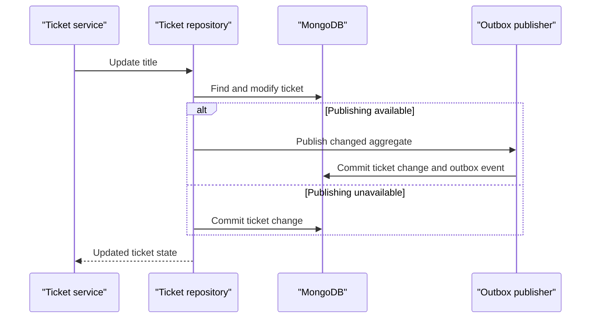

# Ticket Repositories

Ticket Repositories is the tenant-aware MongoDB query and update layer for ticket documents. It is supplied by the OpenFrame OSS Library through the `com.openframe.oss:openframe-data-mongo-sync` dependency, pinned by this service at version `7.0.11`. The module turns ticket filters, search terms, device visibility constraints, pagination inputs, and lifecycle updates into MongoDB operations while preserving tenant isolation.

The implementation is enabled only when `openframe.tenant-isolation.enabled` is `true`. It extends the library tenant-aware repository support, so aggregate counts and default collection-wide operations are scoped to the active tenant.

## Source Components

| Component | Responsibility |
| --- | --- |
| [`CustomTicketRepository`](https://github.com/flamingo-stack/openframe-oss-lib/blob/7a766f00e4f58b5d89db007b878ac8d6e0c344f4/openframe-data-mongo-sync/src/main/java/com/openframe/data/repository/ticket/CustomTicketRepository.java) | Defines the ticket-specific query, cursor paging, statistics, bulk-update, denormalized-field, activity-stamp, and sort-validation contract. |
| [`CustomTicketRepositoryImpl`](https://github.com/flamingo-stack/openframe-oss-lib/blob/7a766f00e4f58b5d89db007b878ac8d6e0c344f4/openframe-data-mongo-sync/src/main/java/com/openframe/data/repository/ticket/CustomTicketRepositoryImpl.java) | Implements the contract with `TenantAwareMongoTemplate`, MongoDB criteria and aggregations, optimistic-version-aware writes, and optional outbox publication. |

## Architecture

The repository is a persistence boundary, not a ticket workflow engine. Ticket services supply a `TicketQueryFilter`, optional text search, access restrictions, and sorting choices. The repository composes those inputs into a MongoDB `Query`, executes it in the current tenant context, and returns ticket documents or aggregate values.

This module has no generated child documentation: its public contract and MongoDB implementation are the two components documented on this page.

## Query Construction and Access Boundaries

`buildTicketQuery` combines independent criteria using MongoDB conjunctions:

- **Structured filters:** ticket numbers, status identifiers and kinds, organizations, assignees, devices, and creation sources.
- **Boolean flags:** escalation and pending-approval filters. A request for `false` includes documents where the flag is absent, maintaining compatibility with older documents and inferred false values.
- **Creation window:** `createdAtFrom` is inclusive and `createdAtTo` is exclusive.
- **Text search:** case-insensitive, literal matching against title, device hostname, organization name, and assigned name. A value containing only digits also matches the ticket number exactly. The input is regex-quoted before use, so it is treated as text rather than a regular expression pattern.
- **Explicit identifier restriction:** callers can supply a ticket identifier set to further constrain results.

### Agent Owner Scope

A non-null `ClientOwnerScope` activates device-facing visibility controls. The query requires the owner machine identifier to match. When an organization is present in the scope, the owner organization must match it or be absent; the latter accommodates tickets created before owner-organization backfill. The effective lower creation-time bound is the later of the request's lower bound and the device's organization-assignment time.

## Activity Filtering

Activity criteria can select stale tickets, active tickets, and tickets awaiting an external client. For stale and active states, the implementation uses a per-status cutoff when one is configured, otherwise the default cutoff. It evaluates `lastActivityAt` first; tickets without activity use `createdAt` as the fallback timestamp. The awaiting-external condition is represented by a non-null `awaitingClientSince` value.

This design lets status-specific staleness policy coexist with a default policy without requiring a separate query path.

## Cursor Paging and Sorting

`findTicketsWithCursor` implements keyset pagination rather than offset pagination.

1. It accepts an ObjectId cursor, a page size, and sort direction.
2. For the default `_id` sort, it selects identifiers before or after the cursor according to direction.
3. For another allowed sort field, it loads the cursor document and selects documents with a later sort value, plus documents tied on that value whose identifiers fall after the cursor.
4. Results are ordered by the requested field and `_id` as a deterministic tie-breaker.

If the cursor is malformed, missing, or has no value for the requested sort field, the implementation logs the condition and falls back to identifier-bound paging. The allowed sort fields are `_id`, ticket number, status kind, organization name, assignee name, device hostname, creation time, update time, resolution time, last activity time, and order. `isSortableField` is the validation gate for callers; `_id` is the default.

## Counts and Operational Statistics

The module provides both caller-filtered and tenant-wide measures:

- `countTickets` counts an already constructed query.
- `countTicketsByStatusKind` groups the tenant's tickets by `TicketStatusKind`; unrecognized stored enum values are logged and skipped.
- `countTicketsByStatusId` groups by concrete status identifier.
- `getTotalCount` counts all tickets in the current tenant.
- `getAverageResolutionTimeMs` averages `resolvedAt - createdAt` only for tickets where both timestamps exist, returning an empty result when no qualifying ticket exists.

These aggregate operations start from tenant criteria rather than an unrestricted collection scan.

## Mutation Semantics

### Status and Denormalized Data

Bulk status reassignment updates status identifier, status kind, and `updatedAt`; it can start from a status identifier or from a caller-built query. The repository also propagates copied display data after source entities change:

- assignee identifier to assignee name;
- resolver identifier to resolver name;
- organization identifier to organization name; and
- device identifier to device hostname.

Copied-field updates target only documents whose stored value differs. Because they update `Ticket.class`, Spring Data version handling protects a concurrent stale ticket save from overwriting the propagated value.

### Title Updates and Publication

`updateTitle` uses an atomic find-and-modify operation and updates `updatedAt`. If both an outbox publisher and ticket aggregate specification are available, the write runs through `publishChanged` so ticket projections receive the same change as a repository save. An optimistic-lock failure is retried once because the title operation is an idempotent plain assignment. When publishing infrastructure is unavailable, the repository performs the write directly.

### Activity and Approval Markers

`updatePendingApproval` writes the derived approval flag without advancing the ticket version. `updateLastActivityAt` and `updateActivityAndAwaiting` use targeted find-and-modify operations and return the new ticket document. The latter atomically sets activity and either sets or clears the client-wait timestamp.

These operations intentionally do not redefine `updatedAt`, which clients interpret as a status movement. They increment the version by zero to prevent Spring Data from adding its normal version increment, allowing high-frequency message activity to coexist with user edits without creating avoidable optimistic-lock conflicts.

## Maintenance Considerations

- Preserve tenant-aware template usage for every new collection-level operation. A direct non-tenant Mongo operation would bypass the module's isolation boundary.
- Add a field to the allowlist before accepting it as a dynamic sort key. Do not pass unvalidated field names into `Sort`.
- Extend search deliberately: the implementation uses quoted literals to prevent user search text from becoming an executable regular expression.
- Keep activity stamps as targeted updates. Replacing them with full document saves would alter `updatedAt` and increase conflicts with user-driven edits.
- When adding a mutation that changes ticket projections, determine whether it must use the outbox-backed aggregate publication path, as title changes do.
