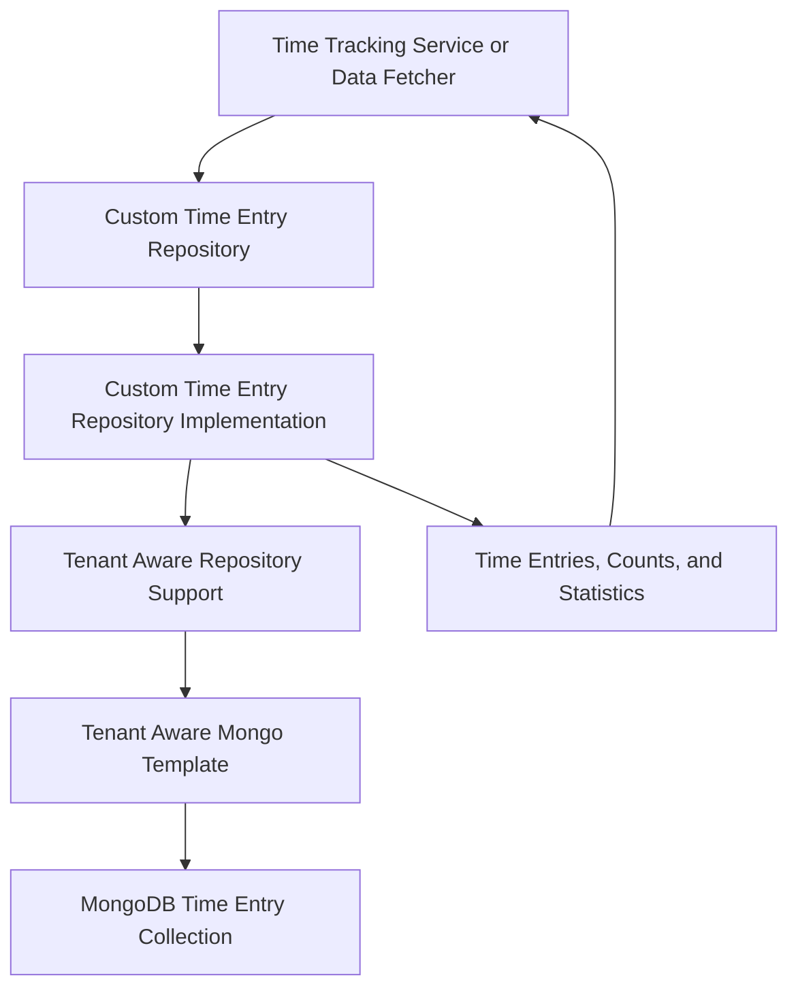
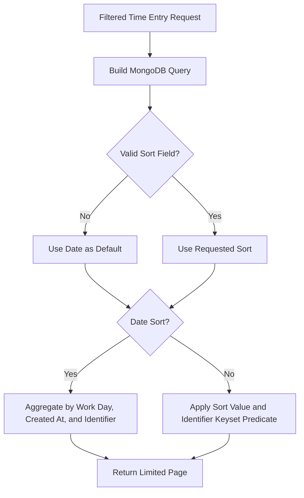
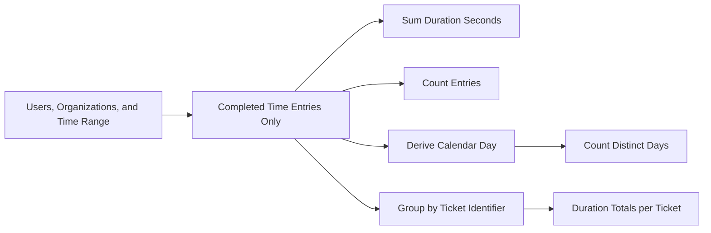

# Timetracking Repositories

Timetracking Repositories provides the tenant-scoped MongoDB query and aggregation implementation for time entries. It is supplied at runtime by the **OpenFrame OSS Library** artifact `com.openframe.oss:openframe-data-mongo-sync` version `7.0.11`, which this repository consumes. The module exposes a narrow repository contract for filtering, cursor pagination, sorting, counts, and completed-work reporting while keeping tenant isolation in the data-access layer.

The implementation is enabled only when `openframe.tenant-isolation.enabled` is `true`. It extends `TenantAwareRepositorySupport` and uses `TenantAwareMongoTemplate`; every retrieval and aggregation therefore executes in the active tenant context.

## Responsibilities

- Build a MongoDB query from a `TimeEntryQueryFilter`.
- Provide deterministic keyset pagination for regular sortable fields and the specialised calendar-date view.
- Count filtered entries.
- Calculate completed-entry duration, count, and active-day statistics for optional user and organization scopes.
- Aggregate completed duration per requested ticket while returning zero for tickets that have no completed entries.
- Restrict sorting to a reviewed allowlist and provide `date` as the default sort field.

## Architecture

The contract separates consumers from query construction details. `CustomTimeEntryRepositoryImpl` performs the data access and relies on the tenant-aware template rather than a plain template. This matters for both simple queries and aggregation pipelines: a caller does not supply tenant criteria, and repository code must preserve the template's tenant scoping.

## Core Components

### Custom Time Entry Repository

[`CustomTimeEntryRepository`](https://github.com/flamingo-stack/openframe-oss-lib/blob/7a766f00e4f58b5d89db007b878ac8d6e0c344f4/openframe-data-mongo-sync/src/main/java/com/openframe/data/repository/timetracking/CustomTimeEntryRepository.java) defines the persistence-facing API.

| Operation | Purpose |
|---|---|
| `buildTimeEntryQuery` | Translates a time-entry filter into MongoDB criteria. |
| `findTimeEntriesWithCursor` | Reads a bounded, deterministically sorted page after a keyset cursor. |
| `countTimeEntries` | Counts entries matching a prepared query. |
| `sumDurationSeconds` | Sums duration over completed entries in an optional user, organization, and time scope. |
| `countCompletedEntries` | Counts completed entries in the same reporting scope. |
| `countDistinctActiveDays` | Counts distinct calendar days that contain completed work. |
| `sumDurationSecondsByTicketIds` | Produces duration totals keyed by ticket identifier. |
| `isSortableField` and `getDefaultSortField` | Validate consumer-provided sort fields and expose the fallback field. |

### Custom Time Entry Repository Implementation

[`CustomTimeEntryRepositoryImpl`](https://github.com/flamingo-stack/openframe-oss-lib/blob/7a766f00e4f58b5d89db007b878ac8d6e0c344f4/openframe-data-mongo-sync/src/main/java/com/openframe/data/repository/timetracking/CustomTimeEntryRepositoryImpl.java) implements the contract using MongoDB queries and aggregation pipelines.

#### Filter construction

`buildTimeEntryQuery` composes filters only when their values are present:

- `userId`, `ticketId`, `organizationId`, and `source` accept sets of values.
- `startedAt` accepts a lower bound, upper bound, or both. The lower bound is inclusive and the upper bound is exclusive.
- State maps to `endedAt`: active entries have no end timestamp and completed entries have one.
- Text search matches notes and ticket title case-insensitively. If the search text is numeric, it also matches the ticket number exactly. Search text is regex-quoted before use, so it is treated as literal text rather than a caller-provided regular expression.

The resulting `Query` is reusable for counting or retrieval. Tenant criteria is not manually attached at this stage; it is enforced by the tenant-aware template when the query is executed.

#### Sorting and cursor pagination

The sortable-field allowlist is `_id`, `date`, `startedAt`, `endedAt`, `durationSeconds`, `createdAt`, and `updatedAt`. Any consumer should validate a requested field through `isSortableField`; the default is `date`.

For most fields, the cursor is the last document identifier. When the primary sort field is not `_id`, the implementation resolves the cursor document in the current tenant, reads its sort value, and applies a keyset predicate:

1. select values after the cursor's sort value in the chosen direction;
2. for equal values, select identifiers after the cursor identifier in that same direction;
3. order by the requested field and then `_id` as a stable tie-breaker.

An invalid cursor is logged and does not abort the query. If a cursor document or its sort value cannot be used, the implementation falls back to identifier-based continuation. The cursor lookup deliberately uses `findOne(Query)` because the tenant-aware template scopes it; using an unscoped identifier lookup would risk cross-tenant access.

The `date` sort has separate semantics. It derives a day key from `startedAt` and orders by the compound key `(work day, created at, identifier)`. Its cursor encodes the day key, creation time in milliseconds, and identifier. This keeps manually added midnight entries ordered by insertion time within their calendar day, while backdated records stay with their own day. The direction-sensitive compound predicate advances consistently through all three tie-breakers.

#### Completed-work reporting

Reporting methods use a shared match policy: the entry must be completed, and optional user and organization lists restrict the population. When both time boundaries are provided, the `startedAt` range is `[from, to)`.

- `sumDurationSeconds` groups matching entries and sums `durationSeconds`.
- `countCompletedEntries` counts the matching documents.
- `countDistinctActiveDays` projects a `YYYY-MM-DD` value from `startedAt`, groups by that value, and counts the groups.
- `sumDurationSecondsByTicketIds` filters requested tickets, groups by ticket identifier, and sums completed durations. It pre-populates all requested identifiers with zero so absent aggregation rows are distinguishable from omitted requests.

## Integration Boundaries

This module owns persistence mechanics, not time-entry domain policy or API presentation. Callers provide `TimeEntryQueryFilter` values, requested sort and paging parameters, and reporting scopes. The repository returns `TimeEntry` documents or scalar aggregates.

Time-entry read models and service-level operations remain outside this module. In the wider platform, ticket-related projections can consume completed duration totals through `sumDurationSecondsByTicketIds`, while API-facing components can combine filtered pages with `countTimeEntries` to produce paginated responses.

## Operational Notes

- Tenant isolation must remain enabled for this implementation to be instantiated.
- Continue pages using the exact cursor format expected by the active sorting mode. The date cursor is a three-part compound value; other modes use an object identifier.
- Do not add a sortable field solely to the client contract. Extend the allowlist and `getSortFieldValue` together so keyset pagination remains valid.
- Statistics intentionally exclude active entries because they require a non-null `endedAt` value.
- The date grouping derives the day from `startedAt`; report consumers should use a consistent interpretation of that stored timestamp.
