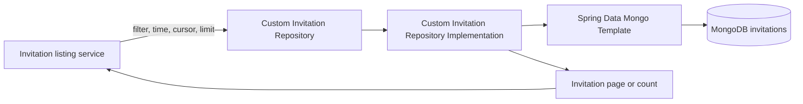
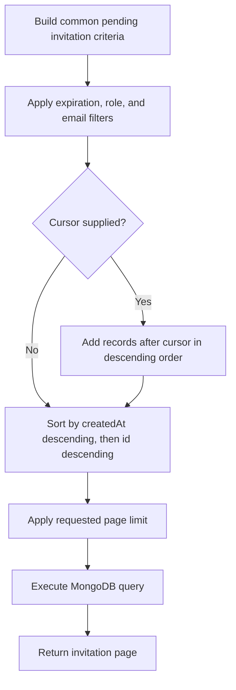

# User Invitation Repositories

The User Invitation Repositories module supplies the MongoDB query extension used to list and count pending user invitations. It belongs to the `openframe-data-mongo-sync` library from OpenFrame OSS Library, version `7.0.11`, which this tenant service consumes at runtime.

Its public interface separates pagination from counting while applying the same definition of an *open* invitation: an invitation whose status is `PENDING`, optionally further constrained by expiration state, assigned roles, and an email search term. The implementation executes these queries through Spring Data MongoDB's `MongoTemplate`.

## Responsibilities

- Return a deterministic, cursor-paginated page of pending invitations.
- Count the pending invitations that match the same filters.
- Evaluate expiration relative to a caller-provided instant, rather than an implicit database or server clock.
- Filter by one or more invitation roles.
- Perform literal, case-insensitive email substring matching.
- Preserve stable descending ordering by creation time and MongoDB identifier.

## Architecture

`CustomInvitationRepository` is the application-facing contract. `CustomInvitationRepositoryImpl` builds `Criteria` objects, attaches them to a MongoDB query, and maps the retrieved documents to `Invitation` values.

## Core Components

| Component | Responsibility |
|---|---|
| `CustomInvitationRepository` | Defines `findOpenInvitationsPage` and `countOpenInvitations`, the extension points for listing and counting open invitations. |
| `CustomInvitationRepositoryImpl` | Implements both operations using `MongoTemplate`; centralizes common filter criteria so page and count semantics remain aligned. |

The implementation source is maintained in OpenFrame OSS Library: [Custom Invitation Repository](https://github.com/flamingo-stack/openframe-oss-lib/blob/7a766f00e4f58b5d89db007b878ac8d6e0c344f4/openframe-data-mongo-sync/src/main/java/com/openframe/data/repository/user/CustomInvitationRepository.java) and [Custom Invitation Repository Implementation](https://github.com/flamingo-stack/openframe-oss-lib/blob/7a766f00e4f58b5d89db007b878ac8d6e0c344f4/openframe-data-mongo-sync/src/main/java/com/openframe/data/repository/user/CustomInvitationRepositoryImpl.java).

## Query Semantics

### Shared eligibility criteria

Both repository methods derive conditions through the same internal criteria builder:

1. Every result must have `status` equal to `PENDING`.
2. When the expiration filter is present, expired invitations have `expiresAt` before the supplied time; non-expired invitations have `expiresAt` at or after it.
3. When roles are supplied, the `roles` field must contain at least one requested role.
4. When an email search value has text, surrounding whitespace is removed and the email is searched using a quoted, case-insensitive regular expression. Quoting the input makes it a literal search rather than allowing regular-expression syntax from the caller.

The count query uses this same criteria set without sort, cursor, or limit. Consequently, it represents the total matching invitations at the supplied time, while the page query represents one ordered subset.

### Page ordering and cursor progression

Pages are sorted descending by `createdAt`, then descending by `_id`. The second sort key provides deterministic ordering when creation timestamps collide.

The cursor represents the last entry already returned. For a cursor with a creation time, subsequent results include records with an earlier creation time, records with the same creation time and a smaller identifier, and documents whose creation time is missing. A cursor without a creation time advances only by smaller identifiers at the missing timestamp. This explicitly accounts for MongoDB's descending-sort treatment of absent `createdAt` values and prevents those documents from becoming unreachable during traversal.

## Operational Considerations

- **Consistent pagination:** Reuse the same `now` value while fetching a page and its corresponding count if the caller needs a coherent expiration boundary. Different time values can legitimately change whether an invitation is considered expired.
- **Cursor validity:** The cursor is parsed before its boundary criterion is added. Callers should treat it as an opaque continuation value created from the final item of a prior page.
- **Filter performance:** The mandatory status condition, the expiration condition, role membership, email search, and descending sort fields shape the query. Database indexes should be evaluated against expected invitation volume and filter combinations.
- **Diagnostics:** The implementation logs the generated page query at debug level. Count queries are not logged by this module.

## System Context

The repository is a persistence-layer component rather than an invitation workflow. Higher-level API and authorization components are responsible for creating, updating, accepting, or presenting invitations. This module focuses only on retrieving pending invitation records from MongoDB with stable list behavior.
