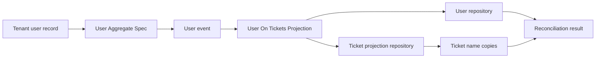
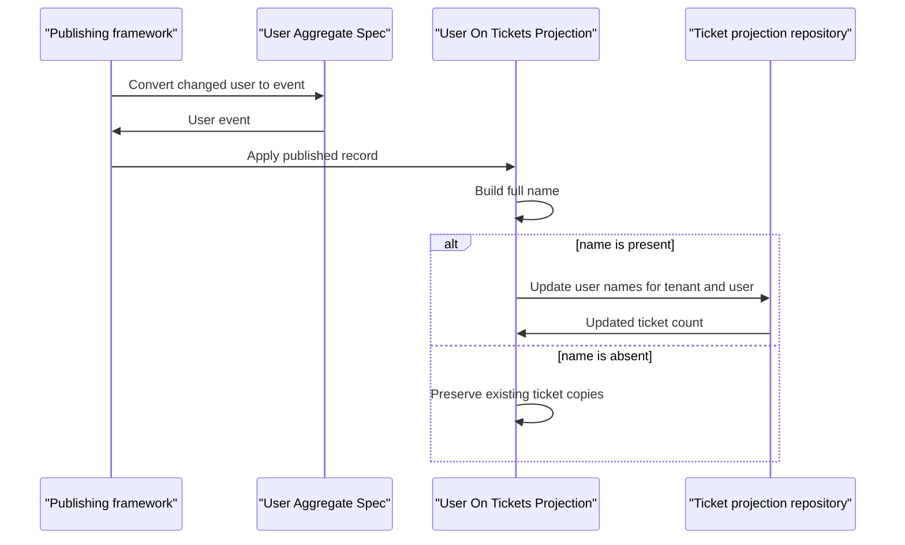
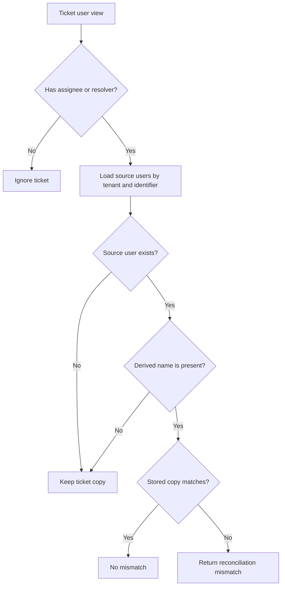

# User Publishing

User Publishing keeps denormalized user names on ticket records synchronized with their source user records. It is implemented by the `openframe-data-mongo-sync` library from [OpenFrame OSS Library](https://github.com/flamingo-stack/openframe-oss-lib) and is assembled at runtime by OpenFrame OSS Tenant. The module publishes a compact user-change event and projects the resulting display name into a ticket's assignee and resolver name fields.

The module deliberately treats a user's identity as tenant-scoped. A name for the same user identifier in one tenant cannot be used to reconcile a ticket in another tenant.

## Responsibilities

- Define the `users` aggregate type through `UserAggregateSpec`.
- Transform a `User` or its `AuthUser` subtype into a `UserEvent` containing the user identifier and name parts.
- Build a display name by trimming and joining nonblank first and last names.
- Apply user-name changes to the ticket copies for both assignment and resolution roles.
- Reconcile stored ticket copies against the current user records and report mismatches without changing data.
- Process updates in batches when the publishing framework selects batched projection.

## Architecture

### Runtime Flow

1. The publishing framework detects a user aggregate change.
2. `UserAggregateSpec` declares the aggregate type as `users` and creates a `UserEvent` from the user's identifier, first name, and last name.
3. `UserOnTicketsProjection` derives the display name and updates ticket copies associated with that tenant and user identifier.
4. The ticket repository updates both relevant ticket roles: `assignedName` for assignees and `resolvedByName` for resolvers.
5. Reconciliation can read a narrow ticket view, load relevant users in bulk, and return the ticket copies whose stored names differ from their current source names.

## Core Components

| Component | Responsibility |
| --- | --- |
| [`UserAggregateSpec`](https://github.com/flamingo-stack/openframe-oss-lib/blob/7a766f00e4f58b5d89db007b878ac8d6e0c344f4/openframe-data-mongo-sync/src/main/java/com/openframe/data/repository/user/publishing/UserAggregateSpec.java) | Spring component implementing the publishing aggregate contract for users. It identifies the event stream as `users`, converts `User` data to events, and registers the ticket projection. Because `AuthUser` extends `User`, auth-user repository changes share this specification. |
| [`UserEvent`](https://github.com/flamingo-stack/openframe-oss-lib/blob/7a766f00e4f58b5d89db007b878ac8d6e0c344f4/openframe-data-mongo-sync/src/main/java/com/openframe/data/repository/user/publishing/UserEvent.java) | Published event payload with `userId`, `firstName`, and `lastName`. Its `fullName()` helper omits blank parts, trims the remaining parts, and joins them with one space. The derived full name is intentionally not part of the serialized payload. |
| [`UserOnTicketsProjection`](https://github.com/flamingo-stack/openframe-oss-lib/blob/7a766f00e4f58b5d89db007b878ac8d6e0c344f4/openframe-data-mongo-sync/src/main/java/com/openframe/data/repository/user/publishing/UserOnTicketsProjection.java) | Projection that propagates a nonempty display name to tickets, supports change counting and batched updates, and compares ticket copies to source users during reconciliation. |
| [`TicketUserView`](https://github.com/flamingo-stack/openframe-oss-lib/blob/7a766f00e4f58b5d89db007b878ac8d6e0c344f4/openframe-data-mongo-sync/src/main/java/com/openframe/data/repository/user/publishing/TicketUserView.java) | Minimal projection view used during reconciliation. It contains the ticket and tenant identifiers plus assignee and resolver identifiers and copied names. |
| [`UserFullNames`](https://github.com/flamingo-stack/openframe-oss-lib/blob/7a766f00e4f58b5d89db007b878ac8d6e0c344f4/openframe-data-mongo-sync/src/main/java/com/openframe/data/repository/user/publishing/UserFullNames.java) | Batch helper that indexes source display names by `TenantScopedId`, preventing cross-tenant comparisons while avoiding repeated name construction. |

## Projection Semantics

### Applying an Event

For an incoming published record, the projection uses the record tenant identifier and `UserEvent.userId` as the target identity. When `fullName()` is nonempty, it delegates to `TicketProjectionRepository.updateUserNames` to synchronize ticket copies. `countChanges` and `applyBatch` use the same identity and calculated name, allowing the publishing runtime to calculate work and process it incrementally.

A blank derived name is a no-op. Existing ticket names are retained instead of being cleared. This is intentional: historical assignment data may contain a fallback display value such as an email address, and an incomplete user profile must not destroy that value.

### Reconciliation

Reconciliation receives `TicketUserView` records rather than full tickets. It:

1. Excludes tickets that contain neither an assignee nor a resolver.
2. Collects the tenant and user identifiers referenced by the remaining ticket views.
3. Loads matching source users in one repository query.
4. Indexes their derived names by tenant and identifier.
5. Checks the assignee copy first, then the resolver copy.
6. Returns a mismatch only when the source user exists, has a nonempty derived name, and its name differs from the stored copy.

If a source user has been deleted, its ticket copy is not reported as a mismatch. If a ticket has both an invalid assignee copy and resolver copy, reconciliation returns the assignee mismatch first for that ticket.

## Data Contract

### Published User Event

`UserEvent` contains only the public source fields needed by this projection:

| Field | Meaning |
| --- | --- |
| `userId` | Identifier of the changed user. The published record supplies the tenant context separately. |
| `firstName` | Optional first-name input to display-name generation. |
| `lastName` | Optional last-name input to display-name generation. |

The display name is derived at consumption time. Null, blank, or whitespace-only parts are removed; the remaining parts are trimmed and separated by a single space.

### Ticket Reconciliation View

`TicketUserView` maps only the ticket properties this projection reconciles:

| Field | Meaning |
| --- | --- |
| `id` | Ticket identifier. |
| `tenantId` | Tenant boundary for source lookups and mismatch reporting. |
| `assignedTo` and `assignedName` | Assignee user identifier and its denormalized display-name copy. |
| `resolvedById` and `resolvedByName` | Resolver user identifier and its denormalized display-name copy. |

## Integration Boundaries

User Publishing depends on the publishing API for aggregate, published-record, projection, tenant-scoped identity, and reconciliation contracts. It uses `UserRepository` to obtain authoritative user data and `TicketProjectionRepository` to update or count affected ticket copies. The projected domain type is `Ticket` and the projection view type is `TicketUserView`.

The module is part of the Mongo synchronous data library, version `7.0.11`, consumed by OpenFrame OSS Tenant. It does not define an HTTP endpoint or an independent service process; it is activated as a Spring component when its containing library is on the application classpath.

## Operational Notes

- Name updates are tenant-scoped and must preserve that scope in repository implementations.
- An empty source name intentionally preserves existing ticket copies.
- Deleted users intentionally do not create reconciliation mismatches.
- Repository update methods must consistently handle both assignee and resolver references, otherwise reconciliation will surface stale copies.
- Batched processing returns the next position from the ticket repository. A `null` result signals that no batch continuation is required.
