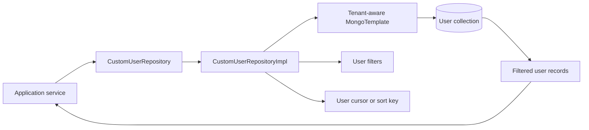
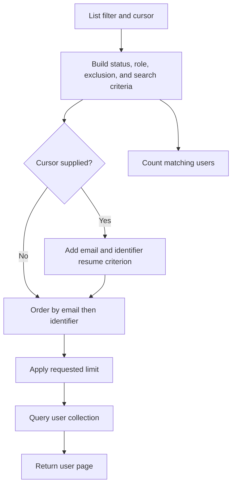
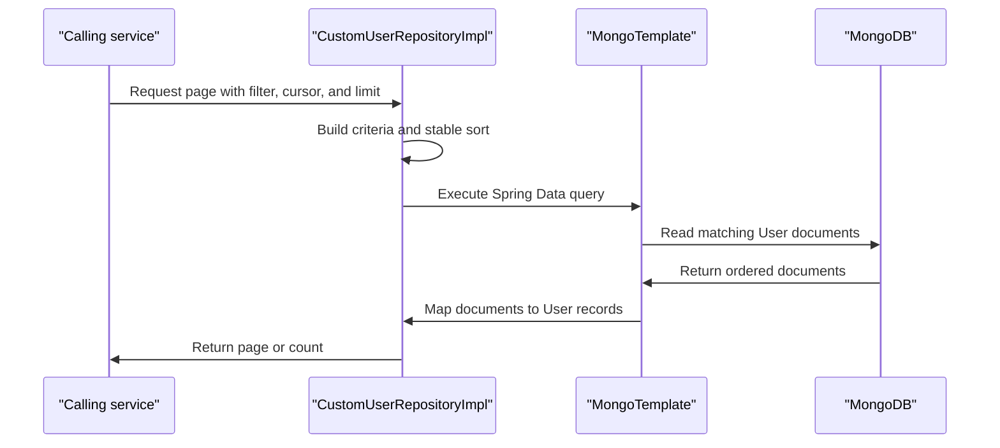

# User Repositories

User Repositories provides the custom MongoDB read layer for user records in OpenFrame. It is supplied at runtime by the `com.openframe.oss:openframe-data-mongo-sync` library, version `7.0.11`, which this service repository consumes. The module complements the standard repository surface with user search, filtered counts, and two stable pagination strategies.

The implementation lives in the OpenFrame OSS Library rather than this repository:

- [Custom User Repository contract](https://github.com/flamingo-stack/openframe-oss-lib/blob/7a766f00e4f58b5d89db007b878ac8d6e0c344f4/openframe-data-mongo-sync/src/main/java/com/openframe/data/repository/user/CustomUserRepository.java)
- [Custom User Repository implementation](https://github.com/flamingo-stack/openframe-oss-lib/blob/7a766f00e4f58b5d89db007b878ac8d6e0c344f4/openframe-data-mongo-sync/src/main/java/com/openframe/data/repository/user/CustomUserRepositoryImpl.java)
- [User Sort Key](https://github.com/flamingo-stack/openframe-oss-lib/blob/7a766f00e4f58b5d89db007b878ac8d6e0c344f4/openframe-data-mongo-sync/src/main/java/com/openframe/data/repository/user/UserSortKey.java)

## Responsibilities

- Build MongoDB criteria for user status, email, and name searches.
- Support list views filtered by statuses, roles, excluded user identifiers, and tokenized free-text search.
- Exclude self-deleted users from email matches in list-view free-text search, while retaining name matching behavior.
- Produce predictable pages with a secondary identifier key when the primary sort value is duplicated.
- Count the same filtered set used by list pagination.
- Leave tenant criteria compatible with the tenant-aware Mongo template configuration supplied by the data layer.

## Architecture

The repository implementation translates filters into Spring Data `Criteria` and executes them through `MongoTemplate`. Its criteria are intentionally composed as one keyless conjunction when needed; this lets a tenant-aware template contribute tenant constraints without a conflicting keyed criterion. Tenant isolation itself is configured outside this module by the shared Mongo data layer.

## Core Components

| Component | Responsibility |
|---|---|
| `CustomUserRepository` | Defines the custom query API: a legacy-style filtered search, email-ordered cursor pagination with counting, and creation-time keyset pagination. |
| `CustomUserRepositoryImpl` | Converts filters to MongoDB queries, enforces deterministic sorting, logs query execution at debug level, and materializes `User` documents. |
| `UserSortKey` | Carries the creation timestamp and identifier required to resume a descending creation-time page without duplicates caused by equal timestamps. |

## Query APIs

### Filtered Search

`findUsersBySearch` accepts a `UserQueryFilter` and a limit. When a filter is supplied, the implementation applies:

- an exact status criterion;
- a case-insensitive, literal email fragment match; and
- a case-insensitive, literal first-name or last-name fragment match.

Results use descending `createdAt` followed by descending `id`. Literal quoting prevents filter text from being interpreted as a regular-expression pattern.

### List Pagination and Counting

`findUsersPage` and `countUsers` share the same list criteria:

- status membership;
- role membership;
- exclusion of specified user identifiers; and
- whitespace-tokenized search across first name, last name, and email.

Each search token must match at least one configured field, and all token criteria are combined. The list page is ordered by ascending `email`, then ascending `id`. The cursor represents the last email and identifier pair; the following page selects users with a greater email, or the same email and a greater identifier. That tie-breaker prevents records with equal emails from being skipped or repeated.

For an email token, users with status `SELF_DELETED` are excluded. This prevents a synthetic email assigned during self-deletion from appearing in ordinary email searches.

### Creation-Time Keyset Pagination

`findUserPageAfter` is optimized for a descending order of `createdAt` and `id`. `UserSortKey` records the final row of a page. A later page includes records with an earlier timestamp, records with the same timestamp and a smaller identifier, and—after dated records—records without `createdAt`.

This explicit null branch is necessary because a date range does not match missing timestamp values. It preserves the declared sort behavior: user records with no creation timestamp appear last and are then advanced by identifier alone.

## Data Flow

## Ordering and Pagination Invariants

Maintainers should preserve these invariants when changing query behavior:

1. Every cursor must match the ordering of the query that consumes it.
2. A non-unique primary sort field requires `id` as a stable secondary key.
3. The count operation must use the same filter criteria as the corresponding list operation.
4. Missing `createdAt` values must be explicitly included when traversing a creation-time keyset page.
5. Search values are quoted before being used in a MongoDB regular expression, so user-entered text remains literal.
6. New criteria must remain compatible with tenant scoping contributed by the Mongo configuration.

## System Context

The API and client services use the shared data library for persisted user access. User-facing application features such as management, invitations, authentication, and ticket ownership may depend on user records, but their API contracts and business workflows are outside User Repositories. This module is deliberately limited to efficient, tenant-compatible MongoDB query construction and retrieval.
