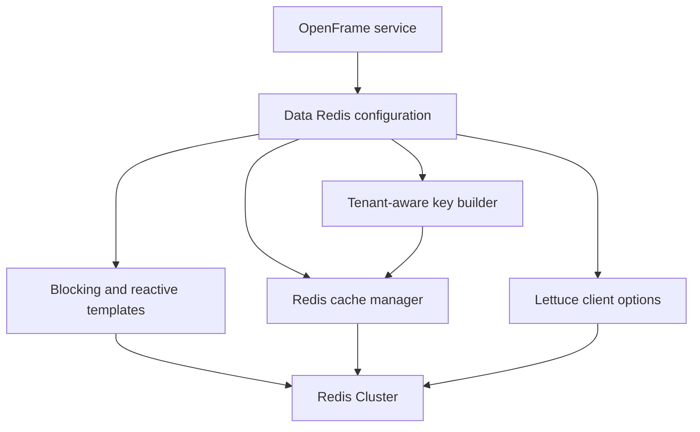
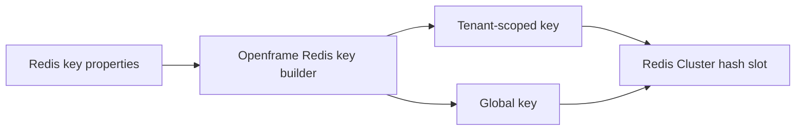
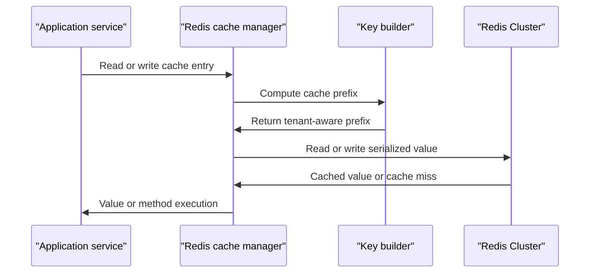

# Data Redis

Data Redis is the OpenFrame Redis integration supplied by the `com.openframe.oss:openframe-data-redis` library. It supplies Spring Data Redis templates, Spring Cache support, tenant-safe key construction, and a Lettuce client compatibility adjustment. The tenant service consumes version `7.0.11` of this library; the implementation is maintained in the OpenFrame OSS Library.

The module is enabled only when `spring.redis.enabled=true`, except for the Lettuce client adjustment, which is registered whenever Spring Boot creates a Lettuce connection. Redis Cluster is deployed as a platform datasource and shared application configuration supplies its cluster nodes.

## Architecture

Data Redis is infrastructure rather than an API surface: application services use Spring cache annotations, Redis templates, or Redis repositories, while this module standardizes connection behavior, serialization, expiration, and key isolation.

## Runtime Activation and Boundaries

`RedisConfig` and `CacheConfig` both require `spring.redis.enabled=true`. This makes Redis-backed templates, repositories, and caching opt-in. The configuration also uses missing-bean conditions, allowing an application to replace the provided cache manager or templates intentionally.

`LettuceClientConfig` is deliberately not gated by that flag. When a service has a Redis host and Boot creates the Lettuce connection, it disables maintenance-notification negotiation. This avoids sending `CLIENT MAINT_NOTIFICATIONS ON`, which Valkey does not support and which can otherwise be reported as a command error by Memorystore.

## Component Responsibilities

| Component | Responsibility | Key behavior |
|---|---|---|
| [CacheConfig](https://github.com/flamingo-stack/openframe-oss-lib/blob/7a766f00e4f58b5d89db007b878ac8d6e0c344f4/openframe-data-redis/src/main/java/com/openframe/data/config/CacheConfig.java) | Configures Spring Cache on Redis. | Uses a six-hour default TTL, does not cache null values, and reduces `fleetPolicyCache` and `fleetQueryCache` TTLs to one hour. |
| [RedisConfig](https://github.com/flamingo-stack/openframe-oss-lib/blob/7a766f00e4f58b5d89db007b878ac8d6e0c344f4/openframe-data-redis/src/main/java/com/openframe/data/config/RedisConfig.java) | Provides synchronous and reactive Redis access. | Registers string-based blocking and reactive templates and scans `com.openframe.data.repository.redis` for Redis repositories. |
| [LettuceClientConfig](https://github.com/flamingo-stack/openframe-oss-lib/blob/7a766f00e4f58b5d89db007b878ac8d6e0c344f4/openframe-data-redis/src/main/java/com/openframe/data/config/LettuceClientConfig.java) | Customizes Lettuce client options. | Disables maintenance notifications for Valkey compatibility. |
| [OpenframeRedisKeyConfiguration](https://github.com/flamingo-stack/openframe-oss-lib/blob/7a766f00e4f58b5d89db007b878ac8d6e0c344f4/openframe-data-redis/src/main/java/com/openframe/data/redis/OpenframeRedisKeyConfiguration.java) | Creates the shared key builder and binds Redis key properties. | Supplies an overrideable `OpenframeRedisKeyBuilder` bean. |

## Key Isolation

The key builder is the module's multi-tenant safety boundary. A tenant-scoped key requires a nonblank tenant identifier and fails fast when the configured `openframe.redis.tenant-id` value is absent. Callers that serve multiple tenants can supply the tenant explicitly; installation-wide state can use a global key without a tenant segment.

By default, keys use the `of` global prefix and place the tenant identifier in Redis Cluster hash-tag braces. Consequently, keys for one tenant are colocated in one Redis Cluster hash slot. The builder trims redundant colon delimiters before assembling a key.

For a configured key prefix of `of`, tenant identifier `tenant_a`, and cache name `devices`, the cache prefix is structurally `of:{tenant_a}:devices::`. The actual cache entry appends Spring's cache key. If tenant hash tags are disabled, the tenant segment is emitted without braces.

The `openframe.redis.keys` group carries named relative prefixes for password resets, email verification, login assertions, OAuth development tickets, rate limiting, API-key statistics, gateway state, and AI-agent state. These values define suffix namespaces; callers still use the key builder to apply the global and tenant segments.

## Cache Behavior

`CacheConfig` enables Spring caching and creates a `RedisCacheManager` only when the application has not defined its own `CacheManager`. Cache keys are UTF-8 strings, while values use Jackson JSON serialization with embedded type metadata. The configuration retains Spring Cache null-value compatibility in the serializer but instructs the cache configuration not to store null values. It also disables failure on null primitive values during deserialization, preserving compatibility with older cached entries when a primitive field is introduced.

Fleet policy and query caches expire after one hour because policy and query definitions may be renamed or deleted. All other caches created through this manager use the six-hour default unless an application provides its own cache manager or configuration.

## Template and Repository Access

`RedisConfig` exposes three string-oriented access paths:

- `RedisTemplate<String, String>` for imperative operations, with string serialization for keys, values, hash keys, and hash values.
- `ReactiveStringRedisTemplate` for reactive string operations.
- `ReactiveRedisTemplate<String, String>` with an explicit all-string serialization context.

The module also enables repository discovery below `com.openframe.data.repository.redis`. Domain-specific repository interfaces and their data models are intentionally outside this infrastructure module.

## Configuration Reference

| Property | Default or requirement | Effect |
|---|---|---|
| `spring.redis.enabled` | Must be `true` | Activates Data Redis templates, repositories, and cache configuration. |
| `openframe.redis.key-prefix` | `of` | Prefixes all builder-generated keys to avoid collisions with other applications. |
| `openframe.redis.tenant-id` | Required for tenant keys | Identifies the tenant namespace. Missing values cause tenant-key construction to fail. |
| `openframe.redis.tenant-hash-tag` | `true` | Wraps the tenant identifier in braces so tenant keys share a Redis Cluster slot. |
| `openframe.redis.keys.*` | Named defaults | Defines relative namespaces for security, rate limiting, gateway, statistics, and AI state. |

## Operational Considerations

- Keep the tenant identifier stable. Changing it changes the namespace and makes existing tenant-scoped cache entries inaccessible until they expire or are removed.
- Treat cache entries as versioned serialized data. The serializer accommodates added primitive fields, but incompatible type or schema changes can still require cache invalidation.
- Use the key builder rather than concatenating Redis keys in application code. This preserves tenant isolation and Redis Cluster slot locality.
- A custom `CacheManager`, `RedisTemplate`, or reactive template takes precedence over the supplied bean because the module only creates these defaults when no matching bean exists.
- Redis availability is a platform concern. The tenant deployment declares a Redis Cluster datasource; services that opt in must receive compatible Spring Redis connection settings through their runtime configuration.
