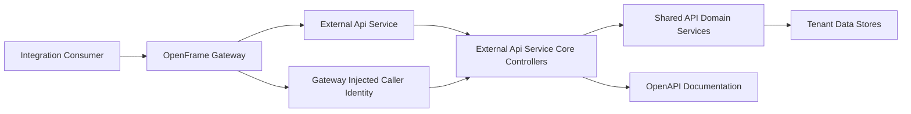
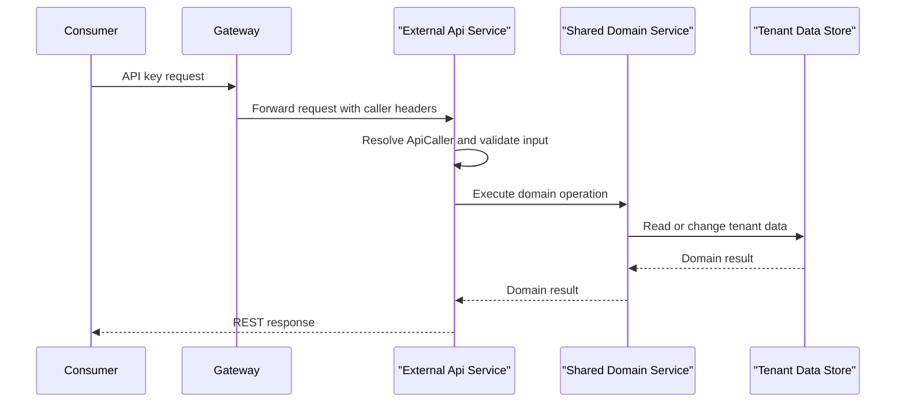
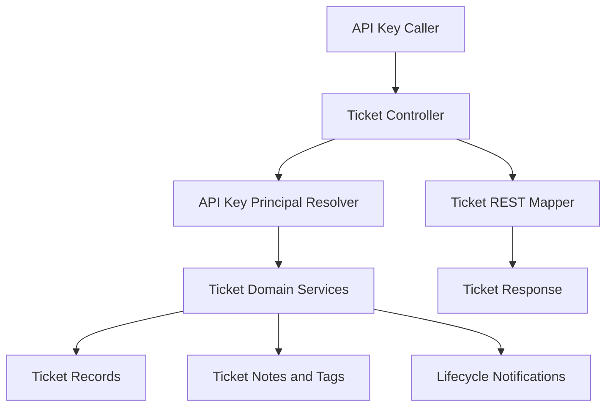
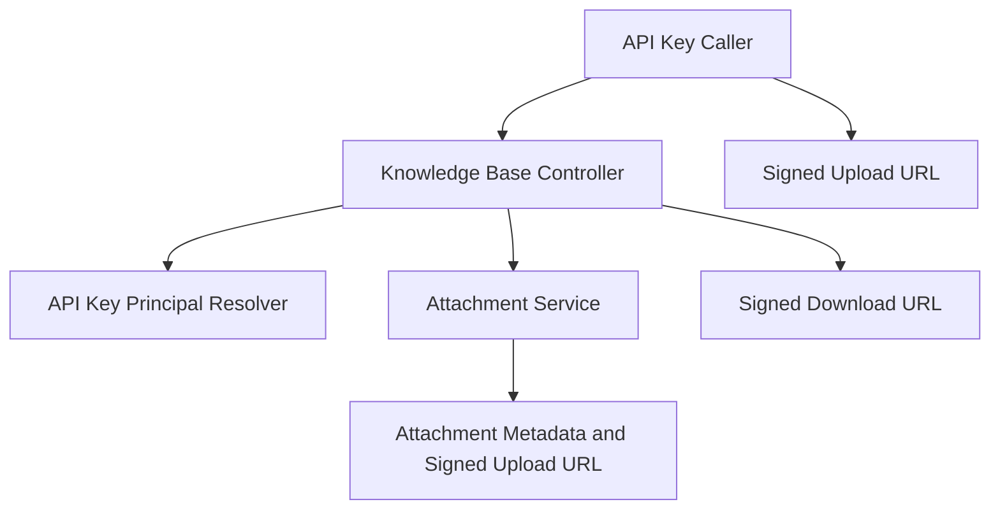

# External Api Service Core

## Purpose

External Api Service Core is the REST-facing library assembled by the `openframe-external-api` application. It exposes selected OpenFrame capabilities to integrations through versioned endpoints, while delegating domain behaviour to shared API and data services. The implementation is supplied by the `com.openframe.oss:openframe-external-api-service-core` library, pinned at version `7.0.11` by this repository.

The module provides API-key-oriented access to customers, devices, tickets, knowledge-base content, logs, and integrated tools. It also supplies the OpenAPI contract, request-context binding, response mapping conventions, and a uniform JSON representation for timestamps.

## Runtime Position

The tenant repository starts `ExternalApiApplication` in the `openframe-external-api` service. The Kubernetes gateway routes `/api-docs/**` to that service; the library's documented OpenAPI server prefix is `/external-api`. Gateway authentication injects caller identity headers, which this module resolves into an `ApiCaller` argument for each controller.

## Request Processing Model

The gateway authenticates the API key and forwards the user and API-key identifiers. `ApiCallerArgumentResolver`, registered by `ExternalApiWebConfig`, makes those values available to controller methods as `ApiCaller`. Controllers log those identifiers, validate transport inputs, decode opaque cursors where applicable, delegate to domain services, and use dedicated mappers to return external REST representations.

The module deliberately reuses the shared ticket, organization, device, knowledge-base, log, and tool services. As a result, externally initiated writes follow the same lifecycle, validation, numbering, notification, and tenant-scoping rules as dashboard operations rather than maintaining a second implementation of those rules.

## Public API Areas

The following implementation areas are documented in focused submodules after this overview is generated.

- Customer, device, log, and tool endpoints expose inventory, operational data, integrated-tool metadata, and constrained update operations.
- Ticket endpoints expose ticket query, lifecycle, assignment, tagging, and note operations under the API-key owner identity.
- Knowledge-base endpoints manage folders, articles, tags, assignments, and signed attachment transfers.
- Integration proxy endpoints forward approved HTTP methods to a selected integrated tool through the shared proxy service.
- Configuration and web support publish OpenAPI metadata, normalize `Instant` output, and bind gateway identity context.
- Transport contracts define validated requests and response payloads for device filters, knowledge-base resources, tickets, and tools.

## Detailed Submodules

- [Rest Resources](rest_resources.md) documents the customer, device, log, tool, and integration-proxy controllers.
- [Ticket Api](ticket_api.md) documents ticket querying, creation, lifecycle transitions, assignments, tags, notes, and ticket transport contracts.
- [Knowledge Base Api](knowledge_base_api.md) documents folder and article management, tags, and signed attachment upload and download flows.
- [Web and Openapi](web_and_openapi.md) documents timestamp serialization, OpenAPI generation, and gateway caller-context resolution.
- [Resource Contracts](resource_contracts.md) documents shared device-filter and integrated-tool response contracts.

## Cross-Cutting Behaviour

### Authentication and rate limits

Every documented external endpoint requires an API key. The OpenAPI configuration defines an `ApiKeyAuth` security scheme using the `X-API-Key` header. Gateway-level authentication and rate limiting are outside this library; common documentation responses include `401`, `429`, and `500`. Controllers rely on gateway-provided caller headers rather than parsing API-key material themselves.

### Pagination, filtering, and sorting

Collection endpoints use a default limit of 20 and cap limits at 100 where pagination applies. Cursors are opaque external values decoded by the external cursor helper before calls to shared domain services. Invalid cursors are rejected. Filter endpoints expose available values and counts for relevant resource domains, allowing clients to build compatible queries.

### JSON timestamps

`ExternalApiJacksonConfig` serializes every `Instant` as an ISO-8601 UTC string truncated to milliseconds and always includes three fractional digits. This keeps create responses and later reads stable despite MongoDB millisecond storage precision.

### OpenAPI documentation

`OpenApiConfig` defines the OpenFrame External API metadata, the gateway-relative server, API-key security, and the `external-api` group. That group includes `/tools/**`, `/test/**`, and `/api/v1/**`, while excluding actuator and internal core paths. A global customizer documents common `400`, `401`, `429`, and `500` responses on grouped operations.

## Key Domain Flows

### Ticket lifecycle

Tickets are created and changed on behalf of the principal resolved from the caller's user ID. A transition is evaluated through the ticket lifecycle service, assignment uses the ticket service, and notes are protected by author checks in the shared domain layer. Ticket cursors are ticket identifiers in the external page information.

### Knowledge-base attachment transfer

Creating an attachment registers metadata and returns a short-lived signed upload URL. The client uploads file bytes directly to that URL using the declared content type. Download access follows the same pattern: the API returns a short-lived signed URL rather than relaying file bytes.

## Module Boundaries

This library is a transport and composition layer, not the system of record. Its controllers depend on services supplied by the OpenFrame API libraries, while persistence and tenant isolation are supplied by the data libraries. The `openframe-external-api` application in this repository supplies the executable service shell. Gateway routing, API-key verification, and rate limiting are provided by the gateway and security layers.

The source implementation belongs to OpenFrame OSS Library. The external service is delivered by this repository as the `ghcr.io/flamingo-stack/openframe-oss-tenant/openframe-external-api` image.
