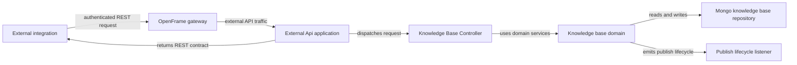
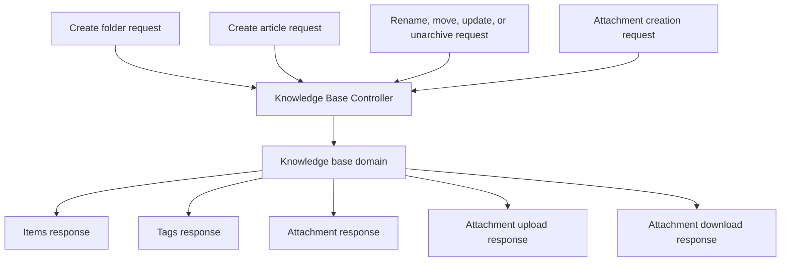
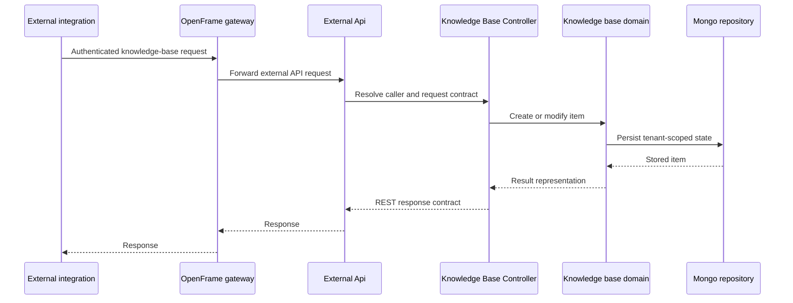
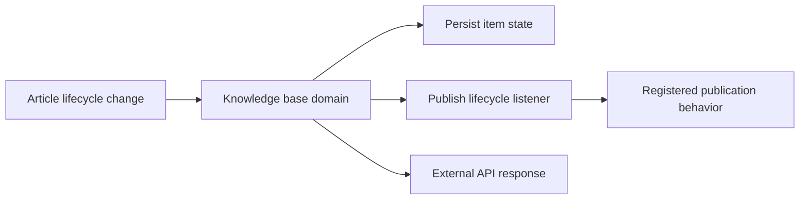

# Knowledge Base Api

Knowledge Base Api is the REST-facing knowledge-base capability supplied by the OpenFrame External Api service. It lets authenticated external integrations manage a tenant's article and folder hierarchy, tags, article lifecycle, and attachment content without coupling callers to the platform's internal GraphQL model.

The implementation is provided by the `openframe-external-api-service-core` library from [OpenFrame OSS Library](https://github.com/flamingo-stack/openframe-oss-lib). This tenant repository assembles that library into the External Api application and deploys it behind the OpenFrame gateway. The supplied module tree identifies the controller and request and response contracts; it does not provide the controller source for this run, so this document intentionally describes operations and boundaries rather than inventing HTTP paths, verbs, parameter names, or response status codes.

## Responsibilities

Knowledge Base Api provides the following integration-facing functions:

- Creates folders and articles.
- Lists knowledge-base items and exposes tags.
- Renames folders and moves knowledge-base items within the hierarchy.
- Updates articles, including archive and unarchive lifecycle actions.
- Uploads attachment content, returns attachment metadata, and supports attachment download responses.
- Converts external request contracts into the internal knowledge-base model while keeping API callers independent of internal persistence and GraphQL schemas.

The public REST adapter is [`KnowledgeBaseController`](https://github.com/flamingo-stack/openframe-oss-lib/blob/main/openframe-external-api-service-core/src/main/java/com/openframe/external/controller/KnowledgeBaseController.java). The controller is delivered by the `com.openframe.oss:openframe-external-api-service-core` dependency, pinned at version `7.0.11` by this repository.

## Architecture

At runtime, the gateway route for external API documentation and requests targets the External Api service. Authentication and request resolution are shared External Api concerns. Knowledge Base Api is therefore an adapter layer, not an independently deployed service.

### Component boundaries

| Layer | Library component | Role |
|---|---|---|
| REST resource | [`KnowledgeBaseController`](https://github.com/flamingo-stack/openframe-oss-lib/blob/main/openframe-external-api-service-core/src/main/java/com/openframe/external/controller/KnowledgeBaseController.java) | Defines the external knowledge-base operation boundary and maps requests and responses. |
| Request contracts | `CreateArticleRequest`, `CreateFolderRequest`, `UpdateArticleRequest`, `RenameFolderRequest`, `MoveKnowledgeBaseItemRequest`, `UnarchiveArticleRequest`, and `CreateKnowledgeBaseAttachmentRequest` | Make article, folder, hierarchy, lifecycle, and attachment input explicit at the REST boundary. |
| Response contracts | `KnowledgeBaseItemsResponse`, `KnowledgeBaseTagResponse`, `KnowledgeBaseAttachmentResponse`, `KnowledgeBaseAttachmentUploadResponse`, and `KnowledgeBaseAttachmentDownloadResponse` | Return list, tag, metadata, upload, and download representations suitable for integrations. |
| Internal query layer | [`KnowledgeBaseDataFetcher`](https://github.com/flamingo-stack/openframe-oss-lib/blob/main/openframe-api-service-core/src/main/java/com/openframe/api/datafetcher/KnowledgeBaseDataFetcher.java) | Serves the platform's internal GraphQL-facing knowledge-base access path. It is adjacent to, rather than a REST replacement for, the controller. |
| Batch relation loading | `KnowledgeBaseItemDataLoader`, `KnowledgeBaseAttachmentDataLoader`, and `KnowledgeBaseTagDataLoader` | Avoid repeated per-item lookups when internal GraphQL queries traverse item, attachment, and tag relations. |
| Persistence extension | [`CustomKnowledgeBaseItemRepository`](https://github.com/flamingo-stack/openframe-oss-lib/blob/main/openframe-data-mongo-sync/src/main/java/com/openframe/data/repository/knowledgebase/CustomKnowledgeBaseItemRepository.java) | Provides custom knowledge-base item queries over the tenant-aware Mongo data layer. |
| Publish hook | [`KnowledgeBasePublishLifecycleListener`](https://github.com/flamingo-stack/openframe-oss-lib/blob/main/openframe-api-lib/src/main/java/com/openframe/api/service/knowledgebase/KnowledgeBasePublishLifecycleListener.java) | Defines a lifecycle integration point for published knowledge-base content. |

## Contract model

The REST contract separates state-changing commands from read representations.

### Item hierarchy and lifecycle

Folders establish the navigable hierarchy. Articles are created and updated as content-bearing items. Move and rename contracts support structural changes without requiring an integration to reconstruct the complete tree. The dedicated unarchive contract shows that article availability includes a reversible archived state.

Consumers should treat the controller's contracts as the stable integration boundary. They should not rely on Mongo document layout, internal data fetchers, or DataLoader behavior.

### Attachments

Attachment support is modeled as a distinct workflow instead of an opaque field on an article:

1. An integration submits attachment creation or upload input.
2. The controller delegates validation and storage work to the knowledge-base domain.
3. The API returns upload and attachment metadata representations.
4. A separate download representation supports retrieving attachment content.

The exact upload transport and download URL shape must be taken from the deployed OpenAPI description. They are not inferred here because no controller method bodies were supplied.

## Request processing flows

### Create or update content

### Publication lifecycle

Publishing is a domain concern exposed through the `KnowledgeBasePublishLifecycleListener` extension point. The listener allows publication-related behavior to be connected without embedding that behavior in the REST resource.

The module tree confirms the lifecycle listener exists, but does not identify its listener implementations or downstream effects. Maintainers should inspect registered implementations before changing publish semantics.

## Authentication, tenancy, and isolation

Knowledge Base Api runs inside the External Api service, whose web configuration resolves the API caller before controller logic executes. The broader OpenFrame deployment routes external API traffic through the gateway. The underlying data stack includes tenant-aware Mongo configuration; the knowledge-base repository operates within that persistence boundary.

Consequently, integrations should:

- Authenticate through the platform-supported external API mechanism.
- Assume all knowledge-base operations are scoped to the caller's permitted tenant context.
- Avoid passing or trusting a tenant identifier unless the verified API contract explicitly requires it.
- Use the published OpenAPI description for authorization requirements and endpoint-level details.

## Internal and external access paths

Knowledge-base data is reachable through two complementary layers:

- **External REST path:** `KnowledgeBaseController` and its knowledge-base request and response contracts serve external integrations.
- **Internal GraphQL path:** `KnowledgeBaseDataFetcher` with knowledge-base DataLoaders supports platform UI and internal API graph resolution.

These paths should share domain semantics, but they have different transport contracts and optimization mechanisms. Changes to article or folder behavior should be checked against both paths, especially when altering fields, relation loading, archive behavior, tags, or attachments.

## Testing and maintenance

The external integration suite includes [`ExternalKnowledgeBaseTest`](https://github.com/flamingo-stack/openframe-oss-lib/blob/main/openframe-test-service-core/src/main/java/com/openframe/test/tests/external/ExternalKnowledgeBaseTest.java), supplied by the `com.openframe.oss:openframe-test-service-core` library. Its presence indicates that Knowledge Base Api behavior is exercised as part of the external API test surface.

When maintaining this module:

1. Start with the controller and the relevant external request or response contract.
2. Trace corresponding internal behavior through the knowledge-base data fetcher, DataLoaders, and repository extension.
3. Check the publication lifecycle listener before modifying archive or publication-related operations.
4. Update or run the external knowledge-base tests for externally observable changes.
5. Obtain authoritative endpoint paths, schemas, and authentication details from the deployed External Api OpenAPI documentation rather than deriving them from class names.

## Source inventory

| Source | Supplied by | Why it matters |
|---|---|---|
| `openframe-external-api-service-core` | OpenFrame OSS Library, version `7.0.11` | REST controller and knowledge-base transport contracts. |
| `openframe-api-service-core` | OpenFrame OSS Library, version `7.0.11` | Internal knowledge-base data fetcher and batch relation loaders. |
| `openframe-api-lib` | OpenFrame OSS Library, version `7.0.11` | Knowledge-base publication lifecycle abstraction. |
| `openframe-data-mongo-sync` | OpenFrame OSS Library, version `7.0.11` | Tenant-aware Mongo repository extension. |
| `openframe-test-service-core` | OpenFrame OSS Library, version `7.0.11` | External knowledge-base integration coverage. |

This repository supplies the External Api application entry point and deployment wiring. The knowledge-base runtime implementation itself is assembled from these OpenFrame OSS Library artifacts.
