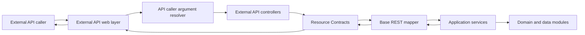
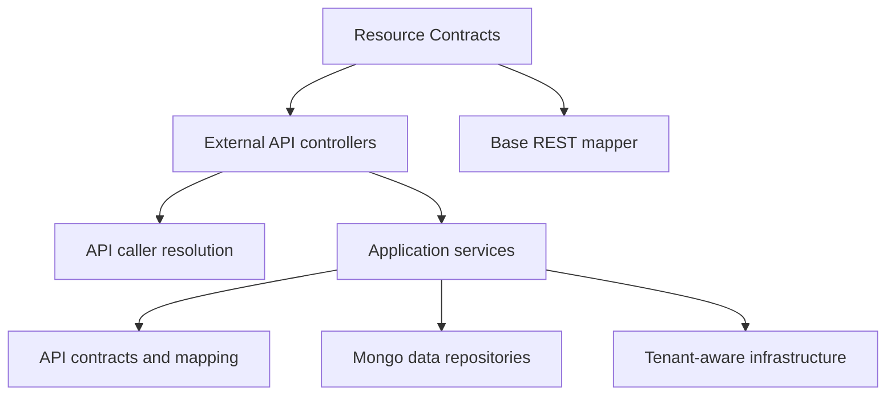
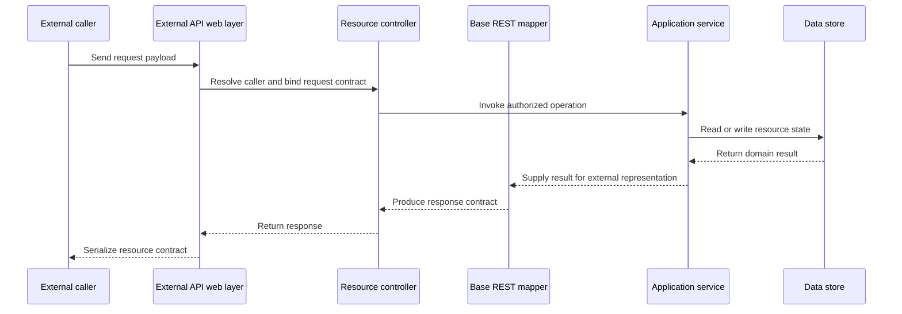
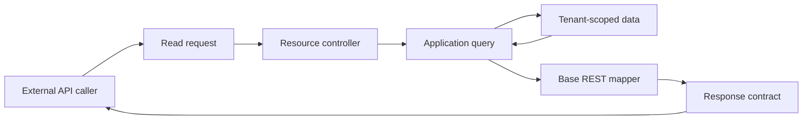
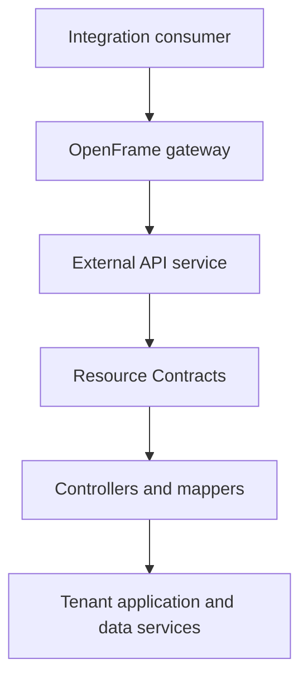

# Resource Contracts

Resource Contracts is the data-model boundary of the External API service. It defines the request and response shapes exchanged by external integrations for devices, knowledge base content, tickets, and tool access. The module is supplied at runtime by the `openframe-external-api-service-core` library from OpenFrame OSS Library version `7.0.11`, which this repository consumes.

The supplied module tree identifies no implementation component owned directly by this documentation node. Its contract surface is instead represented by the External API data transfer objects listed under its parent module. This page documents that boundary without inferring HTTP paths, field names, or validation rules that are not present in the supplied components.

## Purpose and Scope

Resource Contracts provide a stable vocabulary between callers and the External API controllers:

- **Request contracts** carry create, update, move, rename, assignment, note, and ticket-transition intent into the service.
- **Response contracts** serialize public resource state, including devices, tags, knowledge base items and attachments, tickets, and tool connection material.
- **Mapping boundary** separates externally shaped payloads from internal domain, persistence, and service representations.
- **Compatibility boundary** concentrates changes that can affect API clients, making contract changes a deliberate interoperability concern.

The contracts do not themselves authorize requests, select tenant data, persist records, or execute business operations. Those responsibilities belong to the External API service's web configuration, caller resolution, controllers, and the underlying application services.

## Contract Families

| Family | Contracts identified in the module tree | Role |
|---|---|---|
| Device and tag discovery | `DeviceFilterItem`, `DeviceTagResponse`, `TagFilterItem` | Represent externally consumable device-filter and tag data. |
| Knowledge base commands | `CreateArticleRequest`, `CreateFolderRequest`, `CreateKnowledgeBaseAttachmentRequest`, `MoveKnowledgeBaseItemRequest`, `RenameFolderRequest`, `UnarchiveArticleRequest`, `UpdateArticleRequest` | Carry content and structure changes into knowledge base operations. |
| Knowledge base views | `KnowledgeBaseAttachmentDownloadResponse`, `KnowledgeBaseAttachmentResponse`, `KnowledgeBaseAttachmentUploadResponse`, `KnowledgeBaseItemsResponse`, `KnowledgeBaseTagResponse` | Return knowledge base items, tags, attachment metadata, and download or upload results. |
| Ticket commands | `AssignTicketRequest`, `CreateTicketRequest`, `TicketNoteRequest`, `TransitionTicketRequest`, `UpdateTicketRequest` | Express ticket creation, ownership, notes, status movement, and updates. |
| Ticket views | `TicketAttachmentResponse`, `TicketFilterOptionResponse`, `TicketFiltersResponse`, `TicketNoteResponse`, `TicketOwnerResponse`, `TicketStatisticsResponse`, `TicketStatusResponse`, `TicketTagResponse`, `TicketsResponse` | Return ticket records and supporting filter, owner, status, tag, attachment, note, and statistics data. |
| Tool access views | `ToolApiKeyResponse`, `ToolCredentialsResponse`, `ToolResponse`, `ToolUrlResponse` | Represent tool identity and connection material exposed to authorized external callers. |

## Architecture

The contract layer is an adapter boundary, not an independent service. The relationships below reflect the classes provided by `openframe-external-api-service-core` and the surrounding modules named in the supplied tree.

### Responsibilities by Layer

- The **External API web layer** configures HTTP concerns and resolves the caller context through `ExternalApiWebConfig` and `ApiCallerArgumentResolver`.
- **Controllers** such as `CustomerController`, `DeviceController`, `IntegrationController`, `KnowledgeBaseController`, `LogController`, `TicketController`, and `ToolController` bind transport requests to application operations and emit resource contracts.
- **Resource Contracts** make the externally visible input and output shapes explicit. They should remain free of persistence behavior and service orchestration.
- `BaseRestMapper` is the mapping seam between the service or domain representations and externally oriented response models.
- **Application services and data modules** apply business rules and retrieve or change tenant-scoped data. They are intentionally behind the contract layer.

## Dependency Boundaries

The Resource Contracts module depends conceptually on controller binding and mapping, while controllers and consumers depend on its serialized shape. This direction is important: external payload models must not expose internal persistence documents directly. The API service, API contract, and Mongo repository modules named in the module tree provide the surrounding application, DTO, and persistence layers.

## Request Processing Flow

The following flow applies to a typical write operation, such as creating or updating knowledge base content or changing a ticket. It is intentionally route-agnostic because the provided components do not define resource paths here.

### Processing Invariants

Maintainers should preserve these properties when evolving a contract:

1. **Caller context precedes resource work.** The web layer resolves the API caller before a controller delegates to a service.
2. **Request and response contracts remain transport models.** Business decisions, tenant selection, and persistence mechanics remain outside DTO classes.
3. **Mappings are explicit.** Add or modify conversion logic at the REST mapping boundary rather than coupling callers to internal models.
4. **A response is derived after service execution.** Return models reflect the result supplied by the application layer, not request echoes unless the operation semantics explicitly require it.
5. **Tool access data requires special care.** `ToolApiKeyResponse`, `ToolCredentialsResponse`, and `ToolUrlResponse` can convey connection material; changes must preserve the service's authorization and disclosure expectations.

## Read-Model Flow

For read operations, response contracts turn internal query results into API resources. Filter and pagination behavior are controller and service concerns; the available contract names indicate that ticket filters and device tags are separately represented rather than embedded as opaque internal objects.

Examples of response-only support models include `TicketFiltersResponse`, `TicketFilterOptionResponse`, `TicketStatusResponse`, `TicketOwnerResponse`, and `DeviceTagResponse`. These models allow the API to expose display or selection data without requiring consumers to understand the backing repository or domain object shape.

## Mapping and Evolution Guidance

### Adding a Resource Field

1. Identify whether the new data belongs in a request contract, a response contract, or both.
2. Confirm that the relevant controller and application service can authorize, obtain, and validate the data.
3. Extend the mapper so the external model is constructed deliberately from its source representation.
4. Consider existing API consumers before changing a serialized response, especially fields representing ticket status, tags, attachments, or tool connection details.
5. Add or update integration coverage at the External API boundary. The module tree includes external API tests for authentication, customers, devices, knowledge base content, logs, pagination, tickets, and tools.

### Compatibility Considerations

Treat every public DTO adjustment as an API compatibility change:

- Prefer additive response changes when consumer behavior is unknown.
- Do not rename, remove, or reinterpret a field without coordinating a versioning or migration strategy.
- Keep request models narrowly scoped to the operation they support instead of reusing persistence-oriented objects.
- Preserve distinctions among related response types, such as attachment metadata, attachment download results, and attachment upload results.
- Review how optionality, defaults, and validation are implemented in the actual DTO source before changing a contract. Those details are not exposed by the supplied component inventory.

## Integration with the Tenant Deployment

This repository packages the External API application, which assembles `openframe-external-api-service-core`. The platform gateway routes the `/api-docs/**` path to the External API service according to the repository configuration; the supplied deployment facts do not establish additional public resource paths for this module. The External API configuration includes `OpenApiConfig`, so generated API documentation is the authoritative route and schema reference when the service is running.

## Maintainer Checklist

- Identify the relevant contract family and the controller that owns the operation.
- Verify serialization and validation annotations in the implementation source before relying on field-level behavior.
- Keep sensitive tool credentials and API key material limited to authorized response paths.
- Update mapper logic and API-level tests together with DTO changes.
- Validate OpenAPI output after changes, because it is the consumer-facing schema representation.
- Avoid leaking database documents, tenant identifiers, or internal exception details through a resource contract.

## Provenance

The DTOs and web-layer components documented here are provided by the OpenFrame OSS Library artifact `com.openframe.oss:openframe-external-api-service-core` at version `7.0.11`. The tenant repository consumes that artifact and packages the `openframe-external-api` service image. No direct implementation components were supplied for Resource Contracts itself, so source-level field definitions and endpoints must be confirmed in the library source or in the running service's OpenAPI output.
