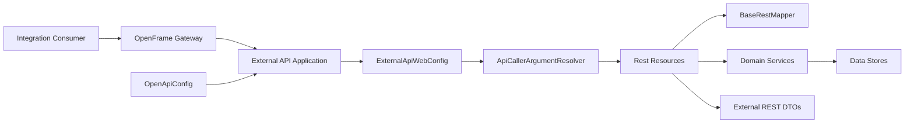
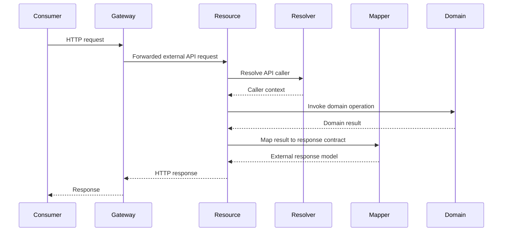
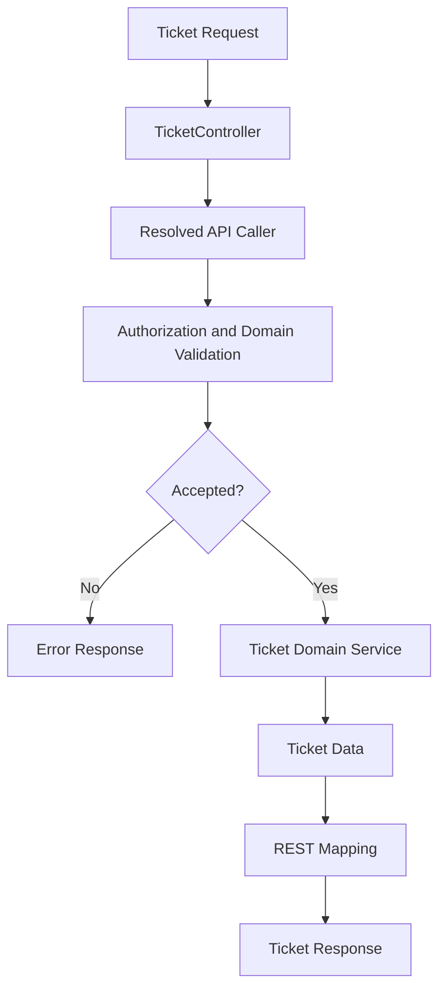
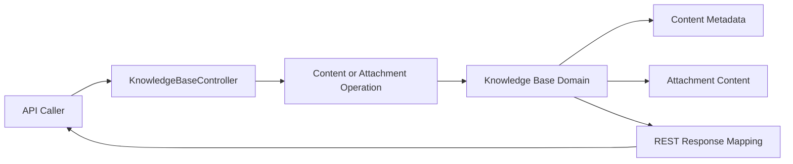
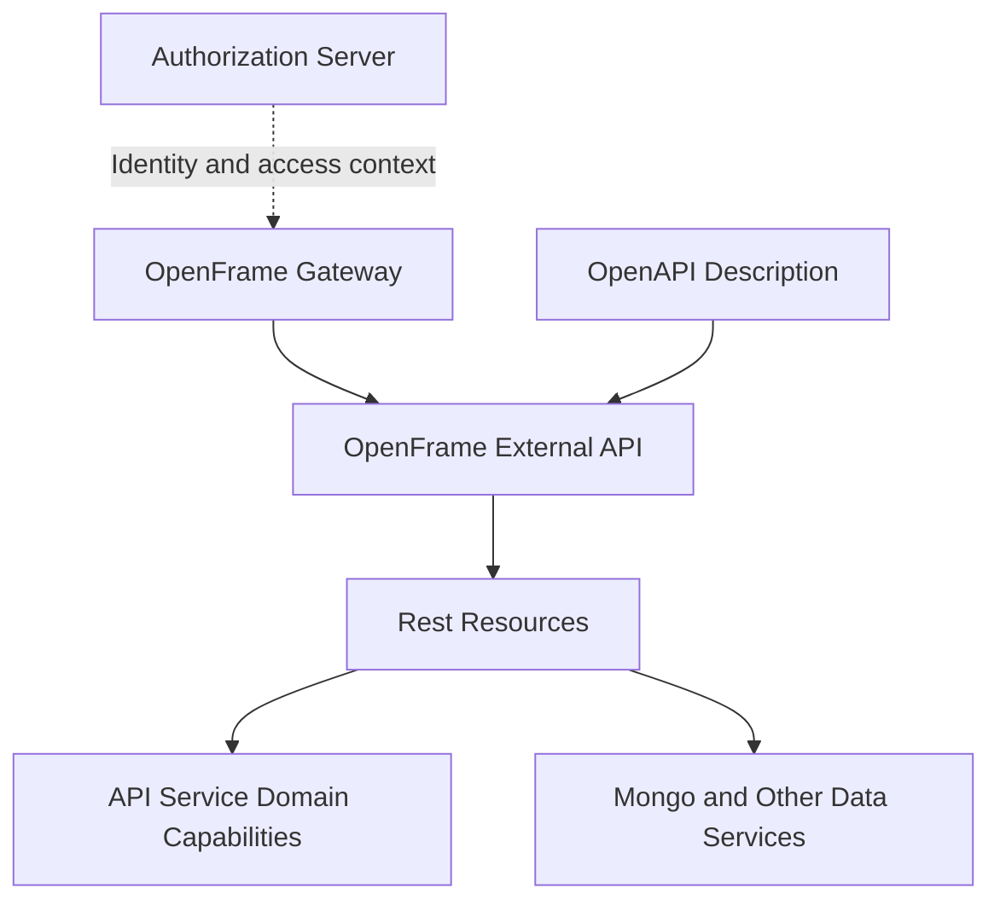

# Rest Resources

Rest Resources is the HTTP resource layer of the OpenFrame External API. It groups the Spring controllers that expose integration-facing operations for customers, devices, integrations, knowledge base content, logs, tickets, and tools. The implementation is supplied by the `openframe-external-api-service-core` library, consumed by this repository at version `7.0.11`; the tenant service contributes the application runtime that assembles that library.

This module is an API boundary, not a persistence or message-processing layer. A resource accepts an HTTP request, obtains the authenticated caller through the web integration, delegates the operation to its domain dependencies, and serializes a resource-specific response DTO. Exact request mappings, HTTP methods, and field-level contracts are intentionally not enumerated here because they are not present in the supplied component source.

## Responsibilities

- Present integration-oriented REST resources through `CustomerController`, `DeviceController`, `IntegrationController`, `KnowledgeBaseController`, `LogController`, `TicketController`, and `ToolController`.
- Translate externally shaped requests and responses using the `BaseRestMapper` foundation and resource DTOs.
- Resolve the API caller through `ApiCallerArgumentResolver`, allowing controller methods to receive caller context without independently parsing credentials.
- Register the MVC integration through `ExternalApiWebConfig` and expose OpenAPI configuration through `OpenApiConfig`.
- Keep domain processing behind the controller boundary: resources coordinate work but should not duplicate ticket, device, knowledge base, log, or tool business logic.

## Component Map

| Component | Role in Rest Resources |
| --- | --- |
| `CustomerController` | Resource entry point for customer-facing integration operations. |
| `DeviceController` | Resource entry point for device and device-tag representations. |
| `IntegrationController` | Resource entry point for integration management operations. |
| `KnowledgeBaseController` | Resource entry point for knowledge base items, folders, tags, and attachments. |
| `LogController` | Resource entry point for externally consumable log operations. |
| `TicketController` | Resource entry point for ticket lifecycle, notes, assignment, status, filters, and attachments. |
| `ToolController` | Resource entry point for tool details, credentials, URLs, and API-key-related representations. |
| `ApiCallerArgumentResolver` | MVC argument resolver that supplies caller information to resource handlers. |
| `ExternalApiWebConfig` | Web-layer configuration that registers external API MVC behavior. |
| `OpenApiConfig` | OpenAPI configuration for publishing the external API description. |
| `BaseRestMapper` | Shared mapping base for translating domain data to REST contracts. |

## Architecture

The gateway configuration in this repository sends `/api-docs/**` traffic to the External API service. `OpenApiConfig` therefore belongs to the same deployed API surface as the resources. Other gateway routing and any controller-specific request mappings must be verified from the running service configuration or generated API description.

## Resource Families and Contract Boundaries

The external API library defines DTOs alongside its controllers. These contracts separate the external representation from the underlying data model.

| Resource family | Contract examples | Boundary concern |
| --- | --- | --- |
| Devices | `DeviceFilterItem`, `DeviceTagResponse`, `TagFilterItem` | Filtering and tag-oriented device representations are exposed without requiring callers to consume internal device entities. |
| Knowledge base | Create, update, move, rename, archive, attachment upload, download, and response DTOs | Content and attachment operations use distinct input and response contracts. |
| Tickets | Create, update, assign, transition, note, attachment, filter, status, owner, statistics, and list DTOs | Ticket lifecycle requests are explicit inputs, while views are returned as response models. |
| Tools | `ToolApiKeyResponse`, `ToolCredentialsResponse`, `ToolResponse`, `ToolUrlResponse` | Tool metadata and connection material are represented by dedicated external DTOs. |

## Request Processing Flow

Authentication and authorization are cross-cutting concerns. The caller resolver establishes the controller-facing caller context; enforcement beyond that boundary remains the responsibility of the configured security and domain layers. Resource handlers should preserve this separation rather than accepting a caller identity from client-controlled request data.

## Ticket Lifecycle Interaction

Ticket operations are the most stateful resource family represented by the supplied contracts. The resource layer receives a lifecycle command, delegates mutation and validation, then returns a mapped view. The controller should not persist ticket state directly.

The available contracts indicate separate commands for creating, updating, assigning, transitioning, and adding notes. This design makes intent visible at the boundary and avoids treating every ticket change as a generic document update.

## Knowledge Base and Attachment Flow

Knowledge base resources cover both content hierarchy operations and attachment transfers. Inputs such as create, update, move, rename, unarchive, and attachment-upload requests identify the intended operation, while download, upload, and attachment response objects define externally consumable results.

Keep binary or attachment transport concerns isolated from article and folder metadata handling. This allows attachment-specific validation and response semantics without coupling them to the content hierarchy model.

## Dependencies and System Position

Rest Resources is provided by the OpenFrame OSS Library artifact `com.openframe.oss:openframe-external-api-service-core` version `7.0.11`. The tenant repository publishes the `com.openframe:openframe-external-api` application artifact and deploys an External API service image. The service participates in the tenant deployment alongside the gateway, authorization server, API service, client service, management service, and stream service.

The dotted relationship denotes a security dependency in the deployed platform rather than a controller-to-controller invocation. Do not introduce direct resource-layer dependencies on gateway routing internals.

## Extension Guidance

When adding a REST resource or expanding an existing one:

1. Define or extend a dedicated external request and response DTO rather than exposing persistence documents.
2. Obtain caller context through the established MVC resolver and apply authorization in the appropriate security or domain layer.
3. Delegate validation, mutation, and persistence to domain services; keep controllers focused on HTTP orchestration.
4. Reuse the mapping approach provided by `BaseRestMapper` so serialization remains consistent across resource families.
5. Update the generated OpenAPI metadata and verify the deployed API description through the configured documentation route.
6. Add integration coverage for both authorized and unauthorized requests, validation failures, and successful response mapping.

## Operational Notes

- This module does not define a standalone network listener. It runs inside the External API Spring application.
- The repository configuration confirms the gateway route for `/api-docs/**`; it does not, from the supplied information, establish concrete routes for every resource controller.
- REST contracts can be externally consumed. Treat response field changes, request validation changes, and status-code changes as API compatibility decisions.
- No source-level controller code was supplied for this module. Validate endpoint paths, annotations, authorization rules, and error responses against the library source or the generated OpenAPI document before making compatibility claims.
