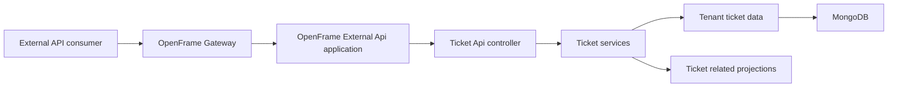
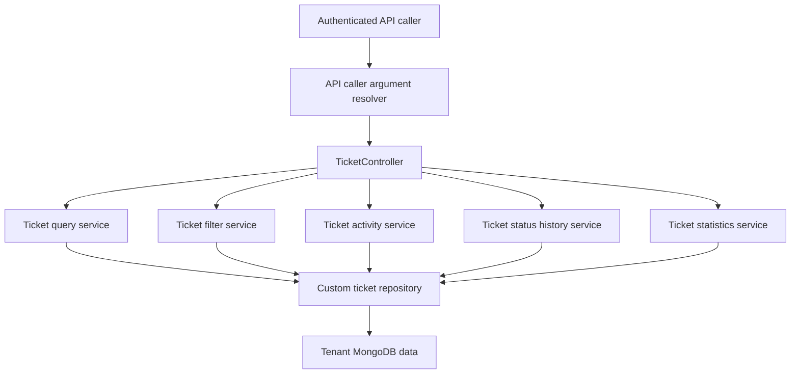
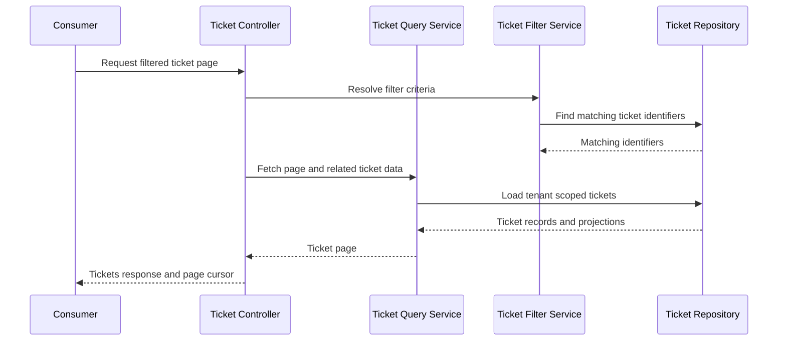
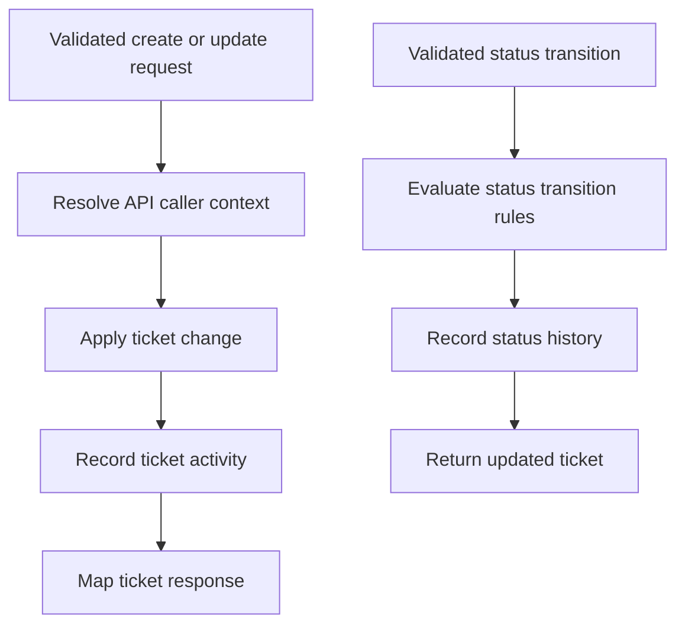
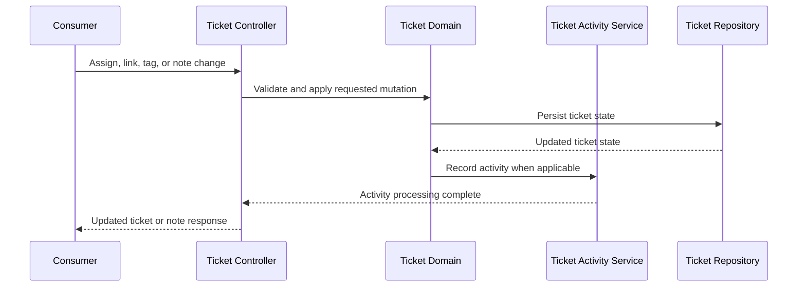
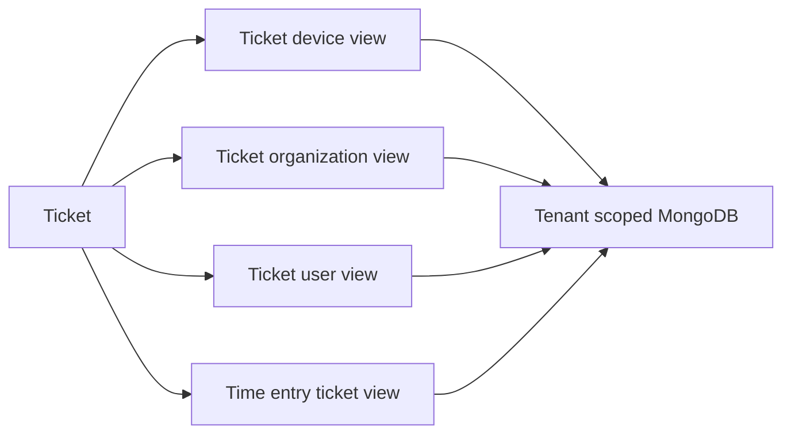

# Ticket Api

Ticket Api is the ticket-management surface of the External Api service. It presents ticket retrieval and mutation capabilities to authenticated API consumers while the underlying implementation is supplied by the `com.openframe.oss:openframe-external-api-service-core` library, version `7.0.11`. The tenant repository packages that library into the OpenFrame External Api application.

The module centers on `TicketController`. Its controller operations accept a resolved API caller, validate write payloads, and coordinate ticket query, filtering, activity, status-history, and statistics services supplied by `com.openframe.oss:openframe-api-lib` version `7.0.11`.

For the surrounding service and application boundary, see [External Api Service Core](external-api-service-core.md). For the broader REST resource layer, see [Rest Resources](rest_resources.md).

## Responsibilities

Ticket Api provides these capabilities:

- List tickets using status, customer, assignee, and tag selections; optional text search; cursor pagination; and caller-selected ordering.
- Return one ticket, available status definitions, tags, filter choices, and aggregate ticket statistics.
- Create and update tickets, including title, description, device, customer, assignee, status, and tag associations where applicable.
- Transition a ticket to a requested status with an optional reason, and maintain status history.
- Assign or unassign a technician, unlink a device or customer, and add or remove tags.
- Add, edit, and delete ticket notes.

The module does not define a separate service in this repository. It assembles the external API library into the `openframe-external-api` service, which is released as the `openframe-external-api` container image.

## Position in the System

At deployment time, the gateway routes the external API documentation path to the OpenFrame External Api service. Ticket Api executes inside that service rather than as an independently deployed endpoint group. Tenant-scoped Mongo configuration and repositories provide the persistent backing for ticket data, while related device, organization, user, and time-entry projections supply the relationships represented by a ticket.

## Component Model

### API Boundary

`TicketController` is the entry point supplied by the external API library. An `ApiCaller` is resolved by the external API web layer rather than accepted from a client request body. This caller context is passed to each controller operation, keeping access decisions and tenant context outside mutable ticket payloads.

The controller's public operation groups are:

| Group | Operations | Result |
|---|---|---|
| Discovery and listing | Retrieve tickets, one ticket, statuses, tags, filters, and statistics | Response models such as `TicketsResponse`, `TicketStatusResponse`, `TicketTagResponse`, `TicketFiltersResponse`, and `TicketStatisticsResponse` |
| Ticket lifecycle | Create, update, and transition a ticket | Updated ticket representation and recorded lifecycle changes |
| Associations | Assign or unassign, unlink customer or device, add or remove a tag | Updated ticket representation |
| Notes | Add, update, and delete a note | Ticket note representation or updated ticket state |

### Service Responsibilities

The API library separates read-oriented and lifecycle concerns into focused services.

| Component | Responsibility |
|---|---|
| `TicketQueryService` | Provides ticket-oriented query operations used by API-facing read flows. |
| `TicketFilterService` | Resolves the selectable filter dimensions and ticket identifiers matching filter criteria. |
| `TicketActivityService` | Handles ticket activity concerns associated with changes and interactions. |
| `TicketStatusHistoryService` | Maintains or reads status-transition history. |
| `TicketStatisticsService` | Produces ticket aggregates, including counts grouped by status definition. |
| `TicketNumberService` | Provides ticket-number behavior used by ticket lifecycle logic. |
| `TicketStalenessResolver` | Resolves staleness information using its configured properties and a resolver stamp. |

The persistence implementation is supplied by the data library. `CustomTicketRepository` and its implementation provide ticket-specific repository behavior. Ticket, user, organization, device, and time-entry publishing components provide projection types used to keep ticket-related views aligned with changes in those domains.

## Request and Response Contracts

All write requests are validated at the controller boundary. Field names below are the contract names exposed by the library records.

| Contract | Fields | Use |
|---|---|---|
| `CreateTicketRequest` | `title`, `description`, `statusId`, `deviceId`, `customerId`, `assigneeId`, `tagIds` | Creates a ticket and initializes its optional associations. |
| `UpdateTicketRequest` | `title`, `description`, `deviceId`, `customerId`, `assigneeId`, `tagIds` | Changes the editable ticket content and associations. |
| `TransitionTicketRequest` | `toStatusId`, `reason` | Requests a status change and supplies an optional transition reason. |
| `AssignTicketRequest` | `assigneeId` | Assigns the ticket to a user. |
| `TicketNoteRequest` | `content` | Creates or replaces note content. |

List retrieval accepts optional status, customer, assignee, and tag identifier collections; an optional search term; a cursor; and sort controls. The limit defaults to `20`, must be at least `1`, and is capped at `100`. The cursor is based on the page end cursor; unreadable cursor input is rejected by the controller.

Ticket representations are composed into dedicated response types. The response layer includes a ticket collection with pagination information, individual ticket data, owners, notes, attachments, tags, status definitions, filter options, and statistics. Consumers should treat identifiers returned by status, tag, and filter discovery as the inputs for subsequent filtering and mutation requests.

## Ticket Read Flow

The filter service is responsible for interpreting the selected dimensions, while the query service supplies ticket data for the page. Search covers ticket title, description, ticket number, device, customer, and assignee. Ordering can use fields including creation time, update time, ticket number, status kind, customer name, assignee name, and device hostname.

## Ticket Lifecycle Flow

A transition explicitly names the target status through `toStatusId`; the controller also accepts a `reason`. The ticket domain exposes `TicketStatusTransitionRule`, and the status-history service is the designated component for preserving the resulting lifecycle record. Clients should discover valid statuses before requesting transitions and should handle a rejected transition as a domain-level outcome rather than assuming every status pair is valid.

## Association and Note Flow

Association operations support assignment changes, explicit removal of an assignee, customer, or device link, and tag additions or removals. Note operations accept the same note-content contract for creation and update, while note deletion addresses the note independently within its ticket.

## Data and Tenant Boundaries

Ticket Api is tenant-aware through the surrounding service configuration and caller context. Repository and projection components from the Mongo data library include tenant-aware configuration and ticket views for devices, organizations, users, and time entries. API consumers must therefore use identifiers that are valid in the caller's tenant; identifiers are not portable across tenants.

## Dependencies

| Dependency | Origin | Role in Ticket Api |
|---|---|---|
| External API service core | OpenFrame OSS Library, `7.0.11` | Provides the controller, request and response contracts, OpenAPI configuration, and caller-resolution web layer. |
| API library | OpenFrame OSS Library, `7.0.11` | Provides ticket query, filtering, statistics, activity, staleness, numbering, and status-history services. |
| Mongo sync data library | OpenFrame OSS Library, `7.0.11` | Provides tenant-aware Mongo configuration, ticket repositories, and cross-domain ticket projections. |
| Gateway service core | OpenFrame OSS Library, `7.0.11` | Provides the gateway runtime used to expose the external API service through configured routes. |
| OpenFrame External Api application | This repository | Bootstraps the external API library into the deployable service. |

## Testing and Maintenance

The OpenFrame test library includes `ExternalTicketsTest`, a ticket-focused external API test suite, alongside external API authentication and pagination coverage. Changes to Ticket Api should preserve the following contracts:

1. Validate every write payload at the controller boundary.
2. Preserve tenant scope through caller context and repository operations.
3. Keep cursor behavior, limit constraints, and supported sort fields compatible for list consumers.
4. Record lifecycle changes through the ticket activity and status-history services rather than bypassing domain handling.
5. Verify ticket, association, note, filtering, pagination, and transition scenarios through the external API test suite.

The release workflow publishes the OpenFrame External Api image from this repository. Deployment configuration then supplies the gateway routing and shared MongoDB connection settings used by the running service.
