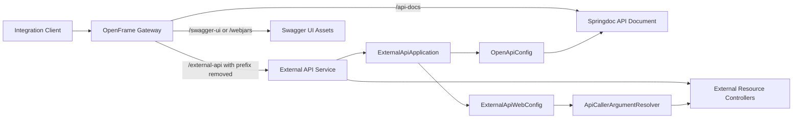
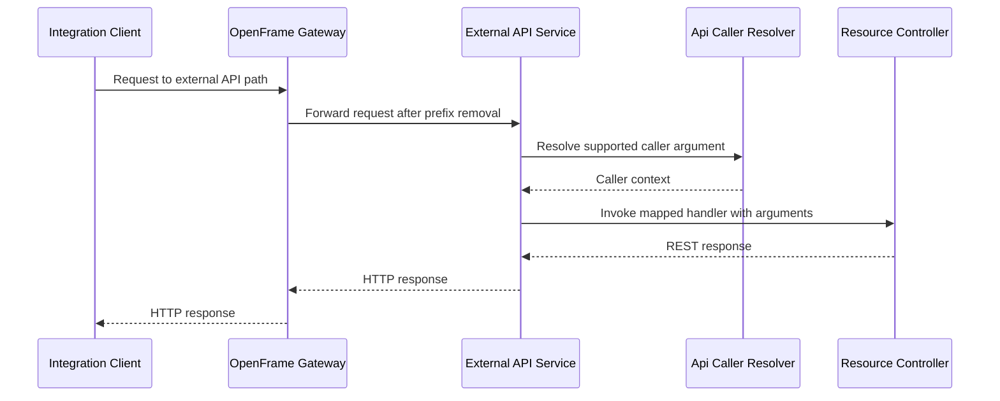
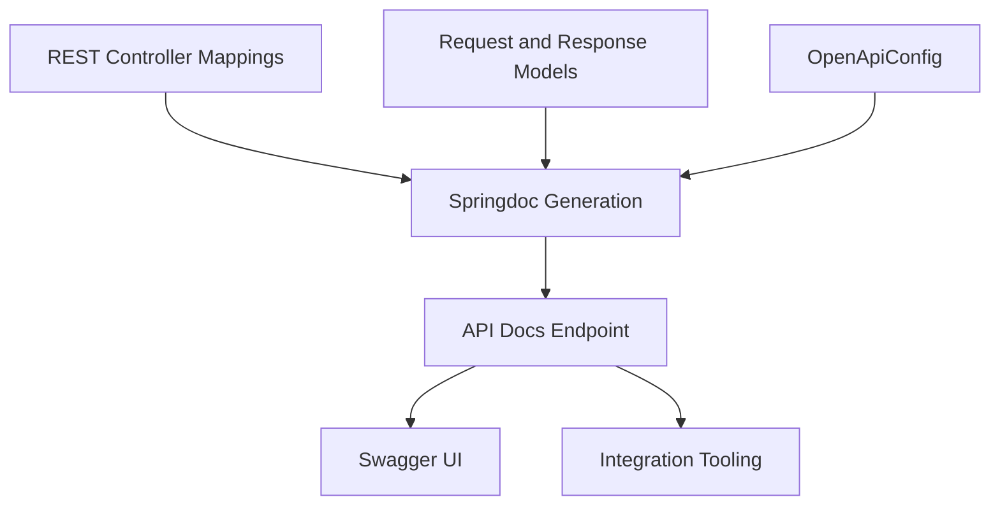

# Web And Openapi

Web And Openapi is the HTTP presentation and API-description layer of the OpenFrame External API service. It combines Spring MVC extension points with Springdoc configuration so programmatic integrations can discover and invoke the service's REST resources. The running application is assembled in this repository, while the web and OpenAPI implementation is supplied by the `openframe-external-api-service-core` library at version `7.0.11`.

The service itself is a servlet application on port `8092`. In the tenant deployment, the gateway exposes external API traffic under `/external-api/**` and removes that leading path before forwarding it to this service. OpenAPI documents are separately routed through `/api-docs/**`; Swagger static resources are routed through `/swagger-ui/**` and `/webjars/**`.

## Responsibilities

- **Application bootstrap:** `ExternalApiApplication` starts Spring Boot and scans the external, data, core, API, and Kafka packages.
- **Web argument resolution:** `ExternalApiWebConfig` installs `ApiCallerArgumentResolver`, allowing controller methods that support it to receive the resolved caller context instead of parsing request security details themselves.
- **OpenAPI description:** `OpenApiConfig` contributes the generated API definition and its service-level metadata and security documentation.
- **Interactive documentation:** Springdoc is configured to publish its document at `/api-docs`; the configured Swagger UI path is `/swagger-ui.html`. The UI enables method and alphabetical tag sorting, filtering, request-duration display, and Try It Out.
- **Resource discovery:** the generated contract describes REST resources implemented by the external API service, including customers, devices, integrations, knowledge base items, logs, tickets, and tools.

## Assembly and Ownership

| Concern | Runtime provider | Notes |
|---|---|---|
| Application entry point | This repository | [`ExternalApiApplication`](https://github.com/flamingo-stack/openframe-oss-tenant/blob/main/openframe/services/openframe-external-api/src/main/java/com/openframe/external/ExternalApiApplication.java) defines the component scan and calls Spring Boot. |
| External API implementation | OpenFrame OSS Library | [`openframe-external-api-service-core`](https://github.com/flamingo-stack/openframe-oss-lib/tree/main/openframe-external-api-service-core) provides Web And Openapi, controllers, DTOs, and mappers. |
| Web configuration | OpenFrame OSS Library | [`ExternalApiWebConfig`](https://github.com/flamingo-stack/openframe-oss-lib/blob/main/openframe-external-api-service-core/src/main/java/com/openframe/external/web/ExternalApiWebConfig.java) registers the custom argument resolver. |
| Caller binding | OpenFrame OSS Library | [`ApiCallerArgumentResolver`](https://github.com/flamingo-stack/openframe-oss-lib/blob/main/openframe-external-api-service-core/src/main/java/com/openframe/external/web/ApiCallerArgumentResolver.java) adapts request security context for supported controller parameters. |
| OpenAPI configuration | OpenFrame OSS Library | [`OpenApiConfig`](https://github.com/flamingo-stack/openframe-oss-lib/blob/main/openframe-external-api-service-core/src/main/java/com/openframe/external/config/OpenApiConfig.java) configures the generated API description. |
| Deployment and route configuration | This repository | [`openframe-external-api.yml`](https://github.com/flamingo-stack/openframe-oss-tenant/blob/main/configs/base/openframe-external-api.yml) configures the servlet service and Springdoc; [`openframe-gateway.yml`](https://github.com/flamingo-stack/openframe-oss-tenant/blob/main/configs/base/openframe-gateway.yml) defines gateway forwarding. |

## Request Handling

The gateway owns the public prefix. A request that enters through `/external-api/**` is forwarded to the External API service with one path segment removed, so controllers receive their application-relative routes. This differs from documentation assets: `/api-docs/**`, `/swagger-ui/**`, and `/webjars/**` are forwarded directly to the service without the external API prefix-removal filter.

Within the servlet application, standard Spring MVC handler selection chooses the controller. `ExternalApiWebConfig` adds `ApiCallerArgumentResolver` to MVC's resolver list. For controller arguments supported by that resolver, it supplies the current API caller context; resource controllers can therefore concentrate on the operation and domain authorization rather than reconstructing caller identity from the request.

## OpenAPI Publication Flow

Springdoc inspects the MVC mappings and model types available in the External API application. Web And Openapi supplements that generated view with the configuration from `OpenApiConfig`; the resulting document is delivered at the configured `/api-docs` path. Swagger UI consumes that document to render interactive reference material. This is a runtime-generated contract: changes to controller mappings, request DTOs, or response DTOs affect the published description.

## REST Resource Surface

The external service core contains the following controller groups. Web And Openapi does not implement their business operations; it makes their HTTP mappings, caller context, and schema documentation available as one coherent web surface.

| Controller group | Scope |
|---|---|
| Customer | Customer-facing organization resources. |
| Device | Device lookup and device-related filtering or tag representations. |
| Integration | Integration-facing operations. |
| Knowledge Base | Knowledge base items, folders, article changes, and attachment operations. |
| Log | Log retrieval resources. |
| Ticket | Ticket creation, retrieval, assignment, notes, transitions, filtering, and statistics. |
| Tool | Tool metadata, credentials, API keys, and URLs. |

The route configuration does not define individual controller paths. Use the generated OpenAPI document from a running deployment as the authoritative list of operations, methods, parameters, response codes, and schemas.

## Configuration Boundaries

### Service configuration

`openframe-external-api.yml` establishes these Web And Openapi-relevant settings:

| Setting | Value | Effect |
|---|---|---|
| `server.port` | `8092` | HTTP listener for the External API service. |
| `spring.main.web-application-type` | `servlet` | Uses the Spring MVC servlet stack. |
| `springdoc.api-docs.path` | `/api-docs` | Publishes the OpenAPI document at this application path. |
| `springdoc.swagger-ui.path` | `/swagger-ui.html` | Configures the Swagger UI entry path in the service. |
| Swagger UI options | sorting, filter, Try It Out, request duration | Controls UI behavior rather than REST resource behavior. |

### Gateway configuration

`openframe-gateway.yml` is the public-routing boundary:

| Gateway route | Upstream behavior |
|---|---|
| `/external-api/**` | Sends traffic to `openframe-external-api` and strips the first path segment. |
| `/api-docs/**` | Directly forwards documentation requests to `openframe-external-api`. |
| `/swagger-ui/**` | Directly forwards Swagger UI resources to `openframe-external-api`. |
| `/webjars/**` | Directly forwards webjar assets to `openframe-external-api`. |

Keep the service-side Springdoc paths and gateway route predicates aligned. A path change in one layer without the corresponding change in the other can make the API document or UI unavailable even when resource controllers continue to serve API traffic.

## Maintenance Guidance

1. **Treat the generated OpenAPI document as the integration contract.** Review it whenever controller mappings or external DTOs change.
2. **Preserve the gateway prefix distinction.** External operations use the `/external-api` gateway prefix, while documentation routes have their own gateway paths.
3. **Keep caller resolution centralized.** Add request-derived caller data through `ApiCallerArgumentResolver` and its supporting security model rather than independently parsing headers in individual controllers.
4. **Update the library deliberately.** Web And Openapi behavior comes from OpenFrame OSS Library version `7.0.11`; upgrading that dependency can change document metadata, resolver behavior, controller mappings, or schema generation.
5. **Verify documentation assets through the gateway.** Test both the configured API document endpoint and the configured Swagger UI path after gateway or Springdoc changes.

## Operational Dependencies

Web And Openapi depends on the External API application to component-scan the library packages and on the gateway to expose them. The same service configuration enables MongoDB and Cassandra and configures NATS and Kafka integration; those facilities support the external controllers' underlying application behavior, but they are not direct responsibilities of the web configuration itself.

The gateway configuration also enables rate limiting and API-key statistics at the gateway layer. Consequently, public request admission and related gateway accounting occur before a request is forwarded to this module; Web And Openapi is responsible for MVC dispatch and API-description generation after forwarding.
