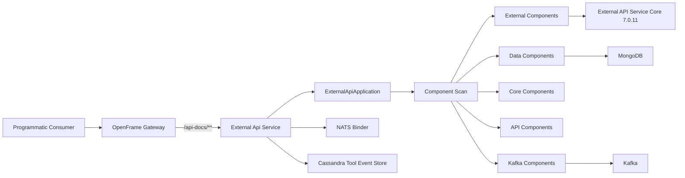
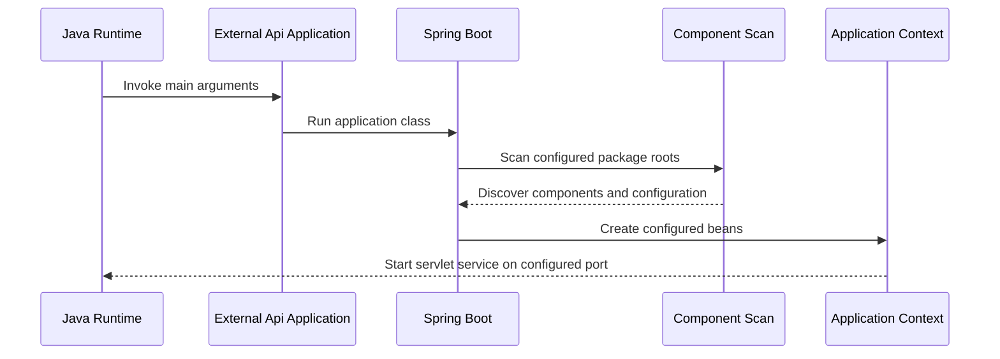
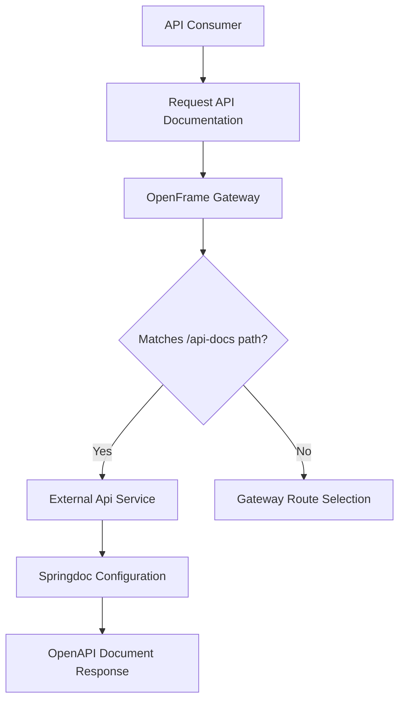
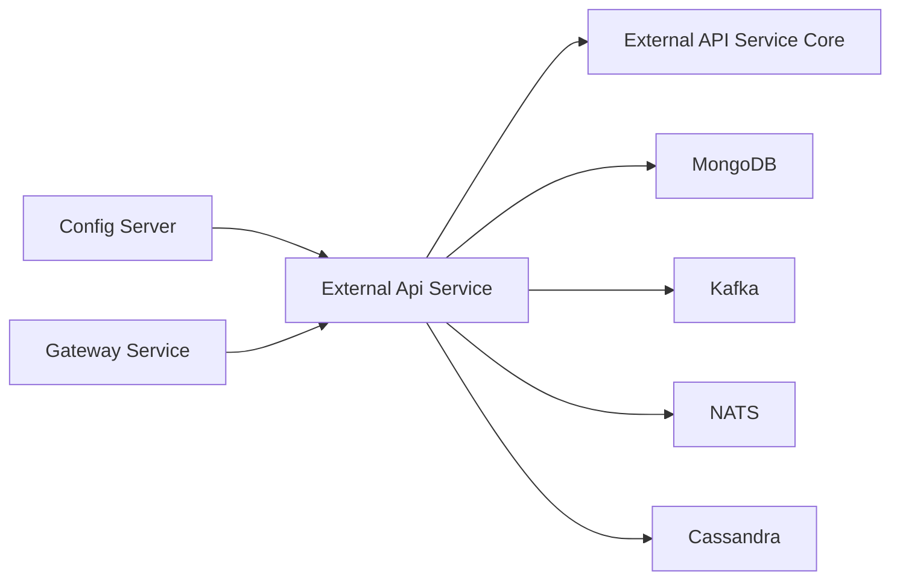

# External Api Service

External Api Service is the servlet-based OpenFrame boundary for programmatic access authenticated with API keys. This repository supplies the deployable Spring Boot application and its tenant configuration; the endpoint, API-key, web, and OpenAPI implementation is contributed by the pinned `openframe-external-api-service-core` library version `7.0.11`.

The module is deliberately thin. `ExternalApiApplication` is the composition root: it starts Spring Boot and expands component discovery beyond its own package so that shared data, core, API, and Kafka components participate in the same application context.

## Responsibilities and Boundaries

| Area | Responsibility in this module | Source of behavior |
| --- | --- | --- |
| Process startup | Creates the Spring Boot application context and starts the embedded servlet application. | `ExternalApiApplication` |
| Component composition | Scans the external, data, core, API, and Kafka package roots. | `ExternalApiApplication` |
| External API features | Provides programmatic access with API keys, according to the service module declaration. | External API service core dependency |
| API description | Serves generated API documentation at `/api-docs` and configures Swagger UI at `/swagger-ui.html`. | Tenant configuration and the external API service core |
| Persistence and events | Enables MongoDB and Kafka settings, selects Cassandra storage for tool events, and provides NATS binder connectivity. | Tenant configuration plus scanned/library components |
| Runtime packaging | Produces a JAR and runs it in a Java 25 runtime container as an unprivileged user. | Maven module and container definition |

The application source contains no controllers, endpoint mappings, or API-key validation logic of its own. Do not assume an endpoint exists merely because a package is scanned; the deployed API surface is defined by the external API service core and the active configuration.

## Architecture

The gateway configuration explicitly forwards only the `/api-docs/**` route to this service. The service listens on port `8092`; its separate management server listens on port `8093`. Any additional production ingress or internal service exposure must be verified in deployment configuration before being documented or relied on.

## Component Model

### External Api Application

`ExternalApiApplication` is annotated with `@SpringBootApplication`, which enables Spring Boot auto-configuration, configuration-class registration, and component scanning. Its explicit `@ComponentScan` includes these package roots:

| Package root | Why it is included |
| --- | --- |
| `com.openframe.external` | Finds the external API module and library-provided configuration. |
| `com.openframe.data` | Makes shared data-layer components available. |
| `com.openframe.core` | Makes shared OpenFrame core components available. |
| `com.openframe.api` | Makes shared API components available. |
| `com.openframe.kafka` | Makes Kafka-related components available. |

Startup is a single call to `SpringApplication.run(ExternalApiApplication.class, args)`. Consequently, failures while creating any required bean in these scanned packages, during auto-configuration, or while binding required configuration prevent the service from starting.

## Request and Documentation Flow

The repository's gateway configuration routes `/api-docs/**` to External Api Service. The service configuration sets Springdoc's documentation path to `/api-docs` and Swagger UI path to `/swagger-ui.html`. API request paths other than the documented gateway route are not inferred here.

Springdoc configuration also sorts operations by method and tags alphabetically, enables request-duration display, enables the filter control, and allows the try-it-out control. These are documentation interface settings, not evidence that every operation may be invoked anonymously; the module description identifies API keys as the programmatic-access mechanism.

## Runtime Configuration

The tenant configuration identifies the application as `openframe-external-api` and declares a servlet web application. Its effective configuration must be supplied through the deployment's configuration mechanism; this file describes the repository baseline.

| Setting area | Baseline |
| --- | --- |
| Application port | `8092` |
| Management port | `8093` |
| Web application type | Servlet |
| MongoDB integration | Enabled |
| Cassandra integration | Enabled, while Spring Boot Cassandra auto-configurations are excluded |
| Redis integration | Disabled |
| Kafka | Enabled, with bootstrap server `kafka.datasources.svc.cluster.local:9092` |
| NATS | Configured for the Spring Cloud Stream NATS binder at `nats.datasources.svc.cluster.local:4222` |
| Tool event storage | Cassandra |
| Outbound device topic | `devices-topic` |
| Object storage feature | S3 integration enabled with bucket `local-dev-bucket` |

The explicit Cassandra exclusions are important: the service enables its Cassandra-related application integration but prevents the listed Spring Boot Cassandra auto-configurations from creating their default configuration. Maintain both sides of that choice when upgrading Spring Boot or changing data infrastructure.

NATS configuration is required because the NATS binder is initialized at startup by the library version used here. Removing the server properties can make binder creation fail and therefore stop the application context from starting.

The S3 settings permit the library's attachment-related service to register. The configured client is lazy, so booting does not itself prove that attachment operations can succeed. A real bucket and Google Cloud credentials are required when that feature is used.

## Dependencies and Integration Position

External Api Service is one deployable Maven module in the OpenFrame tenant service set. It has a direct dependency on `com.openframe.oss:openframe-external-api-service-core` at the shared library version `7.0.11`, plus Spring Cloud Config support. The parent build provides shared observability dependencies, including Spring Boot Actuator and Prometheus registry support.

The Config Server, Gateway Service, and data systems in this diagram are deployment-level collaborators identified by this repository's service and configuration topology. The application class itself does not directly instantiate these services.

## Build and Delivery

The Maven artifact is `com.openframe:openframe-external-api` with `jar` packaging. It is built as part of the parent reactor. The container build selects this Maven module and its required upstream modules, copies the resulting JAR to `/app/app.jar`, and starts it with `java -jar app.jar`.

The final image uses Eclipse Temurin Java 25 JRE on Alpine Linux. It creates and switches to a non-root `appuser` with user ID `1001` before the application starts. The release workflow publishes the service image as `ghcr.io/flamingo-stack/openframe-oss-tenant/openframe-external-api`; tenant deployment configuration references that image.

## Maintenance Guidance

1. Treat `ExternalApiApplication` as the package-discovery boundary. Adding a component outside the five scanned roots requires an intentional scan or import change.
2. Upgrade the external API service core and its configuration together. Its startup requirements, including NATS binder and attachment service requirements, are version-sensitive.
3. Preserve the split between application port `8092` and management port `8093` when adjusting probes, services, or ingress.
4. Validate the gateway route and Springdoc paths together whenever API documentation exposure changes.
5. Do not enable a datastore by configuration alone without confirming the corresponding component's connection, credentials, and auto-configuration behavior.
6. Keep production secrets out of the repository configuration. The baseline NATS credentials and local bucket value are deployment defaults, not a substitute for production secret management.
