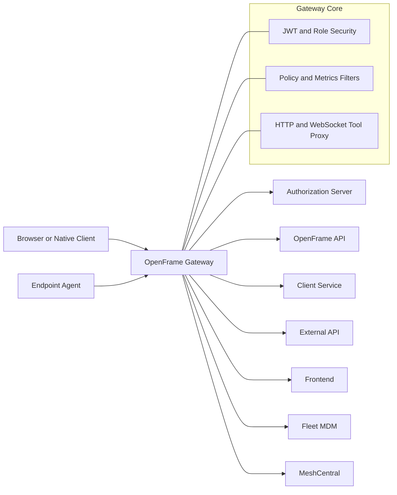
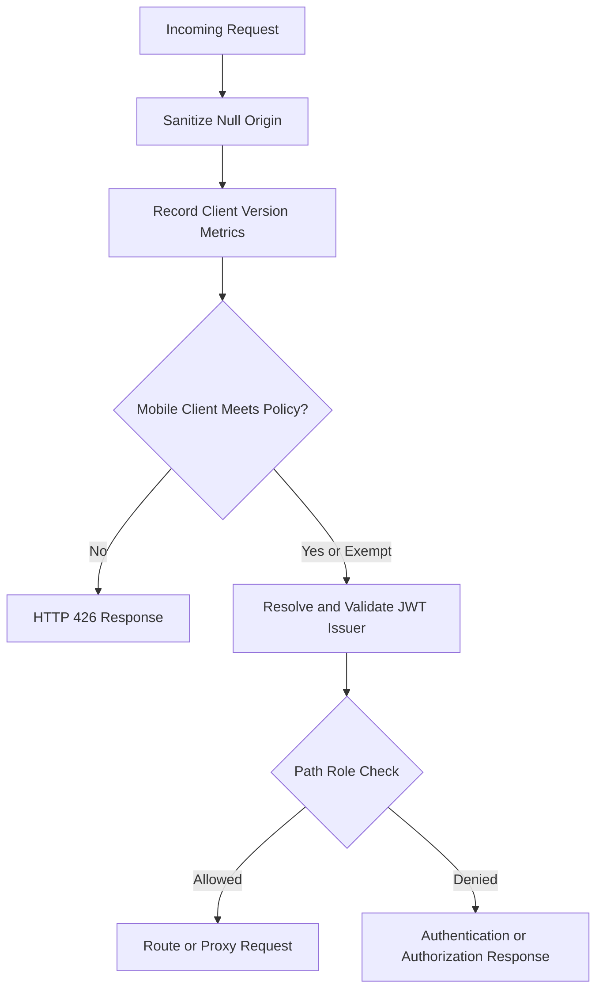
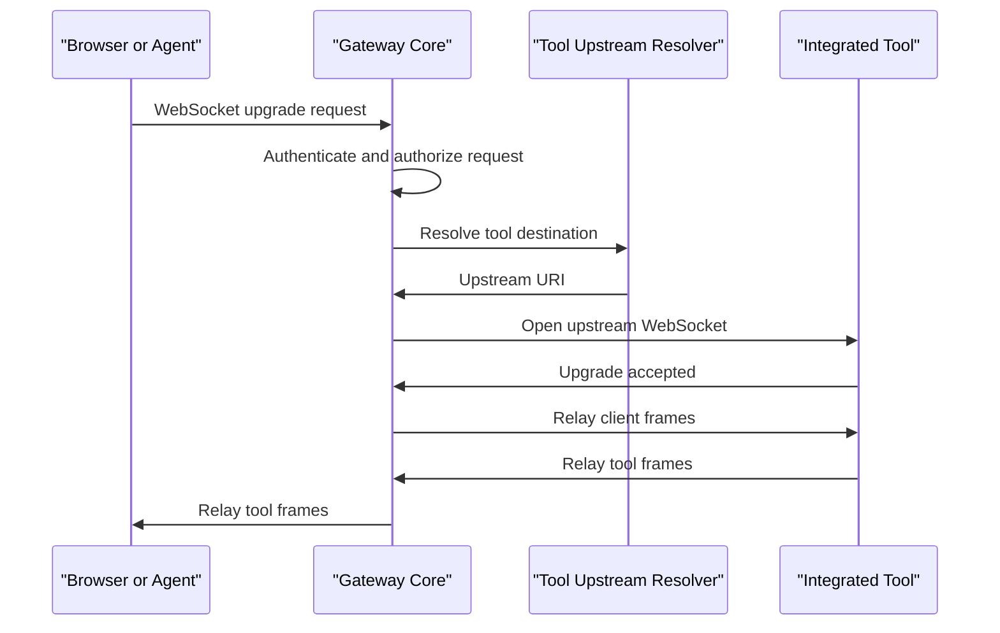

# Gateway Core

Gateway Core is the reactive edge layer used by the `openframe-gateway` application. It is supplied by the OpenFrame OSS Library artifact `com.openframe.oss:openframe-gateway-service-core` at version `7.0.11` and assembled in this repository's gateway service. The module authenticates requests, applies gateway-wide policy and telemetry, routes HTTP and WebSocket traffic to integrated tools, and provides selected proxy and operational endpoints.

Its implementation is library-owned. The gateway application and its deployment configuration in this repository provide the runtime routes and service topology.

## Responsibilities

- Validate bearer JWTs and translate `roles` and `scope` claims into Spring Security authorities.
- Apply role-based access rules for API, client, tool, chat, content, and WebSocket paths.
- Protect external API traffic with API-key validation, tenant-aware rate-limit keys, response headers, and request statistics.
- Enforce a configurable minimum mobile client bundle version while measuring all observed client versions.
- Proxy browser and agent HTTP requests for integrated tools, including health and connection-test operations.
- Resolve tool upstreams for Fleet MDM and MeshCentral, including configured shared and tenant-aware routing modes.
- Relay tool WebSocket sessions with optional frame diagnostics, cleanup, and a MeshCentral control-command allowlist.

## Runtime Position

The tenant deployment routes gateway paths to the authorization server, API services, client service, external API documentation, and frontend. Gateway Core supplies the common security and proxy behavior around those routes and the integrated-tool traffic it owns.

The configured platform routes include `/sas/**` to the authorization server, `/api-docs/**` to the external API, `/api/**` to OpenFrame API, `/clients/**` to the client service, and `/**` to the frontend. These routes are configured outside this module; Gateway Core additionally handles the explicit `/tools` controller surface and tool WebSocket proxying.

## Request Processing

`OriginSanitizerFilter` runs at the highest web-filter precedence and removes a literal `Origin: null` header before CORS handling. `ClientVersionMetricsFilter` runs before `ClientUpgradeGateFilter`, so accepted and rejected requests are measured. The upgrade gate exempts preflight, WebSocket upgrades, `/oauth/`, `/actuator`, `/health`, and `/ws/` paths. When enabled, it checks the `X-OpenFrame-Client` identity for mobile requests and returns HTTP 426 with the required bundle version and appropriate store URL when a client is below policy.

`GatewaySecurityConfig` disables CSRF, HTTP Basic, and form login, then configures the gateway as an OAuth2 resource server. It uses `sub` as the authenticated principal and derives `ROLE_` authorities from `roles` plus `SCOPE_` authorities from `scope`. Notable authorization boundaries are:

| Path family | Required role |
|---|---|
| `/api/**` | `ADMIN` |
| `/clients/**` | `AGENT`, except the explicitly permitted registration, release-version, metrics, and token paths |
| `/tools/agent/**` and `/ws/tools/agent/**` | `AGENT` |
| `/tools/**` and `/ws/tools/**` | `ADMIN` |
| NATS WebSocket endpoints, `/chat/**`, and `/content/**` | `AGENT` or `ADMIN` |

All other paths are permitted by the security chain. A property-controlled higher-precedence chain can permit configured upstream-authenticated proxy paths without running resource-server authentication.

## JWT Issuer Handling

`JwtAuthConfig` builds and caches a reactive authentication manager per accepted issuer. The locally configured issuer uses the configured public key. Other accepted issuers use non-blocking discovery and JWKS retrieval with configured connect and response timeouts. Issuers are checked against `IssuerUrlProvider` before they can populate the cache or cause network activity; temporarily unreachable issuers are negatively cached to avoid repeated discovery attempts.

For a self-hosted deployment, `DefaultIssuerUrlProvider` is the fallback provider and accepts the single issuer composed from `openframe.security.jwt.allowed-issuer-base` and `openframe.security.jwt.super-tenant-id`. `WsAwareAuthenticationEntryPoint` preserves normal bearer-token 401 behavior while recording WebSocket-upgrade rejections by tool and low-cardinality reason. Its parsed subject is diagnostic-only and is not trusted after authentication failure.

## External API Key Filter

`ApiKeyAuthenticationFilter` is a global filter for `/external-api/**`. It requires `X-API-Key`, validates the key, applies rate limiting, removes the raw key before forwarding, and adds the validated key and user context headers. It skips direct OpenAPI and Swagger paths. When response headers are enabled, it emits minute, hour, and day limit and remaining values; excess traffic receives HTTP 429 plus `Retry-After: 60`.

In tenant-routing mode, the trusted tenant header scopes validation statistics and rate-limit keys. `ApiKeyStatsService` increments success and failure counters asynchronously through the reactive Redis statistics repository with a configured TTL, so statistics failures are logged without failing the proxied request.

## Integrated Tool HTTP Proxy

`IntegrationController` exposes the following authenticated controller surface beneath `/tools`:

| Request | Behavior |
|---|---|
| `GET /tools/{toolId}/health` | Tests the named integration connection. |
| `POST /tools/{toolId}/test` | Tests the named integration connection. |
| HTTP methods under `/tools/{toolId}/**` | Proxies a browser-facing tool API request. |
| HTTP methods under `/tools/agent/{toolId}/**` | Proxies an agent-facing tool request. |

`FleetEndpointAllowlist` is defense in depth for Fleet MDM browser traffic. It only applies when Fleet shared multi-tenancy is enabled and the tool identifier is `fleetmdm-server`; configured `METHOD path-pattern` entries are matched after the Fleet tool prefix. Agent-plane traffic is not subject to this browser-proxy allowlist.

`FleetUpstreamResolver` selects either a configured shared Fleet API or WebSocket endpoint per plane, or falls back to the per-tool upstream when shared routing is disabled or that plane has no configured URL. `MeshCentralUpstreamResolver` uses configured API and WebSocket upstreams, avoids a per-request tool-document lookup, and in tenant-routing mode substitutes the tenant namespace and tenant identifier in the resolved destination. It also avoids duplicating a MeshCentral domain path prefix already present in a relay URL.

## WebSocket Proxying and Safety

The WebSocket proxy filters distinguish tool API and agent endpoints. `ToolApiWebSocketProxyUrlFilter` extracts the tool identifier from the API path, removes the browser `Origin` header, and adds tool API-key headers before forwarding. `ToolAgentWebSocketProxyUrlFilter` uses the agent endpoint shape to extract its tool identifier. `RequestJwtClaimsReader` obtains claims from the original authorization value retained by the proxy filter, with a request-header fallback for routes outside that filter.

`NettySocketConfig` sets `SO_LINGER` to zero and enables `TCP_NODELAY` for the reactive gateway server, gateway HTTP client, and named Reactor Netty WebSocket client. `WebClientConfig` supplies a `WebClient.Builder` with 30-second connect, response, read, and write bounds, plus library Jackson compatibility codecs.

`ProxySessionCleanupWebSocketClient` can log selected proxy-session lifecycle events and, when cleanup is enabled, waits briefly for natural close before force-closing only a genuinely leaked upstream session. This avoids competing close frames during normal teardown.

`WebSocketLoggingProperties` controls path-scoped debug and frame-payload logging. Logging is disabled by default for payloads; text and optionally printable binary previews are capped by `maxLoggedPayloadChars`. `LoggingWebSocketSessionDecorator` observes frames without consuming or releasing their payload buffers, ensuring that diagnostics do not alter the relayed stream.

MeshCentral control-channel filtering is separately configurable through `MeshControlCommandProperties`. It identifies control paths under configured tool prefixes while excluding known byte-tunnel endpoints such as relay, desktop, terminal, file manager, transfer, and agent routes. When enabled, `MeshControlFilteringWebSocketSessionDecorator` parses browser-to-tool text and binary JSON commands, allows only configured actions, and can first report or then enforce drops. Enforcement releases a dropped frame buffer explicitly; server-to-client frames remain unmodified. This staged design supports observe-only rollout before blocking unrecognized actions.

## CORS and Internal Probe

`CorsConfig` binds the normal global CORS configuration when `openframe.gateway.disable-cors` is absent or false. `CorsDisableConfig` instead installs a primary permissive CORS filter when that property is true. The latter allows all origin patterns, methods, and headers with credentials, so it should be used only where the deployment's security model supports it.

`InternalAuthProbeController` is present only when `openframe.gateway.internal.enable=true`. It exposes `GET /internal/authz/probe`, returning HTTP 200 with no body for internal authorization probing.

## Source Files

The runtime code described here is provided by OpenFrame OSS Library:

- [Gateway networking configuration](https://github.com/flamingo-stack/openframe-oss-lib/blob/7a766f00e4f58b5d89db007b878ac8d6e0c344f4/openframe-gateway-service-core/src/main/java/com/openframe/gateway/config/NettySocketConfig.java)
- [Gateway WebClient configuration](https://github.com/flamingo-stack/openframe-oss-lib/blob/7a766f00e4f58b5d89db007b878ac8d6e0c344f4/openframe-gateway-service-core/src/main/java/com/openframe/gateway/config/WebClientConfig.java)
- [WebSocket session logging decorator](https://github.com/flamingo-stack/openframe-oss-lib/blob/7a766f00e4f58b5d89db007b878ac8d6e0c344f4/openframe-gateway-service-core/src/main/java/com/openframe/gateway/config/ws/LoggingWebSocketSessionDecorator.java)
- [Integration controller](https://github.com/flamingo-stack/openframe-oss-lib/blob/7a766f00e4f58b5d89db007b878ac8d6e0c344f4/openframe-gateway-service-core/src/main/java/com/openframe/gateway/controller/IntegrationController.java)
- [API key authentication filter](https://github.com/flamingo-stack/openframe-oss-lib/blob/7a766f00e4f58b5d89db007b878ac8d6e0c344f4/openframe-gateway-service-core/src/main/java/com/openframe/gateway/filter/ApiKeyAuthenticationFilter.java)
- [Gateway security configuration](https://github.com/flamingo-stack/openframe-oss-lib/blob/7a766f00e4f58b5d89db007b878ac8d6e0c344f4/openframe-gateway-service-core/src/main/java/com/openframe/gateway/security/GatewaySecurityConfig.java)
- [Fleet upstream resolver](https://github.com/flamingo-stack/openframe-oss-lib/blob/7a766f00e4f58b5d89db007b878ac8d6e0c344f4/openframe-gateway-service-core/src/main/java/com/openframe/gateway/upstream/fleet/FleetUpstreamResolver.java)
- [MeshCentral upstream resolver](https://github.com/flamingo-stack/openframe-oss-lib/blob/7a766f00e4f58b5d89db007b878ac8d6e0c344f4/openframe-gateway-service-core/src/main/java/com/openframe/gateway/upstream/meshcentral/MeshCentralUpstreamResolver.java)
