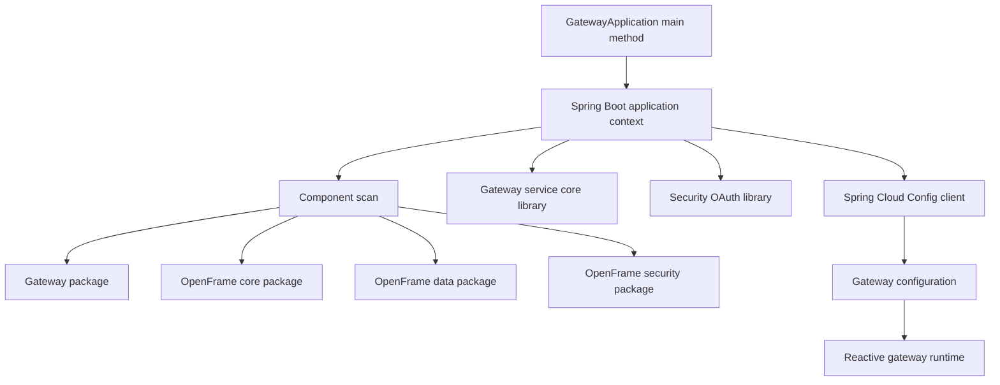
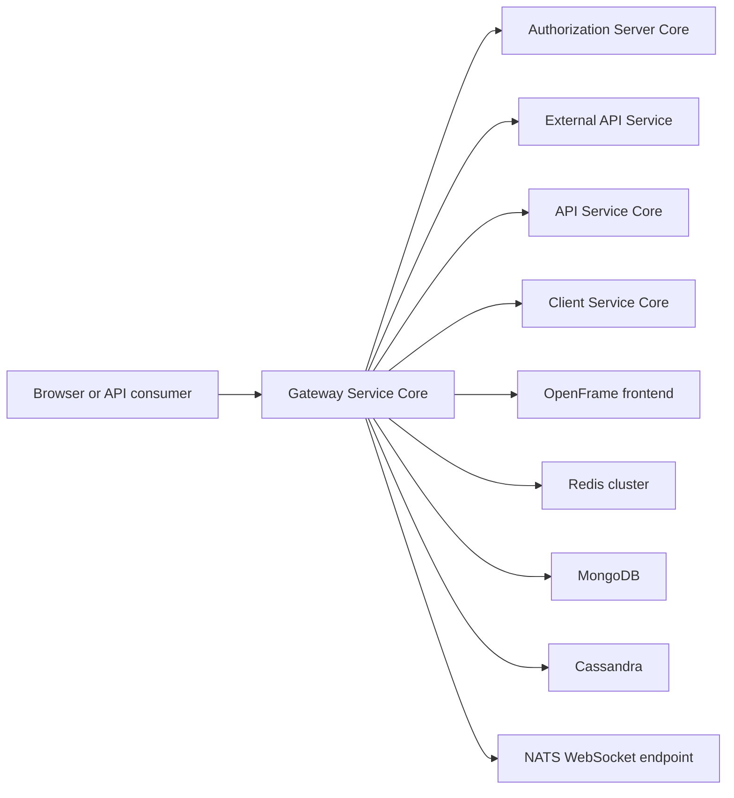
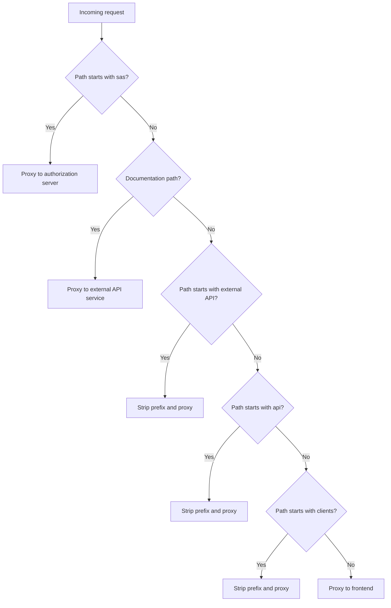
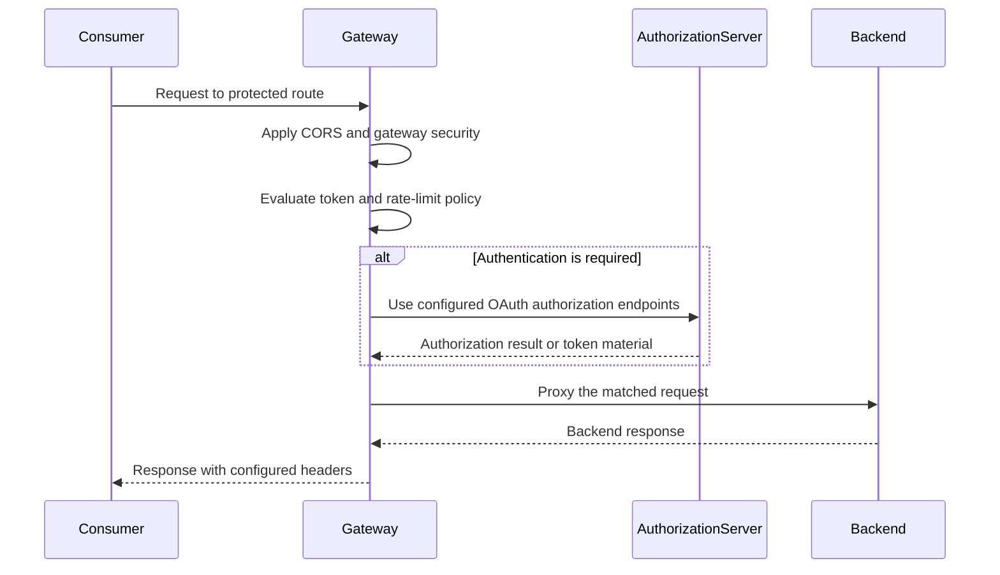
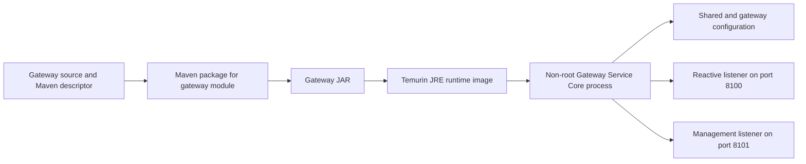

# Gateway Service Core

Gateway Service Core is the reactive edge service for an OpenFrame tenant deployment. It starts the Spring Cloud Gateway application, applies gateway and security capabilities supplied by OpenFrame libraries, and routes browser and API traffic to the authorization server, application services, documentation endpoints, and frontend. The local application code intentionally remains small: `GatewayApplication` establishes the Spring Boot entry point and component-scan boundary, while operational behavior is declared in configuration.

The service is packaged as the Maven artifact `com.openframe:openframe-gateway` and consumes the pinned `openframe-gateway-service-core` and `openframe-security-oauth` libraries. It is deployed as the `openframe-gateway` container image.

## Responsibilities

- Start a reactive Spring Boot gateway on port `8100`.
- Discover gateway, core, data, and security components through the application component scan.
- Apply global CORS policy, HTTP client limits, OAuth settings, JWT validation settings, rate-limit settings, and API-key statistics configuration.
- Route traffic by path to tenant-local Kubernetes services.
- Preserve the `/sas/**` authorization-server path and remove one leading path segment from `/external-api/**`, `/api/**`, and `/clients/**` before proxying.
- Expose management functions on the separate port `8101`; common configuration limits exposed management endpoints to health, info, metrics, and Prometheus.

## Implementation Boundary

The application class is the executable boundary for the service:

- [`GatewayApplication.java`](https://github.com/flamingo-stack/openframe-oss-tenant/blob/main/openframe/services/openframe-gateway/src/main/java/com/openframe/gateway/GatewayApplication.java) calls `SpringApplication.run` from `main`.
- `@SpringBootApplication` activates Spring Boot configuration and auto-configuration.
- `@ComponentScan` includes `com.openframe.gateway`, `com.openframe.core`, `com.openframe.data`, and `com.openframe.security`. This makes gateway-local code and the shared OpenFrame capabilities available in one application context.
- `@RequiredArgsConstructor` is present on the application class. The class currently declares no fields, so startup does not receive constructor dependencies directly.

The gateway module descriptor declares the runtime library boundary rather than defining routing logic locally. Its direct OpenFrame dependencies are `openframe-gateway-service-core` and `openframe-security-oauth`; it also includes Spring Cloud Config support. Configuration is supplied from the shared configuration set, especially [`openframe-gateway.yml`](https://github.com/flamingo-stack/openframe-oss-tenant/blob/main/configs/base/openframe-gateway.yml).

## Position in the Tenant System

Gateway Service Core is the public routing layer for the tenant service set. It does not implement the downstream business services. Instead, it proxies to the routes configured for those services. The catch-all frontend route is last in effect because the specific authorization, API, client, and documentation paths are configured ahead of it.

The API Service Core, Authorization Server Core, Client Service Core, and External API Service labels in this diagram reflect configured routing targets. They are separate services in the provided module tree, not code packages owned by Gateway Service Core.

## Route Contract

The following routes are declared in the gateway configuration. Backend hosts are Kubernetes service DNS names and ports defined by that configuration.

| Incoming path | Target service | Gateway treatment |
|---|---|---|
| `/sas/**` | Authorization Server Core at port `9005` | Proxied without a strip-prefix filter. |
| `/api-docs/**` | External API Service at port `8092` | Direct documentation request. |
| `/swagger-ui/**` | External API Service at port `8092` | Direct Swagger UI asset request. |
| `/webjars/**` | External API Service at port `8092` | Direct web asset request. |
| `/external-api/**` | External API Service at port `8092` | Removes the leading `/external-api` segment. |
| `/api/**` | API Service Core at port `8090` | Removes the leading `/api` segment. |
| `/clients/**` | Client Service Core at port `8097` | Removes the leading `/clients` segment. |
| `/**` | OpenFrame frontend at port `3000` | Catch-all single-page application route. |

## Security and Request Processing

Gateway Service Core is configured as an OAuth-enabled gateway client. Its configured authorization-server URLs point to the `/sas` context path. Callback and authorization URLs derive their public host from `TENANT_HOST_URL`, with a localhost HTTPS default in the configuration. The client identifier and secret can be provided through `OPENFRAME_AUTH_CLIENT_ID` and `OPENFRAME_AUTH_SECRET`.

JWT issuer validation is configured against the in-cluster authorization-server issuer, with a small local cache. The gateway also configures secure cookies by default and a stable single-tenant `super-tenant-id` value required by the underlying library. These settings should remain aligned with the authorization-server deployment and its `/sas` context path.

Global CORS applies to all paths. The allowed origin patterns include localhost HTTP and HTTPS addresses plus the tenant host, credentials are allowed, and the configuration exposes authorization, content type, access-token, and refresh-token headers.

Rate limiting is enabled for the External API configuration. The defaults are 100 requests per minute, 3,000 per hour, and 30,000 per day. Counters use Redis with a 7,200-second TTL. The configured failure mode is fail-open, so a rate-limit backend failure does not block a request; this choice should be considered when evaluating availability and abuse-protection requirements.

## Data and Platform Dependencies

The gateway configuration enables Redis, MongoDB, and Cassandra integration. Shared configuration defines the cluster locations for those stores. The gateway also defines an NATS WebSocket URL. This documentation identifies those configured dependencies without assuming which gateway-library feature consumes each one.

| Dependency | Configured role |
|---|---|
| Redis cluster | Enabled client, rate-limit counter storage, API-key statistics TTL storage, and JWT cache support. |
| MongoDB | Enabled through gateway and shared application configuration. |
| Cassandra | Enabled through gateway and shared application configuration. |
| NATS WebSocket endpoint | Available through the gateway-specific `nats-ws-url` setting. |
| Authorization Server Core | OAuth and JWT issuer integration plus the `/sas/**` proxy target. |
| External API Service | External API and API documentation proxy target. |
| API Service Core | `/api/**` proxy target. |
| Client Service Core | `/clients/**` proxy target. |

## Runtime Characteristics

| Area | Configured behavior |
|---|---|
| Web stack | Reactive Spring application. |
| Main listener | Port `8100`. |
| Management listener | Port `8101`. |
| Backend connect timeout | 3 seconds. |
| Backend response timeout | 20 seconds. This also constrains server-sent-event connections under the current configuration. |
| WebSocket frame limit | 1 MiB. |
| HTTP client TLS | The gateway HTTP client is configured to use an insecure trust manager. Treat this as an operational security consideration. |
| Forwarded headers | Gateway 5 configuration trusts all proxies using the configured pattern. |
| Observability | Shared configuration exposes health, info, metrics, and Prometheus endpoints under the configured management base path. |

The gateway configuration carries aliases for both the older Spring Cloud Gateway configuration location and the Gateway 5 WebFlux location. This preserves route, CORS, and HTTP-client configuration while the deployment transitions between Spring Boot and Spring Cloud Gateway generations.

## Startup and Delivery

The service image uses a two-stage Docker build. The builder stage uses Eclipse Temurin JDK 25 on Alpine, packages the `openframe/services/openframe-gateway` Maven module together with required modules, and obtains build authentication through a build secret. The runtime stage uses Eclipse Temurin JRE 25 on Alpine, copies the resulting JAR to `/app/app.jar`, runs it as a non-root `appuser`, and starts it with `java -jar app.jar`.

## Maintenance Guidance

1. Keep route predicates, destination hosts, and strip-prefix behavior synchronized with the downstream services' context paths.
2. Test specific routes before the catch-all frontend route whenever route configuration changes.
3. Treat public-host, OAuth client, and authorization-server settings as a group. A mismatch can break redirects, callbacks, token validation, or secure cookies.
4. Review the 20-second response timeout before introducing long-lived streaming behavior, since the configuration explicitly notes this affects server-sent events.
5. Review the fail-open rate-limit setting and insecure HTTP-client trust manager against the deployment's security requirements.
6. Do not place real OAuth client secrets or signing material in documentation or source-controlled default configuration. Supply deployment-specific secret values through the platform's secret-management mechanism.

## Source References

- [`GatewayApplication.java`](https://github.com/flamingo-stack/openframe-oss-tenant/blob/main/openframe/services/openframe-gateway/src/main/java/com/openframe/gateway/GatewayApplication.java): Spring Boot entry point and component scan.
- [`pom.xml`](https://github.com/flamingo-stack/openframe-oss-tenant/blob/main/openframe/services/openframe-gateway/pom.xml): Gateway module artifact and direct dependencies.
- [`openframe-gateway.yml`](https://github.com/flamingo-stack/openframe-oss-tenant/blob/main/configs/base/openframe-gateway.yml): Gateway routes, CORS, security, timeout, and rate-limit configuration.
- [`application.yml`](https://github.com/flamingo-stack/openframe-oss-tenant/blob/main/configs/base/application.yml): Shared data-source and management configuration.
- [`Dockerfile`](https://github.com/flamingo-stack/openframe-oss-tenant/blob/main/openframe/services/openframe-gateway/Dockerfile): Container build and runtime process definition.
