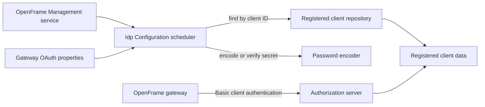
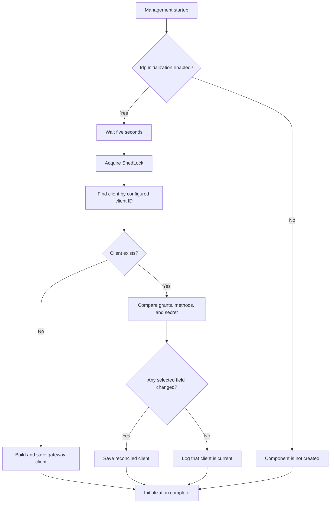
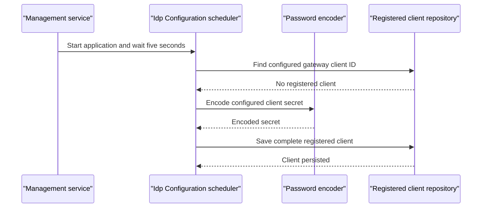
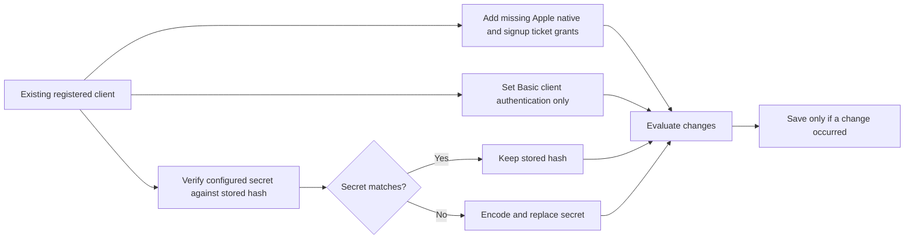
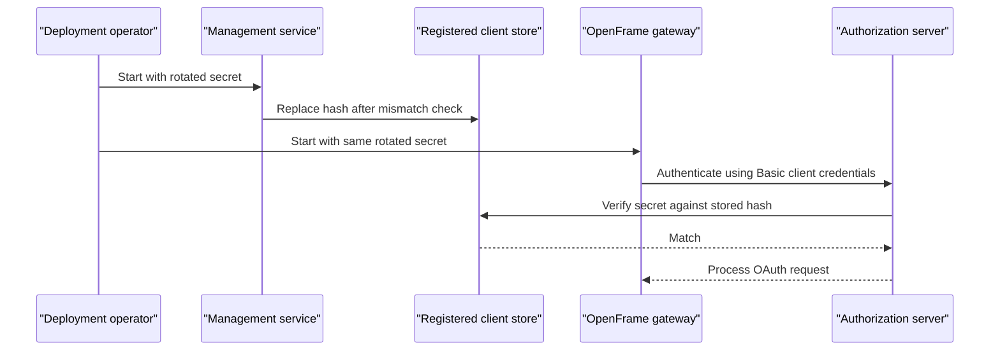

# Idp Configuration

Idp Configuration initializes and reconciles the OAuth client used by the OpenFrame gateway. It is supplied by the OpenFrame OSS Library artifact `com.openframe.oss:openframe-idp-configuration` and runs inside this repository's OpenFrame Management service. Its sole component, [`IdpConfigurationScheduler`](https://github.com/flamingo-stack/openframe-oss-lib/blob/7a766f00e4f58b5d89db007b878ac8d6e0c344f4/openframe-idp-configuration/src/main/java/com/openframe/management/scheduler/IdpConfigurationScheduler.java), creates the client on a new deployment and brings selected security-critical fields of an existing client into line with configuration at management startup.

## Responsibilities

The scheduler is enabled only when `openframe.management.idp.init.enabled` is `true`. Five seconds after the management process starts, it performs one initialization attempt. The task uses an effectively non-repeating fixed delay and ShedLock coordination, so clustered management instances do not concurrently initialize the same client.

The resulting registered client is intended for the gateway and has these properties:

| Concern | Configured behavior |
|---|---|
| Client identity | Uses `openframe.gateway.oauth.client-id`. |
| Client authentication | Uses `client_secret_basic` only. |
| Secret storage | Encodes `openframe.gateway.oauth.client-secret` through Spring Security's `PasswordEncoder`. |
| Redirect target | Uses the single URI from `openframe.gateway.oauth.redirect-uri`. |
| Standard grants | Enables `authorization_code` and `refresh_token`. |
| Custom grants | Enables Apple native and signup-ticket grant URNs. |
| Scopes | Enables `openid`, `profile`, `email`, and `offline_access`. |
| Authorization-code protection | Requires proof key. |
| Consent | Does not require authorization consent. |
| Token lifetime | Uses the configured access and refresh expiration values. |
| Refresh token behavior | Does not reuse refresh tokens. |

## Runtime Architecture

Idp Configuration belongs to the management-side bootstrap path rather than the authorization server request path. The scheduler maintains the authorization server's registered-client record; the gateway subsequently uses that record when it authenticates at OAuth endpoints. The authorization server, gateway, registered-client persistence, and password encoder are provided by their respective runtime modules or Spring infrastructure. Idp Configuration itself does not expose an HTTP endpoint.

## Initialization and Reconciliation Flow

The scheduled method has a five-second initial delay and a fixed delay of `Long.MAX_VALUE`; in practice, each management process attempts initialization once. The ShedLock name is `IdpConfigurationScheduler_initializeDefaultIdp`, with a maximum lock duration of ten minutes and a minimum duration of one minute. Locking protects shared persistence when more than one management instance starts.

### Creation Path

When no record exists for the configured gateway client ID, the scheduler builds a `MongoRegisteredClient` and saves it. The creation operation establishes the complete initial record, including redirect URI, scopes, proof-key requirement, consent behavior, token lifetimes, and refresh-token reuse policy.

### Existing-Client Path

For an existing record, Idp Configuration is intentionally selective. It:

1. Adds either missing custom grant, preserving any grants already present.
2. Replaces authentication methods unless they exactly equal `client_secret_basic`.
3. Replaces the stored client-secret hash only when the configured secret does not match it.

It does not reconcile redirect URIs, scopes, proof-key policy, consent policy, token lifetimes, refresh-token reuse, or removal of pre-existing non-custom grant types. Those values are initialized during creation and remain unchanged by this scheduler for existing records.

## OAuth Contract

The custom grants are part of the authorization contract between the gateway and authorization-server capabilities:

| Grant | Purpose |
|---|---|
| `urn:openframe:params:oauth:grant-type:apple-native` | Supports the native Sign in with Apple token exchange. |
| `urn:openframe:params:oauth:grant-type:signup-ticket` | Redeems a bound mobile signup ticket. |

The component preserves backward compatibility for deployments created before these grants were registered. Without the reconciliation step, authorization-server token processing rejects a request using either custom grant as an unauthorized client.

The gateway is a confidential client. Reconciliation explicitly removes alternative authentication methods by replacing the configured set with `client_secret_basic`. In particular, it does not retain the `none` method: authorization-code redemption cannot rely on proof key alone for this client.

## Configuration Inputs

Idp Configuration reads the following application properties at startup:

| Property | Required use |
|---|---|
| `openframe.management.idp.init.enabled` | Enables component creation when set to `true`. |
| `openframe.gateway.oauth.client-id` | Lookup key and client identifier for creation. |
| `openframe.gateway.oauth.client-secret` | Credential verified and stored as an encoded hash. |
| `openframe.gateway.oauth.redirect-uri` | Initial redirect URI when creating the client. |
| `security.oauth2.token.access.expiration-seconds` | Initial access-token lifetime. |
| `security.oauth2.token.refresh.expiration-seconds` | Initial refresh-token lifetime. |

Treat the gateway secret as sensitive configuration. The scheduler logs the client ID, redirect URI during creation, and boolean reconciliation outcomes, but does not log the secret or its encoded value.

## Secret Rotation

A changed gateway secret is detected by `PasswordEncoder.matches`; only a mismatch causes the stored hash to be replaced. Because the gateway loads its own configured secret at startup and the management service updates the authorization record during its startup, deploy the new secret by restarting management and gateway instances together. Until the running gateway's secret and the stored hash agree, client-authenticated token exchange, refresh, and revocation requests fail with client-authentication errors.

## Failure Handling and Operations

The scheduler catches runtime exceptions only to log the failed client ID and then rethrows the exception. Therefore, repository, password-encoding, or persistence failures remain visible to the scheduling infrastructure rather than being silently ignored.

When troubleshooting startup behavior, confirm the following in order:

1. The enablement property is `true` in the management service configuration.
2. Management can reach the registered-client persistence layer.
3. The gateway client ID, secret, and redirect URI resolve to the expected values.
4. In a multi-instance deployment, one instance can obtain the scheduler lock.
5. After a secret rotation, management and every gateway instance have restarted with the same secret.

The component only manages the default gateway registration. It is not a general administration API for arbitrary OAuth clients, and it does not repeatedly poll configuration after startup.

## Integration Boundaries

| Boundary | Idp Configuration role |
|---|---|
| OpenFrame Management | Hosts and schedules the bootstrap component. |
| Registered-client persistence | Locates and saves `MongoRegisteredClient` records by client ID. |
| Password encoding | Hashes newly stored secrets and verifies whether the configured secret rotated. |
| OpenFrame gateway | Supplies the client configuration and uses Basic authentication against OAuth endpoints. |
| Authorization server | Reads the registered-client record while processing OAuth requests, including the two custom grants. |

The source component is maintained in the OpenFrame OSS Library and assembled into this repository through version `7.0.11` of `com.openframe.oss:openframe-idp-configuration`. Its management-service integration is provided by the repository's `openframe-management` application.