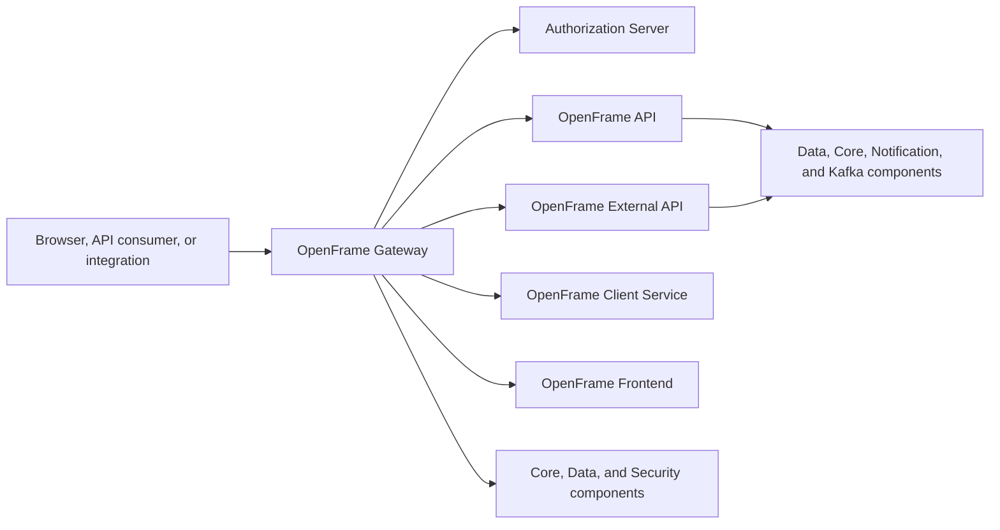
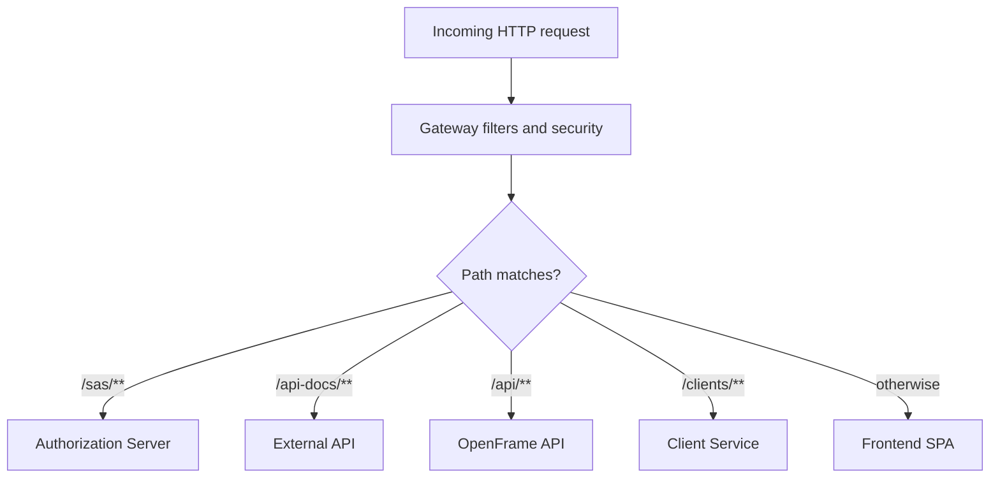
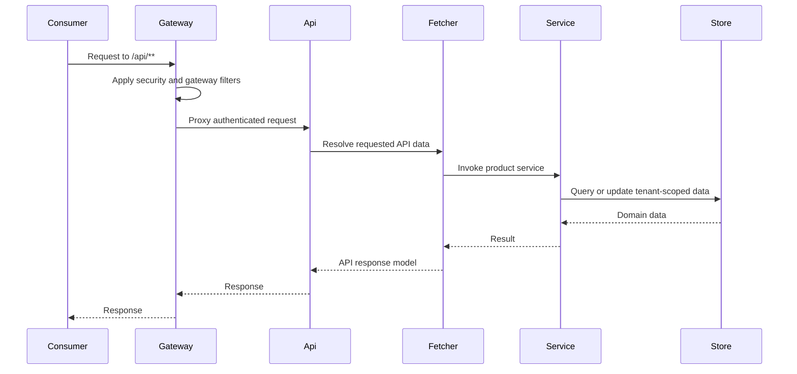
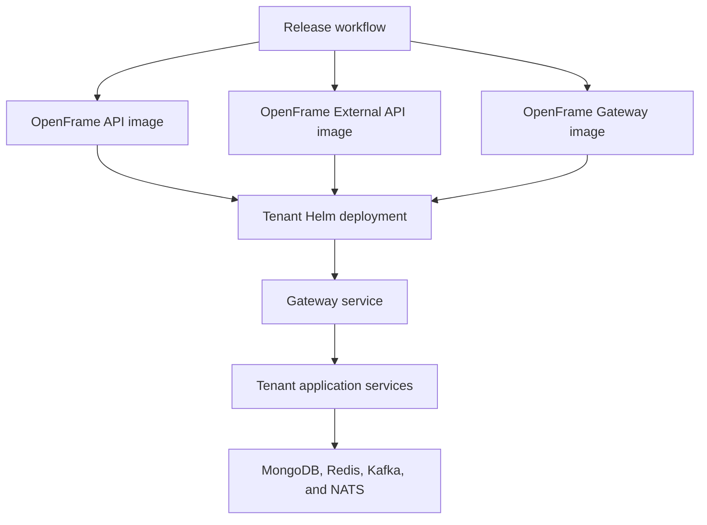

# Api And Gateway Applications

Api And Gateway Applications is the public-facing service boundary for an OpenFrame tenant. It assembles three Spring Boot applications from this repository with the OpenFrame OSS Library version `7.0.11`:

- **OpenFrame API** serves the authenticated product API, including GraphQL data fetching and product-facing REST controllers.
- **OpenFrame External API** exposes the integration-oriented REST surface and its OpenAPI description.
- **OpenFrame Gateway** is the single ingress router. It applies gateway security and request filters, then proxies requests to the appropriate in-cluster service.

The module belongs to [Main Applications](main-applications.md). It is intentionally an application-composition layer: endpoint, domain, data, and gateway implementation classes are supplied primarily by the OpenFrame OSS Library dependencies, while this repository provides the runnable entry points, tenant configuration, images, and deployment wiring.

## Runtime Architecture

Each entry point is annotated with `SpringBootApplication` and starts through `SpringApplication.run`. Its component scan determines which OpenFrame OSS Library packages become part of the service runtime.

The gateway destinations above are configured in `configs/base/openframe-gateway.yml` and point to Kubernetes services in the tenant namespace. OpenFrame API and OpenFrame External API also consume the shared data, core, and Kafka component families. OpenFrame API additionally scans notification components; OpenFrame External API scans the API package so it can use API-layer capabilities alongside its external REST implementation.

## Entry Points and Composition

| Application | Local entry point | Component scan | Responsibility |
|---|---|---|---|
| OpenFrame API | `ApiApplication` | `com.openframe.api`, `com.openframe.data`, `com.openframe.core`, `com.openframe.notification`, `com.openframe.kafka` | Starts the principal product API and logs its startup. |
| OpenFrame External API | `ExternalApiApplication` | `com.openframe.external`, `com.openframe.data`, `com.openframe.core`, `com.openframe.api`, `com.openframe.kafka` | Starts the REST API intended for external integrations. |
| OpenFrame Gateway | `GatewayApplication` | `com.openframe.gateway`, `com.openframe.core`, `com.openframe.data`, `com.openframe.security` | Starts the edge router and its security, filtering, and proxy integration. |

The tenant repository publishes runnable Maven artifacts for each application: `com.openframe:openframe-api`, `com.openframe:openframe-external-api`, and `com.openframe:openframe-gateway`, all at `1.0.0-SNAPSHOT`. Release automation also publishes the corresponding images under the repository's GitHub Container Registry namespace.

## Gateway Routing Contract

The gateway owns the externally reachable path partitioning listed below. These paths are configured routes, not controller declarations in the three local entry-point classes.

| Route identifier | Incoming path predicate | Upstream service | Purpose |
|---|---|---|---|
| `sas` | `/sas/**` | OpenFrame Authorization Server | Authorization server traffic. |
| `swagger-api-docs` | `/api-docs/**` | OpenFrame External API | External API documentation traffic. |
| `openframe-api` | `/api/**` | OpenFrame API | Product API traffic. |
| `openframe-client` | `/clients/**` | OpenFrame Client Service | Client-service traffic. |
| `openframe-ui-spa` | `/**` | OpenFrame Frontend | Single-page application fallback. |

Route ordering is operationally important: the specific authorization, API documentation, API, and client predicates must resolve before the catch-all frontend route.

## API Responsibilities

### OpenFrame API

The OpenFrame API library supplies configuration such as `ApiApplicationConfig`, authentication and security configuration, GraphQL scalar configuration, and controllers for agent log keys, registration secrets, API keys, devices, invitations, organizations, users, client configuration, releases, SSO, health, and knowledge-base images.

Its data-fetcher layer includes device, device-log, organization, user, notification, knowledge-base, tag, package-search, and remote-management fetchers. Data loaders support batched resolution for related entities such as machines, users, tickets, scripts, tags, tool connections, and knowledge-base records. The service layer covers ticket queries and status history, device-log lookup, command execution, scripts, package and software dispatch, software catalog status, and vulnerability read models.

The resulting design keeps protocol resolution at the edge of the API while library services and Mongo-backed repositories implement the business and persistence behavior. Kafka and NATS-connected services in the wider deployment carry asynchronous device and delivery activity.

### OpenFrame External API

The External API library supplies `OpenApiConfig`, web configuration, an API-caller argument resolver, base REST mapping, and controllers for customers, devices, integrations, knowledge-base content, logs, tickets, and tools. Its resource contracts cover ticket creation, assignment, notes, updates, transitions, filters, attachments, device tags, and knowledge-base article, folder, attachment, and lifecycle operations.

External API requests traverse the gateway's `/api-docs/**` documentation route when requesting API documentation. The application itself is also routed as an in-cluster service, where its controller layer delegates to the shared API, data, core, and Kafka component packages.

### OpenFrame Gateway

The Gateway library provides gateway security configuration, JWT configuration, API-key authentication, client version and upgrade filters, origin sanitization, CORS behavior, API-key statistics, and upstream resolution for Fleet and MeshCentral. It also includes WebSocket proxy support, JWT-claim reading, session cleanup, control-command filtering, and request logging decorators.

This makes the gateway more than a path router: it is the policy-enforcement boundary before traffic reaches tenant services or upstream remote-management systems.

## Request Processing

The following interaction represents a typical authenticated product request. Exact controller and resolver selection depends on the requested API operation.

For integration REST calls, substitute OpenFrame External API for OpenFrame API. The gateway still performs its edge responsibilities before the external controller and REST mapper produce the response.

## Security and Tenant Boundaries

Security is distributed by responsibility:

1. **Gateway enforcement:** `GatewaySecurityConfig`, `JwtAuthConfig`, `ApiKeyAuthenticationFilter`, origin sanitization, CORS configuration, and a WebSocket-aware authentication entry point act before proxying.
2. **Authorization service:** `/sas/**` is routed to the separate authorization server, which issues and manages authorization-server flows.
3. **Application authorization:** OpenFrame API brings its authentication and security configuration into the product API context. OpenFrame External API uses its web-layer API-caller resolution and shared API components.
4. **Data isolation:** API and external API composition includes the data package. The associated Mongo configuration includes tenant-aware and tenant-isolation facilities; business services and repositories must preserve the resolved tenant context rather than accepting a tenant identity from an untrusted request field.

The gateway library also exposes a default issuer URL provider and tenant-aware upstream concerns. Maintain the relationship between forwarded gateway context, authorization issuer configuration, and the tenant data context when changing ingress or host configuration.

## Operational Dependencies

| Dependency | Applications using it | Role |
|---|---|---|
| Configuration service | All three through platform configuration | Provides application configuration in the deployed platform. |
| Authorization server | Gateway, API consumers | Gateway routes authorization traffic through `/sas/**`. |
| MongoDB | OpenFrame API and External API through data components | Primary tenant application data store. |
| Redis | Shared platform configuration and data components | Clustered cache and supporting data services. |
| Kafka and NATS | API and External API component scans, wider platform services | Device events, delivery flows, and asynchronous processing. |
| Frontend and Client Service | Gateway | Gateway targets them through explicit path predicates. |

## Deployment Position

The tenant Helm deployment references images for OpenFrame API, OpenFrame External API, and OpenFrame Gateway. Release automation builds and publishes all three images. The deployment must make the configured Kubernetes DNS targets reachable from the gateway and provide the configuration values required by the scanned Spring components.

## Maintenance Guidance

- Add a product controller, GraphQL data fetcher, data loader, or domain service to the OpenFrame API composition when it is part of the authenticated product surface.
- Add a versioned, integration-oriented REST resource to OpenFrame External API, with matching request and response contracts and OpenAPI coverage.
- Change gateway predicates only with an explicit review of route precedence, authentication behavior, CORS and origin handling, WebSocket proxy behavior, and the target Kubernetes service.
- Keep `ComponentScan` scopes deliberate. Adding a package can activate configurations, controllers, repositories, or message consumers at startup.
- Test gateway behavior separately from backend behavior. The test-service library includes external API authentication, customer, device, knowledge-base, log, pagination, ticket, and tool test coverage, plus transient gateway retry helpers.
- When failures span routing, tokens, or tenant context, verify the gateway, authorization-server route, backend application logs, and data-layer tenant configuration as one request path.

## Source Locations

The local bootstrap classes are available in this repository:

- [ApiApplication](https://github.com/flamingo-stack/openframe-oss-tenant/blob/main/openframe/services/openframe-api/src/main/java/com/openframe/api/ApiApplication.java)
- [ExternalApiApplication](https://github.com/flamingo-stack/openframe-oss-tenant/blob/main/openframe/services/openframe-external-api/src/main/java/com/openframe/external/ExternalApiApplication.java)
- [GatewayApplication](https://github.com/flamingo-stack/openframe-oss-tenant/blob/main/openframe/services/openframe-gateway/src/main/java/com/openframe/gateway/GatewayApplication.java)
- [Gateway configuration](https://github.com/flamingo-stack/openframe-oss-tenant/blob/main/configs/base/openframe-gateway.yml)

The application functionality described above is assembled from the OpenFrame OSS Library Maven dependencies pinned at `7.0.11`.
