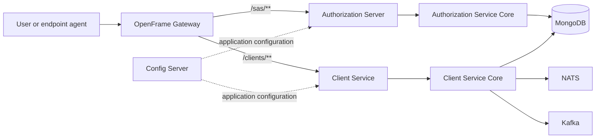
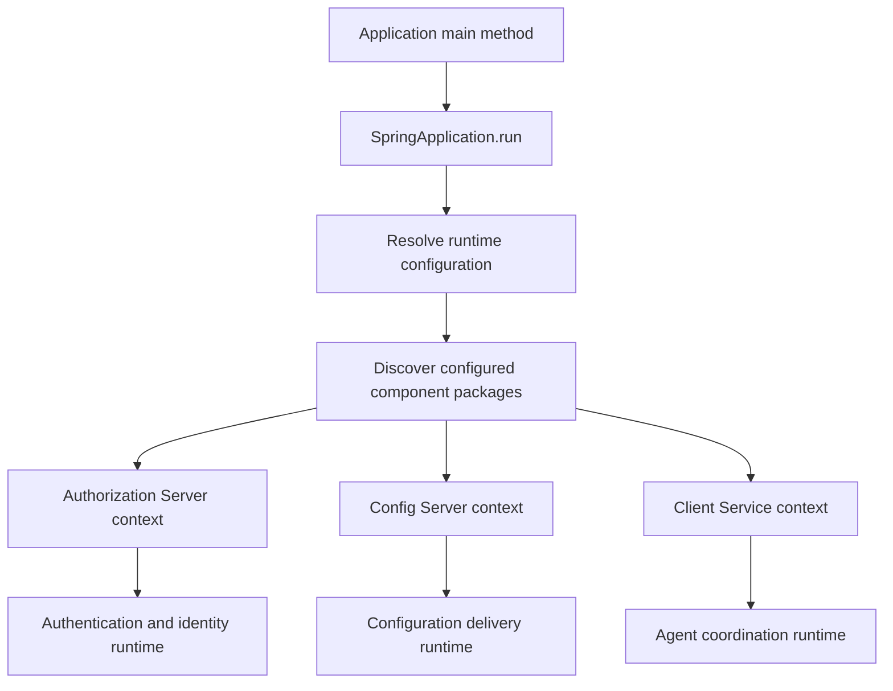
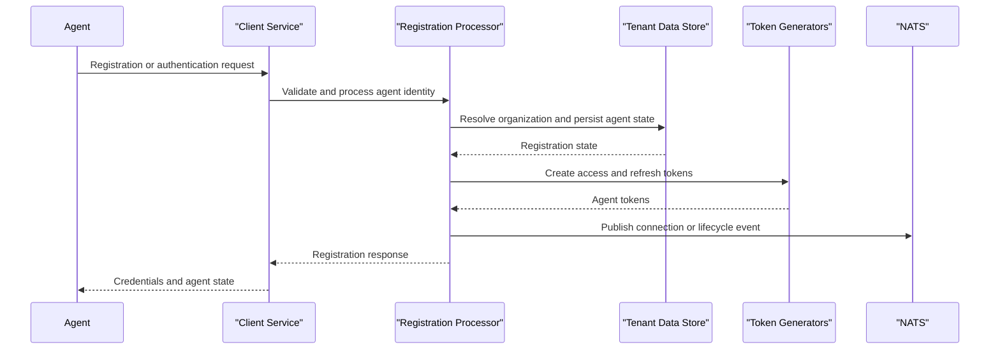
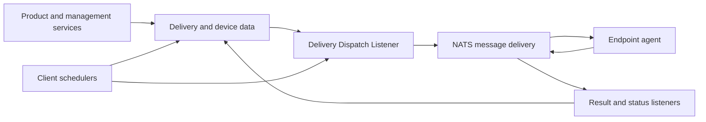

# Identity Configuration And Client Applications

Identity Configuration And Client Applications documents the three Spring Boot services that establish tenant identity, distribute shared configuration, and coordinate installed endpoint agents. It belongs to [Main Applications](main-applications.md) and covers the local application entry points in OpenFrame OSS Tenant together with the OpenFrame OSS Library components they assemble.

The repository supplies the runnable applications, container images, tenant configuration, and deployment wiring. Most authorization, configuration, registration, messaging, and persistence behavior comes from OpenFrame OSS Library Maven dependencies pinned at version `7.0.11`. The resulting deployable Maven artifacts are `com.openframe:openframe-authorization-server`, `com.openframe:openframe-config`, and `com.openframe:openframe-client`, each at version `1.0.0-SNAPSHOT`.

## Responsibilities

| Application | Local bootstrap class | Primary responsibility | Important assembly boundary |
| --- | --- | --- | --- |
| OpenFrame Authorization Server | `OpenFrameAuthorizationServerApplication` | Provides OAuth authorization-server, tenant discovery, sign-in, invitation, password-reset, and SSO capabilities. | `com.openframe.authz`, core, data, and notification packages. |
| OpenFrame Config Server | `ConfigServerApplication` | Starts the centrally deployed configuration service that supplies shared and service-specific runtime settings. | Spring Boot configuration-server capabilities supplied by the Config Core library and runtime configuration. |
| OpenFrame Client Service | `ClientApplication` | Coordinates endpoint-agent registration, authentication, device state, command delivery, result handling, and client-oriented scheduling. | data, client, core, security, and Kafka producer packages, excluding the Cassandra health indicator. |

The gateway sends `/sas/**` traffic to the authorization server and `/clients/**` traffic to the client service. Those paths are deployment routes configured in the gateway, rather than mappings declared by these three bootstrap classes. See [Api And Gateway Applications](api_and_gateway_applications.md) for edge routing and gateway enforcement.

## Runtime Architecture

All three processes begin by calling `SpringApplication.run`. Spring resolves configuration and performs component discovery before instantiating the discovered configurations, controllers, services, listeners, repositories, and scheduled workers. The local classes are deliberately small: their annotations define the executable service boundary, while the library modules hold the substantive runtime implementation.

## Application Composition

### OpenFrame Authorization Server

`OpenFrameAuthorizationServerApplication` is annotated with `SpringBootApplication` and `EnableDiscoveryClient`. Its component scan loads `com.openframe.authz`, `com.openframe.core`, `com.openframe.data`, and `com.openframe.notification`. This combines the authorization service with common functionality, tenant-aware persistence, and notification capabilities without manually wiring individual beans.

The assembled Authorization Service Core library includes:

- Authorization and security configuration through `AuthorizationServerConfig`, `SecurityConfig`, `SessionConfig`, tenant-filter configuration, and dynamic client-registration support.
- Mongo-backed registered-client support through `MongoRegisteredClientRepository`.
- Tenant-discovery, login, invitation-registration, tenant-registration, password-reset, mobile-version-policy, SSO discovery, SSO join, and SSO login controllers.
- Apple, Google, and Microsoft client-registration strategies, along with custom authentication grants and token-minting provider support.
- RSA authentication-key generation and PEM utilities, plus SSO identity capture, cookie payload handling, and post-login success handling.

`EnableDiscoveryClient` makes service discovery available to this application. The exact discovery registration behavior remains configuration-driven; retain the annotation and the associated runtime settings when moving or renaming the service.

### OpenFrame Config Server

`ConfigServerApplication` has the standard `SpringBootApplication` bootstrap and delegates application creation to Spring Boot. It also has Lombok logging enabled, though the entry method itself only starts the application context.

At runtime, Config Core contributes `ConfigServerConfiguration`, `ConfigGitCacheRepair`, and `LoggingConfigController`. Together, these components establish configuration-server behavior, repair cached configuration Git state where necessary, and expose logging-configuration management. The application should be available before services that retrieve centralized settings, because configuration values determine service routes, datasource locations, security material, and feature behavior.

The platform configuration identifies shared connectivity for MongoDB, Redis, Cassandra, and Pinot. Service-specific configuration supplies Kafka and NATS connection settings where required. This module describes the service relationship, not an editable list of every configuration key; consult the platform configuration for environment-specific values.

### OpenFrame Client Service

`ClientApplication` scans the data, client, core, security, and Kafka producer packages. This places the Client Service Core, data access, security support, and asynchronous message publishing in one application context. It explicitly excludes `CassandraHealthIndicator`, so adding or changing health checks should account for this intentional exception rather than assuming that every data-module indicator is active.

The Client Service Core supplies the transport-facing and operational pieces, including:

- `AgentAuthController`, `AgentController`, and `AgentLogKeyController` for agent authentication, registration and agent-facing operations, and log-key handling.
- `DefaultAgentRegistrationProcessor`, organization resolution, registration-tag assignment, machine and agent-secret generation, plus access-token and refresh-token generation.
- NATS listeners for client connection, installed-agent, machine heartbeat, hostname, timezone, tool-connection, delivery-result, package-update, and RMM execution events.
- Delivery dispatch, result recording, retry, and scheduling components for commands, scripts, software operations, package updates, and device-online work.
- Client feature-flag retrieval and client update, tool-installation, and remote-management coordination.

## Startup Process

The scanning model is a maintenance boundary. Adding a package to an application's scan can activate controllers, repositories, security configuration, scheduled work, or message listeners. Conversely, a component delivered in a dependency is not active unless it lies within a scanned package and its conditional requirements are satisfied.

## Identity and Agent Registration Flow

The client-facing registration path joins identity management with device lifecycle management. The precise controller mapping and request schema are owned by the Client Service Core library; the following sequence describes the responsibilities established by the components in this module.

Client authentication and registration must preserve tenant context throughout organization lookup, agent-secret handling, token creation, and persistence. The registration processor's helper services provide the server-side generation and mapping mechanisms; they are not a reason to accept a machine identifier, organization identifier, or authorization decision from an untrusted agent without validation.

## Client Event and Delivery Processing

After registration, the Client Service becomes the bridge between persisted delivery state and the endpoint messaging channel. The library's `DeliveryDispatchListener` and `DeliveryResultListener` manage delivery activity, while command, script, package-update, and RMM result listeners process distinct message categories. Schedulers cover retry, execution watchdogs, schedule firing, online dispatch, and package auto-update triggering.

Kafka support is included in the Client Application component scan through the Kafka producer package. NATS is the configured client-service transport dependency in platform configuration. Treat delivery ordering, acknowledgements, retries, and state changes as an end-to-end concern: client changes may affect data repositories, endpoint agents, and downstream stream processing.

## Security and Configuration Boundaries

| Concern | Owning service or component group | Maintenance implication |
| --- | --- | --- |
| Interactive identity and OAuth protocol flows | Authorization Server and Authorization Service Core | Keep client registration, key material, issuer behavior, tenant forwarding, and SSO flows aligned. |
| Endpoint credentials and tokens | Client Service Core registration and authentication services | Protect registration secrets, refresh tokens, access tokens, and agent log keys at rest and in transit. |
| Edge authentication | Gateway and its `/sas/**` and `/clients/**` routes | Review gateway routing and security behavior together with changes to either downstream service. |
| Central settings | Config Server and shared configuration | Deploy and validate required configuration before starting dependent applications. |
| Tenant data isolation | Data components used by authorization and client contexts | Do not bypass tenant-aware repository and context handling in custom services. |

The Config Server is a dependency of the operational system, not a substitute for runtime secret-management controls. Sensitive configuration should be managed according to platform operations practices, and logs must not expose token, secret, or key material.

## Operational Dependencies

| Dependency | Used by | Role |
| --- | --- | --- |
| OpenFrame OSS Library `7.0.11` | All applications | Provides authorization, config-server, client-service, data, core, security, and notification implementations. |
| Gateway | Authorization Server and Client Service | Routes public requests to `/sas/**` and `/clients/**`. |
| MongoDB | Authorization Server and Client Service | Stores tenant-scoped identity, registered-client, agent, delivery, and related application data through data components. |
| NATS | Client Service | Carries agent and delivery-oriented messaging. |
| Kafka | Client Service | Supports event publication and broader asynchronous platform processing. |
| Redis, Cassandra, and Pinot | Shared platform capabilities | Configured platform dependencies that support other data, cache, health, and analytics workloads as applicable. |

Release automation publishes container images for the three applications under `ghcr.io/flamingo-stack/openframe-oss-tenant`. The tenant Helm deployment references the authorization-server, config, and client images alongside the rest of the platform services.

## Maintenance Guidance

1. Keep bootstrap classes minimal and make package-scan changes only when the target component's configuration and dependencies are understood.
2. Validate authorization changes across the gateway, authorization server, client registration, and tenant-aware data layers.
3. Treat new agent message types as a protocol change: define delivery behavior, persistence, retries, failure handling, and endpoint compatibility before enabling listeners or schedulers.
4. Preserve the Client Application exclusion of `CassandraHealthIndicator` unless a deliberate health-check design replaces it.
5. Start configuration infrastructure early and verify that authorization and client services receive the expected configuration for their environment.
6. Test normal registration, reauthentication, token refresh, disconnect, retry, and deactivation paths, not only successful initial registration.

## Source Locations

The executable entry points are maintained in this repository:

- [OpenFrame Authorization Server Application](https://github.com/flamingo-stack/openframe-oss-tenant/blob/main/openframe/services/openframe-authorization-server/src/main/java/com/openframe/authz/OpenFrameAuthorizationServerApplication.java)
- [Config Server Application](https://github.com/flamingo-stack/openframe-oss-tenant/blob/main/openframe/services/openframe-config/src/main/java/com/openframe/config/ConfigServerApplication.java)
- [Client Application](https://github.com/flamingo-stack/openframe-oss-tenant/blob/main/openframe/services/openframe-client/src/main/java/com/openframe/client/ClientApplication.java)

The implementation classes discussed throughout this page are supplied by OpenFrame OSS Library dependencies at version `7.0.11`; their source remains in that library rather than this tenant repository.
