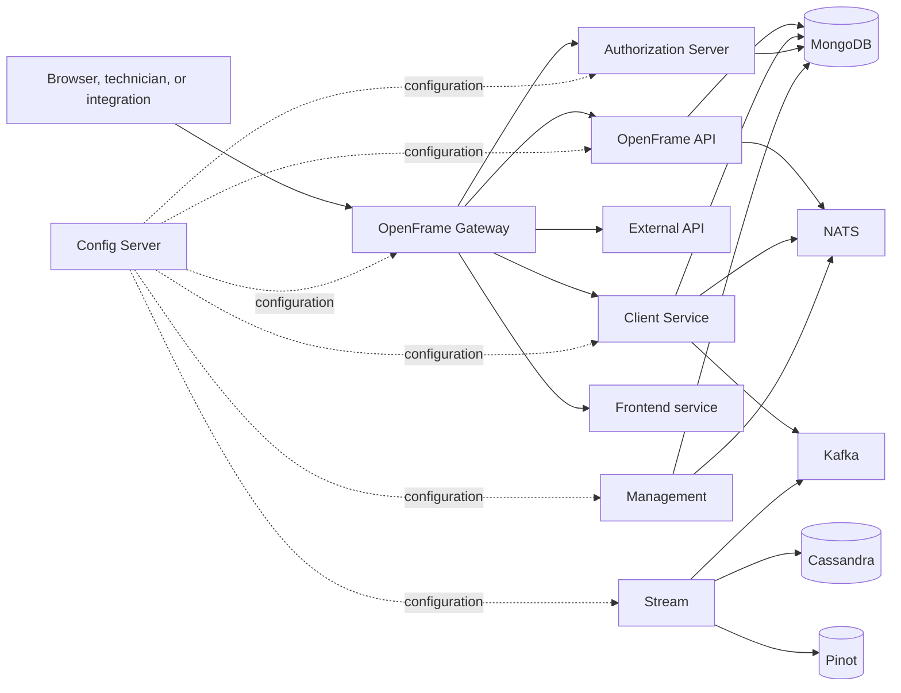
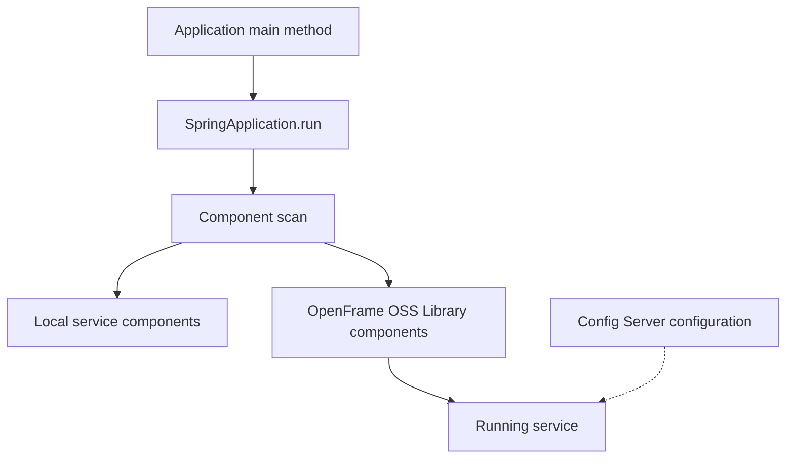
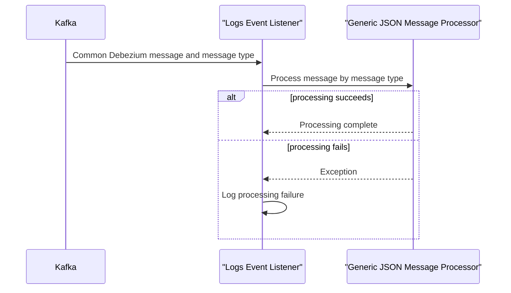

# Main Applications

Main Applications is the runnable service layer of the OpenFrame OSS Tenant distribution. It assembles shared capabilities from the OpenFrame OSS Library into independently deployable Spring Boot processes: the tenant API, authorization server, client coordination service, configuration server, external REST API, gateway, management service, and Kafka stream processor.

The repository publishes the application artifacts and container images for these services. Their domain controllers, repositories, security primitives, and processors are supplied chiefly by OpenFrame OSS Library version `7.0.11`; the application classes in this repository define the Spring Boot entry points and component-scan boundaries that compose those capabilities.

## Runtime Architecture

The gateway routes `/sas/**` to the authorization server, `/api-docs/**` to the external API, `/api/**` to the OpenFrame API, `/clients/**` to the client service, and remaining paths to the frontend. The gateway configuration is supplied from the shared configuration set; route prefixes are recorded here to describe the deployed topology, rather than as an API contract.

## Applications

| Application | Responsibility | Composition boundary |
| --- | --- | --- |
| OpenFrame API | Primary tenant-facing application API, including device, organization, identity, and operational capabilities. | Scans `com.openframe.api`, data, core, notification, and Kafka packages. |
| Authorization Server | OAuth and tenant-aware authentication service. | Scans authorization, core, data, and notification packages; enables service discovery. |
| Client Service | Agent registration, authentication, device state, command delivery, and RMM result processing. | Scans client, data, core, security, and Kafka producer packages. |
| Config Server | Central configuration service. | Starts Spring Boot configuration-server capabilities supplied by its runtime dependencies. |
| External API | REST API intended for integrations, including customer, device, ticket, tool, log, and knowledge-base resources. | Scans external, API, data, core, and Kafka packages. |
| Gateway | Edge router and security boundary for browser and integration traffic. | Scans gateway, core, data, and security packages. |
| Management | Background initialization, catalog synchronization, maintenance, and release-management service. | Scans management, data, and core packages. |
| Stream | Kafka-driven event ingestion and processing service. | Enables Kafka and scans stream, data, and Kafka producer packages. |

## Component Groups

Detailed responsibilities and component-level relationships are documented in these generated submodules:

- [API and Gateway Applications](api_and_gateway_applications.md) covers the primary API, integration API, and gateway entry points.
- [Identity, Configuration, and Client Applications](identity_configuration_and_client_applications.md) covers authentication, configuration, and the client-service entry points.
- [Management and Stream Applications](management_and_stream_applications.md) covers scheduled operational initialization and Kafka event processing.

## Startup and Processing Flows

### Service bootstrap

Each entry point delegates startup to `SpringApplication.run`. Its `@ComponentScan` list is the service's explicit assembly boundary: it selects implementations from the local service module and the OpenFrame OSS Library without requiring application code to instantiate them directly. The client and management applications intentionally exclude `CassandraHealthIndicator`, while the stream application explicitly enables Kafka support.

### Logs event ingestion

`LogsEventListener` is activated only when the inbound logs-events topic name property is configured. It consumes `CommonDebeziumMessage` records with a `message-type` header using the OSS Tenant listener-container factory and a dedicated consumer group. It delegates dispatch to `GenericJsonMessageProcessor`; exceptions are logged so a failed event does not escape the listener method.

## Distribution-Specific Behavior

The management service contributes `NoAdditionalStreamConfigurationProvider`. Its provider returns an empty stream list, which means this OSS distribution adds no extra NATS JetStream streams beyond those created by the base `NatsStreamConfigurationInitializer`. This keeps the application assembly aligned with the distribution's omission of AI chat features.

## Deployment Context

The release workflow publishes container images for the API, authorization server, external API, client, config, gateway, management, and stream applications under the `ghcr.io/flamingo-stack/openframe-oss-tenant` registry namespace. The tenant Helm deployment references those images and provisions MongoDB, Redis, Cassandra, Pinot, Kafka, and NATS as supporting services. See platform documentation for environment-specific values and operational deployment procedures.
