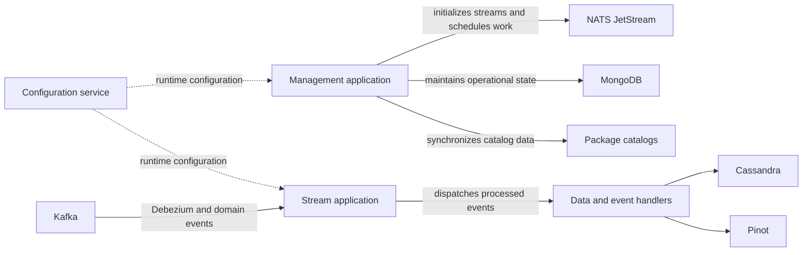
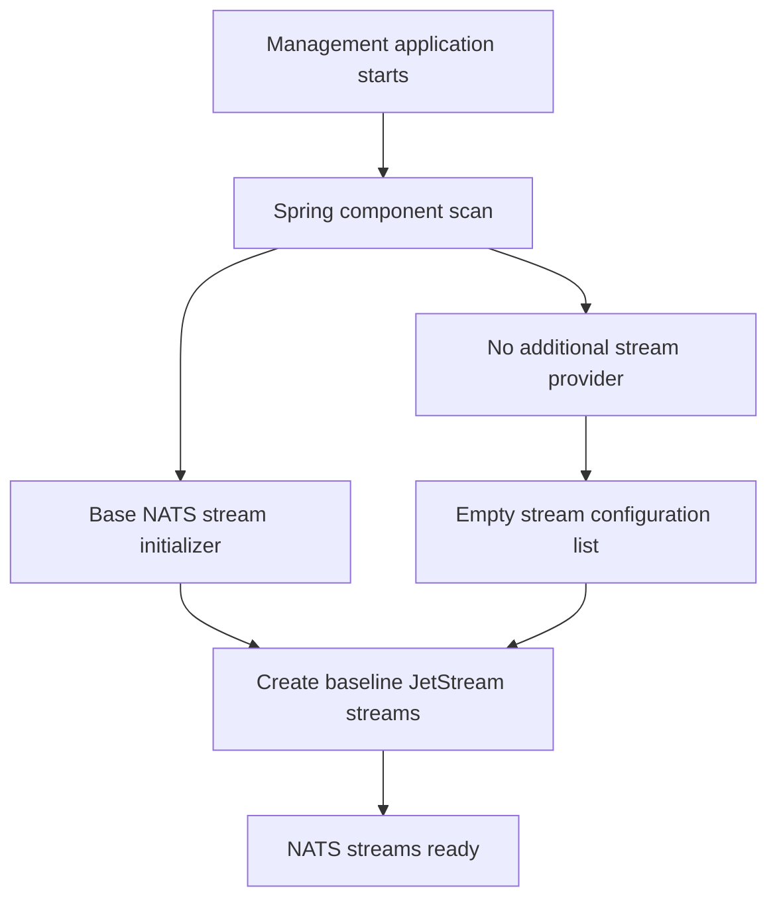
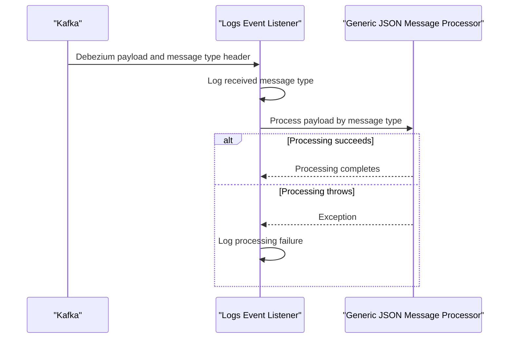
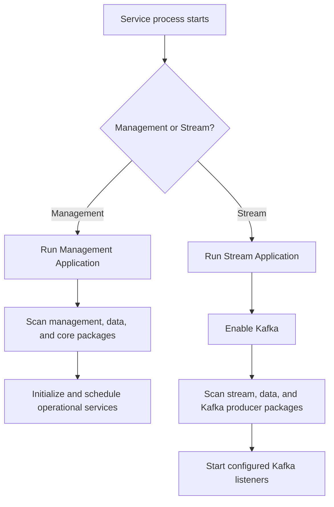

# Management And Stream Applications

Management And Stream Applications contains two Spring Boot services that keep an OpenFrame tenant operational away from the request path. **Management** bootstraps and maintains shared operational state, while **Stream** consumes Kafka events and routes them to the event-processing pipeline. The local application classes are deliberately thin composition roots; most business capabilities are supplied by OpenFrame OSS Library version `7.0.11`.

This module is part of [Main Applications](main-applications.md). It documents the entry points implemented in this repository and the library components they assemble.

## Responsibilities

| Application | Local composition | Primary responsibility |
| --- | --- | --- |
| Management | [`ManagementApplication`](https://github.com/flamingo-stack/openframe-oss-tenant/blob/main/openframe/services/openframe-management/src/main/java/com/openframe/management/ManagementApplication.java) | Starts management, data, and core components for initialization, scheduled maintenance, catalog synchronization, release management, and operational reconciliation. |
| Management | [`NoAdditionalStreamConfigurationProvider`](https://github.com/flamingo-stack/openframe-oss-tenant/blob/main/openframe/services/openframe-management/src/main/java/com/openframe/management/initializer/NoAdditionalStreamConfigurationProvider.java) | Explicitly contributes no distribution-specific NATS JetStream streams. |
| Stream | [`StreamApplication`](https://github.com/flamingo-stack/openframe-oss-tenant/blob/main/openframe/services/openframe-stream/src/main/java/com/openframe/stream/StreamApplication.java) | Enables Kafka listener infrastructure and assembles stream, data, and Kafka-producer components. |
| Stream | [`LogsEventListener`](https://github.com/flamingo-stack/openframe-oss-tenant/blob/main/openframe/services/openframe-stream/src/main/java/com/openframe/stream/listener/LogsEventListener.java) | Conditionally consumes generic Debezium log events and delegates typed dispatch. |

## Runtime Architecture

The deployment configuration connects Management to Kafka and NATS and connects Stream to Kafka. Shared configuration supplies MongoDB, Redis, Cassandra, and Pinot endpoints. Stream handlers determine which downstream stores or projections receive each event; the local listener only establishes the generic logs-events ingress path.

## Application Composition

### Management Application

`ManagementApplication` invokes `SpringApplication.run` and scans three package roots:

- `com.openframe.management` selects management-service components from the application and OpenFrame OSS Library.
- `com.openframe.data` selects shared persistence, repositories, and data services.
- `com.openframe.core` selects common platform capabilities.

The component scan explicitly excludes `CassandraHealthIndicator`. Consequently, Cassandra-specific health reporting is not registered through this application scan, even when matching data components are present.

The assembled Management library capability includes configuration and ShedLock support; controllers for integrated tools, release versions, and device Pinot resynchronization; startup initializers for agent registration secrets, log keys, client configuration, client feature flags, client versions, integrated tools, and NATS streams; and schedulers for package catalogs, device-offline detection, API-key statistics, Fleet setup, and client-version update publishing. These responsibilities are provided by the `openframe-management-service-core` library artifact rather than by the local entry point.

### NATS Stream Baseline

The library's NATS stream initializer creates the baseline streams needed by the tenant. `NoAdditionalStreamConfigurationProvider` implements the corresponding extension point and returns an empty list. It is a deliberate distribution policy: this OSS tenant does not add the extra JetStream streams associated with AI chat functionality.

Returning no additions does not disable baseline stream setup; it limits only the extension contribution made by this distribution.

### Stream Application

`StreamApplication` is a Spring Boot entry point annotated with `@EnableKafka`. It scans:

- `com.openframe.stream` for stream-service processors, deserializers, handlers, and listeners.
- `com.openframe.data` for storage and projection dependencies.
- `com.openframe.kafka.producer` for Kafka publication support used by the assembled processing path.

The `openframe-stream-service-core` library supplies the Kafka configuration and stream-oriented domain processing. Its components include deserializers for Fleet, MeshCentral, audit, command, script, remote-session, and integrated-tool events; generic and tenant-aware Debezium validation and handling; RMM command and script handlers; software inventory handling; and Cassandra and Loki log-event handlers. The application entry point supplies the Spring assembly boundary, while the library supplies these processors.

## Logs Event Ingestion

`LogsEventListener` is registered only when the `openframe.oss-tenant.kafka.topics.inbound.logs-events.name` property is available. Its Kafka listener uses that configured topic, the `openframe-oss-logs-events-group` consumer group, and the `ossTenantKafkaListenerContainerFactory`.

Each record contains a `CommonDebeziumMessage` payload and a `message-type` header. The listener logs the received type, then passes both values to `GenericJsonMessageProcessor`. The processor selects the concrete handling path based on the header rather than on a topic-per-type convention. Any exception is caught and logged by the listener, so it does not escape the listener method.

### Processing Boundaries

The listener is an ingress adapter, not a persistence implementation. It is responsible for receiving the configured topic, extracting the header, invoking typed dispatch, and recording failures. Deserialization, validation, enrichment, and storage behavior reside in the stream-service library's processing pipeline. This separation allows the topic to carry multiple log-event types while maintaining type-specific downstream handlers.

## Startup Flow

## Operational Considerations

- **Configuration gate:** The logs-events listener is absent until its inbound-topic property is set. Verify this property when expected log events are not being consumed.
- **Consumer identity:** The listener uses a fixed consumer group. Scaling relies on Kafka partitioning and standard consumer-group coordination.
- **Failure visibility:** Listener failures are logged with the event type. The method catches exceptions, so monitoring must include error logs and downstream handler outcomes rather than relying only on a propagated listener failure.
- **Health scope:** Management intentionally excludes the Cassandra health indicator from component scanning. Interpret its service health endpoint in that context.
- **Stream provisioning:** The empty additional-stream provider preserves the baseline NATS stream configuration while preventing this distribution from provisioning AI-chat-specific additions.

## Relationship To The Tenant Platform

Management And Stream Applications is deployed with the rest of the tenant services. Management is a background control-plane participant that prepares and reconciles operational resources. Stream is an event-plane participant that converts Kafka-delivered change and activity events into typed processing and projections. Together they support the API, client, and integration-facing applications without serving the gateway's primary request routes directly.
