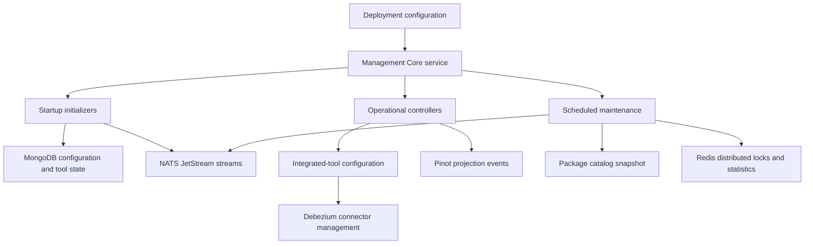
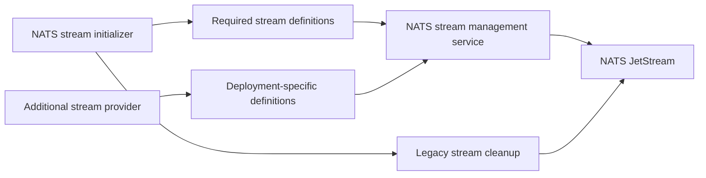
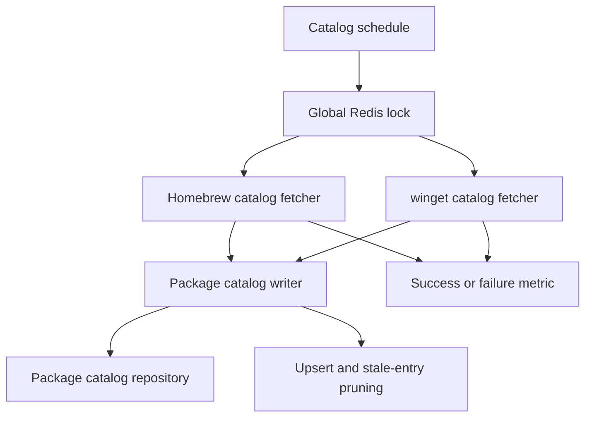
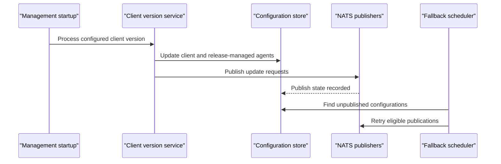

# Management Core

Management Core is the control-plane implementation assembled into the `openframe-management` service. It initializes tenant-scoped operational state, manages integrated-tool configuration, maintains NATS JetStream resources, synchronizes package-search catalogs, and runs scheduled reconciliation work. The implementation is supplied by the OpenFrame OSS Library artifact `com.openframe.oss:openframe-management-service-core` version `7.0.11`; this repository packages and deploys it as the OpenFrame Management service.

The module is intentionally an operational coordinator rather than the primary interactive API. It persists or repairs configuration at startup, publishes update state for managed clients and tool agents, and periodically reconciles data that must remain current even when individual requests are absent.

## Responsibilities

- **Bootstrap tenant state.** Seed an agent log key and agent-registration secret; load bundled tool-agent and client configuration; then apply configured client versions and feature flags in dependency order.
- **Manage event infrastructure.** Reconcile required NATS streams, accept deployment-specific additional streams, and remove obsolete streams without preventing service startup.
- **Manage integrated tools.** Provide endpoints for reading and saving tool definitions, provision Fleet MDM service credentials, configure Debezium connectors, and invoke extension hooks after a save.
- **Operate scheduled maintenance.** Synchronize package catalogs, retry unpublished client and tool-agent updates, synchronize API-key statistics, detect devices that have gone offline, and complete Fleet MDM setup.
- **Repair projections.** Provide an explicit device-to-Pinot resynchronization operation that republishes every persisted machine through the machine-tag event service.

## Architecture

Management Core uses the shared data, Redis, NATS, Debezium, and Fleet MDM integrations provided by the OpenFrame OSS Library. It is also coordinated with the client-facing services: client and tool-agent update publishers carry management decisions to installed agents, while the client service consumes delivery and status messages. The Management service is exposed as a workload in the tenant deployment; it is not one of the gateway routes listed for the public gateway, so its operational endpoints should be protected by the deployment's internal access controls.

## Configuration and Scheduling

[Management Configuration](https://github.com/flamingo-stack/openframe-oss-lib/blob/7a766f00e4f58b5d89db007b878ac8d6e0c344f4/openframe-management-service-core/src/main/java/com/openframe/management/config/ManagementConfiguration.java) component-scans the OpenFrame packages, deliberately excludes the Cassandra health indicator, and registers a BCrypt password encoder.

[Shed Lock Configuration](https://github.com/flamingo-stack/openframe-oss-lib/blob/7a766f00e4f58b5d89db007b878ac8d6e0c344f4/openframe-management-service-core/src/main/java/com/openframe/management/config/ShedLockConfig.java) enables Spring scheduling and uses Redis as a distributed lock provider. Its normal scheduler keys are tenant-scoped, in the form `of:{tenantId}:job-lock:<environment>:<lockName>`, preventing one tenant's scheduler lock from blocking another tenant. Catalog synchronization uses a separate global key prefix because it maintains a shared package catalog snapshot.

The package-catalog scheduler and several reconciliation schedulers are conditional. Their configuration determines whether a task is enabled, its interval, and its lock timing. Failed scheduled work is logged and retried on a later run rather than terminating the process.

## Startup Initialization

Startup initializers implement `ApplicationRunner`. Their work is idempotent or update-oriented so an existing tenant can be reconciled on every service start.

| Initializer | Responsibility | Ordering and failure behavior |
|---|---|---|
| Agent log key initializer | Calls the shared agent-log-key service to create a key when absent. | Logs failures and allows Management Core to start; the next start retries. |
| Agent-registration-secret initializer | Creates the initial agent registration secret through the management secret service. | Logs failures instead of failing startup. |
| Integrated tool-agent initializer | Loads configured classpath agent-definition resources, updates their persisted fields, and overrides MeshCentral, Fleet MDM, and nested osquery versions from configured client-version values. | Order 20. It requires at least one configured agent definition. Missing individual resources are skipped with a warning. |
| OpenFrame client configuration initializer | Loads `agent-configurations/client-configuration.json` and updates the persisted OpenFrame client configuration. | Order 30. |
| OpenFrame client version initializer | Applies the configured OpenFrame client version through `ClientVersionService`, which updates client configuration and marks applicable tool agents for republishing. | Order 40, after tool-agent and client documents exist. |
| Client feature-flags initializer | Processes configured client feature flags into the existing client configuration. | Order 50, after version initialization. |
| NATS stream initializer | Saves required stream definitions, saves implementation-specific extra streams, and removes legacy streams. | Continues startup when removal of an obsolete stream fails. |

### NATS Stream Reconciliation

[Nats Stream Configuration Initializer](https://github.com/flamingo-stack/openframe-oss-lib/blob/7a766f00e4f58b5d89db007b878ac8d6e0c344f4/openframe-management-service-core/src/main/java/com/openframe/management/initializer/NatsStreamConfigurationInitializer.java) ensures streams for tool connections, installed-agent events, machine hostname and timezone events, execution acknowledgements, delivery results, machine package-manager reports, and package-update status reports. Some event streams have bounded retention: timezone and package-manager reports retain data for one hour, while delivery-result and package-update-status streams retain data for one day.

The `AdditionalStreamConfigurationProvider` extension point supplies deployment-specific stream definitions. The tenant application provides the no-additions implementation, preserving a library extension point without requiring tenant-specific stream configuration. Streams named `TOOL_INSTALLATION`, `CLIENT_UPDATE`, `CLIENT_UNINSTALL`, and `TOOL_UPDATE` are considered legacy and are deleted when possible.

## Operational Controllers

### Integrated Tool Management

[Integrated Tool Controller](https://github.com/flamingo-stack/openframe-oss-lib/blob/7a766f00e4f58b5d89db007b878ac8d6e0c344f4/openframe-management-service-core/src/main/java/com/openframe/management/controller/IntegratedToolController.java) serves the following operations:

| Operation | Purpose |
|---|---|
| `GET /v1/tools` | Returns all integrated tools visible to the current tenant. |
| `GET /v1/tools/{id}` | Returns a tool or an error status when it is absent. |
| `POST /v1/tools/{key}` | Creates or updates a tool addressed by its tenant-scoped key. |

A tool's MongoDB identifier is not trusted from the request. On update, the controller reuses the existing document identifier for the current tenant; on create, it clears the identifier. This prevents an identifier submitted for another tenant from replacing that tenant's document. The controller also preserves a previously minted API key if a repeated chart-registration request omits it, forces the path key and tenant identifier, enables the tool, then avoids a write if the effective configuration did not change.

After a save, Management Core reconciles the tool's Debezium connectors and executes every available `IntegratedToolPostSaveHook`. A hook failure is isolated and logged, so it does not undo the successful configuration response.

### Device Pinot Resynchronization

[Device Pinot Resync Controller](https://github.com/flamingo-stack/openframe-oss-lib/blob/7a766f00e4f58b5d89db007b878ac8d6e0c344f4/openframe-management-service-core/src/main/java/com/openframe/management/controller/DevicePinotResyncController.java) exposes `POST /v1/devices/pinot-resync`. It loads all machines from the repository and passes them to `MachineTagEventService.processMachineSaveAll`. The resulting events re-drive the device projection pipeline. The response reports `completed` and the number of machines submitted.

### Deprecated Compatibility Endpoint

[Release Version Controller](https://github.com/flamingo-stack/openframe-oss-lib/blob/7a766f00e4f58b5d89db007b878ac8d6e0c344f4/openframe-management-service-core/src/main/java/com/openframe/management/controller/ReleaseVersionController.java) retains `POST /v1/cluster-registrations` as a no-op compatibility response for an existing cluster-registration job. It logs a warning and is marked for removal with its caller by 2026-07-11. Client versions now come from startup configuration rather than this endpoint.

## Package Catalog Synchronization

Package search is an optional scheduled capability enabled by `openframe.package-search.sync.enabled`. Its default initial delay is ten seconds; configured defaults run Homebrew synchronization every 15 minutes and winget synchronization every 30 minutes. Both fetchers use their configurable base URL and timeout.

- The Homebrew fetcher reads formula and cask metadata, filters disabled or unnamed entries, and supplements entries with best-effort 30-day install analytics. Analytics failure does not fail the catalog sync.
- The winget fetcher downloads the source index package, delegates parsing to `WingetIndexReader`, skips entries without an identifier or name, and maps searchable metadata including aliases, product codes, upgrade codes, normalized names, publishers, and package family names.
- The writer derives stable composite identifiers from manager, package identifier, and—for Homebrew—package type. It upserts the complete snapshot with one timestamp and removes entries for that manager that predate the snapshot, avoiding an empty collection during a successful sync.
- A global distributed lock holds for the scheduled interval, with a one-minute margin when possible, ensuring only one environment-wide writer replaces the shared snapshot.
- `openframe.package_catalog.sync` counters distinguish the manager and success or failure outcome. On failure, the previous snapshot is retained.

## Scheduled Reconciliation

| Scheduler | Triggered work | Coordination |
|---|---|---|
| Agent-version update publish fallback | Retries publishing unpublished OpenFrame client configuration and enabled tool-agent updates, up to the configured maximum attempt count. | Optional and protected by a scheduler lock. Individual tool-agent failures do not stop later agents. |
| API-key statistics sync | Copies API-key statistics from Redis to MongoDB. | Enabled by default unless disabled and protected by a distributed scheduler lock. |
| Device heartbeat offline detection | Marks devices offline when their heartbeat is stale. | Optional periodic sweep; errors are logged. |
| Fleet MDM setup | When the Fleet MDM server tool exists, attempts provisioning and persists its API token. | Optional; later ticks retry failures. |
| Package catalog sync | Replaces shared Homebrew and winget catalog snapshots. | Optional; uses a global Redis lock. |

The standard ShedLock provider tenant-scopes locks. The package catalog is the intentional exception because all tenants use the same catalog source and snapshot.

## Fleet MDM Credentials

[Fleet API Key Resolver](https://github.com/flamingo-stack/openframe-oss-lib/blob/7a766f00e4f58b5d89db007b878ac8d6e0c344f4/openframe-management-service-core/src/main/java/com/openframe/management/service/FleetApiKeyResolver.java) resolves credentials for the configured Fleet MDM integrated tool:

1. It selects the tool API URL, including the configured port when present.
2. It validates the tenant header configuration when Fleet multi-tenancy is enabled.
3. It attempts Fleet's initial setup using the configured tool credentials.
4. If Fleet reports a client-side error because setup already occurred, it logs in as the existing administrator instead.
5. It creates an API-only administrator service user, or logs in as that user when it already exists, and returns its token for persistence by the setup workflow.

This makes initial deployment and later scheduler runs converge on a usable API-only service identity without treating an already initialized Fleet instance as a fatal condition.

## Update Delivery and Recovery

The version initializer is the primary source of client-version changes. Its service path updates persisted client and tool-agent state and requests publishing through the shared NATS publishers. The optional fallback scheduler observes `PublishState`: it ignores already published records, retries records without a state, and retries failed records only while their attempt count is below the configured limit.

`OpenFrameClientVersionUpdateService` is currently a component with an empty `process` method. Maintainers should not rely on it to apply a release version; the active startup flow uses `ClientVersionService` through the version initializer.

## Data and Failure Boundaries

- **MongoDB** stores client configuration, tool agents, integrated tools, machines, and package-catalog entries.
- **Redis** provides distributed locking and participates in API-key statistics synchronization.
- **NATS JetStream** carries client, tool-agent, delivery, execution, and machine-status events.
- **Debezium** connector configuration is reconciled whenever an integrated tool is saved.
- **External catalogs** are read from Homebrew and winget endpoints only when catalog synchronization is enabled.
- **Fleet MDM** is initialized and accessed through the Fleet setup client when the Fleet tool is configured.

Initialization that establishes optional or recoverable state catches errors and logs them so the service can start and retry later. Configuration required for core agent setup is stricter: an empty tool-agent configuration list fails initialization, while a missing individual resource is skipped with a warning. This distinction prevents silent operation without any agent definition while keeping a single bad optional resource from blocking recovery work.

## Source Ownership

The Management Core implementation documented here belongs to the OpenFrame OSS Library and is consumed by this repository at version `7.0.11`. The tenant repository supplies the runnable OpenFrame Management application and deployment configuration. For service routing, shared data stores, and image delivery, refer to the platform documentation.
