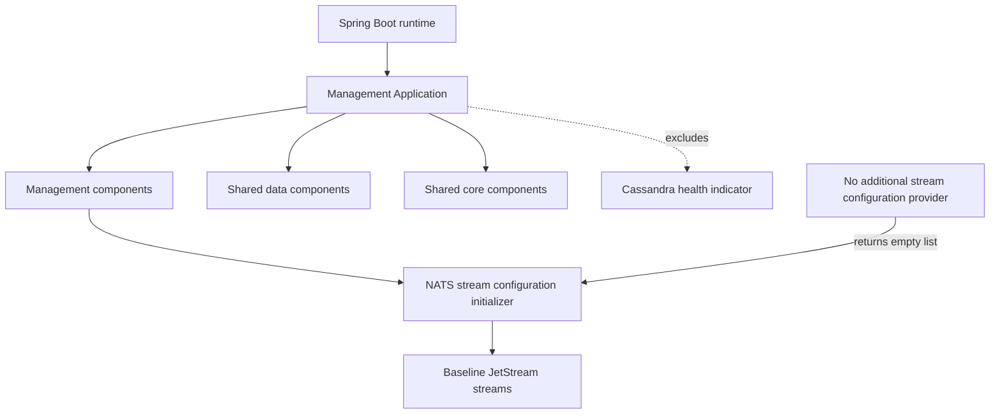
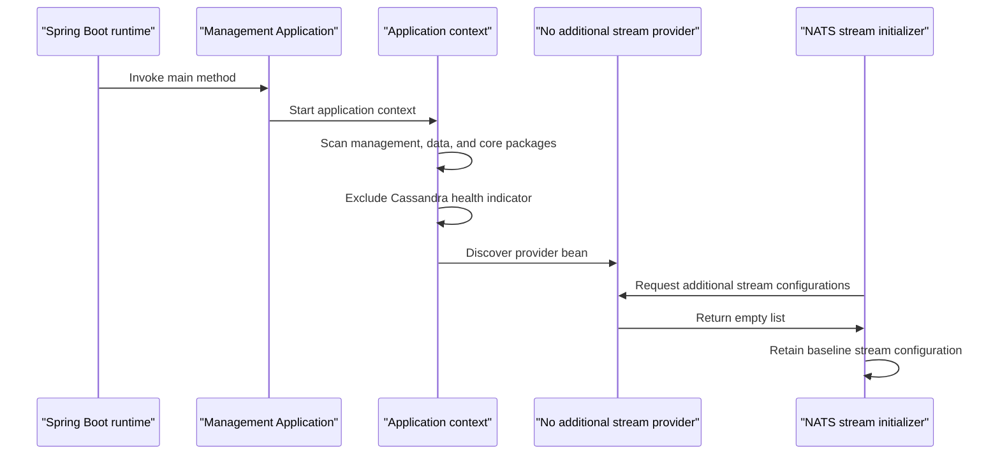

# Management Service Core

Management Service Core is the Spring Boot entry point for the OpenFrame management service. It assembles the management, shared data, and shared core component domains into one application context, while selecting this distribution's stream configuration behavior.

The module deliberately excludes the Cassandra health indicator from component discovery. It also contributes an empty additional-stream configuration provider: this distribution does not enable AI-chat-specific JetStream streams beyond the baseline streams initialized by the management service.

## Responsibilities

- Start the management service through Spring Boot.
- Discover components in `com.openframe.management`, `com.openframe.data`, and `com.openframe.core`.
- Keep `CassandraHealthIndicator` out of this service's Spring context.
- Supply no optional NATS JetStream stream definitions through `NoAdditionalStreamConfigurationProvider`.

## Architecture

`ManagementApplication` is the composition root. Its component scan makes management-local components available alongside the repository's shared data and core components. The explicit exclusion is narrow: it applies to `CassandraHealthIndicator`, rather than excluding the full data component domain.

`NoAdditionalStreamConfigurationProvider` is a Spring component that implements the management service's extension point for optional NATS stream definitions. Its `provide()` method returns an immutable empty list, so the initializer receives no distribution-specific additions.

## Component Reference

| Component | Responsibility |
| --- | --- |
| `ManagementApplication` | Declares the Spring Boot application, configures component scanning, excludes the Cassandra health indicator, and starts the application. |
| `NoAdditionalStreamConfigurationProvider` | Represents the no-op optional stream configuration policy for this distribution. |

## Startup and Stream Initialization Flow

## Integration Boundaries

The service participates in the tenant platform's configured event infrastructure. Its configuration targets Kafka and NATS endpoints, while this module's provider affects only optional NATS JetStream stream additions. It does not define Kafka topics, NATS connection properties, or baseline stream definitions itself.

The broader platform contains API, authorization, client, configuration, external API, gateway, and stream services. Management Service Core is the management-service bootstrap and policy layer within that deployment; it does not duplicate the startup logic of those services.

## Maintenance Notes

- Add a stream only by replacing or changing the additional stream configuration provider when the management service needs a distribution-specific JetStream resource.
- Preserve the explicit Cassandra health-indicator exclusion unless the management deployment is intended to expose that indicator and its prerequisites.
- Keep component-scan package changes intentional: expanding the scan can introduce beans, health checks, or integrations into the management service context.
